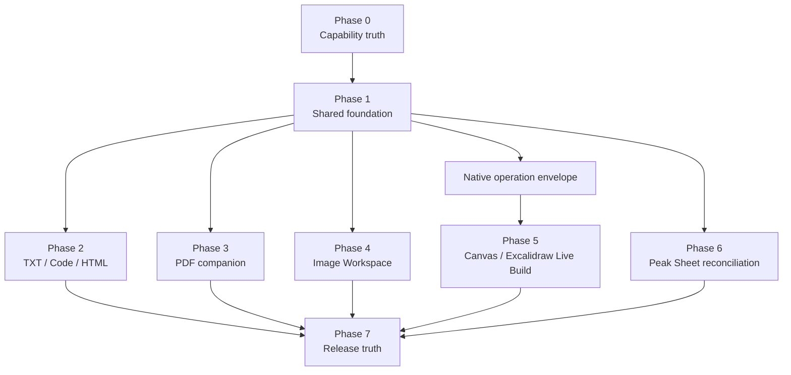
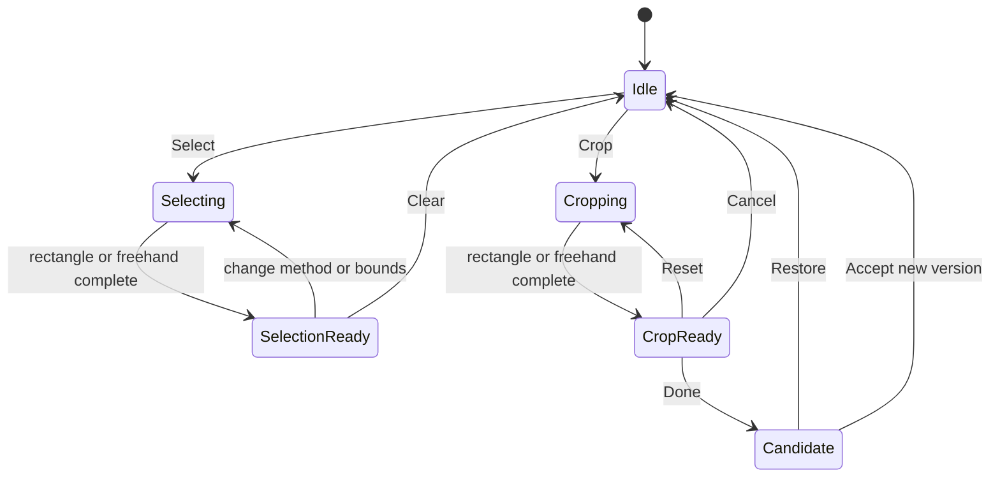

# Peak File Workspace 实施计划

> 日期：2026-08-13
>
> 状态：Implementation handoff；除已注明的现有基础外，任务尚未实施
>
> 产品合同：[Peak File Workspace 最终产品设计](../specs/2026-08-13-peak-file-workspace-final-product-design.md)
>
> 交互参考：[Composer-aligned prototype](../../gstack/peak-file-workspace-composer-aligned-2026-08-10/index.html)
>
> 读者：实施 agent、reviewer、产品 owner
>
> 建议执行方式：按 release slice 分批提交，不做一个跨数月的巨型分支

## 0. 实施结论

这不是六个互不相干的 viewer。正确顺序是先建立文件能力真值、共享选区和 Composer handoff，再按风险逐个接入格式表面，最后才开放宣传。

推荐交付顺序：

1. Capability manifest 与 current-state characterization。
2. Shared File Workspace shell、`SelectionEnvelope` 与 review boundary。
3. TXT、Code Source 与 HTML。
4. PDF companion。
5. Image Workspace。
6. Canvas/Excalidraw Live Build。
7. 全格式真实 Obsidian 验收与宣传生成。

Peak Sheet 已有生产基础，不重新实现。该路线只补它与 capability manifest、统一 selection/context 和文件打开入口的连接。

## 1. Impact Contract

### Primary outcome

每个进入“产品支持”的文件家族，都必须同时具备：

- 机器可读 capability 声明。
- 可审计的文件/选区 context。
- 明确的 AI effect 与写回边界。
- focused tests、production build 和真实 Obsidian 证据。
- 与设置、帮助和宣传一致的状态。

### Required tracks

- Shared foundation：registry、host、selection、Composer handoff、review、history。
- Text/runtime surfaces：TXT、Code、HTML。
- Read companion：PDF。
- Visual editing：Image。
- Native spatial editing：Canvas、Excalidraw。
- Existing surface reconciliation：Peak Sheet、CSV、XLSX。
- Release truth：fixtures、real-app QA、capability-driven documentation。

### Optional tracks

- JSON Source/Tree。
- SVG safe source/preview。
- Audio/Video companion。
- Jupyter planning spike。

Optional tracks 不得挤占首批 release slice。

### Forbidden scope

- DOC/DOCX、PPT/PPTX 产品支持。
- 第二套 AI router、provider 设置或聊天真值。
- 第二套 Canvas/Excalidraw renderer。
- Photoshop、Acrobat 或 IDE 级功能扩张。
- arbitrary shell/network/code execution 随文件编辑自动授权。
- 未审阅覆盖原文件。
- 为每个局部动作注册 Command Palette 命令。

### Skip rule

一个 release slice 可以跳过可选任务，但不能跳过它声明支持格式的 context、write、conflict、recovery 或 real-app gate。缺少任一项时，只能标记为 experimental/partial，不能升级为 product supported。

### Stop and commit rule

- 每个 phase 在 focused tests 与 production build 通过后单独提交。
- 真实 Obsidian 未通过时，提交说明必须写 `INTERACTION NOT VERIFIED`。
- 发现共享合同不成立时，停止新增格式，先修 foundation。
- 不把设计资产、runtime 数据或他人未完成改动混入提交。

## 2. 可复用的当前基础

| 能力 | 当前入口 | 本计划处理 |
| --- | --- | --- |
| File-bound React host | `src/app/ui-host/ReactFileViewHost.ts` | 复用，不新建第二种 host 基类 |
| View registration | `src/app/ui-host/views/ViewManager.ts` | 由 app-owned registry 注册稳定扩展名 |
| Runtime ownership | `src/app/context/AppRuntimeRegistry.ts` | 所有新 runtime 在 app layer 组合与清理 |
| Vault preview | `src/app/platform/preview/AppVaultPreviewAdapter.ts` | 继续提供 binary/text/resource path |
| Document loaders | `src/core/document/loader/` | 只贡献 read/index capability，不拥有 view |
| Composer file routing | `src/app/composer/ComposerDocumentRouter.ts` | 接收统一 context item，不复制 Composer |
| Media runtime | `src/service/media/` 与 `src/app/platform/media/` | Image 复用 resolver、adapter、writer 与 usage |
| Peak Sheet | `src/app/sheet/`、`src/ui/view/peak-sheet/` | 保留 file-native runtime 和 CSV/XLSX 能力 |
| Native patches | `src/service/composer/packs/native/` | Canvas/Excalidraw 复用 parser、validator 与 patch 语义 |
| Candidate review | Composer candidate/runtime | 抽出文件无关的 review contract，不复制聊天状态 |

`DocumentLoaderManager` 注册一个 Loader，不得自动让 `ViewManager` 注册对应 FileView。两者通过 capability manifest 关联，但保持所有权分离。

## 3. 拟议模块所有权

以下是实施时的目标所有权，不要求机械照搬文件名：

```text
src/
├─ core/file-surface/
│  ├─ capability types + manifest schema
│  ├─ SelectionEnvelope + geometry
│  ├─ AI effect + candidate contracts
│  └─ format-independent validation
├─ app/file-surface/
│  ├─ app-owned registry + runtime composition
│  ├─ Vault/native renderer adapters
│  ├─ revision + file lifecycle ports
│  └─ extension/view registration
├─ service/file-surface/
│  ├─ context assembly
│  ├─ effect validation
│  └─ format-specific pure transformations
└─ ui/view/file-workspace/
   ├─ shared shell
   ├─ Intelligence bridge
   ├─ Selection Lens
   └─ format-owned surface components
```

约束：

- app layer 拥有 runtime 和 Obsidian API。
- core 只放框架无关合同与验证。
- service 不增加 module singleton，也不调用 `AppContext.getInstance()` 取捷径。
- UI 通过 ports/runtime 调用能力，不直接写 Vault。
- 生产 UI 使用项目 `Button` primitive 和 Lucide icon。
- 新固定尺寸按钮必须加入 Obsidian reset defense 测试。

## 4. 依赖 DAG



Phase 2、3、4 可以在 Phase 1 合同冻结后并行。Canvas/Excalidraw 必须等待 native operation envelope 完成，不能先写一套临时整场景替换。

## 5. Phase 0：Capability truth 与基线

### FW-00 · 锁定当前行为基线

交付：

- 为 Markdown、Peak Sheet、CSV/XLSX、Image、HTML、PDF、Code、TXT、Canvas 和 Excalidraw 建 fixture inventory。
- 记录当前 view、loader、AI input、edit、writeback、export 和 real-app evidence。
- 修正旧文档里 XLSX 未实现等已过时判断。

验证：

- 每条 current claim 都有源码、测试或明确的 `INTERACTION NOT VERIFIED`。
- DOCX/PPTX 内部 Loader 不进入产品支持清单。

### FW-01 · Capability manifest

新增机器可读 schema，至少包含：

```ts
// Proposed contract.
interface FileSurfaceCapability {
  id: string;
  extensions: string[];
  mimeTypes: string[];
  productStatus: 'supported' | 'experimental' | 'planned' | 'unsupported';
  renderer: 'peak' | 'obsidian' | 'ecosystem' | 'none';
  scopes: Array<'whole' | 'visible' | 'selection' | 'runtime'>;
  effects: Array<'insight' | 'source-patch' | 'dataset-plan' |
    'new-version' | 'annotation' | 'structured-patch' | 'external-action'>;
  sourceOfTruth: string;
  prerequisites: string[];
  exclusions: string[];
  evidence: {
    fixtures: string[];
    focusedTests: string[];
    realAppStatus: 'verified' | 'not-verified' | 'not-applicable';
  };
}
```

实现约束：

- manifest 在 app layer 组合。
- Loader 只能贡献读取事实。
- View、AI action、设置可见性和宣传状态由完整 capability 决定。
- 不把中文 label、阈值或映射散落在逻辑文件中。

### FW-02 · 假阳性清理

清理范围：

- 设置中的扩展名与实际能力不一致。
- 文件图标暗示完整支持。
- Loader 开关与产品 surface 状态混淆。
- 文档把旧计划当成当前实现。

验收：同一种格式在设置、帮助、审计、代码和产品页面中只有一个状态来源。

## 6. Phase 1：Shared File Workspace foundation

### FW-10 · App-owned File Surface Registry

交付：

- 注册稳定的 file surface provider。
- 以 extension/MIME/capability 选择 host。
- 管理 open/load/unload/rename/modify 生命周期。
- 明确 unsupported 与 fallback native preview。

验证：

- 注册/注销对称。
- 插件 reload 后 FileView 可恢复。
- popout 使用元素自己的 `ownerDocument/defaultView`。
- 不新增 service-side runtime singleton。

### FW-11 · Shared shell

交付：

- 文件标题、路径和状态。
- 中央格式表面。
- 等高 Intelligence sidecar。
- selection/context summary。
- 只在候选出现后显示 review bar。

验收：

- 不存在全局 View/Edit/Compare/Changes strip。
- sidecar 可收起，中央文件仍是视觉主体。
- 空、加载、失败、只读、冲突状态可操作。

### FW-12 · `SelectionEnvelope` 与 geometry engine

交付：

- text/source range、DOM element、PDF page、rectangle/freehand、range、object IDs。
- normalized points/bounds 与 renderer coordinate adapters。
- source path、stable ID、revision/hash 和 preview evidence。

验证：

- zoom、pan、rotate、resize 后 selection 可重建。
- 低于最小面积的 lasso 失败关闭，不产生空 context。
- geometry 不持久化为用户文件真值。

### FW-13 · Selection Lens

交付：

- 跟随选区的 Ask/Add/Clear。
- 允许格式注入少量局部 action。
- collision-aware positioner。
- 新选择重复定位，而不是堆多个 Lens。

验证：

- 首帧位置稳定，不从最右侧跳入。
- Lens 不遮挡选区、主 dock 或 sidecar 边界。
- Esc 清除 Lens 并恢复焦点。

### FW-14 · Composer context handoff

交付：

- 将 `SelectionEnvelope` 映射为 Composer context item。
- UI 展示文件名、格式、scope 和定位摘要。
- 保留完整 locator/revision，不只复制文本或截图。
- Add 回执可重复使用、移除和重新定位。

验收：

- Add to Composer 不获得写权限。
- 文件变化后 item 显示 stale 或要求 refresh。
- PDF/Canvas/Excalidraw item 可以跳回来源位置。

### FW-15 · Effect、candidate 与 recovery

交付：

- insight、source patch、dataset plan、new version、annotation、structured patch、external action。
- frozen revision、candidate validation、Accept/Restore/Retry。
- conflict、Save a copy 和 provider unavailable。
- receipt、usage 与版本 lineage。

验证：

- 所有 writer 有 generated artifact registry 登记。
- Accept 后重读 native truth。
- 原文件变化时禁止 stale accept。

## 7. Phase 2：TXT、Code Source 与 HTML

### 7.1 TXT

#### FW-20 · Plain-text Composer adapter

交付：

- `.txt` file view 或 Composer plain-text mode。
- 全文/选区 Ask、source patch、diff 和 accept。
- encoding 与 line-ending preservation。
- 显式 Save as Markdown。

验收：

- 默认 action 不注入 Markdown 语法。
- reopen 后 bytes/encoding 策略符合 fixture。
- conflict 与 Undo 可验证。

### 7.2 Code Source

#### FW-21 · 单文件源码表面

交付：

- 语法高亮、行号、直接输入、保存状态。
- 语言识别与 plain-text fallback。
- 单 active editor 与 source revision。

验收：

- 没有 View/Edit 模式。
- 没有 project tree、Symbols 或 debugger。
- 大文件进入明确的 read-only/degraded mode。

#### FW-22 · Code selection handoff

交付：

- 原生文本选择完成后立即显示 Ask/Add Lens。
- context item 携带 file path、language、line/source range 和 revision。
- repeated selection 重新定位 Lens。

验收：真实鼠标前向/反向选择、键盘选择和焦点恢复均通过。

#### FW-23 · 显式跨文件 context

交付：

- 解析 direct import/reference 作为推荐材料。
- 用户明确选择加入的 code/note 文件。
- ignore、secret、文件数和 token budget 可见。

非目标：本 phase 不实现 multi-file write transaction。执行 run/test/build 也不在 editor 权限内。

### 7.3 HTML

#### FW-24 · Sandboxed HTML preview

交付：

- safe preview trust level。
- 本地 asset resolver 与失败诊断。
- source 编辑按需展开并与 preview 同步。
- 文件夹/bundle boundary 的显式入口。

验证：

- HTML 无法访问 Obsidian/Electron/Node。
- remote resource、script 与 navigation policy 有 fixture。
- preview failure 不影响打开 source。

#### FW-25 · Element picker 与 source locator

交付：

- hover outline、click pin、repeated selection。
- 从 rendered DOM 映射 selector、visible text、bounds 和 source range。
- 动态 KPI、chart、button 与嵌套元素都可选。

验收：不能依赖 demo-only data attribute；DOM 更新后 locator 有 stale/resolve 策略。

#### FW-26 · HTML AI 与 typed bridge

交付：

- explain/modify/fix selected element。
- console/resource diagnostic context。
- source patch review。
- refresh/filter/acknowledge/writeback 的 typed capability bridge。

验证：

- external action 与 source edit 权限分开。
- 业务数据不只存在 localStorage/hidden DOM。
- 任意脚本不能绕过 host action schema。

## 8. Phase 3：PDF companion

### FW-30 · Native viewer adapter

交付：

- 复用 Obsidian viewer 或 PDF.js renderer。
- current page、zoom、rotation、text layer 与 source revision。
- All pages/This page/Text/Lasso scope switch。

### FW-31 · Text selection 与引用锚点

先 spike `react-pdf-highlighter-extended` 或等价方案，只复用：

- text selection。
- scaled anchors。
- selection tip positioning。
- region screenshot。

GO 条件：可以在真实 Obsidian iframe/viewer 中稳定获取页码与坐标，并在 zoom/rotation 后恢复。失败则使用更薄的 PDF.js adapter，不引入第二个完整 viewer。

### FW-32 · PDF freehand lasso

交付：

- 绘制中显示点轨迹，不显示提前闭合线。
- 松手后显示最外层闭合区域。
- page、normalized points/bounds、text/OCR 和 preview 写入 envelope。

验收：短视频证明 pointer trail、闭合、zoom 后重建和 Lens 定位。

### FW-33 · Page-aware AI 与 citations

交付：

- 当前 scope chip。
- page/document/selection ask。
- OCR fallback。
- 回答引用跳回页与区域。
- Add to Composer 与 materialize note。

非目标：不修改 PDF 二进制，不做完整批注编辑器。

## 9. Phase 4：Image Workspace

### FW-40 · 图片文件表面与 source protection

交付：

- PNG/JPEG/WebP baseline。
- metadata、natural pixel size、source hash。
- 当前工作副本与受保护原图。
- 复用 Vault media resolver 和 attachment writer。

### FW-41 · 稳定主工具坞

交付：

- Select、Crop、左右旋转、icon-only Export、Ask、AI edit、Composer、zoom/fit。
- Select/Crop 方法在一级按钮旁内联展开。
- dock 以中心锚扩展，不遮挡图片、不越过容器。

验收：

- 开关方法时 dock 不跳边。
- 窄宽度下有明确 overflow/compact 策略。
- 工具坞上下层级不再形成两排重叠菜单。

### FW-42 · Rectangle 与 Freehand geometry

Rectangle：

- 默认整图八手柄。
- drag/resize 保持最后位置。
- selection 与 crop 使用不同 state owner。

Freehand：

- pointer points 采样与平滑。
- 绘制中只显示已走轨迹。
- 松手后计算最外层 silhouette。
- 内部重叠不进入最终可见轮廓。

可以 spike `perfect-freehand` 只负责显示平滑。它不能拥有 Peak selection、mask、crop 或 AI 语义。

### FW-43 · Select 与 Crop 状态机



验收：Select 从不触发 crop commit；Crop Done 从不覆盖原图。

### FW-44 · Selection Lens positioner

交付：

- 根据 selection bounds、dock bounds、viewport 选择上/下位置。
- 首帧以测量后位置呈现，避免 visible jump。
- selection touch bottom edge 时保留文件可见区。

验收：复现并关闭历史上的右侧跳入、越界和文件遮挡问题。

### FW-45 · Export

交付：

- format、dimensions、quality、size estimate。
- save copy 与冲突处理。
- GIF/SVG 等受限格式的清楚降级。

非目标：不保留黑盒 Compress 或主工具栏 Resize。

### FW-46 · Generative AI editor

交付：

- Quick/Restyle/Light/Material/Compose 分类。
- Style/Subject/Composition typed references。
- Identity/Layout/Text/Unselected preservation。
- creative strength 与 provider/cost/upload boundary。
- 四候选生成、来源表面预览、Accept new version、Restore original。

验证：

- whole image 与 rectangle/freehand scope 都可用。
- local edit 的 candidate 可以对照 mask 外变化。
- Remove 与 Replace 是不同 intent。
- generated output 不静默覆盖 source。

## 10. Phase 5：Canvas/Excalidraw Live Build

### FW-50 · Native operation envelope

拟议合同：

```ts
// Proposed interface.
interface LiveBuildEnvelope {
  sourcePath: string;
  sourceRevision: string | number;
  anchorElementIds: string[];
  reservedBounds: { x: number; y: number; width: number; height: number };
  operations: NativeOperation[];
  createdIds: string[];
  userMoveReceipts: Array<{ id: string; bounds: object; at: number }>;
  selfCheck?: { passed: boolean; findings: string[] };
}
```

要求：

- ordered operations。
- stable created IDs。
- pause/resume。
- user move re-anchor。
- one reviewed transaction。
- fail closed on stale revision。

### FW-51 · Canvas native adapter

交付：

- 读取 selected nodes/edges、bounds、file refs 和 nearby open space。
- 创建 card、file、group、edge。
- 保留 unknown JSON Canvas fields。
- 使用 Canvas 原生选择、菜单、缩放和编辑。

验收：接受后关闭 Peak，Obsidian Canvas 仍可正常编辑结果。

### FW-52 · Excalidraw native adapter

交付：

- 读取 element IDs、text、group、binding、bounds 与 scene revision。
- 创建 rough shape、editable text、bound arrow 和 group。
- 保留 unknown metadata/plugin fields。
- compressed/unsupported scene fail closed。

验收：接受后结果仍由 Excalidraw 原生 editor 编辑；不是 bitmap。

### FW-53 · Build area direct manipulation

交付：

- 从 selection 或 AI tool 创建 build area。
- drag、resize 与 cancel。
- area 只限制生成空间，不替代 native selection。

### FW-54 · Visible operations 与人工接管

交付：

- visible cursor、operation log、progress、Pause/Resume。
- Show every operation。
- Respect my moves。
- 用户移动/改样式后重新计算剩余布局。

验证：短视频证明 AI 操作逐步出现、暂停时可编辑、恢复后尊重新位置。

### FW-55 · Self-check 与 review

交付：

- overlap、reading order、label、edge/binding 检查。
- candidate transaction 的 Accept/Restore。
- layout 与 semantic change 的影响摘要。

禁止：一次性整文件替换、静默写 complete scene、AI 与用户同时抢同一元素。

## 11. Phase 6：Peak Sheet reconciliation

### FW-60 · 将现有能力登记进 manifest

交付：

- `.peaksheet` current view、scopes、AI tools、effects、writer 和 evidence。
- CSV/XLSX import/export 的明确 compatibility exclusions。
- real-app status 独立记录。

### FW-61 · Raw CSV/XLSX open route

目标流程：

- File Explorer 打开 CSV/XLSX。
- 进入轻量 preview/diagnostics。
- 选择 Open as Peak Sheet。
- Preview/accept 后创建 `.peaksheet`。

如果本 release 不做自定义 raw file view，则必须保留现有 Peak Sheet 内 Import，并在 manifest 中准确说明入口，不能提前宣称 File Explorer 原生打开。

### FW-62 · Sheet selection → Composer

交付：

- range/row/column/field/view selection envelope。
- Add to Composer 保留 file path、dataset ID、revision 和 range IDs。
- AI edit 继续走现有 typed patch/permission gate。

## 12. Phase 7：验证、rollout 与宣传

### FW-70 · Format fixture suite

每种格式至少覆盖：

- small valid。
- large/bounded。
- malformed。
- unsupported variant。
- external modification。
- missing provider/offline。
- popout/ownerDocument。

### FW-71 · 自动化层级

按风险分层：

1. Core unit：schema、geometry、patch、conflict。
2. Adapter integration：Vault、renderer、Composer item、writer。
3. UI DOM：focus、keyboard、Lens positioning、state visibility。
4. Focused suites。
5. `npm run build`。
6. Full suite baseline；独立记录 pre-existing failures。

建议命令：

```bash
npm run test -- test/<focused-file-workspace-suite>.test.ts
npm run build
npm run test
git diff --check
```

### FW-72 · 真实 Obsidian 验收

使用项目既定双通道：

- CDP + Playwright：状态设置、DOM、坐标、focus、keyboard、revision 和 geometry。
- Computer Use：证明结果来自真实 Obsidian，并捕获最终可见状态。

必须录制短视频：

- Image rectangle/freehand select 与 crop。
- PDF text/lasso 与 citation jump。
- Code selection Lens 与 focus restore。
- Canvas Live Build pause/manual move/resume/accept。
- Excalidraw Live Build style edit/binding/restore。

静态 mock、harness 和截图不替代上述交互证据。

### FW-73 · Rollout gates

| Gate | 进入条件 | 可见状态 | 退出条件 |
| --- | --- | --- | --- |
| G0 Characterized | baseline 与 manifest 已锁定 | internal only | current facts 无假阳性 |
| G1 Experimental | surface、context、write boundary 通过自动化 | opt-in/experimental | focused build + recovery |
| G2 Dogfood | 真实 Obsidian 核心流程通过 | owner/beta | fixture + device evidence |
| G3 Product supported | help/settings/marketing 同步 | public | full acceptance + owner sign-off |

任何格式都独立过 gate。不能因为 Markdown 或 Peak Sheet 已成熟，就让 HTML/PDF/Image 一起升级。

### FW-74 · 宣传与文档生成

从 manifest 生成或核对：

- 支持格式页面。
- Settings capability labels。
- Help/FAQ。
- release notes。
- landing page claims。

每条宣传必须包含用户任务和限制。DOCX/PPTX 永远显示为 unsupported，不因 Loader 变化自动出现。

## 13. Test matrix

| 风险 | 自动化 | 真实宿主证据 |
| --- | --- | --- |
| Loader/View 假阳性 | manifest/source consistency test | Settings 与打开路径核对 |
| stale write | revision/hash conflict tests | 外部修改后 Accept 被阻止 |
| Lens 跳动/越界 | geometry/DOM bounding-box tests | 真实 resize/zoom/selection 视频 |
| Freehand 轨迹错误 | point/silhouette unit tests | pointer path 视频 |
| PDF 引用失联 | page/anchor round-trip tests | click citation 回跳 |
| HTML 越权 | sandbox/CSP/bridge tests | 本地页面权限拒绝流程 |
| Image 越过 mask | candidate evidence/check | 原图/候选人工对照 |
| Live Build 抢人工位置 | re-anchor/state tests | pause/move/resume 视频 |
| Native file corruption | parser/patch/reopen tests | 原生 Canvas/Excalidraw reopen |
| Marketing drift | manifest/doc snapshot test | 发布前 owner review |

## 14. Rollback 与恢复

### Format-level rollback

- manifest 将格式降回 experimental 或 read-only。
- 注销 Peak FileView 后回到 Obsidian/native fallback。
- 保留用户原文件和已接受的新版本。
- 未接受 candidate 和 transient selection 可安全丢弃。

### Writer rollback

- source patch 使用 revision guard 与 Undo/history。
- Image 默认写新版本，不需要回滚原图。
- PDF 只删除/恢复 companion annotation，不碰 PDF。
- Canvas/Excalidraw 使用 one transaction 和 inverse/restore snapshot。
- HTML external action 依赖目标系统自身的可逆语义；不可逆动作提高确认级别。

### Program rollback

共享 foundation 出现问题时，不回滚已有 Markdown/Peak Sheet runtime。关闭新 surface registry 的 capability flags，并保留 manifest 与 characterization tests，避免重新产生假阳性。

## 15. 推荐 release slices

### Slice A · Truth and selection

- FW-00 至 FW-15。
- 不新增完整格式承诺。
- 成功标志：任何新 surface 都能复用同一 context/review contract。

### Slice B · Text and runtime artifacts

- FW-20 至 FW-26。
- TXT、Code、HTML 分别过 gate。
- 成功标志：native source、rendered HTML 和 Composer handoff 形成闭环。

### Slice C · Read and visual editing

- FW-30 至 FW-46。
- PDF 与 Image 独立 rollout。
- 成功标志：PDF 引用可回跳，Image 原图受保护且候选可比较。

### Slice D · Native spatial creation

- FW-50 至 FW-55。
- Canvas 与 Excalidraw 可共用 envelope，但分别验收。
- 成功标志：AI 像人手工放置 native elements，用户能中途接管。

### Slice E · Product truth closure

- FW-60 至 FW-74。
- Peak Sheet 口径收敛，全格式逐项过 gate。
- 成功标志：manifest、设置、帮助和宣传无漂移。

## 16. Definition of done

整个计划不能以“所有 mock 能点”或“所有 Loader 都注册”为完成。真正完成需要：

- 最终产品设计中的 P0/P1 文件表面全部有生产 host。
- 每种格式的 whole/local selection 能进入同一个 Composer context model。
- 所有写 effect 有 revision、candidate、Accept/Restore 和 recovery。
- Image、PDF、Canvas、Excalidraw 的手势/时序有真实 Obsidian 视频证据。
- Peak Sheet 当前能力和限制被准确登记。
- DOCX/PPTX 保持明确排除。
- 帮助、设置、发布说明和宣传从 capability truth 得到一致结果。

完成每个 release slice 后，再决定是否更新 `docs/progress.md` 与 `docs/roadmap.html`。设计或自动化通过本身不触发 shipped 状态。
