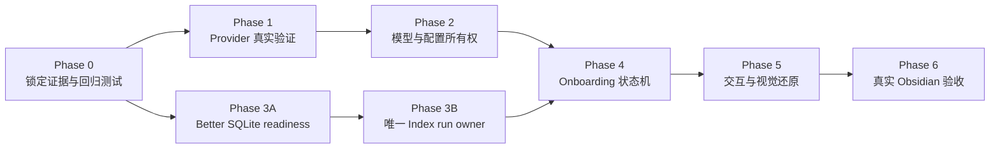

# Peak Assistant Onboarding 真实 UI 可靠性修复计划

> - 状态：待执行
> - 目标：修复真实 Obsidian 中的 Onboarding 状态、恢复、交互与视觉问题
> - 问题合同：[Onboarding 真实 UI 可靠性修复合同](../specs/2026-08-18-onboarding-real-ui-reliability-repair-contract.md)
> - 产品基线：[Onboarding、Settings 与 Knowledge Index 最终设计](../specs/2026-08-13-onboarding-settings-knowledge-index-final-design.md)
> - QA 规范：[Obsidian 真实 UI QA](../../conventions/obsidian-real-ui-qa.md)

## 1. 执行结论

这次不能按“逐屏改 CSS”执行。正确修理顺序是：

1. 先把录屏问题变成可重复测试，锁定 fresh、existing、repair、resume 和 re-run 五类初始状态。
2. 修正 Provider 验证证据和模型配置所有权，保证前两步不会误判或互相覆盖。
3. 建立唯一的 SQLite / Index readiness 和 Index run owner，消除重复索引、重复 Notice 和 false green。
4. 重写 Onboarding 状态机的恢复、完成和 System Check gate。
5. 在真实状态稳定后还原交互和视觉，并通过真实 Obsidian 验收。

所有 P0 都是同一发布门的一部分，不能把“视觉已接近”当作可提前上线的完成状态。



阅读方式：箭头表示硬依赖；Phase 1 与 Phase 3A 可以并行开发，但必须在 Phase 4 汇合前完成。

## 2. 发布门与优先级

### P0：阻止正确完成或破坏用户状态

- Provider endpoint 拼接错误、验证证据虚假或失败连接错误阻断。
- Automatic 不能稳定保存，Hermes 与普通产品模型互相覆盖。
- Better SQLite 未真实探测却显示 Ready。
- 已有索引仍重建；关闭重开、返回或双击产生多个 run / Notice。
- Index pipeline 失败被吞掉，Onboarding 仍进入 Ready。
- System Check 硬编码通过或错误图标显示绿色。
- 打开已完成 wizard 会清空 `completedAt`。
- Try Peak 在真实 surface 打开前就记录完成。

### P1：导致流程难用或不可恢复

- 已保存连接不能编辑、验证或取消 Add connection。
- model picker 闪退，不能通过键盘、Escape 或再次点击关闭。
- Progress saved、Finish later、Back 和重复命令的行为不一致。
- 无 Markdown 文件时 Recent note 静默无动作。
- 步骤条文字截断、按钮 hit target 太小、状态动画缺失。

### P2：视觉一致性和长期维护

- 五屏与目标 mock 的密度、宽度、边界、颜色和图标不一致。
- 新旧 Button / picker primitives 混用。
- 提示文案过密，辅助信息抢占主操作。

### Stop rule

任何 P0 未关闭时，任务状态只能是 `PARTIAL`。没有真实 Obsidian 的 interaction evidence 时，即使测试与 build 全绿，也必须标记 `INTERACTION NOT VERIFIED`。

## 3. Task list

### Phase 0 — 锁定证据与回归基线

#### OR-00 建立一次可比较的真实录屏证据目录

- [ ] 保存原始 `iShot_2026-08-18_19.42.02.mp4` 的路径、SHA-256 和录制时间。
- [ ] 记录当前 commit、Vault fixture、Obsidian 版本、主题、缩放、CSS viewport、DPR 和原生侧栏状态。
- [ ] 为五步各保留一张 real current 截图；记录 active step、connection、model assignment、SQLite readiness、index run 和 completion state。
- [ ] 把当前设计稿作为 reference 保存到同一 manifest，禁止后续拿不同 viewport 或不同状态做 overlay。

退出条件：任何工程师可以从 manifest 还原录屏中的同一初始状态。

#### OR-01 增加状态 characterization tests

- [ ] Provider preset endpoint：OpenAI、Anthropic、OpenRouter、Ollama、Codex gateway、Claude Code gateway 与 custom Base URL。
- [ ] Connect gate：一个 Ready 加一个 Failed 时仍可继续；零 Ready 时不能继续。
- [ ] Model assignment：Automatic、Fixed、引用失效和 capability incompatible 四种状态。
- [ ] Completion：浏览 completed wizard 不清空完成；明确 Apply 才更新长期状态。
- [ ] Index：valid existing、active run、missing、stale、failed 五种 readiness。
- [ ] Idempotence：Continue 双击、Back 后再次前进、关闭重开和重复命令最多启动一个 run。
- [ ] Failure propagation：SQLite、scan、FTS 和 indexing 失败不能进入 `.then(Ready)`。

主要测试文件：

- `test/onboarding-state-machine.test.ts`
- 新增 `test/onboarding-provider-readiness.test.ts`
- 新增 `test/onboarding-model-assignment.test.ts`
- 新增 `test/onboarding-index-coordination.test.ts`
- 新增 `test/onboarding-completion-resume.test.ts`

退出条件：至少有一个新增测试能稳定复现录屏中的每个 P0，且在修复前失败。

### Phase 1 — Provider 连接与真实证据

#### OR-10 统一 Provider endpoint 解析

- [ ] 新建集中式 endpoint resolver，区分 API root、versioned root 和具体 probe path。
- [ ] 规范 trailing slash，不允许调用方盲目追加第二个 `/v1`。
- [ ] custom Base URL 保留用户输入语义；UI 展示规范化后的实际 probe URL，但不暴露密钥。
- [ ] Ollama 只接受预期成功状态和可解析响应，404 不得视为 Ready。

涉及文件：

- `src/core/providers/testProviderConnection.ts`
- `src/core/profiles/presets.ts`
- 建议新增 `src/core/providers/provider-endpoints.ts`

#### OR-11 把一次布尔验证拆成结构化证据

- [ ] 定义 `ConnectionEvidence`：authentication、catalog、minimum generation、tools / structured output、checkedAt、failure reason。
- [ ] 普通聊天首次使用至少要求 authentication、catalog 与 minimum generation。
- [ ] Hermes assignment 额外要求当前模型通过工具能力证据；不能只凭模型名字推测。
- [ ] 状态只允许由 evidence 推导为 Checking、Ready、Needs attention、Not tested、Unavailable。
- [ ] 网络失败、鉴权失败、模型不可用和 capability 不兼容给出不同恢复动作。

#### OR-12 修复连接编辑和流程 gate

- [ ] Onboarding 使用可编辑的 saved profile row，支持 Test、Save、Cancel 和切换默认连接。
- [ ] Add connection 有 Back / Cancel；未通过当前输入的 Test 不允许保存成 Ready。
- [ ] Provider 选择项使用项目 Button / radio primitive，补齐键盘和焦点状态。
- [ ] `Connect another service` 使用稳定 44px hit target，并加入 button reset defense test。
- [ ] Connect AI 的继续条件改为“至少一个首次任务兼容的 Ready connection”，而不是“当前查看行 Ready”。

退出条件：Ready connection 不会被另一个失败 connection 阻断；已保存连接可以修改并重新验证。

### Phase 2 — 模型选择与配置所有权

#### OR-20 引入显式 Model assignment

- [ ] 用 discriminated union 区分 `{ mode: 'automatic' }` 与 `{ mode: 'fixed' }`。
- [ ] `null` 不再同时表达 Automatic、未选择和引用失效。
- [ ] Automatic 必须能解析到至少一个已验证且兼容的候选才算 Ready。
- [ ] candidate list 按角色过滤：Chat、Copilot、Vault Search 与 Hermes 各有 capability contract。
- [ ] Ollama 和 gateway 使用运行时目录；静态 catalog 只作有来源和新鲜度提示的 fallback。

涉及文件：

- `src/core/providers/model-selection.ts`
- `src/ui/view/settings/components/UnifiedModelPicker.tsx`
- `src/ui/view/onboarding/OnboardingStateMachine.ts`
- `src/ui/view/onboarding/HarnessOnboardingWizard.tsx`

#### OR-21 收口长期配置 owner

- [ ] `modelRouting.assignments` 是普通产品功能默认的唯一长期 owner。
- [ ] `harnessSettings.executionModel` 是 Peak Hermes execution model 的唯一长期 owner。
- [ ] `ProfileRegistry` 只保留连接、catalog 和兼容投影；移除反向覆盖长期 assignment 的路径。
- [ ] `main.ts` 的同步逻辑改为单向 derived mirror，禁止旧值覆盖新设置。
- [ ] Onboarding 使用独立 draft；Apply 只提交用户在本次明确改动的字段。
- [ ] re-run 保留已有 Automatic、fixed 和 action-level overrides，除非用户在本次修改。
- [ ] 多字段 apply 失败时不留下半套配置；提供 rollback 或原子 settings update。

退出条件：从 Onboarding、AI & Models 和 Agents 修改后，重新打开三个 surface 得到相同有效值，没有循环覆盖。

#### OR-22 修复 Unified Model Picker 交互

- [ ] 先用 CDP 记录 open → close 的第一处分歧，确认是 trigger、outside listener、portal 还是重渲染导致闪退，禁止猜测式改代码。
- [ ] 每个 picker 持有自己的 trigger、search input 和 portal host ref；移除全局 `document.querySelector` 聚焦。
- [ ] trigger 再点关闭、outside click 关闭、Escape 关闭，关闭后恢复原 trigger 焦点。
- [ ] 搜索、Provider 分组、能力过滤、长模型名、滚动与键盘导航达到同一 interaction contract。
- [ ] popup 不遮住步骤条或 footer；窄窗口可重排，不把 tab/filter 盖住。

退出条件：真实 Obsidian 中连续打开/关闭 20 次无闪退，键盘可完成完整选择。

### Phase 3 — Better SQLite 与 Knowledge Index 单一运行 owner

#### OR-30 实现 Better SQLite 真实 readiness probe

- [ ] native binary 能加载。
- [ ] 当前数据目录可写，数据库可打开。
- [ ] transaction write/read 成功并清理探测数据。
- [ ] FTS schema / 最小 query 成功。
- [ ] production SQLite store 已初始化并可被 Search 使用。
- [ ] `ensureCompatible()` 失败必须返回 typed failure 或抛错，不能吞掉后继续 Ready。
- [ ] UI 显示 Checking、Installing / Repairing、Ready、Needs attention；真实状态变化伴随可见动画。

涉及文件：

- `src/core/storage/sqlite/NativeModuleManager.ts`
- `src/app/commands/composeSettingsActions.ts`
- SQLite store / schema owner 的实际实现文件

#### OR-31 建立 app-owned `IndexRunCoordinator`

- [ ] runtime 在 app layer 组合并由 `AppContext` 或 app runtime registry 持有，不新增 service singleton。
- [ ] 暴露 `startOrAttach(plan)`、`getSnapshot()`、`subscribe()`、`pause(runId)`、`resume(runId)`、`cancel(runId)`。
- [ ] 相同 scope / plan 已有 active run 时返回同一 `runId`。
- [ ] 每个 run 保存稳定阶段、进度、文档序列、速度、ETA、失败和 typed result。
- [ ] UI detach 不取消 run；重新打开只 attach。
- [ ] 移除 `composeSettingsActions` 与 `KnowledgeIndexWorkspaceRuntime` 各自 new initializer 的并行 owner。
- [ ] 把 `IndexService` 的全局静态 pause / cancel 收口为 run-scoped token。
- [ ] pipeline 的 early return / catch 改为显式成功、取消或失败结果。

建议端口：

```ts
interface IndexRunCoordinatorPort {
  startOrAttach(plan: IndexRunPlan): Promise<IndexRunHandle>;
  getSnapshot(runId?: string): IndexRunSnapshot;
  subscribe(listener: (snapshot: IndexRunSnapshot) => void): () => void;
  pause(runId: string): Promise<void>;
  resume(runId: string): Promise<void>;
  cancel(runId: string): Promise<void>;
}
```

精确命名可按现有 port conventions 调整，但 ownership 和结果合同不能退化。

#### OR-32 建立 Onboarding readiness projection

- [ ] 投影至少包含 sqlite、fullText、activeRunId、document counts、scope fingerprint 和 failures。
- [ ] 进入 Prepare 前读取投影，再执行四选一：Reuse、Attach、Repair、Start。
- [ ] existing valid FTS 直接 Reused，不启动 run。
- [ ] active compatible run 直接 Attached，不创建第二个 Notice。
- [ ] missing / incompatible 才 Start；本次首次启动默认只保证最快 full-text 可用。
- [ ] Onboarding 的 quick index choice 不写回长期 `search.indexLevel`。
- [ ] Onboarding、Settings 与 Index Workspace 订阅同一 snapshot；Notice 只是附属呈现。

退出条件：关闭、返回、双击、重复打开或并行打开 Index Workspace 都只能看到一个 run 和一份进度。

### Phase 4 — Onboarding 状态机、恢复与 System Check

#### OR-40 扩展状态机而不是在组件里拼 Promise

- [ ] 每一步明确 `idle / checking / ready / needs-attention / busy / failed`。
- [ ] async command 带 operation id；过期回调不能覆盖新状态。
- [ ] Continue busy 时禁用 Back / Continue 的冲突操作并防止双击。
- [ ] draft save 显示 Saving、Saved、Failed；固定的 “Progress saved” 文案不得冒充写入结果。
- [ ] step gate 只读取 evidence / readiness，不在 render 中制造默认 Ready。

#### OR-41 修复完成、恢复、自动打开与 modal 单例

- [ ] 打开或浏览已完成 wizard 不修改 `completedAt`。
- [ ] fresh install 的自动打开依据首次成功 hard gates，不以 `profiles.length` 代替。
- [ ] Finish later 保存草稿和当前可恢复 step；不绕过 required setup。
- [ ] re-run 从现有有效配置建立 draft，不清空手动设置。
- [ ] 同一 Obsidian window 只允许一个 Onboarding modal；重复命令聚焦现有实例。
- [ ] plugin reload / Obsidian restart 后可以从持久化 draft 和 active index run 恢复。

#### OR-42 重做 System Check 真实 gate

- [ ] 独立检查至少一个 verified connection。
- [ ] 独立解析 Chat、Copilot 和 Hermes assignments；Hermes 要验证 tools capability。
- [ ] 独立读取 Better SQLite / DB / FTS probe。
- [ ] 独立读取 full-text readiness；Building 可以继续，Failed / Missing 按合同阻断。
- [ ] 读取真实 safety mode 和 permission scope；fresh install 应用 Ask every time，re-run 保留已有明确选择。
- [ ] 每项显示 Checking → Ready / Building / Needs attention / Failed，并有 Retry 或准确修复入口。
- [ ] 移除硬编码 `true`、无条件 canContinue 和 CSS false green。

退出条件：任何 hard gate 失败都不能进入 Try Peak，且页面能指出失败来源和修复动作。

### Phase 5 — Try Peak、交互与视觉还原

#### OR-50 把 Try Peak 变成真实 first-success launchpad

- [ ] Chat Studio、Vault Search、File Atlas、Composer 和 Recent note 卡直接打开真实 surface。
- [ ] Recent note 优先打开明确最近使用的 Markdown；无候选时显示 unavailable 或受控 fallback。
- [ ] 打开成功后才记录 `firstSuccessAt` 和 launch target。
- [ ] 打开失败保留 wizard，显示错误、Retry 与替代入口。
- [ ] `Finish setup` 只记录 configuration complete；与 first success 分开。

#### OR-51 还原步骤条和五屏视觉

- [ ] 圆点和连接线共享几何基线；标签使用独立布局区。
- [ ] 目标宽度下五步完整可读，不用省略号掩盖排版失败。
- [ ] 窄宽度进入明确 compact 变体，不保留半截标题或说明。
- [ ] 统一页面内容宽度、字号、按钮高度、间距、边界和 footer sticky 行为。
- [ ] Connect another、Back、Continue、Retry 和 launch cards 使用同一 Button system。
- [ ] 统一 Lucide icons；状态色只由 `data-state` 决定。
- [ ] Checking / Repairing / Scanning / Verifying 使用真实 motion，并遵守 reduced motion。
- [ ] 删除重复或过密的小字；辅助解释改为 tooltip、details 或错误发生时的 inline help。

#### OR-52 防御 Obsidian 宿主样式覆盖

- [ ] 为新增固定 hit target 的公共按钮补齐 `!important` 几何防御。
- [ ] 更新 `test/shared-button-reset-defense.test.ts` 覆盖 Onboarding primitives。
- [ ] 真实 Obsidian 中读取 computed width、height、line-height、overflow 和 bounding boxes。
- [ ] CSS 选择器不得用元素类型或首个 icon 无条件映射 success。

退出条件：五个步骤分别通过 reference / real current / normalized current / overlay 或 diff 检查。

### Phase 6 — 验证、失败注入与发布

#### OR-60 Focused verification

- [ ] 运行新增 Onboarding tests。
- [ ] 运行 provider、model routing、settings roundtrip、SQLite schema、search availability 和 button reset 相关现有测试。
- [ ] 运行 `npm run build`。
- [ ] 对任何全量测试既有失败单独归因，不得混入本任务 gate。

#### OR-61 真实 Obsidian interaction matrix

- [ ] CDP 建立确定性初始状态、DOM 断言、焦点、Escape、键盘、重复点击和 computed geometry。
- [ ] Computer Use 只负责证明可见结果来自真实 Obsidian，并保存最终态截图。
- [ ] 每个重要 state 保存 reference、real current、normalized current、overlay / diff 与 manifest。
- [ ] model picker 闪退、关闭重开、Index attach 和 System Check 动画使用短视频证明时序。
- [ ] 若 source revision、viewport、主题、zoom 或 state 不一致，标记 `NOT COMPARABLE`，先修证据环境。

#### OR-62 Failure injection

- [ ] 错误 API key。
- [ ] Provider 429、5xx、timeout 与 catalog 为空。
- [ ] compatible chat model 但 tools capability 不通过。
- [ ] Better SQLite binary 不兼容、目录不可写、FTS probe 失败。
- [ ] Index 单文档失败、pipeline fatal、pause / resume / cancel。
- [ ] Obsidian 在 indexing 中关闭并重开。
- [ ] launch target 创建失败或 Vault 没有 Markdown。

退出条件：失败都停在可恢复状态，不误报 Ready、不覆盖配置、不创建重复 run。

## 4. 验收场景矩阵

| ID | 初始条件 | 必须结果 |
|---|---|---|
| S01 | 全新用户，无连接 | 停在 Connect AI；可 Add、Cancel、Test；不能假 Ready |
| S02 | 一个 Ready、一个 Failed | 可以继续；Failed 保留 Needs attention |
| S03 | 编辑已有 Ready connection | 原值可编辑；重新 Test 后原子保存；Cancel 无副作用 |
| S04 | Automatic assignment | 可继续且可恢复；候选只来自 verified compatible models |
| S05 | Hermes model 无 tools evidence | 明确不兼容并提供替代模型，不能进入 Ready |
| S06 | Better SQLite binary 可用但 DB 不可写 | Needs attention；System Check 阻断 |
| S07 | 已有 valid FTS index | 显示 Reused；不启动 indexing |
| S08 | 已有 compatible active run | Attach 同一 runId；无第二个 Notice |
| S09 | 没有 index | 只启动一次 quick full-text run；可看真实进度 |
| S10 | indexing 中关闭并重开 | 恢复同一 run、进度和失败数 |
| S11 | Continue 双击 / Back 再前进 | 仍只有一个 run 和一个 operation result |
| S12 | Index pipeline fatal | System Check 显示 Failed；可 Retry；不能假 Ready |
| S13 | 已完成用户 re-run | 不清空 `completedAt`，未修改设置不变 |
| S14 | Try Peak launch 失败 | wizard 保留、显示错误；不记录 first success |
| S15 | Vault 无 Markdown | Recent note 不静默；提供 unavailable 或替代入口 |
| S16 | 窄窗口、键盘操作 | 步骤标题可读；picker 可搜索、选择、Escape 和焦点恢复 |

## 5. 文件与所有权地图

### Onboarding UI / state

- `src/ui/view/onboarding/HarnessOnboardingWizard.tsx`
- `src/ui/view/onboarding/OnboardingStateMachine.ts`
- Onboarding 子组件与对应 CSS

### Provider / model

- `src/core/providers/testProviderConnection.ts`
- `src/core/providers/model-selection.ts`
- `src/core/profiles/presets.ts`
- `src/ui/view/modals/onboarding/ProviderForm.tsx`
- `src/ui/view/settings/components/UnifiedModelPicker.tsx`
- `src/ui/view/settings/tabs/AgentsTab.tsx`

### SQLite / index runtime

- `src/core/storage/sqlite/NativeModuleManager.ts`
- `src/app/commands/composeSettingsActions.ts`
- `src/app/search/KnowledgeIndexWorkspaceRuntime.ts`
- `src/service/search/index/indexInitializer.ts`
- `src/service/search/index/indexService.ts`
- `src/core/ports/SettingsActionsPort.ts`
- `src/app/platform/ObsidianProgressReporter.ts`
- `main.ts` / `AppContext` composition

### Tests / styling

- `test/onboarding-state-machine.test.ts`
- 新增的 Onboarding focused tests
- `test/shared-button-reset-defense.test.ts`
- `src/styles/peak-components.css` 或拆出的 Onboarding-owned style file

## 6. 建议提交边界

每个提交都必须只包含本任务文件，并在进入下一阶段前通过相应 focused tests。

1. `test: characterize onboarding reliability failures`
2. `fix: make provider readiness evidence based`
3. `refactor: unify onboarding model assignment ownership`
4. `refactor: coordinate knowledge index runs`
5. `fix: make onboarding resume and system checks truthful`
6. `fix: restore onboarding interactions and visual parity`
7. `test: verify onboarding recovery in Obsidian`

Phase 1 与 Phase 3 可以分别在独立 worktree 开发，但 `main.ts`、`AppContext`、settings ports、Onboarding state machine 和共享 CSS 属于 integration seams，最终必须由单一 integration owner 人工合并并重跑 focused tests。

## 7. 实施检查点

### Checkpoint A — 状态合同成立

- Provider、Automatic、SQLite 和 Index 的 characterization tests 已失败并能解释录屏问题。
- 配置 owner 和 Index run owner 已在 code review 中确认。
- 未开始视觉调整。

### Checkpoint B — 运行可靠性成立

- Provider evidence、SQLite probe、Index start-or-attach 和 System Check 全部由真实 runtime 状态驱动。
- S01–S13 focused / integration tests 通过。
- 此时允许开始 UI parity。

### Checkpoint C — 真实 UI 成立

- S01–S16 在真实 Obsidian 通过。
- 五步 comparison set 完整。
- 没有 `INTERACTION NOT VERIFIED` 项，或剩余项被明确列为 release blocker。

## 8. 最终交付物

- 实现提交与每个 commit 的验证结果。
- 更新后的 Onboarding 状态与运行合同测试。
- 真实 Obsidian QA manifest 和五步 visual comparison set。
- provider / SQLite / index failure injection 记录。
- 一份最终 implementation note，只写当前事实、剩余 blocker 和恢复方式，不把 mock 或 source verification 写成真实 UI 已验收。

本计划本身不代表产品代码已经修复。开始实现时必须从 OR-00 / OR-01 执行，不能跳到 OR-51 只做视觉覆盖。
