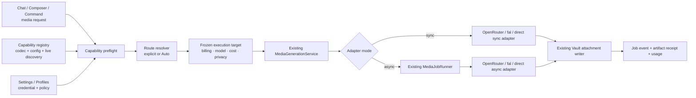
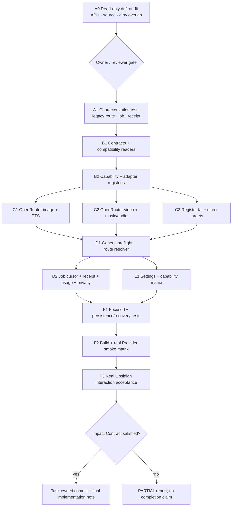

# OpenRouter + fal.ai 双一等媒体 Provider 实施方案

状态：**方案已定，尚未实施**  
读者：Peak Assistant owner、后续实施者与 reviewer  
适用范围：image、video、TTS、music/audio generation；保留 direct-provider 能力  
实施入口：本文件只定义目标合同、执行 DAG、迁移与验收，不授权直接改代码

## 0. 一页结论

Peak Assistant 应同时支持 OpenRouter 与 fal.ai，并把它们视为**平级、可显式选择的一等媒体 Provider**。

最终不是两套媒体系统，而是一套现有运行时、三类账单入口：

- `openrouter`：标准 image/reference-image、异步 video、TTS、标准 audio/music 的聚合入口。
- `fal`：image/video/TTS/music 的一等入口，同时承载 fill、mask、upscale、lip-sync、video-to-video、SFX、3D 等长尾能力。
- `direct`：保留 OpenAI 等用户直连 Provider；它不是 OpenRouter 或 fal.ai 的 fallback 别名。
- `auto`：在发起付费请求前，根据 capability、参数、隐私、成本、可用性和用户偏好，解析成上述一个明确入口。

核心边界：

1. 继续复用 `MediaGenerationService`、`MediaJobRunner`、Vault attachment writer、job/receipt/usage 持久化，不创建第二媒体 runtime。
2. “路由偏好”与“实际执行目标”分离。每个 job 在提交前冻结 billing provider、model、capability、成本与隐私快照。
3. 显式选择 OpenRouter 或 fal.ai 时，不能静默切换到另一家。`auto` 是扣费前选择，不是失败后的静默 fallback。
4. Provider 失败后的跨 Provider 重试默认关闭；只有用户预先授权或再次确认才可发生，并必须生成新的 job 与独立成本回执。
5. Provider/模型是否可用由 capability contract 决定，不能由 UI model 列表、模型名称或 SDK 方法存在性推断。

## 1. 决策背景与当前事实

### 1.1 为什么当前主要使用 fal.ai

历史媒体调研以“覆盖最多媒体能力的聚合平台”为问题中心，比较了 fal.ai、Replicate 等方案，但没有把 OpenRouter 当作媒体候选。fal.ai 因统一队列、丰富的 image/video/audio 模型以及 endpoint-specific 控制而进入现有实现。

这是一条历史范围与架构惯性，不是 OpenRouter 缺乏媒体能力的证明。当前 OpenRouter 已提供专用 image API、异步 video API、TTS endpoint、audio output 与媒体模型发现；本地依赖 `@openrouter/ai-sdk-provider@2.9.0` 也已经暴露 `imageModel()` 与 `videoModel()`。

### 1.2 当前源码基线

| 位置 | 当前事实 | 形成的限制 |
| --- | --- | --- |
| `src/core/types/media-generation.ts` | 路由是 `native \| fal \| auto`，resolved route 只有 `native \| fal` | OpenRouter 不能成为独立账单/执行入口 |
| `src/app/media/composeMediaGenerationService.ts` | 组装 fal sync/async 与 OpenAI direct image/video | OpenRouter profile 不能进入媒体 runtime |
| `src/core/providers/vercel/provider-factory.ts` | OpenRouter 只用于 language model | 已有 credential/profile 没有被媒体复用 |
| `src/service/media/preflight.ts` | availability、Auto 候选和错误均写死为 native/fal 二元结构 | 新 Provider 必须修改分支而非注册 capability |
| `templates/config/media-generation.json` | preset provider 只有 `fal \| native` | model/preset 与账单路由耦合 |
| `MediaJobRunner` | 已有 durable `submit → poll → download`、取消和重启恢复 | 可直接承载 OpenRouter video，不需要新 runner |
| job/receipt/usage | 已持久化 route、provider、model、estimate 与 provider cursor | 需要扩展快照和兼容读取，而非重建存储 |
| Media Settings | UI、验证矩阵和 strings 固定为 Auto/Native/fal | 无法平级配置与解释 OpenRouter |

### 1.3 已有资产应保留

- App 层唯一装配入口：`src/app/media/composeMediaGenerationService.ts`。
- 统一同步执行入口：`MediaGenerationService`。
- 统一异步生命周期：`MediaJobRunner` + `AsyncMediaAdapter`。
- 单一 Vault 写入器：`ObsidianMediaAttachmentWriter`。
- 单一 artifact receipt、media usage 与 generated output governance。
- 现有 fal adapters、OpenAI direct image/video adapters、reference resolver、confirmation gate 与 boot recovery。

## 2. Impact Contract

这是一项 provider-boundary 重构。只有以下合同全部满足，才可称为“双一等 Provider 完成”；否则必须标记为 partial progress。

### 2.1 主指标

1. **路由忠实度 100%**：显式 `openrouter`、`fal`、`direct` 的测试与真实回执中，billing provider 不发生静默变化。
2. **共享 runtime 中 Provider 分支归零**：`MediaGenerationService` 与 `MediaJobRunner` 只消费已解析的 execution target/adapter id，不出现 OpenRouter/fal 专用执行分支。
3. **四类媒体可表达**：OpenRouter 与 fal.ai 都可通过同一 capability contract 表达 image、video、TTS、music/audio；实际模型缺失时显示 `unavailable`，不得伪造支持。
4. **异步可恢复性不回退**：OpenRouter video 与 fal video/music 都能持久化 cursor、重启续跑、下载、失败、取消本地跟踪并生成真实 receipt。
5. **账单与隐私可追溯**：每个 job/receipt 均记录实际 billing provider、model、估算/实际成本置信度与隐私/retention 摘要。

### 2.2 必达轨道

- 合同解耦：route preference、execution target、capability descriptor、provider cursor。
- Provider registry：OpenRouter、fal.ai、direct 三类 backend 平级注册。
- OpenRouter adapters：image、video、TTS、music/audio 所需协议。
- 通用 preflight/Auto resolver：按 operation × capability × parameters 筛选与排序。
- 配置与设置：profile/credential、provider preference、模型/preset、capability matrix、验证状态。
- job、receipt、usage、privacy 与兼容迁移。
- focused tests、build、真实 Provider smoke matrix、Obsidian 真实交互验收。
- 文档真相同步，不把 mocked contract 或本地 build 写成 production success。

### 2.3 可选轨道

- OpenRouter image streaming partial preview。
- Provider webhook；桌面插件默认仍以 poll 为主。
- fal.ai 更多 specialist capability 的产品入口。
- 把 fal credential 完整迁入通用 ProfileRegistry。

可选轨道不能阻塞双一等基础能力，但不得借“可选”跳过必达轨道。

### 2.4 禁止范围

- 不创建第二套 media service、job runner、attachment writer、artifact store 或 tool loop。
- 不让 OpenRouter media 走普通 Chat text tool loop 并绕过 media preflight/job/receipt。
- 不删除 fal.ai 或 direct-provider 能力来简化实现。
- 不把一方降级为另一方的隐藏 fallback。
- 不直接从 service 层写 SQLite；仍由现有 repo/service 与 generated-output runtime 持久化。
- 不把动态发现到的任意模型直接标为可执行；没有 request/response codec 的模型只能显示为 discovered/unsupported。
- 不改 `docs/roadmap.html`，除非 owner 在实施完成后单独授权状态更新。
- 不混入当前工作区已有的 graph、roadmap、progress 或其他非本任务改动。

### 2.5 Skip budget 与停止规则

- 必达轨道 skip budget：`0`。
- 缺真实 credential 可以阻塞付费 E2E，但不能阻塞 adapter contract、capability、路由、错误、持久化、恢复和 mocked integration。
- 若 OpenRouter 某媒体类别在实施时没有兼容模型，只能把该 capability 标为 `unavailable` 并附实时发现证据；不能假装成功，也不能阻止其他 capability 交付。
- 最终提交必须只含本任务 owned files；若与已有 dirty changes 重叠且不能安全拆分，停止并报告 overlap。

### 2.6 需求到验收的追踪

| Owner 意图 | 设计落点 | 实施轨道 | 验收证据 |
| --- | --- | --- | --- |
| 两个都支持 | 三类 billing route + 平级 registry | B2、C1–C3、E1 | 两家可独立配置/显式选择/生成 receipt |
| 不互相降级 | explicit route fidelity + fallback 独立 policy | D1、D2 | 路由忠实度测试、无静默跨 Provider retry |
| 复用现有系统 | 单 runtime、单 runner、单 writer | B2、D1、D2 | runtime 分支审计、无新 store/writer |
| image/video/speech/music | capability descriptor + 四类 adapters | C1、C2 | adapter contract + real smoke matrix |
| 成本与隐私诚实 | frozen target + cost/privacy snapshot | D2、E1 | confirmation、receipt、usage、ZDR gate |

## 3. 目标产品合同

### 3.1 用户可理解的四个选择

| 选择 | 用户含义 | 失败时行为 |
| --- | --- | --- |
| Auto | Peak 在扣费前选择一个满足请求的 Provider | 显示将使用的 Provider/model/cost/privacy 后再提交；无候选则停止 |
| OpenRouter | 本次通过 OpenRouter 执行和计费 | 不跨 Provider；给出 OpenRouter 设置或换模型建议 |
| fal.ai | 本次通过 fal.ai 执行和计费 | 不跨 Provider；给出 fal 设置或换 endpoint 建议 |
| Direct provider | 直接调用所选 Provider/Profile | 不跨 Provider；给出对应 Profile/endpoint 建议 |

“OpenRouter 里的 Google/OpenAI 模型”和“fal.ai 里的 Google/其他模型”都不能改变账单来源语义。UI 主标签与 receipt 首先显示 OpenRouter/fal.ai/direct，再显示模型来源。

### 3.2 Auto 与 fallback 是不同动作

```text
Auto selection:
request -> preflight candidates -> choose one target -> confirm if needed -> submit once

Cross-provider fallback:
submitted/failed target -> detect charge ambiguity -> ask or honor explicit policy
-> create a new job -> submit to a different billing provider
```

规则：

- Auto 在第一次 provider request 前完成；它不等于“先试一家，失败再试另一家”。
- 已获得 provider job id 后，优先 poll/re-download 同一个 job，禁止因网络错误自动重新生成。
- 只有可以证明“请求未被 Provider 接收且未计费”时，才允许同 Provider 的幂等重试。
- 跨 Provider 重试必须使用新 `jobId`，记录 `retryOfJobId`、原失败原因和新的预估成本。
- 默认策略是 `never`；若产品提供 `ask`，确认卡必须展示第二次可能计费。

### 3.3 一等支持的定义

OpenRouter 与 fal.ai 的“一等”不是要求模型数量相同，而是要求拥有相同产品权利：

- 可在 Settings 中独立配置、验证、启用和禁用。
- 可在 Composer/Chat 请求中显式选择。
- 可被 Auto 平等评估，而非固定主/备顺序。
- 使用同一 job、confirmation、Vault writer、receipt、usage 与错误恢复合同。
- capability 缺失时显示真实原因，不被 UI 隐藏或伪装成另一个 Provider。

## 4. 目标架构



### 4.1 分离 route preference 与 execution target

建议替换当前 `MediaExecutionRoute` 同时承担“用户偏好”和“最终执行”的做法：

```ts
type MediaRoutePreference = 'auto' | 'openrouter' | 'fal' | 'direct';

type MediaBillingRoute = Exclude<MediaRoutePreference, 'auto'>;

interface MediaExecutionTarget {
  billingRoute: MediaBillingRoute;
  providerId: string;       // openrouter, fal, openai, ...
  profileId?: string;       // OpenRouter/direct profile；不得写 key
  adapterId: string;        // runtime registry key
  modelId: string;          // provider 接受的真实模型/endpoint id
  capabilityId: string;     // 例如 image.generate、video.generate
  capabilityRevision: string;
  cost: MediaCostSnapshot;
  privacy: MediaPrivacySnapshot;
}
```

关键约束：

- `auto` 只存在于 request preference；进入 job 前必须解析成 frozen target。
- adapter lookup 使用 `adapterId`，不再按 `native/fal` union 取 map。
- `providerId` 表示真正发送请求的服务；OpenRouter 下游模型厂商只作为 model metadata。
- job recovery 使用持久化 target，不重新跑 Auto；否则重启后可能换账单来源。

### 4.2 Capability descriptor

Capability 必须同时描述“模型声称支持什么”和“Peak adapter 真会编码什么”：

```ts
interface MediaCapabilityDescriptor {
  capabilityId: string;
  kind: 'image' | 'video' | 'tts' | 'music';
  operation: string;
  adapterId: string;
  executionMode: 'sync' | 'async' | 'stream';
  input: {
    references?: { min: number; max: number; mimeTypes: string[] };
    mask?: 'unsupported' | 'optional' | 'required';
    aspectRatios?: string[];
    durationsSeconds?: number[] | { min: number; max: number };
    quantity?: { min: number; max: number };
    outputFormats?: string[];
  };
  availability: 'ready' | 'degraded' | 'action-required' | 'unavailable';
  pricing: MediaPricingDescriptor;
  privacy: MediaPrivacyDescriptor;
}
```

Capability IDs 至少覆盖当前产品：

- `image.generate`
- `image.edit.reference`
- `image.edit.mask`
- `video.generate.text`
- `video.generate.reference`
- `tts.generate`
- `music.generate`

fal.ai 的长尾能力可继续扩展 `image.upscale`、`video.lipsync`、`video.transform`、`audio.sfx`、`asset.3d`，但只有 product surface 与 codec 同时存在时才能标为 ready。

### 4.3 Capability registry 的三层来源

按以下职责合并，而不是简单覆盖：

1. **Adapter codec 声明**：Peak 能否正确构造请求、解析结果、恢复 job；这是可执行性的硬下限。
2. **Curated config**：默认模型、product preset、参数边界、copy、已审计的 pricing/terms；仍放在 `templates/config/`。
3. **Live discovery**：验证模型当前存在、endpoint 参数、价格和 availability；只做实时收窄与更新，不能凭 discovery 自动发明 codec。

合并规则：

- `ready = codec exists AND credential ready AND model discovered/configured AND request parameters valid`。
- live discovery 失败时使用带时间戳的 last-known-good；没有 LKG 时使用 compiled fallback，但状态必须是 `degraded`。
- discovery 不能阻塞 plugin 启动，且不得上传 prompt、Vault refs 或文件内容。
- model、pricing、capability cache 是可重建 projection，不是用户内容。

### 4.4 Provider adapter family

不要做一个充满媒体类别分支的 `OpenRouterMediaAdapter`。按协议拆分、按 Provider family 组装：

- `OpenRouterImageAdapter`：专用 image API；text-to-image 与兼容 reference-image。
- `OpenRouterVideoAdapter`：`submit → poll → download`；进入现有 `AsyncMediaAdapter`/runner。
- `OpenRouterSpeechAdapter`：专用 speech endpoint，返回原始 audio bytes。
- `OpenRouterAudioAdapter`：处理需要 streaming audio output 的模型；music capability 只有协议与模型都验证后开放。
- 现有 `FalMediaAdapter` / `FalAsyncMediaAdapter` 保留；逐步把 endpoint-specific request codecs 移入配置/codec registry。
- OpenAI direct image/video adapters 保留，注册为 `direct` execution targets。

SDK 选择不是架构合同：

- 若 `@openrouter/ai-sdk-provider` 能完整暴露 image/video 所需字段与 usage，可在 adapter 内使用。
- 若异步 cursor、content download、actual cost、TTS raw bytes 或 provider-specific options 暴露不完整，使用薄 HTTP client。
- SDK/HTTP 类型不得泄漏到 service、job、receipt 或 UI 层。

### 4.5 App 层唯一装配

`composeMediaGenerationService.ts` 继续拥有：

- credential/profile resolvers；
- capability registry；
- sync/async adapter registries；
- `MediaGenerationService`、`MediaJobService`、`MediaJobRunner`；
- writer、receipt sink、usage emitter、generated-output sink。

禁止新增 service-side singleton 或 `AppContext.getInstance()` 捷径。Provider 扩展通过依赖注入和 registry 完成。

## 5. 路由与预检算法

### 5.1 候选生成

预检将 request 归一化成：

- capability id；
- references/mask/output format/duration/quantity 等硬参数；
- route preference；
- privacy policy；
- budget/confirmation policy；
- user/provider/model preference。

候选只保留：

- adapter codec 存在；
- credential/profile ready；
- provider/model 当前可用或有允许使用的 LKG；
- 参数落在 endpoint capability 范围；
- privacy policy 允许；
- 预估成本未违反 hard budget。

### 5.2 显式路由

显式 `openrouter`、`fal`、`direct` 只评估该 billing route。失败返回结构化问题：

- credential/profile 缺失；
- model/endpoint 不存在；
- operation/reference/mask/format 不支持；
- retention/ZDR 与用户策略冲突；
- cost unknown 或超预算；
- provider degraded/rate limited。

不能把“该路由不可用”转换成另一家 Provider 的执行。

### 5.3 Auto 排序

Auto 是确定性规则，不交给 LLM 自由选择。建议排序键从硬到软：

1. capability 与参数完全匹配；
2. privacy policy；
3. hard budget；
4. 用户固定 provider/model preference；
5. 预计总成本；
6. availability/近期成功率；
7. latency class；
8. 配置中的稳定 tie-breaker。

排序过程生成可解释 `routeDecision`，至少包含候选、排除原因、胜出原因和 capability revision。普通 UI 只显示简要解释；diagnostics/receipt 保留机器事实。

### 5.4 成本确认

- video、music 与超过用户阈值的 image batch 继续要求确认。
- 预估成本未知时显示 `unknown`，不能写成 `$0`。
- Provider 返回实际成本时，receipt 同时保留 estimate 与 actual，并把 confidence 标为 `provider-reported`。
- 若实际成本 API 只能异步获得，先完成 artifact receipt，再追加 usage settlement event；不得覆写历史估算来源。

## 6. 持久化、兼容与治理

### 6.1 Job snapshot

每个新 job 持久化：

- 原始 request 与 normalized capability；
- frozen `MediaExecutionTarget`；
- confirmation/cross-provider policy；
- provider cursor；
- estimate 与后续 actual cost；
- privacy snapshot；
- retry/fallback lineage；
- receipts 与状态转换。

### 6.2 通用异步 cursor

当前 `providerRequestId + providerResponseUrl` 带有 fal 语义。迁移为：

```ts
interface MediaProviderCursor {
  requestId: string;
  pollRef?: string;
  downloadRef?: string;
  generationId?: string;
  providerState?: Record<string, string>;
}
```

持久化建议：

- SQLite 增加 nullable `provider_cursor_json`；旧列暂时保留为兼容读取。
- reader 先读新 cursor；缺失时从旧 `provider_request_id/provider_response_url` 归一化。
- writer 只写新 cursor 后，至少跨一个稳定发布周期再考虑退休旧列。
- signed URL、token 或 header 不进入 diagnostics；能由 request id 重建时不持久化完整 URL。

### 6.3 Receipt 与 usage

扩展 media receipt，但保持现有 artifact carrier：

- `billingRoute`：`openrouter | fal | direct`。
- `providerId`、`profileId`、`modelId`、`capabilityId`。
- `estimate`、`actualCost`、`billingUnit`、`costConfidence`。
- `privacy`：ZDR eligibility、retention summary、reference upload summary。
- `routeDecision` 简要事实与 `fallbackFromJobId`。
- `providerRequestId` 可用于支持排障，但展示时截断/脱敏。

继续复用：

- `media.generated-attachment` 用户 artifact；
- `media.job-events` JSONL durable record；
- Chat artifact receipt；
- `UsageRecordedViewEvent(feature='media_generation')`。

不增加第二 carrier，不把 binary/base64 放入 JSON/SQLite，不直接写用户 Markdown。

### 6.4 旧数据兼容

- 旧 request/setting 的 `native` 在 read boundary 归一化为 `direct`。
- 旧 receipt 的 `executionRoute: native` 原样可读，UI 可显示“Direct provider (legacy Native)”。
- 旧 job 没有 execution target 时，从旧 preflight provider/model 构造兼容 target；不得重新跑 Auto。
- 不批量重写历史 JSONL、receipts 或 user data。
- 兼容 reader 有明确退休门槛：至少一个稳定发布周期、迁移 telemetry 无旧读命中，再单独评审。

### 6.5 Generated artifact governance

本方案不新增 persistent writer 或 output id。若实施中改变 writer evidence、job carrier 或 materialization rule，必须先更新 `docs/conventions/generated-artifact-registry.md` 与 catalog descriptor；否则保持现有 registry 不动。

## 7. 设置与产品 UI

### 7.1 设置结构

Settings → Media Generation 建议按以下顺序：

1. Default route：Auto / OpenRouter / fal.ai / Direct provider。
2. Auto policy：provider preference、privacy、budget、latency；默认不允许 cross-provider fallback。
3. OpenRouter：选择已有 enabled OpenRouter Profile；展示 live/local capability 状态。
4. fal.ai：沿用现有 key resolver；展示 capability 状态与 specialist presets。
5. Direct provider：选择 direct Profile；先保留 OpenAI image/video。
6. Per-kind defaults：provider、model/preset、参数边界。
7. Availability matrix：provider × capability，而不是 route × kind 的硬编码二维表。
8. Local validate 与 optional live probe 分开；live probe 必须标注可能联网，但不得触发付费生成。

### 7.2 Credential 决策

第一实施波不应为了视觉对称强行把 fal key 迁入 `ProfileKind`：

- OpenRouter 复用现有 `ProfileRegistry(kind='openrouter')`。
- Direct 复用现有 provider profiles。
- fal 通过 `MediaCredentialResolver` 包装现有 `settings.ai.falApiKey`。
- Settings 表面把三者呈现为平级 Provider；底层 credential carrier 不必同时重构。

若未来统一 fal profile，必须另立迁移任务，提供双读、单写与 rollback；不能与本 wave 混成大范围 Profile 改造。

### 7.3 状态语言

统一状态：

- `configured`
- `checking`
- `ready`
- `degraded`
- `action-required`
- `unavailable`

`Validate configuration` 只证明本地 shape/profile 存在，不证明 remote connectivity。只有 live probe 或真实 generation 才能升级相应证据标签。

## 8. 隐私、安全与 Provider 条款

### 8.1 请求边界

- 只上传本次明确使用的 prompt、reference、mask；不扫描或附带其他 Vault 内容。
- reference 仍由 `MediaReferenceResolver` 在执行时解析；job 只存 stable ref，不存 base64。
- credential 只能由 app-owned resolver 注入 adapter；不能进入 request/job/receipt/log。
- provider response/poll URL 进入 trace 前必须走现有 redactor。

### 8.2 ZDR 与 retention

- OpenRouter video 当前不具备 ZDR eligibility，因为异步产物需要临时保留以供轮询与下载。
- 若用户策略为 `require-zdr`，OpenRouter video 必须在 preflight 被过滤，而不是生成后再提示。
- fal.ai 与 direct provider 的 retention 按 endpoint/profile descriptor 表达；无法核实时标为 `unknown`，不能假设等同。
- privacy snapshot 保存“实施时确认的政策摘要 + revision/time”，不保存长篇条款副本。

### 8.3 远程取消

- 只有 Provider 明确支持且 adapter 已验证时才显示 remote cancel。
- 本地 cancel 的真实语义是“停止 Peak 跟踪/后续写入”；若远程任务可能继续计费，确认卡与 receipt 必须说明。
- 不得把 HTTP 中断或停止 poll 表述为已取消 Provider 任务。

## 9. 实施 DAG

本任务遵循两阶段门槛：先做只读 drift audit 与精确文件计划，owner/reviewer 确认后再实施。



### 9.1 A0 — 实施前只读 gate

实施者先输出，不改代码：

- 当前 `git status` 与 overlap matrix；
- OpenRouter/fal 官方 API、SDK、pricing、retention/ZDR 的当日核验；
- 当前 source route/adapter/job/settings/test candidate matrix；
- exact file plan 与预期主指标变化；
- 需要 owner 决策的真实问题。

若 Provider API 与本计划不同，以当日官方 source 为准，并回写本计划偏差说明后再进入实现。

### 9.2 A1 — Characterization

先锁定旧行为：

- `native/fal/auto` persisted request 可读。
- explicit route 不静默 fallback。
- async job 的 submit/poll/download、confirmation、cancel、resume。
- receipt/usage 的 route/provider/model/cost。
- Settings overlay round-trip。

这些测试是迁移护栏，不是要求保留旧的二元类型结构。

### 9.3 B1–B2 — 合同与 registry

- 新增 preference/target/capability/cursor 类型。
- 在 read boundary 加 legacy normalizer。
- 把 `Partial<Record<ResolvedMediaRoute, Adapter>>` 改为 adapter registry。
- capability registry 组合 codec/config/discovery/credential 状态。
- preflight 暂时双读，但只输出新 target；不得长期维护 parallel V1/V2 runtime。

### 9.4 C1–C3 — Provider 接线

- OpenRouter image 与 TTS 先完成同步链路。
- OpenRouter video 进入既有异步 runner。
- OpenRouter music/audio 根据当日协议做 stream 或 async adapter，不得把 TTS 假装成 music。
- fal/direct 适配成同一 registry entry；保留原 adapters 与 provider-specific codecs。
- 每个 adapter 都实现 capability declaration、configuration probe 与 redaction-safe error mapping。

### 9.5 D1–D2 — 路由与持久化

- 用通用 candidate resolver 替换 native/fal 分支。
- 冻结 execution target 后再创建 job/confirmation receipt。
- 增加 cursor JSON、route decision、privacy 与 actual cost 兼容字段。
- boot recovery 从 frozen target 找 adapter，不重新选路。
- usage 记录 billing provider，不能只记 upstream model 品牌。

### 9.6 E1 — Settings

- route picker 扩为 Auto/OpenRouter/fal/direct。
- provider-specific credential resolver 不泄漏进 UI 逻辑。
- availability 表由 capability registry 投影，不手写行过滤。
- strings/labels/terms 放 `templates/config/`，不在 TSX 硬编码。
- migration 后保存使用新值；旧 `native` 只由 compatibility reader 接受。

### 9.7 F1–F3 — 验收与收口

- focused tests 全过后运行 production build。
- 有明确付费授权时执行最小真实请求；无授权不擅自调用。
- 通过 Obsidian CDP 验证真实 Settings、preflight、confirmation、job update、artifact receipt 与 Vault attachment。
- Computer Use 只负责真实应用可见证据；不可替代 DOM/state assertions。
- 最后检查 service/runtime 无 provider-specific 执行分支，无第二 writer/store/runner。

## 10. 预计文件计划

实施前 A0 必须复核路径与 overlap。以下是目标 ownership，不是预先授权的修改清单。

### 10.1 新增候选

- `src/core/types/media-capability.ts`
- `src/service/media/MediaCapabilityRegistry.ts`
- `src/service/media/MediaRouteResolver.ts`
- `src/app/platform/media/openrouter/OpenRouterMediaClient.ts`
- `src/app/platform/media/openrouter/OpenRouterImageAdapter.ts`
- `src/app/platform/media/openrouter/OpenRouterVideoAdapter.ts`
- `src/app/platform/media/openrouter/OpenRouterSpeechAdapter.ts`
- `src/app/platform/media/openrouter/OpenRouterAudioAdapter.ts`
- 对应 focused test files。

若实现者能在不形成大文件/深分支的前提下复用已有文件，可以减少新增文件，但不能合并成一个 provider mega-adapter。

### 10.2 修改候选

| 轨道 | 候选文件 |
| --- | --- |
| Domain/ports | `src/core/types/media-generation.ts`、`MediaGenerationPort.ts`、`AsyncMediaAdapter.ts` |
| Config/settings | `settingsTypes.ts`、`mediaGenerationConfig.ts`、`mediaSettingsOverlay.ts`、两个 config JSON |
| Runtime | `preflight.ts`、`MediaGenerationService.ts`、`MediaJobRunner.ts`、`adapterRequest.ts` |
| App composition | `src/app/media/composeMediaGenerationService.ts` |
| Persistence | `ChatMediaJobRepo.ts`、SQLite DDL/migrations、generated output compatibility readers |
| UI | `MediaGenerationTab.tsx`、media confirmation/receipt/status components |
| Usage/privacy | `MediaUsageEmitter.ts`、receipt extras/renderer、redactor rules |
| Docs/tests | capability checklist、focused media tests、必要的 generated artifact registry evidence |

### 10.3 保护文件

- `docs/roadmap.html`
- 当前已有修改的 `docs/progress.md`
- graph renderer/convergence 相关文件
- 与本任务无关的 docs/assets/mock
- Vault 用户内容、runtime data、ignored artifacts

## 11. 测试与验收矩阵

### 11.1 Contract 与纯逻辑

- legacy `native` request/settings/job/receipt 正常归一化。
- explicit OpenRouter/fal/direct 只产生对应 billing route。
- Auto 按 capability/privacy/budget/preference 稳定排序。
- capability 缺 codec、credential、model、参数时返回精确 reason。
- `require-zdr` 过滤不合规候选。
- unknown cost 不被写为 0。
- provider failure 不触发静默跨 Provider retry。

### 11.2 Adapter contract

| Provider | 能力 | 必验事实 |
| --- | --- | --- |
| OpenRouter | image | request 参数、references、数量/格式、bytes、usage/cost、错误 |
| OpenRouter | video | submit id、poll 状态、download、restart、retention metadata |
| OpenRouter | TTS | raw audio bytes、MIME/format、voice/model capability |
| OpenRouter | music/audio | stream/async framing、音频拼接、真实 media kind、cost |
| fal.ai | 四类现有能力 | 注册后行为不回退，endpoint codec 与恢复保持 |
| direct | OpenAI image/video | legacy profile 选择、route label、receipt 保持 |

HTTP contract tests 使用 fake transport，不依赖真实费用，但 fixture 必须来自当日官方 schema 的最小合法形状。

### 11.3 Job、storage 与 recovery

- cursor 新旧双读、new-only write。
- queued/awaiting/running/completed/failed/cancelled 合法迁移。
- plugin reload 后按 frozen target 恢复同一 Provider。
- poll/download 暂时失败不重复 submit。
- completed provider job、download 失败可单独 retry download。
- cross-provider retry 生成新 job lineage 与第二成本确认。
- JSONL event、SQLite projection、receipt 与 usage 一致。

### 11.4 UI 与设置

- Settings overlay 保存/重载四种 preference。
- OpenRouter Profile disabled/no key、fal key empty、direct Profile invalid 的状态与 Configure 跳转。
- capability matrix 不为不存在的模型显示 ready。
- confirmation 卡展示 billing provider/model/cost/privacy。
- receipt 完成后打开真实 Vault attachment。
- 键盘、focus、Escape 与状态刷新通过 real Obsidian 验证。

### 11.5 真实 Provider smoke matrix

只有在 owner 明确授权使用 test credentials 与少量费用后执行：

| Route | Image | Video | TTS | Music/audio |
| --- | --- | --- | --- | --- |
| OpenRouter | 最小 1 张 | 最短/最低成本 clip | 短文本 | 最短/最低成本产物 |
| fal.ai | 最小 1 张 | 最短/最低成本 clip | 短文本 | 最短/最低成本产物 |
| Direct | 现有支持项 | 现有支持项 | 不强行承诺 | 不强行承诺 |

每次真实调用保存：request shape 脱敏摘要、job id、provider/model、成本、耗时、artifact path、receipt id、失败/取消语义。不得保存 key、完整 signed URL 或私密 prompt。

### 11.6 建议验证命令

实施者按实际新增文件调整 focused commands，至少包括：

```bash
npm run test -- test/media-generation-service.test.ts
npm run test -- test/media-auto-route.test.ts
npm run test -- test/media-job-runner.test.ts
npm run test -- test/media-preflight.test.ts
npm run test -- test/media-settings-overlay.test.ts
npm run test -- test/settings-media-generation-roundtrip.test.ts
npm run test -- test/media-openrouter-image-adapter.test.ts
npm run test -- test/media-openrouter-video-adapter.test.ts
npm run test -- test/media-openrouter-audio-adapters.test.ts
npm run build
```

Focused/build 通过不等于真实 Provider 或 Obsidian 验收。没有真实 credential evidence 时必须写 `CLIENT E2E NOT VERIFIED`；没有真实 Obsidian 交互证据时写 `INTERACTION NOT VERIFIED`。

## 12. Rollout 与 rollback

### 12.1 Rollout

1. 新 contract/registry 先带 legacy reader，默认行为保持现有 Auto/fal/direct 结果。
2. OpenRouter route 在 adapter、capability、settings、receipt、recovery 全部完成后才对用户显示。
3. 先 opt-in；真实 smoke 与 Obsidian acceptance 通过后，才允许进入 Auto 候选。
4. Auto 初次启用时显示实际选择与账单来源，不改变用户已显式选择的 route。
5. 一个稳定发布周期后，评估旧 `native` 写入与二元 availability compatibility 的退休。

Rollout gate 只能控制 registry entry/Auto eligibility，不能复制一套 V1/V2 media pipeline。

### 12.2 Rollback

- 关闭 OpenRouter registry entry 与 Auto eligibility，保留 fal/direct。
- 不删除 OpenRouter jobs/receipts/artifacts；新版本仍可只读展示。
- 已提交的 OpenRouter async job 继续由原 adapter 恢复或明确标记 action-required，不能切到 fal 重做。
- 若必须降级旧 binary，先完成/取消所有新 route 非终态 job；旧 binary 不被假设能理解新 execution target。
- SQLite migration 必须 additive；rollback 不依赖 destructive down migration。

## 13. 备选方案与取舍

| 方案 | 决定 | 原因 |
| --- | --- | --- |
| 用 OpenRouter 替换 fal.ai | 不采纳 | 会失去 fal 的 specialist endpoint 覆盖，也违背 owner 的双支持决策 |
| 保持 fal.ai 为唯一媒体聚合层 | 不采纳 | 无法复用用户已有 OpenRouter profile、统一账单与模型选择优势 |
| OpenRouter 主路由，fal.ai 只做 fallback | 不采纳 | 两者不再平级，并会制造静默账单切换风险 |
| 每个 Provider 各建一套 service/job/UI | 不采纳 | 重复状态机、恢复、writer、receipt，长期必然漂移 |
| 动态发现所有模型并自动开放 | 不采纳 | 模型存在不代表 Peak 已实现正确 codec、参数与 terms |
| 第一波把 fal key 强迁 ProfileRegistry | 延后 | 与媒体路由价值无直接依赖，扩大迁移面；先用统一 credential resolver |
| 只在现有 union 增加 `openrouter` | 不充分 | 能短期运行，但仍会让每个新 Provider 修改 preflight/service/UI 分支 |

推荐方案的代价是前期要完成 capability/target/cursor 的合同迁移；收益是此后新增 Provider 或长尾能力只注册 descriptor/adapter，不再扩散到共享 runtime。

## 14. 风险与处理

| 风险 | 影响 | 处理 |
| --- | --- | --- |
| OpenRouter/fal capability 与 pricing 快速变化 | UI 与 cost 过期 | live discovery + LKG + revision/time；实施前复核 |
| 动态模型存在但 adapter codec 不兼容 | 请求失败或参数被忽略 | codec 是 ready 的硬门槛 |
| 网络超时后重复提交 | 二次收费 | frozen cursor、幂等判断、poll/download retry，不盲目 resubmit |
| Auto 被误解为 silent fallback | 账单来源失控 | 扣费前冻结并展示；fallback 独立 policy |
| OpenRouter video 非 ZDR | 隐私策略违反 | preflight privacy filter + 明示 retention |
| fal specialist endpoint schema 差异大 | mega-adapter/分支膨胀 | endpoint codec registry + curated presets |
| fal key 与 ProfileRegistry 不对称 | 实施范围膨胀 | 第一波 credential resolver 统一接口，不强迁 carrier |
| 历史 job/receipt 不兼容 | 恢复或展示失败 | 双读、单写、无批量 rewrite |
| dirty worktree overlap | 混入他人改动 | A0 overlap audit + task-owned staging/commit |

## 15. 已决事项与待实施时复核

### 15.1 已决

- OpenRouter 与 fal.ai 都是一等 Provider。
- direct-provider 继续保留。
- 只有一个 media runtime/job runner/writer/receipt pipeline。
- Auto 不等于跨 Provider fallback。
- 显式 route 不静默换 Provider。
- cross-provider fallback 默认关闭。
- job 创建前冻结 execution target，恢复时不重新路由。
- Settings 平级不要求第一波同时重构所有 credential carrier。

### 15.2 实施时必须复核

- 当日 OpenRouter image/video/TTS/music/audio endpoint、SDK 与 response/cost schema。
- OpenRouter video ZDR/retention 现行政策。
- fal.ai 各默认 endpoint 的 input/output schema、queue、cancel、pricing 与 terms。
- music/audio 是否走 streaming chat audio、专用 endpoint 或异步 job；以模型实际协议为准。
- provider-reported actual cost 的获取时间与结算语义。
- signed URL 的有效期、恢复与持久化最小字段。

这些复核会调整 adapter codec 和 descriptor，不得推翻“双一等、单 runtime、无静默换账单来源”的产品合同。

## 16. 实施者最终交付格式

最后只提交一个 implementation note，至少包含：

```text
Outcome: COMPLETE — Impact Contract satisfied
或
Outcome: PARTIAL — Impact Contract not satisfied

Routes shipped:
Capabilities by Provider:
Legacy compatibility:
Provider/cost/privacy receipt evidence:
Focused tests:
Build:
Real OpenRouter smoke:
Real fal.ai smoke:
Real Obsidian interaction:
CLIENT E2E: VERIFIED / NOT VERIFIED
INTERACTION: VERIFIED / NOT VERIFIED
Protected scopes untouched:
Commit SHA:
Remaining blockers:
```

若任一必达轨道缺失、路由仍静默换 Provider、job recovery 重新 Auto 选路，Outcome 只能是 `PARTIAL`。

## 17. 证据与参考

### 17.1 当前仓库

- [`src/core/types/media-generation.ts`](../../../src/core/types/media-generation.ts)
- [`src/core/ports/MediaGenerationPort.ts`](../../../src/core/ports/MediaGenerationPort.ts)
- [`src/core/ports/AsyncMediaAdapter.ts`](../../../src/core/ports/AsyncMediaAdapter.ts)
- [`src/service/media/preflight.ts`](../../../src/service/media/preflight.ts)
- [`src/service/media/MediaGenerationService.ts`](../../../src/service/media/MediaGenerationService.ts)
- [`src/service/media/MediaJobRunner.ts`](../../../src/service/media/MediaJobRunner.ts)
- [`src/app/media/composeMediaGenerationService.ts`](../../../src/app/media/composeMediaGenerationService.ts)
- [`templates/config/media-generation.json`](../../../templates/config/media-generation.json)
- [`docs/research/2026-07-01-multimodal-generation-studio/README.md`](../../research/2026-07-01-multimodal-generation-studio/README.md)

### 17.2 Provider 官方资料

- [OpenRouter Image Generation](https://openrouter.ai/docs/guides/overview/multimodal/image-generation)
- [OpenRouter Video Generation](https://openrouter.ai/docs/guides/overview/multimodal/video-generation)
- [OpenRouter Text-to-Speech](https://openrouter.ai/docs/guides/overview/multimodal/tts)
- [OpenRouter Audio](https://openrouter.ai/docs/guides/overview/multimodal/audio)
- [OpenRouter Models](https://openrouter.ai/docs/guides/overview/models)
- [fal Model APIs](https://docs.fal.ai/model-apis)

Provider API、模型、价格和 retention 是易变事实；实施前必须重新核验，不能只依赖本方案日期或旧 snapshot。
