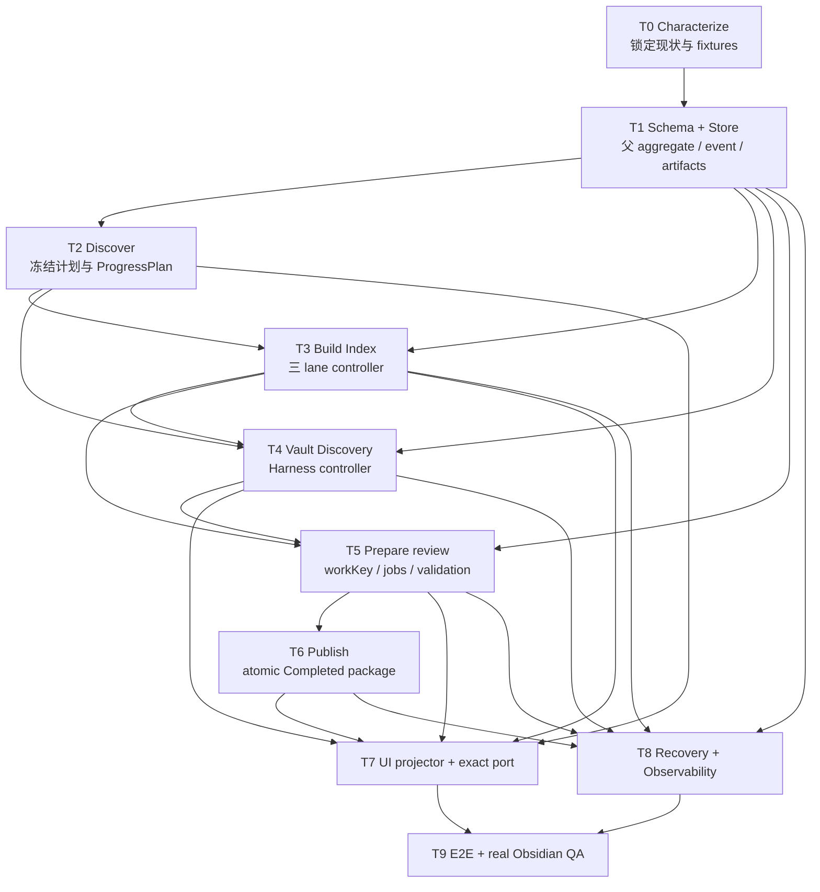

# Scan Vault 一比一生产实现范围

> 状态：待实施
>
> 日期：2026-08-23
>
> 上位合同：[`Scan Vault 端到端生产运行设计`](../specs/2026-08-23-scan-vault-end-to-end-runtime-design.md)
>
> 可直接复制到实现 session：[`Scan Vault 完整生产实现任务 Prompt`](./2026-08-23-scan-vault-production-implementation-handoff-prompt.md)
>
> 交付性质：完整生产 wave；不接受 Mock-only、timer demo 或半条链路

## 1. 实现结论

本轮实现的目标是把当前 Vault Intelligence Scan 从四阶段临时 runtime 替换为可持久化、可暂停恢复、可解释进度的五阶段 DAG，并让批准的 Mock 由同一真实 projection 驱动。不是“参考 Mock 做一个相似 UI”，而是同时对齐 render tree、interaction、state contract、数据真值和写入边界。

最终生产流程固定为：

```text
Scan setup
→ Discover
→ Build Index（Full-text / Embeddings / AI enrichment 三 lane）
→ AI work（Vault-wide Discovery）
→ Prepare review
→ Publish
→ Completed / Work queue
→ owner choice
→ Proposal / Apply / Re-index / Verify
```

Build Index 和 AI work 可按证据 gate 重叠，但 Prepare review 和 Publish 的依赖不可绕过。

## 2. Impact Contract

### 2.1 Primary metric

把生产路径中的以下旧结构降为零：

- `VaultScanStageId` 缺失 `prepare-review`；
- Vault-wide operations 被 `operationExecutionGroup()` 合并成一个 shared execution；
- `performPublish()` 临时派生 maintenance tasks；
- React/演示 timer 生成运行进度；
- 成功 AI receipt 在暂停恢复后被重复执行；
- Approved Mock 依赖独立假数据，而非生产 projection。

### 2.2 Required tracks

以下九个 track 全部必做：

1. Parent ScanRun aggregate、event store、checkpoint 和 projector；
2. Discover 冻结 plan、scope、routes、DAG 和 ProgressPlan；
3. Build Index 三 lane、route-aware scheduler、backpressure 和 receipts；
4. deterministic evidence assembly + VaultDiscoveryController + Agent Harness + tools + completion gate；
5. ReviewPreparationController + unified ReviewPreparationAgent + review artifacts + stable workKey + validator/revision loop；
6. deterministic atomic Publish 与 Completed handoff；
7. Approved Mock 一比一生产 UI port；
8. pause/resume/stop/retry/stale/rebuild/observability；
9. focused tests、migration tests、build、真实 Obsidian 验收。

### 2.3 Optional tracks

只有以下内容可以有证据地延后：

- 多设备/跨进程 remote worker；
- 长期 ETA 校准 dashboard；
- 自动 route cost optimizer；
- 历史 run 全量可视化浏览器；
- 对旧 Vault Review Markdown 的物理归档或删除。

### 2.4 Forbidden scope

- 不修改 Scan 外的 Chat、Composer、Search 或 Graph 产品 IA；
- 不自动写用户 Markdown/frontmatter/link；
- 不新增 service singleton 或 service → app/ui 反向依赖；
- 不新增第二套 Agent harness、permission 或 trace runtime；
- 不在 Run progress 提供模型配置；
- 不用 fake timer、随机数字、文字 token 或 Agent 自报完成度驱动 UI；
- 不改 proposal apply/verify 的 owner-approved 写入门；
- 不删除 legacy data；迁移只允许 copy/import/read adapter；
- 不以“简化”为理由删掉批准 Mock 中的 lane、stream、stage hover、controls 或 review dependency。

### 2.5 Skip budget

Required tracks 的 skip budget 为 0。任何 required track 未完成，交付必须标为 `partial progress`，不能称作完整 Scan Vault 实现。

### 2.6 Minimum acceptable delta

最低可接受结果必须同时满足：

- 同一个 frozen run 可从 Discover 走到 Completed；
- 应用重启后可从 durable checkpoint 恢复；
- Build Index、Discovery、Prepare review 各自有真实 session 和 progress；
- Completed tasks 在 Publish 前已生成并验证；
- Approved Mock 只消费生产 projector；
- Scan 前后用户文件 byte hash 不变；
- 旧 shared AI 和 publish-time task derivation 不再位于生产路径。

### 2.7 Stop / commit rule

每个 slice 只有在 focused tests 和相关 build 通过后才能提交，只提交该 slice 自有文件。最终 closure 必须完成 cross-slice tests、production build、persistence restart/replay、真实 Obsidian interaction；不能完成的真实交互必须明确标记 `INTERACTION NOT VERIFIED`，不得用 HTML Mock 代替。

## 3. 执行 DAG



并行原则：T3 与 T4 的内部代码可以在 T1/T2 合同冻结后并行；T5 依赖二者输出 schema；T7 可以先做 projector contract test，但不能接假 runtime；T9 是唯一 closure gate。

## 4. 精确文件范围

以下是目标责任分布。实施时可以在同一目录内做小幅命名调整，但不得改变 layer ownership。

### 4.1 Core types and ports

新增或重构：

```text
src/core/types/vault-scan.ts
src/core/types/vault-discovery.ts
src/core/types/review-preparation.ts
src/core/ports/VaultScanStorePort.ts
src/core/ports/VaultScanArtifactPort.ts
src/core/ports/IndexRunCoordinatorPort.ts
```

必须完成：

- 五阶段 `VaultScanStageId`；
- `FrozenScanPlan`、route pool、work graph、ProgressPlan；
- parent/domain session/event/projection schema；
- terminal disposition、checkpoint 和 receipt types；
- schema version + migration types；
- UI 不再直接依赖 runtime mutable state。

现有 `src/core/types/vault-intelligence.ts` 应收缩为 workspace/task/proposal 的公共类型或通过兼容 export 过渡；不能继续无限承载所有 Scan internals。

### 4.2 App composition and persistence

```text
src/app/vault-intelligence/VaultScanRuntime.ts
src/app/vault-intelligence/VaultScanComposition.ts
src/app/vault-intelligence/VaultScanRecordStore.ts
src/app/vault-intelligence/VaultIntelligenceRecordStore.ts
src/app/context/AppContext.ts
main.ts
src/core/storage/generated-output/catalog/vaultIntelligenceOutputs.ts
docs/conventions/generated-artifact-registry.md
```

必须完成：

- app layer 构造所有 controllers 和 adapters；
- DR-26 current projection、DR-27 per-run events migration、DR-28 immutable artifacts；
- event-first、snapshot replay、checksum/read-back；
- legacy version 1–4 state 幂等迁移；
- 没有新的 service-owned global runtime。

### 4.3 Parent controller

```text
src/service/vault-scan/ScanRunController.ts
src/service/vault-scan/ScanRunProjector.ts
src/service/vault-scan/ScanProgressCalculator.ts
src/service/vault-scan/ScanEtaEstimator.ts
src/service/vault-scan/ScanRecoveryPolicy.ts
src/service/vault-scan/ScanEventReducer.ts
```

必须完成：

- DAG dependency resolution；
- active stage projection 和 inspection stage 分离；
- system-owned percent/ETA；
- pause/stop/stale/error transitions；
- single-writer + idempotency；
- no React business calculation。

### 4.4 Discover

```text
src/service/vault-scan/discover/DiscoverController.ts
src/service/vault-scan/discover/FrozenScopeBuilder.ts
src/service/vault-scan/discover/WorkGraphPlanner.ts
src/service/vault-scan/discover/RoutePolicyFreezer.ts
```

必须完成四 gate、fingerprint、preflight 和首个 durable checkpoint。现有 optional `plan-scan` 只可提供建议，不拥有 frozen plan。

### 4.5 Build Index

```text
src/service/vault-scan/index/BuildIndexController.ts
src/service/vault-scan/index/IndexLaneQueue.ts
src/service/vault-scan/index/IndexRouteScheduler.ts
src/service/vault-scan/index/IndexReceiptReducer.ts
src/service/search/index/...
src/core/ports/IndexMaintenancePort.ts
```

必须完成：

- Full-text、Embedding、AI enrichment 三个 queue；
- 一个文件 Search ready 后立即 fan-out；
- local serial + remote bounded rolling pool；
- per-file actual model route；
- already-current 幂等；
- provider callback 只发 event，不直接改 session；
- IndexService 通过 ports 使用，controller 不依赖具体 singleton。

### 4.6 Vault-wide Discovery

按 [`Vault-wide Discovery Harness`](../specs/2026-08-23-vault-wide-discovery-harness-design.md) 落地：

```text
src/app/vault-intelligence/VaultDiscoveryRuntime.ts
src/service/vault-discovery/VaultDiscoveryController.ts
src/service/vault-discovery/EvidenceAssemblyController.ts
src/service/vault-discovery/DiscoverySession.ts
src/service/vault-discovery/EvidenceLedger.ts
src/service/vault-discovery/InvestigationScheduler.ts
src/service/vault-discovery/FindingRegistry.ts
src/service/vault-discovery/ConvergencePolicy.ts
src/service/vault-discovery/tools/*
templates/prompts/vault-discovery-*.md
templates/config/vault-discovery.json
```

必须删除生产 runtime 对 shared `operationExecutionGroup()` 的依赖。Setup operation IDs 保留为 capability/objective/route hints，不再被当成固定执行步骤。

Content-health detectors、broken-reference checks 和 `runMobiusGlobalMaintenance()` 必须在 Evidence assembly 中形成版本化 facts，不能继续留到 Publish。Discovery investigator 和 Task synthesis 是仅有的两种逻辑 Agent capability；不能为每种 finding 类型硬建一个 Agent。

### 4.7 Prepare review

按 [`Prepare review`](../specs/2026-08-23-vault-scan-review-preparation-design.md) 落地：

```text
src/app/vault-intelligence/ReviewPreparationRuntime.ts
src/service/vault-review-preparation/ReviewPreparationController.ts
src/service/vault-review-preparation/ReviewInputNormalizer.ts
src/service/vault-review-preparation/ReviewWorkPlanner.ts
src/service/vault-review-preparation/ReviewPreparationAgent.ts
src/service/vault-review-preparation/ReviewJobScheduler.ts
src/service/vault-review-preparation/ReviewArtifactStore.ts
src/service/vault-review-preparation/ReviewWorkValidator.ts
src/service/vault-review-preparation/tools/*
templates/prompts/vault-review-preparation.md
templates/config/vault-review-preparation.json
```

`deriveVaultMaintenanceTasks()` 从 UI model 和 Publish 路径移除。Controller 先建立 provisional work graph；ReviewPreparationAgent 为所有非 deterministic-only reviewable work 生成并修订 `ReviewWorkArtifact`；Validator 通过后才能冻结 stable workKey 和 task。Owner choice reconcile 和 exact-patch safety 必须在 service/controller 层完成。

Setup 保留 `review-work-shaping` 与 `review-artifact-drafting` 两个 route policies，但二者由同一个 Agent session 消费。旧 `maintenance-synthesis` / `file-proposals` 只作为迁移别名，不再代表 shared Vault Review 或提前生成 source proposal。

### 4.8 Publish and Completed

```text
src/service/vault-scan/publish/CompletedPackageBuilder.ts
src/service/vault-scan/publish/CompletedPublisher.ts
src/service/vault-scan/publish/CompletedPackageValidator.ts
```

Publish 不允许调用模型。现有 `prepareProposal()`、apply、re-index、verify 继续作为 Completed 后 owner flow，不并入 Scan 自动写入。

### 4.9 UI exact port

主要修改范围：

```text
src/ui/view/vault-intelligence/VaultIntelligenceWorkspace.tsx
src/ui/view/vault-intelligence/VaultIntelligenceModel.ts
src/ui/view/vault-intelligence/components/scan/*
src/styles/peak-components.css
```

以这些文件为一比一目标：

- `docs/gstack/vault-intelligence-workspace-2026-08-12-v2/index.html`
- `docs/gstack/vault-scan-build-index-flow-2026-08-23/index.html`
- `docs/gstack/vault-scan-vault-wide-discovery-2026-08-23/index.html`
- `docs/gstack/vault-scan-review-preparation-2026-08-23/index.html`

保留并实现：

- 单一顶部 overall progress；
- `View 5 stages` hover/focus/click inspection；
- 当前 stage 长标题和 controls；
- Build Index 自己的 progress、三 lane 和相同竖向 current file list；
- Discovery discoveries + streaming session；
- Prepare review stream job 与 review work 的真实依赖；
- Completed task list 与 detail；
- 不自动追踪滚动，不闪烁，不恢复已删除的小字层级。

## 5. 迁移顺序

### Slice 0：Characterization

- 固定当前 setup/run/completed fixtures；
- 为现有 `executeRun`、`deriveProgressLedger`、operation grouping 和 publish task derivation 写 characterization tests；
- 记录 primary worktree 的现有变更，避免覆盖并行工作；
- 锁定四个 Mock 的 source hash 和测试 viewport。

交付：旧行为有证据，但没有宣布旧行为正确。

### Slice 1：Schema、store、reducer

- 新 parent/domain schema；
- event store、artifacts、replay 和 migration；
- deterministic reducer/projector；
- 旧 UI 暂时仍可读 compatibility projection。

Gate：重启/replay/duplicate event/checksum tests 全绿。

### Slice 2：Discover 与 ProgressPlan

- setup draft → FrozenScanPlan；
- scope/revision/route pool/DAG/progress weights；
- preflight failure 和 optional planner fallback。

Gate：相同输入 fingerprint 稳定，恢复不换 scope/route。

### Slice 3：Build Index

- 将现有 core index/enrichment 接入三 queue；
- route capacity、batch、rolling pool、backpressure；
- per-file receipts、checkpoint、ETA；
- 旧 `performIndex` 退出生产路径。

Gate：146×3、mixed routes、pause/restart、partial failure tests 全绿。

### Slice 4：Vault-wide Discovery

- 落地 controller、tools、findings、frontier、convergence；
- CapabilityRunner / AgentLoop attempts；
- 流事件和 discoveries projection；
- 旧 `performAi` 与 shared operation group 退出生产路径。

Gate：非线性发现、citation、budget、pause/resume、completion gate tests 全绿。

### Slice 5：Prepare review

- input freeze、provisional graph、conflict-aware job scheduler、统一 Agent jobs、artifact drafting、validation/revision；
- preserve owner choices；
- stream 与 work row 因果连接；
- `deriveVaultMaintenanceTasks()` 退出生产路径。

Gate：每 atom 恰一 disposition；task plan 可 replay；普通 reviewable task 必须有 Agent receipt 和 validated artifact；没有 review artifact 不得 Ready。

### Slice 6：Publish 与 Completed

- immutable package；
- atomic pointer、events、read-back；
- recoverable retry；
- Work queue / Completed 消费新 package。

Gate：故障注入后不重复 AI、不重复 task/workKey。

### Slice 7：Production UI exact port

- 切换为 `ScanRunProjector` 唯一数据源；
- 移植批准 Mock DOM/interaction/CSS；
- 删除 demo timer 和独立 mock-state adapter；
- stage inspection、pause/resume 和滚动稳定性。

Gate：rendered contract + real Obsidian DOM/geometry/interaction。

### Slice 8：Legacy retirement

- 删除旧四阶段 types/reducer；
- 删除 `operationExecutionGroup()` shared AI branch；
- 删除 publish-time task derivation；
- 删除 UI 双进度和 demo-only state；
- 临时 migration flag 在验证后移除，不保留长期双 runtime。

Gate：repo search 证明旧生产入口为零，legacy reader 只用于持久化迁移。

## 6. 测试范围

### 6.1 Focused unit / contract tests

建议新增：

```text
test/vault-scan-state-machine.test.ts
test/vault-scan-progress-plan.test.ts
test/vault-scan-event-replay.test.ts
test/vault-scan-persistence-migration.test.ts
test/vault-scan-discover-controller.test.ts
test/vault-scan-index-lanes.test.ts
test/vault-scan-route-scheduler.test.ts
test/vault-scan-pause-resume.test.ts
test/vault-discovery-controller.test.ts
test/vault-discovery-completion-gate.test.ts
test/vault-review-preparation-controller.test.ts
test/vault-review-work-key.test.ts
test/vault-review-preparation-agent.test.ts
test/vault-review-artifact-validation.test.ts
test/vault-review-job-conflicts.test.ts
test/vault-scan-publish-atomicity.test.ts
test/vault-scan-user-files-unchanged.test.ts
test/vault-intelligence-scan-rendered-parity.test.ts
```

### 6.2 Integration matrix

必须覆盖：

- empty/small/146-file/large Vault；
- entire/changed/selected scope；
- only Search、Search+Embedding、三层全开；
- local serial、remote single、mixed route pool；
- provider retry/fallback/rate limit/receipt lost；
- mid-index pause、mid-tool pause、app restart、stale source；
- zero findings、frontier expansion、budget exhausted、completed-with-attention；
- zero review tasks、ambiguous tasks、conflict、needs recovery；
- publish failure at each atomic boundary；
- old version 1–4 persisted state migration；
- SQLite projection deletion/rebuild；
- user-file byte hashes unchanged。

### 6.3 Verification commands

每个 slice 至少运行其 focused test。Closure 至少运行：

```bash
npm run test
npm run build
```

再执行真实 Obsidian CDP + Playwright：plugin-only reload、打开 Vault Intelligence、启动真实 fixture scan、pause/resume、hover stage menu、点击 inspection、检查三个 Index lanes、Discovery stream、Prepare review 依赖和 Completed handoff。最终用 Computer Use 留一张人类可见的真实宿主证据；HTML Mock 不计验收。

## 7. Rollout 与 rollback

### 7.1 Rollout

迁移期允许一个 app-owned、默认关闭的临时 runtime switch，仅用于同一 fixture 对比 legacy 与新 projection。它不能写两套 canonical data，也不能进入长期 Settings。

顺序：

1. 新 runtime shadow-read 旧 state；
2. 新 store 对测试 fixture 写入并 replay；
3. 新 runtime 成为 Scan 唯一 writer；
4. UI 切新 projector；
5. 观察真实 run 与 restart；
6. 删除临时 switch 和 legacy writer。

### 7.2 Rollback

在第 3 步之前可直接关 switch。成为唯一 writer 后，rollback 只能切回上一稳定 build，并由 legacy read adapter 忽略新字段；不得删除新 per-run artifacts 或把 owner choice 回写成旧格式。

Publish pointer 更新失败时只回滚 pointer，不删除已 stage 的 immutable body。所有迁移必须幂等。

## 8. Review gate

Major review 必须逐层进行：

1. Data truth：scope、revision、route、workKey、receipt 是否正确；
2. State contract：DAG、pause、failure、completion 是否正确；
3. Structure：controller/port/app ownership 是否正确；
4. Interaction：stage hover、inspection、pause/resume、stream/work dependency；
5. Layout/visual：与 Mock 的 DOM、geometry、typography、icons、scroll 一致；
6. Safety：用户文件不变、proposal gate 未绕过；
7. Recovery：restart、replay、rebuild、rollback。

只通过 build 或 screenshot 不足以过 gate。

## 9. 最终完成定义

只有以下条件全部满足，才能说“Scan Vault 整个流程实现完成”：

- 五阶段父状态机和三类 domain session 都在生产路径；
- ProgressPlan/ETA/receipts 来自真实运行；
- Build Index、Discovery、Prepare review 与 Publish 边界符合上位合同；
- pause/resume/restart 不丢失成功工作；
- Approved Mock 由 production projector 一比一驱动；
- Completed 中的每项 work 可回到 evidence 和 source revision；
- owner choice → proposal → apply → re-index → verify 边界未被破坏；
- 旧 shared AI、publish-time task derivation、fake progress 和长期双 runtime 已退役；
- tests/build/persistence migration 通过；
- 真实 Obsidian 验收通过，或未能验证的具体交互被诚实列为阻塞，而不是默认为完成。

这就是后续实现的完整范围。任何超出此范围的新产品能力单独立项；任何少于此范围的交付都必须标为部分进展。
