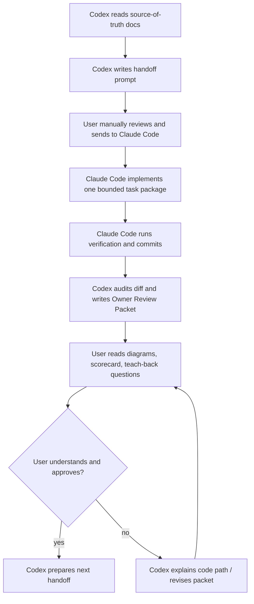

# Peak Assistant Refactor Ops

Last updated: 2026-06-12

This folder is the operating layer for the large architecture modernization. It does not replace the architecture reports. It turns them into a repeatable loop where Codex produces understanding, review packets, diagrams, scorecards, and Claude Code handoffs, while Claude Code only performs implementation work.

## Source Of Truth

Final architecture docs:

1. [`2026-06-01-peak-system-architecture-modernization-handbook.html`](../specs/2026-06-01-peak-system-architecture-modernization-handbook.html)
   - Main system understanding handbook and modernization action map.
   - Defines the architecture spine: `Capability Contract -> RunEnvelope -> Ports -> ToolDef -> Skill Compiler -> Artifact/Trace`.
   - Defines the task DAG from T0 to T12.
   - Contains the hard rule: no dual system / no dual business implementation.

2. [`2026-06-02-ambient-push-current-work-state-product-technical-review.html`](../specs/2026-06-02-ambient-push-current-work-state-product-technical-review.html)
   - Ambient Push final spec.
   - Ambient is post-foundation and must not be implemented inside the old Ambient pipeline as a parallel target architecture.

3. [`2026-06-03-obsidian-plugin-command-gateway-capstone-review.html`](../specs/2026-06-03-obsidian-plugin-command-gateway-capstone-review.html)
   - Command Gateway final spec.
   - Command Gateway is T12 capstone, not an early implementation task.

Historical exploration docs are reference only. They should not override the final three docs.

## Operating Decision

This project should not be run as autonomous vibe coding.

The operating model is:

| Role | Owns | Does not own |
| --- | --- | --- |
| User | Authorization, direction, deciding whether the architecture is understandable and controllable | Reading every diff line alone |
| Codex | Architecture reports, diagrams, task design, handoff prompts, diff audit, owner review packets, scorekeeping | Large implementation edits in `src/` during the modernization loop |
| Claude Code | Code implementation from a bounded handoff, local tests, implementation notes, small commits | Redefining architecture, skipping task order, writing final architecture source of truth |

## Loop



Manual handoff is intentional. It is the owner authorization point.

## Review Access Rule

Any document that requires user review must be easy to open from the Codex conversation where it is mentioned.

Codex must do both:

1. In the final chat response, list review artifacts with clickable absolute file links.
2. In the document itself, include clear review entry points near the top when the document depends on companion reports, handoffs, source-of-truth docs, or next-step docs.

Do not make the user hunt through git status, file trees, relative paths, or prior chat messages to find what needs review.

For every review cycle, the user-facing closeout should include:

- primary artifact to review;
- companion evidence or previous packet, if relevant;
- next handoff or next draft, if relevant;
- whether the document is final, draft, or waiting for user approval.

## Owner-Facing Language Rule

Owner-facing refactor artifacts must optimize for user understanding, not English practice.

Use Chinese first for:

- Owner Review Packets;
- scorecard explanations and progress summaries;
- "why this task", "what changed", "what remains old", and "what to do next";
- chat closeouts that ask the user to review, approve, or send a handoff.

Keep English for code-facing names and precision:

- commit messages;
- file names, symbols, interface names, test names, and command names;
- architecture terms that appear directly in code, such as `Capability Contract`, `RunEnvelope`, `ProgressReporterPort`, `ToolDef`, `Port`, `Adapter`, and `Inventory`.

When Claude Code returns an implementation note, Codex must translate and normalize it into a Chinese owner-facing summary before asking the user to decide. English technical detail may remain below the Chinese summary, but the user should be able to understand the task status without reading a long English report.

## Code Reading Guide Rule

Every code-changing task must include a code reading guide for the owner.

Claude Code implementation notes must include:

- changed code files grouped by purpose;
- a recommended reading order;
- the key symbols/functions/classes to inspect in each file;
- what changed in each file, in plain Chinese;
- what did not change and should not be reviewed for this task;
- tests or source-scan guards that prove the change.

Codex Owner Review Packets must include:

- clickable file links in the chat closeout for the main changed code files;
- a "read in this order" section near the top of the packet;
- short guidance for each file: "look for this function / boundary / deleted old path";
- the first debug file to open if the behavior breaks later.

Do not accept a code-changing task if the owner cannot answer: "which code files changed, why, and in what order should I read them?"

## Mutable Global State Rule

New mutable globals must not be scattered across random service, core, or port files.

Avoid patterns like:

```ts
let defaultSomething: Something | null = null;
export function setDefaultSomething(...) { ... }
export function getDefaultSomething() { ... }
```

These are hidden service locators. They make the runtime harder to understand because dependencies are no longer visible from a constructor, capability contract, run envelope, or app composition point.

Preferred order for new work:

1. Pass dependencies explicitly through a constructor, capability runtime, or `RunEnvelope` once that exists.
2. Put long-lived app-owned adapters in one app composition location, such as `main.ts` or a future app-level runtime registry.
3. Use `AppContext` only as a transitional centralization point when the alternative would scatter multiple module-level globals. Do not expand service-side `AppContext.getInstance()` usage as the default solution.
4. If a module-level mutable default is unavoidable for a narrow T2 slice, it must be:
   - explicitly named as temporary in comments and the Owner Review Packet;
   - fail-loud when missing;
   - cleared on plugin unload if it captures app/runtime objects;
   - covered by tests or source-scan guards;
   - listed as a retirement target for T3/T4.

`ProgressReporterPort`'s `defaultReporter` is accepted only as a T2 transitional compromise. Do not copy this pattern into new ports. T3/T4 should replace it with an explicit runtime/composition mechanism.

## Non-Negotiable Gates

Every implementation task must answer these before it is considered accepted:

1. Which capability or boundary did this task clarify?
2. What is the single runtime path after the change?
3. What is the state source of truth after the change?
4. Which old path was deleted, emptied, or reduced to thin forwarding?
5. Which fake port, fixture, or contract test proves the boundary?
6. What remains intentionally old, and why?
7. What should the user read to debug this later?
8. Which changed code files should the user read, in what order, and what should they look for?
9. Did this introduce or preserve mutable global state? If yes, where is it centralized, why is it temporary, and what retires it?

If the answer is "new and old implementations both continue to own behavior", the task is not accepted.

## Task Order

Start here:

```text
T0 Boundary Baseline
-> T1 Contract Seeds
-> T2 Port Sketches
-> T3 RunEnvelope Core
-> T4 Capability Replacement
-> T7 UI RunEvent Projection
-> T9 Pilot Capability
-> T10 Conformance + Golden Trace
-> T11 Expand to next capability
-> T12 Command Gateway Capstone
```

T5 and T6 can proceed when T2/T4 establish enough tool boundary evidence, but they should not be used to bypass T0-T3.

Ambient starts only after the foundation is in place. Command Gateway starts only after T10.

## Current Implementation Status

Completed and accepted:

- T0 Boundary Baseline: [`t0-boundary-baseline-handoff.md`](./t0-boundary-baseline-handoff.md) + [`2026-06-12-t0-owner-review-packet.md`](../audits/2026-06-12-t0-owner-review-packet.md)
- T1 Vault Lint Contract Seed: [`t1-vault-lint-contract-seed-handoff.md`](./t1-vault-lint-contract-seed-handoff.md) + [`2026-06-12-t1-owner-review-packet.md`](../audits/2026-06-12-t1-owner-review-packet.md)
- T2A ProgressReporterPort first slice: [`t2-first-port-sketches-draft.md`](./t2-first-port-sketches-draft.md) + [`2026-06-12-t2a-owner-review-packet.md`](../audits/2026-06-12-t2a-owner-review-packet.md)
- T2B IndexInitializer ProgressReporterPort follow-up: [`t2b-index-initializer-progress-reporter-handoff.md`](./t2b-index-initializer-progress-reporter-handoff.md) + [`2026-06-12-t2b-owner-review-packet.md`](../audits/2026-06-12-t2b-owner-review-packet.md)

Ready for owner approval:

- T2C AnalysisDocPersistence Notice cleanup: [`t2c-analysis-doc-persistence-notice-cleanup-handoff.md`](./t2c-analysis-doc-persistence-notice-cleanup-handoff.md)

Next owner decision:

- send `T2C` to Claude Code for read-only investigation, or skip to `T3` RunEnvelope Core;
- do not start Chat, Ambient Push, or Command Gateway yet.

## Supporting Files

- [`claude-code-handoff-template.md`](./claude-code-handoff-template.md): reusable Claude Code prompt shape.
- [`owner-review-packet-template.md`](./owner-review-packet-template.md): Codex review packet shape after Claude Code commits.
- [`architecture-scorecard.md`](./architecture-scorecard.md): scoring rubric and progress ledger.
- [`t1-vault-lint-contract-seed-handoff.md`](./t1-vault-lint-contract-seed-handoff.md): T1 implementation handoff.
- [`t2-first-port-sketches-draft.md`](./t2-first-port-sketches-draft.md): T2A port extraction handoff source.
- [`t2b-index-initializer-progress-reporter-handoff.md`](./t2b-index-initializer-progress-reporter-handoff.md): T2B implementation handoff.
- [`t2c-analysis-doc-persistence-notice-cleanup-handoff.md`](./t2c-analysis-doc-persistence-notice-cleanup-handoff.md): T2C implementation handoff.

## Do Not Do

- Do not ask Claude Code to "modernize the architecture" broadly.
- Do not let Claude Code implement Ambient in the old `AmbientPushService` path.
- Do not let Command Gateway appear before T10 as a standalone agent runtime.
- Do not accept a task that adds abstractions without deletion, tests, or lower change radius.
- Do not merge a task if the user cannot explain the new entry point, state truth, and debug path.
