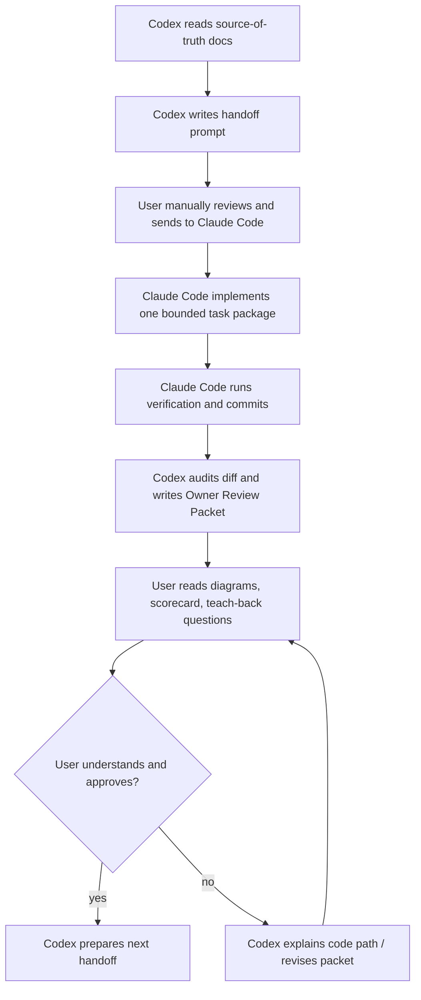

# Peak Assistant Refactor Ops

Last updated: 2026-06-12

This folder is the operating layer for the large architecture modernization. It does not replace the architecture reports. It turns them into a repeatable loop where Codex produces understanding, review packets, diagrams, scorecards, and Claude Code handoffs, while Claude Code only performs implementation work.

## Source Of Truth

Final architecture docs:

1. [`2026-06-01-peak-system-architecture-modernization-handbook.html`](../specs/2026-06-01-peak-system-architecture-modernization-handbook.html)
   - Main system understanding handbook and modernization action map.
   - Defines the architecture spine: `Capability Contract -> RunEnvelope -> Ports -> ToolDef -> Skill Compiler -> Artifact/Trace`.
   - Defines the task DAG from T0 to T12.
   - Contains the hard rule: no dual system / no dual business implementation.

2. [`2026-06-02-ambient-push-current-work-state-product-technical-review.html`](../specs/2026-06-02-ambient-push-current-work-state-product-technical-review.html)
   - Ambient Push final spec.
   - Ambient is post-foundation and must not be implemented inside the old Ambient pipeline as a parallel target architecture.

3. [`2026-06-03-obsidian-plugin-command-gateway-capstone-review.html`](../specs/2026-06-03-obsidian-plugin-command-gateway-capstone-review.html)
   - Command Gateway final spec.
   - Command Gateway is T12 capstone, not an early implementation task.

Historical exploration docs are reference only. They should not override the final three docs.

## Operating Decision

This project should not be run as autonomous vibe coding.

The operating model is:

| Role | Owns | Does not own |
| --- | --- | --- |
| User | Authorization, direction, deciding whether the architecture is understandable and controllable | Reading every diff line alone |
| Codex | Architecture reports, diagrams, task design, handoff prompts, diff audit, owner review packets, scorekeeping | Large implementation edits in `src/` during the modernization loop |
| Claude Code | Code implementation from a bounded handoff, local tests, implementation notes, small commits | Redefining architecture, skipping task order, writing final architecture source of truth |

## Loop



Manual handoff is intentional. It is the owner authorization point.

## Non-Negotiable Gates

Every implementation task must answer these before it is considered accepted:

1. Which capability or boundary did this task clarify?
2. What is the single runtime path after the change?
3. What is the state source of truth after the change?
4. Which old path was deleted, emptied, or reduced to thin forwarding?
5. Which fake port, fixture, or contract test proves the boundary?
6. What remains intentionally old, and why?
7. What should the user read to debug this later?

If the answer is "new and old implementations both continue to own behavior", the task is not accepted.

## Task Order

Start here:

```text
T0 Boundary Baseline
-> T1 Contract Seeds
-> T2 Port Sketches
-> T3 RunEnvelope Core
-> T4 Capability Replacement
-> T7 UI RunEvent Projection
-> T9 Pilot Capability
-> T10 Conformance + Golden Trace
-> T11 Expand to next capability
-> T12 Command Gateway Capstone
```

T5 and T6 can proceed when T2/T4 establish enough tool boundary evidence, but they should not be used to bypass T0-T3.

Ambient starts only after the foundation is in place. Command Gateway starts only after T10.

## First Implementation Task

T0 is complete and accepted. The first completed Claude Code handoff was [`t0-boundary-baseline-handoff.md`](./t0-boundary-baseline-handoff.md).

Next handoff to send:

- [`t1-vault-lint-contract-seed-handoff.md`](./t1-vault-lint-contract-seed-handoff.md)

Draft for after T1 acceptance:

- [`t2-first-port-sketches-draft.md`](./t2-first-port-sketches-draft.md)

## Supporting Files

- [`claude-code-handoff-template.md`](./claude-code-handoff-template.md): reusable Claude Code prompt shape.
- [`owner-review-packet-template.md`](./owner-review-packet-template.md): Codex review packet shape after Claude Code commits.
- [`architecture-scorecard.md`](./architecture-scorecard.md): scoring rubric and progress ledger.
- [`t1-vault-lint-contract-seed-handoff.md`](./t1-vault-lint-contract-seed-handoff.md): next implementation handoff.
- [`t2-first-port-sketches-draft.md`](./t2-first-port-sketches-draft.md): draft port extraction handoff for after T1.

## Do Not Do

- Do not ask Claude Code to "modernize the architecture" broadly.
- Do not let Claude Code implement Ambient in the old `AmbientPushService` path.
- Do not let Command Gateway appear before T10 as a standalone agent runtime.
- Do not accept a task that adds abstractions without deletion, tests, or lower change radius.
- Do not merge a task if the user cannot explain the new entry point, state truth, and debug path.
