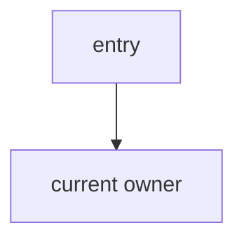
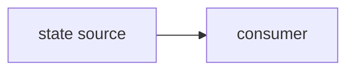

# Claude Code Handoff Template

Use this template for one bounded implementation task. Claude Code writes code. Codex writes architecture reports, handoff prompts, owner review packets, diagrams, and scorecards.

## Header

```md
# Peak Assistant Modernization Handoff: <Task ID and Name>

Branch:
codex/peak-modernization-refactor

Source-of-truth docs:
- docs/superpowers/specs/2026-06-01-peak-system-architecture-modernization-handbook.html
- docs/superpowers/specs/2026-06-02-ambient-push-current-work-state-product-technical-review.html
- docs/superpowers/specs/2026-06-03-obsidian-plugin-command-gateway-capstone-review.html

Current operating rules:
- Codex owns architecture reports, diagrams, task design, and review packets.
- Claude Code owns implementation only.
- User manually authorizes each handoff.
```

## Task

```md
## Goal

<One sentence: what this task improves.>

## Scope

Allowed:
- <files / directories / behavior>

Not allowed:
- Do not implement Ambient Push unless this is an approved post-foundation Ambient task.
- Do not implement Command Gateway unless this is T12.
- Do not introduce a second runtime path.
- Do not leave old and new business logic owning the same behavior.
- Do not do opportunistic UI polish or unrelated cleanup.

## Architecture intent

This task should improve:
- Single runtime path:
- State ownership:
- Fake-port / fixture testability:
- Old-path deletion:
- Lower change radius:
```

## Required First Response From Claude Code

Claude Code must not edit files before answering this section, unless the handoff explicitly says implementation may start immediately.

````md
## Read-only investigation

Files inspected:
- ...

Current runtime path:


Current state ownership:


Current modularity problem:
- ...

Proposed change boundary:
- ...

Old path to delete, empty, or reduce to thin forwarding:
- ...

Risks / stop conditions:
- ...
````

The user may then approve implementation.

## Implementation Requirements

```md
## Implementation requirements

- Keep the task package small enough to review.
- Prefer contract seeds, ports, fixtures, and guards before large service moves.
- If adding an abstraction, state what real boundary it protects.
- If preserving an old public entry, make it thin forwarding only.
- If tests are impossible in this slice, explain why and add the nearest guard or fixture.
```

## Verification

```md
## Required verification

Run:
- npm run build

Also run, when relevant:
- npm run test
- npm run test -- <specific test>
- rg checks for old path references
- bundle or generated artifact checks if the task touches build/runtime output

Report:
- commands run
- pass/fail
- warnings
- pre-existing failures
```

## Implementation Note Required From Claude Code

After implementation and commit, Claude Code should report:

```md
## Implementation note

Commit:
- <hash and message>

Changed files grouped by purpose:
- Contract / types:
- Runtime:
- Ports / adapters:
- Tests:
- Deleted or reduced old path:

Verification:
- ...

Known remaining old paths:
- ...

Suggested next task:
- ...
```

## Stop Conditions

Claude Code must stop and ask before proceeding if:

- The task needs to modify more than one task package.
- A dependency from the DAG is missing.
- It cannot remove or reduce the old path it intended to replace.
- It discovers the final docs are wrong or stale.
- It needs to touch Ambient or Command Gateway before the approved stage.
- It needs to rewrite large UI surfaces to complete a backend boundary task.
