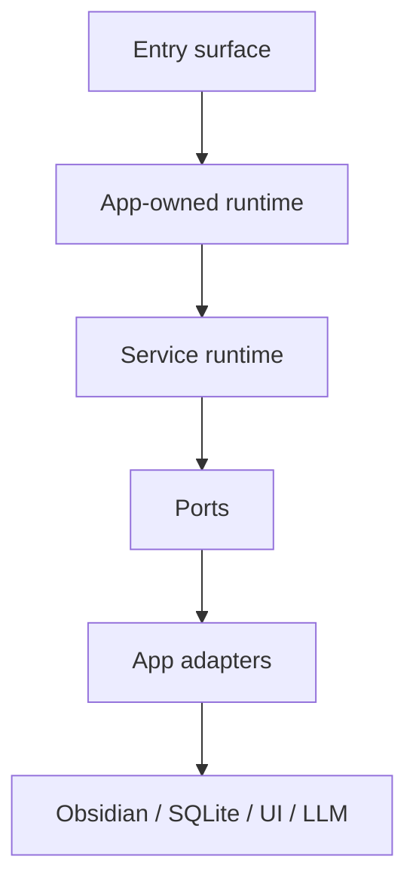
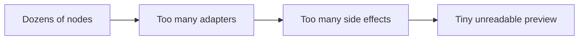
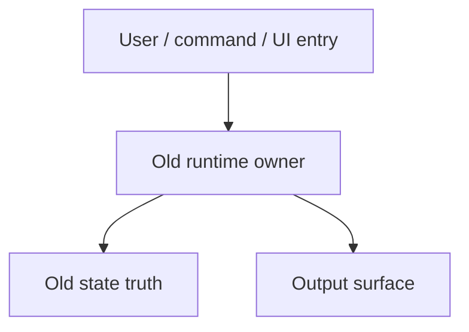
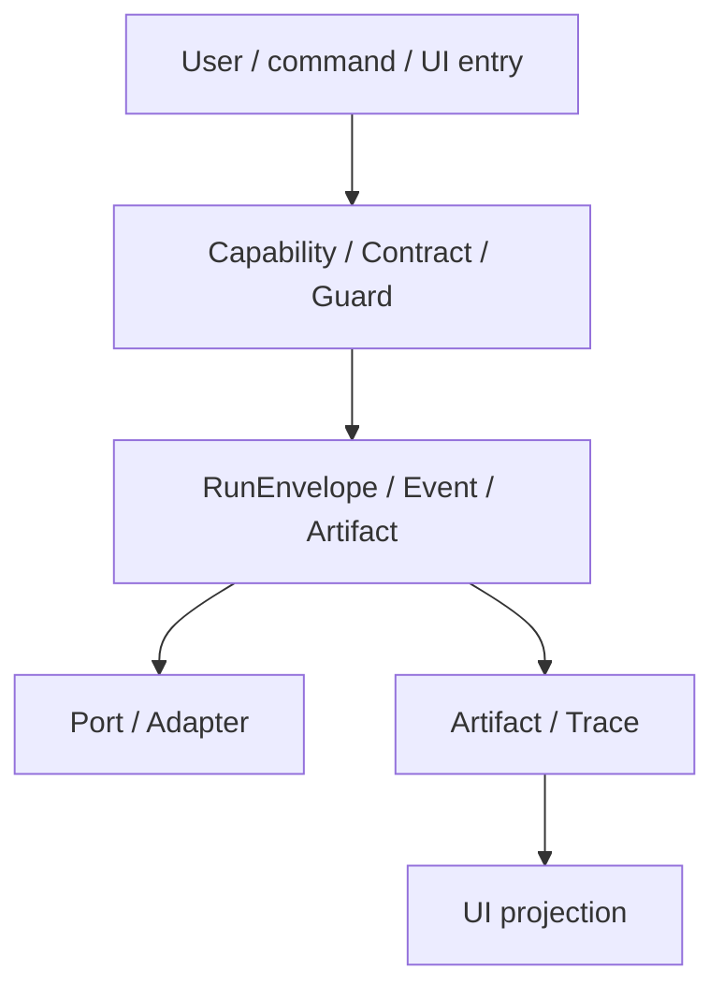
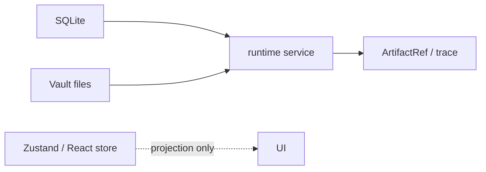
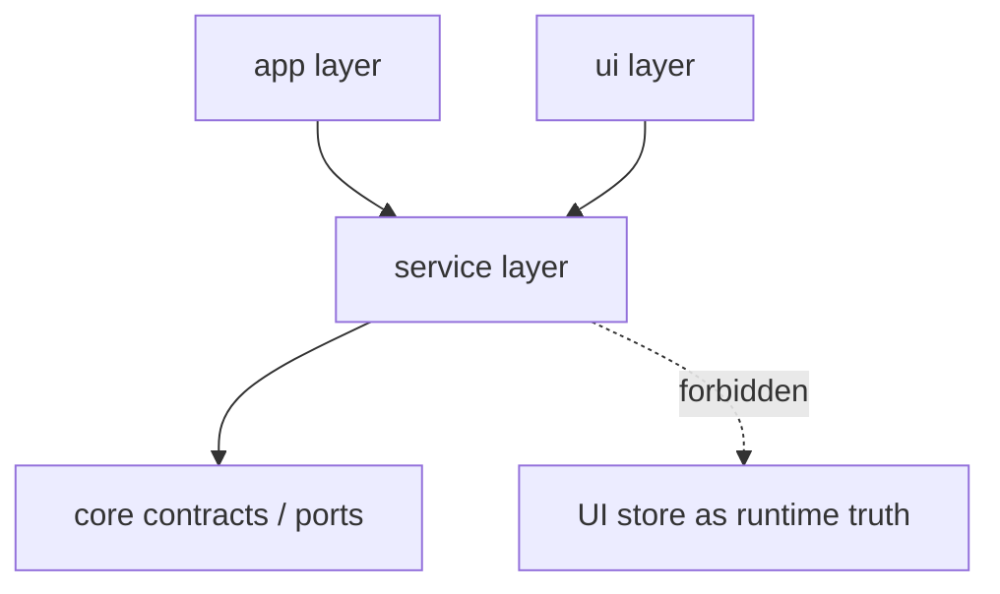

# Owner Review Packet Template

Codex writes this after Claude Code completes one implementation task and commits. The goal is not only to review code. The goal is to help the user understand whether the project became more elegant, modular, and controllable.

Owner-facing language rule:

- Write the packet in Chinese first.
- Keep code symbols, file names, commands, test names, interface names, and commit messages in English.
- Explain architecture terms the first time they matter, especially `Inventory`, `Port`, `Adapter`, `Capability Contract`, and `RunEnvelope`.
- Put the user decision near the top, before detailed evidence.

## Packet Header

```md
# Owner Review Packet: <Task ID and Name>

Claude Code commit:
- <hash> <message>

Source-of-truth docs checked:
- Main handbook:
- Ambient spec:
- Command Gateway spec:

Verdict:
- Accepted / Needs changes / Blocked

Owner decision:
- <用户现在要决定什么>

Global position:
- <这一轮在 T0-T12 里的位置，以及为什么不是在做产品功能本身>
```

## 0. Review Entry Points

List the documents the user should open first. When Codex reports this packet in chat, it must also provide clickable absolute file links for these entries.

| Review item | Status | Why open it |
| --- | --- | --- |
| This Owner Review Packet | Final / Draft | Main review surface for this task. |
| Claude Code implementation note | Source evidence | Shows what Claude claims it changed and verified. |
| Relevant handoff | Source contract | Shows what Claude was allowed to do. |
| Companion audit / baseline | Evidence | Shows before/after or diagnostic evidence. |
| Next handoff / draft | Pending approval | Shows the proposed next action, if any. |

## 0.5 Code Reading Guide

List changed code files in the order the owner should read them. This section is required for every code-changing task.

| Order | File | What to inspect | Why it matters |
| ---: | --- | --- | --- |
| 1 | `<file>` | `<function / class / type>` | `<main boundary or behavior change>` |
| 2 | `<file>` | `<function / class / type>` | `<supporting wiring or adapter>` |
| 3 | `<test file>` | `<test names / source scan>` | `<proof that the change is guarded>` |

Reading notes:

- Read first:
- Then read:
- Optional / only if debugging:
- Files intentionally not changed:
- If this breaks later, open this file first:

## 0.6 Visual Dependency Maps

Every code-changing Owner Review Packet must include visual maps. The owner should be able to understand the runtime shape before reading the file list.

Keep diagrams small. One diagram should answer one question. Prefer several 4-8 node Mermaid diagrams over one huge all-in-one graph. ASCII arrow diagrams may be used as an explanation under the rendered diagram, but they are not a substitute for visual maps.

Required maps for implementation tasks:

1. Runtime / dependency ownership map:
   - entry surfaces;
   - app-level composition and runtime owner;
   - service runtime / ports;
   - app adapters;
   - external side effects.

2. Main sequence map:
   - one representative user or system trigger;
   - runtime call path;
   - port calls;
   - projection / persistence outcome.

3. State ownership map:
   - durable state;
   - runtime state;
   - UI projection;
   - old state owner removed or preserved.

4. Old-path deletion / guard map:
   - deleted or moved old paths;
   - new accepted path;
   - tests / source guards / boundary audit that prevent regression.

Use Mermaid by default. Keep labels short and owner-facing:



Do not replace diagrams with long prose tables unless the task is pure documentation or diagnostic-only.

Avoid:



Supplement with ASCII only when it clarifies the rendered diagram:

```text
service runtime
  -> port
    -> app adapter
      -> side effect
```

## 1. One-Sentence Outcome

What changed in plain language?

```md
This task <introduced / measured / replaced / deleted / projected> <boundary or capability> so that <control benefit>.
```

中文说明:

- 这一轮做了什么:
- 为什么这让项目更可控:
- 它没有做什么:

## 2. Before Runtime Path



Explain:

- Entry:
- Runtime owner:
- State truth:
- Output:
- Why this was hard to control:

## 3. After Runtime Path



Explain:

- New entry:
- New runtime owner:
- New state truth:
- Surface projection:
- How this lowers change radius:

## 4. State Ownership Map



Mark each state source:

| State | Owner | Consumers | Still ambiguous? |
| --- | --- | --- | --- |
|  |  |  |  |

## 4.5 Mutable Global State Check

List module-level mutable defaults, singleton registries, or hidden service-locator state touched by this task.

| Item | File | Introduced / Preserved / Removed | Accepted? | Retirement path |
| --- | --- | --- | --- | --- |
| `defaultX` | `<file>` | Introduced / Preserved / Removed | Yes / No / Temporary | `<future task or target architecture>` |

Questions:

- Did this task introduce a new `let defaultX = null` style mutable global?
- If yes, why was constructor injection / RunEnvelope / app composition not enough?
- Is it centralized in an app-level composition place or scattered in a service/core/port module?
- Is it fail-loud and cleared on unload if needed?
- What future task should remove or replace it?

## 4.6 Runtime Ownership Check

List where capability runtimes are composed, stored, and passed.

| Runtime | Owner before | Owner after | App-level composition point | Service-layer singleton? | Accepted? |
| --- | --- | --- | --- | --- | --- |
| `<runtime>` |  |  |  | Yes / No | Yes / No / Needs fix |

Questions:

- Did this task add or preserve `let currentRuntime = null` + `set/getRuntime` in a service-layer file?
- If a runtime is long-lived, is it owned by `main.ts`, `AppContext`, or an app-owned registry?
- Do service-layer files import `AppContext` to find runtime dependencies?
- Are runtime dependencies visible from constructors, ports, UI context, or `RunEnvelope` options?
- Is unload / teardown ownership clear?

## 4.7 Config Defaults Ownership Check

List product/domain config defaults touched by this task.

| Config | Editable source | Compiled fallback | Loader / adapter | Inline in service engine? | Drift guard |
| --- | --- | --- | --- | --- | --- |
| `<config>` | `templates/config/...` | `<defaults file>` | `<adapter>` | Yes / No | `<test / rg check>` |

Questions:

- Did this task add or preserve a large `DEFAULT_*_CONFIG` object inside a service engine?
- Are thresholds, weights, labels, regexes, colors, and timing knobs discoverable without reading engine logic?
- Does the fallback file document which `templates/config/*.json` it mirrors?
- Is there a test or source-scan guard preventing template/fallback drift?
- If no template exists, is that explicitly justified?

## 5. Module Boundary Map



Explain:

- Boundary improved:
- Boundary still weak:
- New abstraction justified by:
- New abstraction risk:

## 6. Key Files To Read

Group files by learning path, not by git order.

| Read order | File | Why it matters |
| --- | --- | --- |
| 1 |  |  |
| 2 |  |  |
| 3 |  |  |

## 7. Old Path Deletion / Reduction

| Old path | Status | Evidence | Remaining risk |
| --- | --- | --- | --- |
|  | Deleted / Thin forwarding / Still active |  |  |

If old and new paths both still own behavior, the task is not accepted.

## 8. Verification

| Check | Result | Notes |
| --- | --- | --- |
| `npm run build` |  |  |
| targeted tests |  |  |
| old-path `rg` checks |  |  |
| manifest / assets if touched |  |  |

## 9. Elegance Score

Use the rubric in [`architecture-scorecard.md`](./architecture-scorecard.md).

| Dimension | Code | Before | After | Delta | Confidence | Reason / evidence |
| --- | --- | ---: | ---: | ---: | --- | --- |
| Architecture clarity | AC |  |  |  |  |  |
| Capability semantics | CS |  |  |  |  |  |
| Dependency direction | DD |  |  |  |  |  |
| Modularity / cohesion | MC |  |  |  |  |  |
| Side-effect isolation | SI |  |  |  |  |  |
| Single runtime path | SR |  |  |  |  |  |
| State ownership clarity | SO |  |  |  |  |  |
| Observability / trace | OT |  |  |  |  |  |
| Testability / fake-port readiness | TF |  |  |  |  |  |
| Old-path deletion | OD |  |  |  |  |  |
| Change radius | CR |  |  |  |  |  |
| Owner comprehension | OC |  |  |  |  |  |
| Overall elegance | Overall |  |  |  |  |  |

Grouped indices:

| Group | Before | After | Delta | Reason |
| --- | ---: | ---: | ---: | --- |
| Control Index |  |  |  | AC + OT + OC |
| Boundary Index |  |  |  | DD + MC + SI + CR |
| Runtime Truth Index |  |  |  | SR + SO + CS |
| Verification Index |  |  |  | TF + OD |

Optional task dimensions, if relevant:

| Optional dimension | Code | Score | Evidence |
| --- | --- | ---: | --- |
| UI surface stability | UX |  |  |
| Backward compatibility / migration safety | BC |  |  |
| Performance / cost containment | PC |  |  |
| Security / permission boundary | SC |  |  |
| Developer experience | DX |  |  |
| Documentation / handoff quality | DOC |  |  |

## 10. What The User Should Understand

After reading this packet, the user should be able to answer:

1. What is the new runtime path?
2. Where is the state truth?
3. Which side effects are behind ports or adapters?
4. Which old path was removed or downgraded?
5. If this breaks, which file should I inspect first?
6. How would I inspect or replay this run?
7. What does this unlock next?
8. What should not be touched in the next task?
9. Who owns runtime composition?
10. Where do product/domain defaults live?

## 11. Next Task

```md
Recommended next task:
- <Task ID>

Why now:
- ...

Do not do next:
- ...

Codex should prepare:
- ...
```

## 12. Review Verdict

```md
Verdict:
- Accepted / Needs changes / Blocked

Reason:
- ...

Required follow-up before next task:
- ...
```
