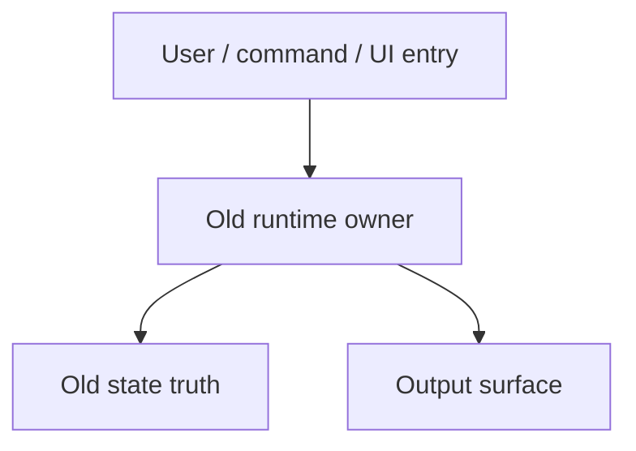
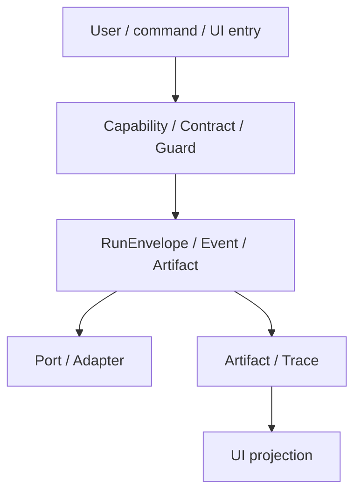
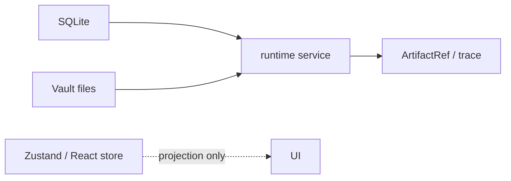
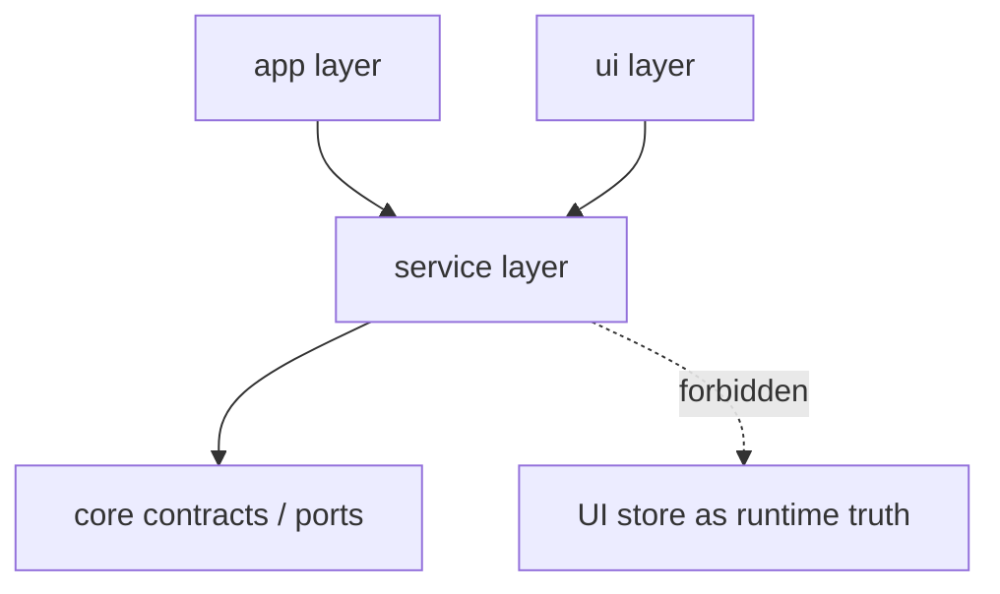

# Owner Review Packet Template

Codex writes this after Claude Code completes one implementation task and commits. The goal is not only to review code. The goal is to help the user understand whether the project became more elegant, modular, and controllable.

## Packet Header

```md
# Owner Review Packet: <Task ID and Name>

Claude Code commit:
- <hash> <message>

Source-of-truth docs checked:
- Main handbook:
- Ambient spec:
- Command Gateway spec:

Verdict:
- Accepted / Needs changes / Blocked
```

## 1. One-Sentence Outcome

What changed in plain language?

```md
This task <introduced / measured / replaced / deleted / projected> <boundary or capability> so that <control benefit>.
```

## 2. Before Runtime Path



Explain:

- Entry:
- Runtime owner:
- State truth:
- Output:
- Why this was hard to control:

## 3. After Runtime Path



Explain:

- New entry:
- New runtime owner:
- New state truth:
- Surface projection:
- How this lowers change radius:

## 4. State Ownership Map



Mark each state source:

| State | Owner | Consumers | Still ambiguous? |
| --- | --- | --- | --- |
|  |  |  |  |

## 5. Module Boundary Map



Explain:

- Boundary improved:
- Boundary still weak:
- New abstraction justified by:
- New abstraction risk:

## 6. Key Files To Read

Group files by learning path, not by git order.

| Read order | File | Why it matters |
| --- | --- | --- |
| 1 |  |  |
| 2 |  |  |
| 3 |  |  |

## 7. Old Path Deletion / Reduction

| Old path | Status | Evidence | Remaining risk |
| --- | --- | --- | --- |
|  | Deleted / Thin forwarding / Still active |  |  |

If old and new paths both still own behavior, the task is not accepted.

## 8. Verification

| Check | Result | Notes |
| --- | --- | --- |
| `npm run build` |  |  |
| targeted tests |  |  |
| old-path `rg` checks |  |  |
| manifest / assets if touched |  |  |

## 9. Elegance Score

Use the rubric in [`architecture-scorecard.md`](./architecture-scorecard.md).

| Dimension | Before | After | Delta | Reason |
| --- | ---: | ---: | ---: | --- |
| Architecture clarity |  |  |  |  |
| Modularity |  |  |  |  |
| Single runtime path |  |  |  |  |
| State ownership clarity |  |  |  |  |
| Testability / fake-port readiness |  |  |  |  |
| Old-path deletion |  |  |  |  |
| Overall elegance |  |  |  |  |

## 10. What The User Should Understand

After reading this packet, the user should be able to answer:

1. What is the new runtime path?
2. Where is the state truth?
3. Which old path was removed or downgraded?
4. If this breaks, which file should I inspect first?
5. What does this unlock next?

## 11. Next Task

```md
Recommended next task:
- <Task ID>

Why now:
- ...

Do not do next:
- ...

Codex should prepare:
- ...
```

## 12. Review Verdict

```md
Verdict:
- Accepted / Needs changes / Blocked

Reason:
- ...

Required follow-up before next task:
- ...
```
