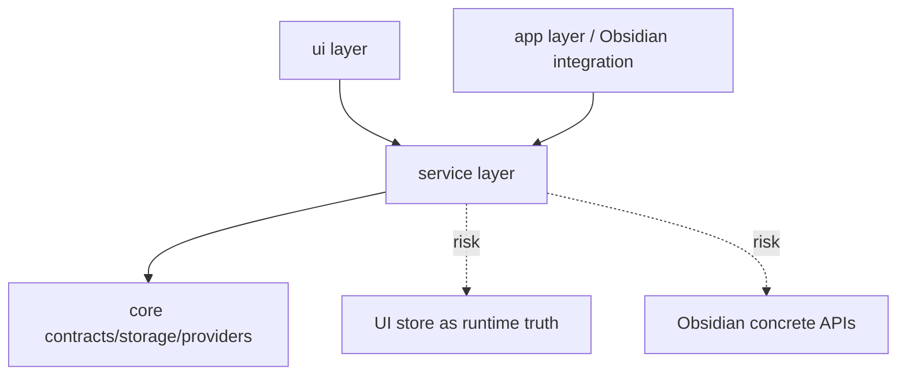
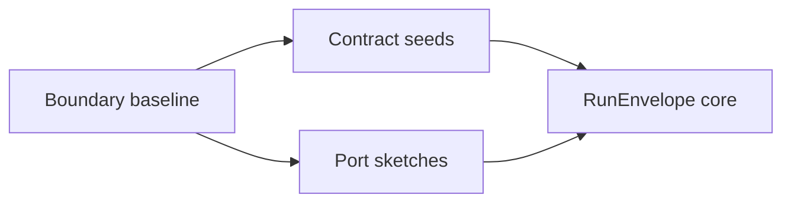

# T0 Boundary Baseline Handoff

This is the first Claude Code implementation handoff for the large modernization. It is intentionally conservative.

T0 is not a feature rewrite. T0 creates visibility and guardrails so later tasks can improve modularity without guessing.

## Send To Claude Code

```md
# Peak Assistant Modernization: T0 Boundary Baseline

Branch:
codex/peak-modernization-refactor

Source-of-truth docs:
- docs/superpowers/specs/2026-06-01-peak-system-architecture-modernization-handbook.html
- docs/superpowers/specs/2026-06-02-ambient-push-current-work-state-product-technical-review.html
- docs/superpowers/specs/2026-06-03-obsidian-plugin-command-gateway-capstone-review.html

Operating rules:
- Codex owns architecture reports, diagrams, review packets, and task design.
- Claude Code owns implementation only.
- Do not rewrite the architecture source-of-truth docs.
- Do not implement Ambient Push.
- Do not implement Command Gateway.
- Do not start T1/T2/T3 in this task.

Goal:
Create a boundary baseline for the current codebase so future modernization can measure and reduce cross-layer coupling, dual runtime paths, and unclear state ownership.

Allowed changes:
- Add a lightweight boundary audit script, test, or report generator if appropriate.
- Add documentation under docs/superpowers/refactor-ops/ or docs/superpowers/audits/ if needed to record T0 findings.
- Add small static checks that can run locally without Obsidian.
- Add package.json scripts only if they are clearly scoped and non-disruptive.

Not allowed:
- Do not move large service files.
- Do not refactor Chat/Search/Copilot behavior.
- Do not change UI behavior.
- Do not add Capability Contract, RunEnvelope, or Port implementation yet.
- Do not introduce a new runtime path.
- Do not delete old code unless it is dead and proven unused by this T0 audit.

Required read-only investigation before editing:
1. Inspect the four-layer architecture:
   - app/
   - core/
   - service/
   - ui/
2. Identify current boundary risks:
   - service importing UI or Obsidian concrete APIs directly
   - UI owning long-running runtime state
   - app/context leaking into service logic
   - duplicate execution paths for the same product capability
   - tool/provider/schema coupling that will block ToolDef/Port extraction
3. Produce a short investigation note before coding:
   - files inspected
   - current suspected boundary violations
   - proposed T0 artifact
   - risks
   - exact files you intend to edit
   - stop if the scope looks bigger than T0

Implementation target:
Prefer one of these shapes:

Option A: Boundary audit script
- Add a script that scans imports and reports suspicious cross-layer dependencies.
- It should be conservative: report findings, not fail CI yet.

Option B: Boundary audit document only
- If a script would be brittle, create a concise audit report with evidence and recommended next checks.

Option C: Script + initial baseline report
- Best if cheap: generate a baseline report committed under docs/superpowers/audits/.

Acceptance criteria:
- T0 produces a repeatable baseline or explicit evidence map.
- It does not change product behavior.
- It does not start implementing the target architecture.
- It identifies at least:
  - cross-layer import risks
  - old runtime path risks
  - state ownership ambiguity risks
  - likely first capability candidates for T4/T9
- It has a clear command or manual procedure to refresh the baseline.

Required verification:
- npm run build
- Run any new script/test added for T0.
- Confirm git diff contains no generated images or binary design assets.

Implementation note required after commit:
- commit hash and message
- what T0 artifact was added
- how to run it
- top 5 findings
- what should be T1/T2 input
- what was intentionally not changed
```

## Codex Review Focus After Claude Code Finishes

Codex should write an Owner Review Packet and focus on:

1. Did T0 stay diagnostic, or did it accidentally start refactoring?
2. Does the baseline help the user understand the codebase better?
3. Are the findings evidence-backed by files/imports/runtime paths?
4. Does it identify where T1 Contract Seeds and T2 Port Sketches should begin?
5. Are there any hidden attempts to create a second architecture instead of measuring the current one?

## Expected Diagrams In Owner Review Packet





## T0 Is Complete When

- The user can name the top boundary risks.
- The user can explain why T1/T2 should start where they start.
- Claude Code has not changed business behavior.
- Codex can score baseline confidence in the Owner Review Packet.
