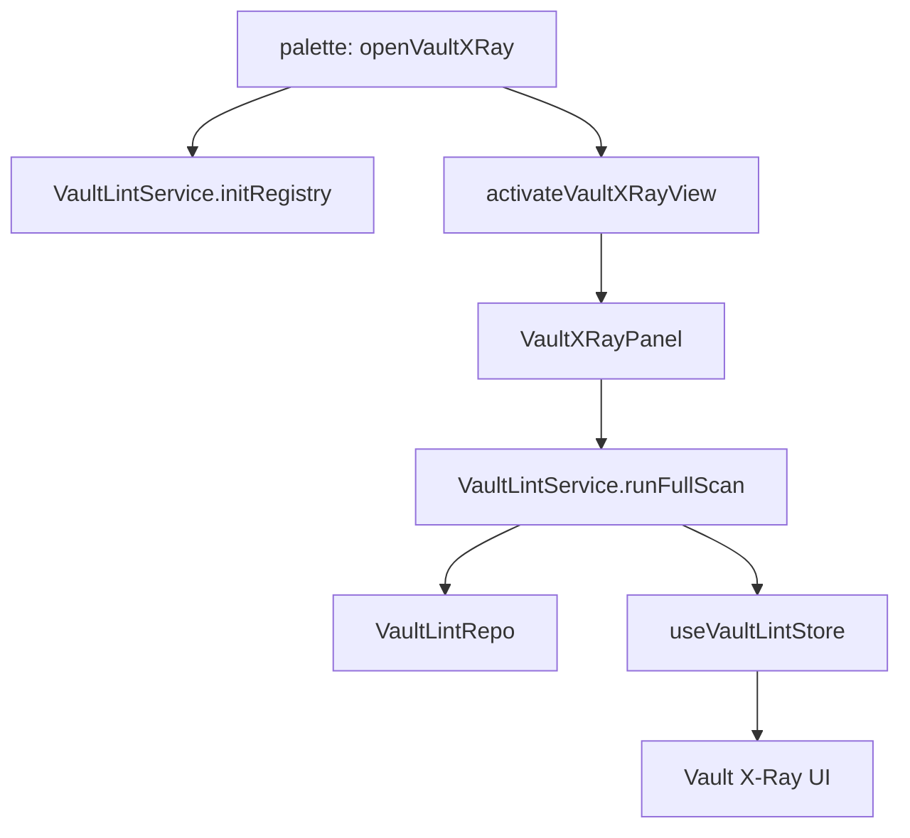
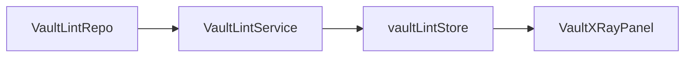

# T1 Vault Lint Contract Seed Handoff

This is the next Claude Code handoff after T0. It is intentionally small. The goal is to name and document the first capability contract without moving runtime ownership yet.

Do not send T2 until T1 has been reviewed by Codex and accepted by the user.

## Send To Claude Code

```md
# Peak Assistant Modernization: T1 Vault Lint Contract Seed

Branch:
codex/peak-modernization-refactor

Source-of-truth docs:
- docs/superpowers/specs/2026-06-01-peak-system-architecture-modernization-handbook.html
- docs/superpowers/specs/2026-06-02-ambient-push-current-work-state-product-technical-review.html
- docs/superpowers/specs/2026-06-03-obsidian-plugin-command-gateway-capstone-review.html
- docs/superpowers/audits/2026-06-12-t0-findings.md
- docs/superpowers/audits/2026-06-12-t0-owner-review-packet.md

Current operating rules:
- Codex owns architecture reports, diagrams, task design, and review packets.
- Claude Code owns implementation only.
- Do not rewrite the final architecture source-of-truth docs.
- Do not implement Ambient Push.
- Do not implement Command Gateway.
- Do not touch Chat, Quick Search, or Copilot in this task.

Goal:
Create the first capability contract seed for Vault Lint so the project has one concrete example of capability id, inputs, outputs, state owner, side effects, and AppContext dependency inventory.

This task should improve:
- Architecture clarity: make the Vault Lint runtime path explicit.
- Capability semantics: name Vault Lint as a product capability, not only a service/view/store trio.
- Owner comprehension: make it easy for the user to explain what Vault Lint reads, writes, and will later emit through RunEnvelope.

This task must NOT claim to improve:
- Single runtime path.
- Old-path deletion.
- RunEnvelope.
- Port extraction.

Those come later.

Allowed changes:
- Add a small contract/inventory file next to the current capability, preferably under `src/service/lint/`.
- Add a focused test for contract constants or contract shape if useful.
- Add or update a small docs/audit note if implementation evidence needs to be recorded.
- Update `docs/superpowers/refactor-ops/architecture-scorecard.md` only if the implementation creates a new accepted checkpoint.

Recommended code shape:
- Prefer a new file such as `src/service/lint/VaultLintContract.ts`.
- Export only stable contract seed values and types. Do not wire them deeply yet.
- Suggested symbols:
  - `VAULT_LINT_CAPABILITY_ID = 'vault.lint.scan'`
  - `VaultLintCapabilityInput`
  - `VaultLintCapabilityOutput`
  - `VaultLintProgressEvent`
  - `VaultLintDependencyInventory`
  - `VAULT_LINT_CURRENT_DEPENDENCIES`
- Keep existing runtime behavior in `VaultLintService` unchanged unless a tiny type import is needed.

Not allowed:
- Do not create `src/core/capabilities` or add new contracts under `core/` in this task.
- Do not move `core/document/loader/*`.
- Do not move `core/providers/rerank/llm.ts`.
- Do not introduce RunEnvelope.
- Do not introduce a port implementation.
- Do not remove `useVaultLintStore` yet.
- Do not rewrite `VaultXRayPanel` or `VaultXRayView`.
- Do not broaden into Morning Briefing, Chat, Ambient, Search, or Copilot.

Important architecture decision:
T0 found that current `core/` imports upstream layers. Until the `core` placement question is settled, T1 contract seeds should live beside the owning capability (`src/service/lint/`) rather than under `src/core/`.
```

## Required First Response From Claude Code

Claude Code must not edit files before answering this section.

````md
## Read-only investigation

Files inspected:
- `src/service/lint/VaultLintService.ts`
- `src/service/lint/types.ts`
- `src/service/lint/SignalRegistry.ts`
- `src/service/lint/HealthScoreEngine.ts`
- `src/ui/store/vaultLintStore.ts`
- `src/ui/view/vault-lint/VaultXRayPanel.tsx`
- `src/ui/view/vault-lint/VaultXRayView.ts`
- `src/app/commands/PeakCommandActions.ts`
- existing Vault Lint tests

Current runtime path:


Current state ownership:


AppContext / singleton dependency inventory:
- `AppContext.getInstance().manager.getTemplateManager?.()` in `loadConfig`
- `AppContext.getInstance().app.vault.getMarkdownFiles()` in `runFullScan`
- `sqliteStoreManager.getVaultLintRepo()`
- `SignalRegistry.getInstance()`
- `useVaultLintStore.getState()`

Current modularity problem:
- Service owns scan orchestration, config loading, repo access, vault access, and UI store projection.
- UI store is still runtime projection and partial runtime truth.

Proposed change boundary:
- Add contract seed only. Do not rewire runtime behavior yet.

Old path to delete, empty, or reduce:
- None in T1. This is a seed and inventory task.

Risks / stop conditions:
- Stop if the contract seed requires moving files into `core/`.
- Stop if the task starts changing UI behavior.
- Stop if you need to introduce RunEnvelope or ports to make the contract compile.
````

Wait for user approval before implementing.

## Implementation Requirements

If approved, implement the smallest useful contract seed:

1. Add the contract seed file beside Vault Lint.
2. Keep it dependency-light. It should import existing Vault Lint domain types if needed, but not AppContext, React, Zustand, Obsidian, SQLite, or service singletons.
3. Represent current dependencies explicitly as inventory, not as a new service locator.
4. Add a focused test only if it can run under the current Node test runner without Obsidian.
5. Do not touch user-facing UI.

Suggested contract contents:

```ts
export const VAULT_LINT_CAPABILITY_ID = 'vault.lint.scan' as const;

export interface VaultLintCapabilityInput {
  scanType: 'full';
  trigger: 'manual' | 'startup' | 'scheduled';
}

export interface VaultLintProgressEvent {
  phase: 'init' | 'scanning' | 'persisting' | 'complete' | 'error';
  detector?: string;
  processed?: number;
  total?: number;
  message?: string;
}

export interface VaultLintCapabilityOutput {
  scanId: string;
  healthScore: number;
  totalNotes: number;
  findingCount: number;
}
```

This is a suggested shape, not a required exact API. Prefer the smallest API that reflects existing runtime truth.

## Required Verification

Run:
- `npm run build`
- `npm run test -- test/vault-lint-structural.test.ts`
- `npm run test -- test/vault-lint-repo.test.ts`
- `node scripts/audit/boundary-baseline.mjs --out /tmp/t1-boundary-baseline.md`

Also run if you add a contract test:
- `npm run test -- <new test file>`

Required `rg` checks:
- `rg -n "VAULT_LINT_CAPABILITY_ID|VaultLintCapability" src test docs`
- `rg -n "from ['\"]@/core/capabilities|src/core/capabilities" src test docs`

Expected audit result:
- T1 may add files.
- T1 should not increase service->ui edges.
- T1 should not add new core->upstream edges.

## Implementation Note Required From Claude Code

After implementation and commit, report:

```md
## Implementation note

Commit:
- <hash and message>

Changed files grouped by purpose:
- Contract seed:
- Tests:
- Docs:

Runtime behavior:
- unchanged / changed (explain)

Dependency inventory captured:
- ...

Verification:
- ...

Boundary audit delta:
- service->ui:
- core->upstream:
- service/core->Obsidian side-effect:

Known remaining old paths:
- `VaultLintService` still writes `useVaultLintStore`.
- `VaultLintService` still resolves `AppContext`.
- No RunEnvelope yet.
- No ports yet.

Suggested next task:
- T2 first Port sketch, or T1B contract seed for Morning Briefing.
```

## Codex Review Focus After Claude Code Finishes

Codex should check:

1. Did T1 stay a contract seed, not a runtime rewrite?
2. Is the contract dependency-light?
3. Did the task avoid adding new files under the currently dirty `core/` boundary?
4. Can the user explain Vault Lint's input, output, state owner, and side effects?
5. Did boundary counts stay stable or improve?
6. Did the implementation note admit that no old path was deleted yet?

## T1 Is Complete When

- The project has one concrete capability id for Vault Lint.
- The current Vault Lint dependencies are explicitly listed.
- The user can explain why Vault Lint is the first pilot and why Chat/Ambient are not.
- No second runtime path was created.
- Codex can write an Owner Review Packet with a clearer Capability Semantics score.
