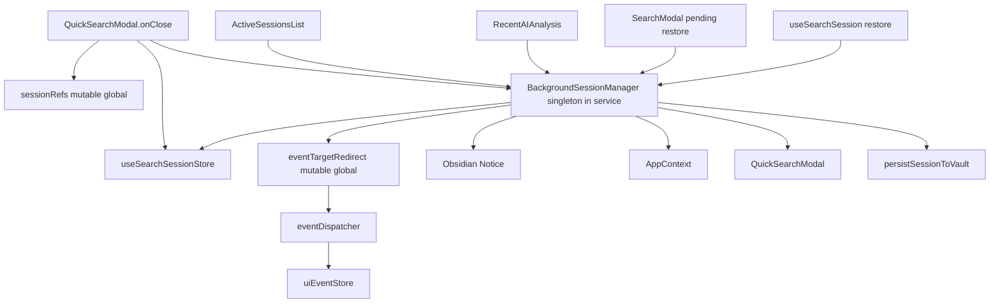
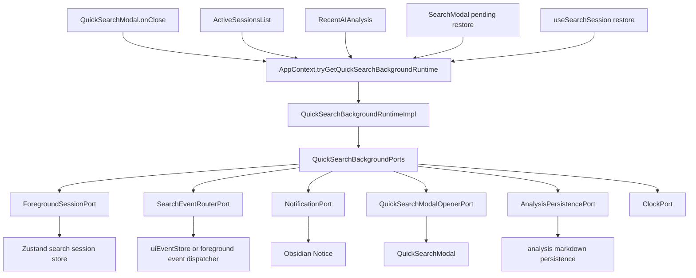
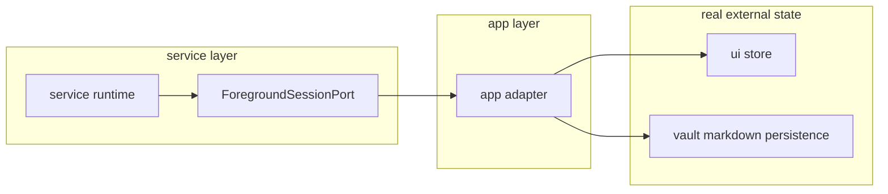
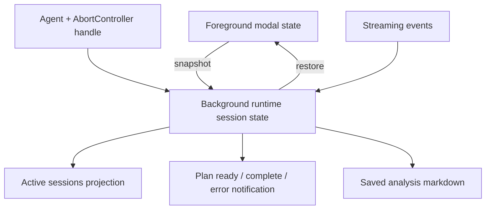
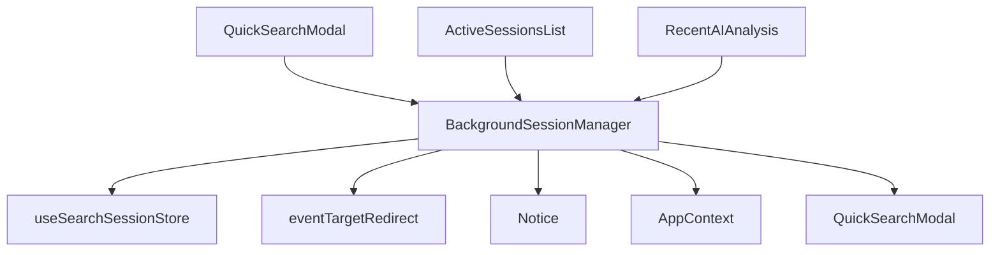
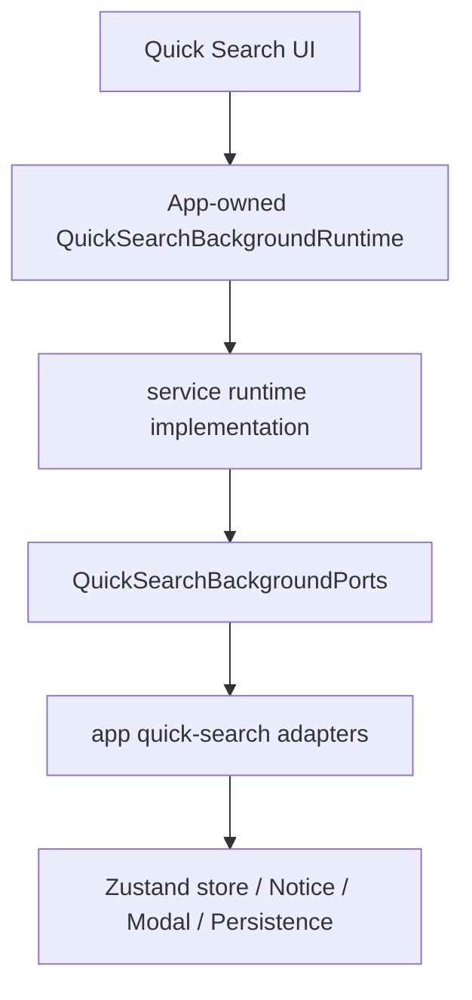
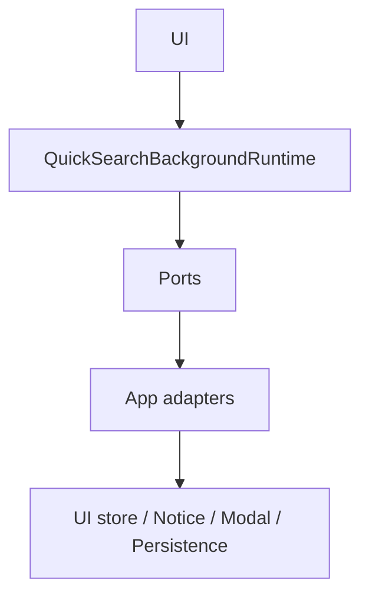

# Peak Assistant Modernization Handoff: T10 Quick Search Background Session Runtime Boundary Wave

## 中文摘要

T7/T8/T9 已经证明同一套现代化模式可以重复使用：

```text
UI / command -> AppContext runtime -> service runtime -> ports -> app adapters -> side effects
```

T10 建议切到 **Quick Search 后台会话**。这是目前剩余边界问题里最适合做“大一点”的一轮：它不是 Chat 全局重构，也不是全部 Quick Search 重写，但它覆盖一个完整用户流程：

```text
用户关闭 Quick Search modal
-> 当前 AI analysis session 继续在后台跑
-> Active Sessions / Recent AI Analysis 可以看到它
-> 用户可以 restore / cancel
-> session 事件继续写进后台 snapshot
-> plan ready / complete / error 时弹通知并能重新打开 modal
```

当前这条流程由 `BackgroundSessionManager` 扛着，但它在 `src/service/` 里直接 import UI store、UI hook、QuickSearchModal、AppContext、Obsidian Notice。这正好违背我们现在已经确立的 runtime ownership / ports / adapters 规则。

T10 的目标是把它变成 app-owned `QuickSearchBackgroundRuntime`，让 service 层只保留后台会话业务逻辑和 ports，不再直接抓 UI / AppContext / Notice / modal。

这是一轮中等偏大的 boundary wave。预期 25-60 个文件，3-5 个小 commit。不要再做 2 行小修；但如果超过 80 个文件或必须重写整个 Quick Search streaming pipeline，就停下来汇报。

## Review Entry Points

| Review item | Status | Why open it |
| --- | --- | --- |
| This T10 handoff | Ready to send | 当前建议发给 Claude Code 的下一轮实现任务。 |
| [`2026-06-13-t9-owner-review-packet.md`](../audits/2026-06-13-t9-owner-review-packet.md) | Previous accepted packet | T9 接受结论：下一步推荐 Quick Search / Background Session。 |
| [`README.md`](./README.md) | Operating rules | 包含 task size policy、runtime ownership rule、code reading guide rule、visual map rule。 |
| [`architecture-scorecard.md`](./architecture-scorecard.md) | Score ledger | T10 完成后由 Codex 更新分数和趋势。 |
| [`2026-04-18-background-multi-session-design.md`](../specs/2026-04-18-background-multi-session-design.md) | Historical reference | 旧后台多会话设计，只作参考，不是当前架构 source of truth。 |
| [`2026-06-01-peak-system-architecture-modernization-handbook.html`](../specs/2026-06-01-peak-system-architecture-modernization-handbook.html) | Source of truth | 主架构顺序和禁止双系统规则。 |

## Why T10 Is This Target

确认自当前代码和 T9 后 boundary baseline：

- `src/service/BackgroundSessionManager.ts` 是剩余 top offender 之一。
- 它在 service 层直接 import:
  - `@/ui/view/quick-search/store/searchSessionStore`
  - `@/ui/view/quick-search/hooks/useEventRouter`
  - `@/ui/view/QuickSearchModal`
  - `@/app/context/AppContext`
  - `obsidian` 的 `Notice`
- UI 又反向调用 `BackgroundSessionManager.getInstance()` 和 `BackgroundSessionManager.pendingRestore`:
  - `QuickSearchModal.tsx`
  - `SearchModal.tsx`
  - `ActiveSessionsList.tsx`
  - `RecentAIAnalysis.tsx`
  - `useSearchSession.ts`
- `eventTargetRedirect` 是一个 exported mutable global，用来让后台 session 接住 streaming event。
- `sessionRefs` 是另一个 module-level mutable holder，用来在 React unmount 后保留 agent / abort controller。

这不是单个 import cleanup。它是一个完整 runtime ownership 问题：

- 谁拥有后台 session 列表？
- 谁拥有 pending restore？
- 谁拥有 streaming event redirect？
- 谁拥有 foreground Zustand store 的 snapshot / restore？
- 谁有资格打开 Obsidian Notice 和 QuickSearchModal？
- service 层到底还能不能知道 UI store？

T10 要回答这些问题。

## Current Shape



How to read this:

- 左侧是用户入口：关闭 modal、Active Sessions、Recent AI Analysis、restore/cancel。
- 中间是 `BackgroundSessionManager`，名义在 service，实际同时管 UI store、modal、notice、event redirect、persistence。
- 右侧是副作用和可变全局。
- 问题不是 UI 调 runtime，而是 service 直接知道太多真实世界对象。

## Target Shape



Target rules:

- `src/service/search/background/*` 或等价 service namespace 只定义 runtime、session state、ports、plain logic。
- `src/app/quick-search/background/*` 或等价 app namespace 负责 adapter composition。
- UI 可以通过 `AppContext.tryGetQuickSearchBackgroundRuntime()` 使用 runtime。
- App adapters 可以碰 UI store，因为 app 层就是 composition / projection 边界。
- Service 层不能碰 UI store、UI hook、QuickSearchModal、AppContext、Obsidian Notice。

## UI Store / SQLite / App Adapter 解耦图

这张图解释“为什么 app adapter 仍然可以 import UI store”。



The rule:

```text
service -> port interface
app adapter -> real UI store / vault / Obsidian / AppContext
```

所以不是“任何地方都不能引用 UI store”。真正的规则是：

- service 不能把 UI store 当运行时真相。
- app adapter 可以把 UI store 包成一个 port。
- UI store 仍然是 foreground modal projection。
- 后台 session 真相应该属于 background runtime。

## State Ownership Map



Ownership rules after T10:

- Foreground modal state can remain in Zustand.
- Detached background session state belongs to `QuickSearchBackgroundRuntime`.
- Active Sessions UI is a projection of runtime state.
- Pending restore belongs to runtime, not static `BackgroundSessionManager.pendingRestore`.
- Notification opening belongs to app adapter, not service.
- Agent / abort handles should not be exposed as ad hoc UI globals if they can be moved into runtime/session handles.

## Scope Boundary

Do this in T10:

- Replace production `BackgroundSessionManager.getInstance()` usage with app-owned runtime access.
- Remove production dependency on `BackgroundSessionManager.pendingRestore`.
- Move background session ownership into `AppRuntimeRegistry` / `AppContext`.
- Introduce explicit ports for foreground snapshot/restore, event routing, notification, modal opening, persistence, and clock.
- Move or re-home pure background session types so service no longer imports UI store types.
- Remove service imports of UI store, UI hook, QuickSearchModal, AppContext, and Obsidian Notice.
- Keep visible user behavior the same for detach, restore, cancel, plan-ready notice, complete notice, and error notice.
- Add fake-port runtime tests and source guards.

Do not do this in T10:

- Do not rewrite all Quick Search analysis modes.
- Do not refactor `VaultSearchAgent`, `AIGraphAgent`, `ReportOrchestrator`, graph stores, or history replay unless strictly needed for the background session boundary.
- Do not redesign Quick Search UI.
- Do not change persisted analysis markdown format.
- Do not change search ranking, vector search, embedding, or AI prompts.
- Do not start Chat modernization, Current Work State, Ambient Push, Copilot Action Registry, or Command Gateway.
- Do not introduce a new service-layer `let currentRuntime = null` or another scattered singleton.
- Do not leave old and new background session paths both owning production behavior.

## Send To Claude Code

````md
# Peak Assistant Modernization: T10 Quick Search Background Session Runtime Boundary Wave

Branch:
codex/peak-modernization-refactor

Source-of-truth docs:
- docs/superpowers/specs/2026-06-01-peak-system-architecture-modernization-handbook.html
- docs/superpowers/refactor-ops/README.md
- docs/superpowers/audits/2026-06-13-t9-owner-review-packet.md
- docs/superpowers/refactor-ops/t10-quick-search-background-session-runtime-boundary-wave-handoff.md

Current operating rules:
- Codex owns architecture reports, handoff prompts, scorecards, and owner review packets.
- Claude Code owns implementation.
- Owner-facing explanations should be Chinese-first.
- Commit messages must be English.
- This is a boundary wave, not a tiny one-file cleanup.
- Target size: 25-60 changed files is acceptable if coherent.
- Use 3-5 small commits if it helps review, but provide one final implementation note.
- Every implementation note must list changed code files and guide the owner through reading the code.

## Goal

Move Quick Search background sessions from `BackgroundSessionManager` service singleton + UI store imports + exported mutable globals to an app-owned `QuickSearchBackgroundRuntime` with explicit ports and app adapters.

After T10:

1. Production code should not call `BackgroundSessionManager.getInstance()`.
2. Production code should not read or write `BackgroundSessionManager.pendingRestore`.
3. `src/service/BackgroundSessionManager.ts` should be deleted, renamed into a plain runtime implementation, or retired from production path.
4. Service-side background runtime code should not import:
   - `@/ui/view/quick-search/store/searchSessionStore`
   - `@/ui/view/quick-search/hooks/useEventRouter`
   - `@/ui/view/QuickSearchModal`
   - `@/app/context/AppContext`
   - `obsidian` `Notice`
5. Long-lived runtime ownership should live in `AppRuntimeRegistry` / `AppContext`.
6. Background session behavior should remain unchanged:
   - close modal while analysis is running or plan-ready;
   - session continues in background;
   - active session list updates;
   - restore returns the snapshot to the foreground modal;
   - cancel aborts the running session;
   - plan ready / complete / error notices still appear;
   - clicking a notice can reopen Quick Search and restore the session.

## Read-only checkpoint required first

Do this checkpoint first. Then continue implementation in the same Claude session if no stop condition appears.

```md
## Read-only checkpoint - T10 Quick Search Background Session

中文摘要:
- 当前后台会话入口:
- 当前 restore/cancel 入口:
- 当前 service -> UI imports:
- 当前 service -> AppContext / Obsidian imports:
- 当前 mutable globals:
- 当前 foreground store truth:
- 当前 background session truth:
- 当前 event redirect path:
- 当前 persistence path:
- 本轮建议拆成几个 commit:
- 预计 changed files 数量:
- 是否发现 stop condition:

Current old path:


Target path:


Proposed commit split:
- Commit 1: background runtime contracts, ports, pure session types, registry/context slot.
- Commit 2: app adapters and composition for foreground store, event routing, notification, modal opening, persistence.
- Commit 3: migrate UI callers from `BackgroundSessionManager` to app-owned runtime.
- Commit 4: retire old singleton/static pending restore/event redirect production usage; add source guards and fake-port tests.
```

Stop and report before editing if:

- This requires rewriting all of `useSearchSession.performAnalysis`.
- This requires changing AI analysis markdown persistence format.
- This requires touching Chat, Current Work State, Ambient, Copilot Action Registry, or Command Gateway.
- This requires modifying more than about 80 files.
- A foreground/background session cannot be restored with the existing snapshot shape.
- You cannot remove service imports of both UI store and QuickSearchModal in one coherent package.

## Files to inspect before editing

Primary old manager:

- `src/service/BackgroundSessionManager.ts`
  - `detachForeground`
  - `restoreToForeground`
  - `cancelSession`
  - `abortAll`
  - `buildSnapshotTarget`
  - `showSessionNotice`
  - `openModalAndRestore`

Foreground modal and hook:

- `src/ui/view/QuickSearchModal.tsx`
  - `onClose`
  - `sessionRefs`
  - `useSearchSessionStore`
- `src/ui/view/quick-search/SearchModal.tsx`
  - `BackgroundSessionManager.pendingRestore`
  - restore callbacks
  - active background session UX
- `src/ui/view/quick-search/hooks/useSearchSession.ts`
  - `sessionRefs`
  - `performAnalysis`
  - `restoreFromBackground`
  - `eventTargetRedirect` reset
- `src/ui/view/quick-search/hooks/useEventRouter.ts`
  - `eventTargetRedirect`
  - `useEventRouter`
- `src/ui/view/quick-search/hooks/eventDispatcher.ts`
  - `dispatchEvent`
  - `EventDispatchTarget`
  - note: this file is not fully service-safe while it imports UI event store.

Foreground state and snapshots:

- `src/ui/view/quick-search/store/searchSessionStore.ts`
  - `snapshotState`
  - `restoreFromSnapshot`
  - `resetAll`
- `src/ui/view/quick-search/store/sessionSnapshot.ts`
  - currently a useful seed, but it imports UI store types; do not pretend it is service-pure without splitting types.

Background session consumers:

- `src/ui/view/quick-search/components/ActiveSessionsList.tsx`
  - `useSyncExternalStore`
  - `subscribe`
  - `getSessions`
  - `cancelSession`
- `src/ui/view/quick-search/components/ai-analysis-sections/RecentAIAnalysis.tsx`
  - background session list
  - restore from recent analysis surface
  - QuickSearchModal opening path

Persistence and app wiring:

- `src/service/search/analysisDocPersistence.ts`
  - likely persistence adapter target, not a full rewrite target.
- `src/app/runtime/AppRuntimeRegistry.ts`
  - add `QuickSearchBackgroundRuntime` binding semantics.
- `src/app/context/AppContext.ts`
  - thin static delegators only.
- `main.ts`
  - compose and bind runtime during plugin boot; clear on unload.

## Required architecture shape

### 1. Runtime ownership

Add an app-owned runtime.

Suggested files, adjust names if local structure suggests a better namespace:

- `src/service/search/background/QuickSearchBackgroundRuntime.ts`
  - interface/type only;
  - no module-level runtime variable;
  - no `set/get current runtime` functions.
- `src/service/search/background/QuickSearchBackgroundRuntimeImpl.ts`
  - plain class implementation;
  - depends only on explicit ports.
- `src/service/search/background/QuickSearchBackgroundTypes.ts`
  - pure background session summaries, snapshots, restore result, detach input.
- `src/service/search/background/ports/QuickSearchBackgroundPorts.ts`
  - foreground/session/persistence/notification/modal/event/clock ports.
- `src/app/quick-search/background/composeQuickSearchBackgroundRuntime.ts`
  - constructs the runtime and adapters.
- `src/app/runtime/AppRuntimeRegistry.ts`
  - add:
    - `setQuickSearchBackgroundRuntime`
    - `getQuickSearchBackgroundRuntime`
    - `tryGetQuickSearchBackgroundRuntime`
    - `clearQuickSearchBackgroundRuntime`
- `src/app/context/AppContext.ts`
  - add thin delegators to the registry.

Suggested runtime methods:

```ts
export interface QuickSearchBackgroundRuntime {
  subscribe(listener: () => void): () => void;
  getSessions(): QuickSearchBackgroundSessionSummary[];
  detachForeground(input?: DetachForegroundInput): QuickSearchBackgroundSession | null;
  restoreToForeground(sessionId: string): QuickSearchBackgroundRestoreResult | null;
  requestRestore(sessionId: string): void;
  consumePendingRestore(): string | null;
  cancelSession(sessionId: string): void;
  abortAll(): void;
  dispose(): void;
}
```

If `requestRestore` / `consumePendingRestore` can be avoided with a cleaner modal opener API, prefer that. The key rule is: no static `BackgroundSessionManager.pendingRestore`.

### 2. Ports

Create explicit ports so service-side background runtime does not know UI/AppContext/Obsidian.

Suggested minimal ports:

```ts
export interface QuickSearchForegroundSessionPort {
  canDetach(): boolean;
  snapshot(): QuickSearchForegroundSnapshot;
  resetForeground(): void;
  restore(snapshot: QuickSearchForegroundSnapshot): void;
  getAgentHandle(): QuickSearchAgentHandle | null;
  bindAgentHandle(handle: QuickSearchAgentHandle | null): void;
}

export interface QuickSearchEventRouterPort {
  routeToBackground(sessionId: string, target: QuickSearchBackgroundEventTarget): void;
  clearBackgroundRoute(sessionId?: string): void;
}

export interface QuickSearchNotificationPort {
  showSessionReady(input: QuickSearchSessionNotification): void;
  showSessionComplete(input: QuickSearchSessionNotification): void;
  showSessionError(input: QuickSearchSessionNotification): void;
}

export interface QuickSearchModalOpenerPort {
  openAndRestore(sessionId: string): void;
}

export interface QuickSearchAnalysisPersistencePort {
  persist(snapshot: QuickSearchForegroundSnapshot, existingPath?: string): Promise<{ path: string }>;
}

export interface QuickSearchClockPort {
  now(): number;
}
```

Names can change. The important thing is the dependency direction:

```text
service/search/background -> ports
app/quick-search/background adapters -> UI store / Notice / Modal / persistence
```

### 3. Snapshot and type split

Do not keep service importing UI store just to reuse types.

Options:

1. Move pure snapshot types/helpers from `src/ui/view/quick-search/store/sessionSnapshot.ts` into a service-safe file, then let UI import them.
2. Create service-side background snapshot types and a UI adapter mapper.
3. Keep UI store snapshot implementation in UI, but expose it through `QuickSearchForegroundSessionPort`.

Preferred outcome:

- service runtime owns `QuickSearchBackgroundSession` and `QuickSearchBackgroundSessionSummary`;
- UI foreground store owns foreground projection;
- app adapter maps between them.

### 4. Mutable global cleanup

Current globals to address:

- `BackgroundSessionManager.instance`
- `BackgroundSessionManager.pendingRestore`
- `eventTargetRedirect`
- `sessionRefs`

Required:

- Remove production use of `BackgroundSessionManager.instance`.
- Remove production use of `BackgroundSessionManager.pendingRestore`.
- Service-side runtime must not import or mutate `eventTargetRedirect`.

Preferred:

- Hide event routing behind `QuickSearchEventRouterPort`.
- Hide agent/abort refs behind `QuickSearchForegroundSessionPort` or a foreground session handle adapter.

Acceptable residual only if necessary:

- `sessionRefs` may remain inside the foreground UI hook as a temporary implementation detail, but no service file and no modal-level business code should reach into it directly. If it remains, list it in the implementation note as explicit residual debt with reason.

### 5. UI caller migration

Update production callers:

- `QuickSearchModal.tsx`
  - should call runtime detach through `AppContext.tryGetQuickSearchBackgroundRuntime()` or injected context, not `BackgroundSessionManager.getInstance()`.
- `SearchModal.tsx`
  - should consume pending restore from runtime or modal opener adapter, not static `pendingRestore`.
- `ActiveSessionsList.tsx`
  - should subscribe to runtime.
- `RecentAIAnalysis.tsx`
  - should restore/cancel/open through runtime or app adapter.
- `useSearchSession.ts`
  - should restore from runtime result.
  - should not directly reset `eventTargetRedirect`.

### 6. App composition

In app layer, compose adapters:

- foreground store adapter wraps `useSearchSessionStore`;
- event router adapter wraps foreground event routing / UI event store;
- notification adapter wraps `Notice`;
- modal opener adapter wraps `QuickSearchModal` and `AppContext`;
- persistence adapter wraps existing `persistSessionToVault`;
- clock adapter wraps `Date.now`.

Bind in `main.ts` after `AppContext` exists and before Quick Search UI can use it. Clear/dispose on unload before `AppContext.clearForUnload()`.

## Tests required

Add or extend tests. Suggested filenames:

- `test/quick-search-background-runtime-ports.test.ts`
- `test/quick-search-background-source-guard.test.ts`
- `test/app-runtime-registry.test.ts`

Minimum fake-port behavior tests:

1. Detach an active foreground session:
   - snapshots foreground;
   - stores a background session;
   - clears foreground;
   - sets event route through port;
   - emits subscriber notification.
2. Plan-ready session:
   - persists snapshot through persistence port when appropriate;
   - sends notification through notification port;
   - does not import Obsidian from service.
3. Restore:
   - returns snapshot/handle;
   - removes or marks session restored;
   - clears event route;
   - restores foreground through foreground port or returns data for foreground adapter.
4. Cancel:
   - aborts the agent handle;
   - removes/cancels session;
   - clears event route.
5. Dispose:
   - aborts all running sessions;
   - clears pending restore;
   - clears event route.

Minimum source guards:

```text
No production `BackgroundSessionManager.getInstance()`.
No production `BackgroundSessionManager.pendingRestore`.
No service-side background runtime import from `@/ui/view/quick-search/store/searchSessionStore`.
No service-side background runtime import from `@/ui/view/quick-search/hooks/useEventRouter`.
No service-side background runtime import from `@/ui/view/QuickSearchModal`.
No service-side background runtime import from `@/app/context/AppContext`.
No service-side background runtime import from `obsidian` `Notice`.
No `let currentQuickSearchBackgroundRuntime` module singleton outside AppRuntimeRegistry/AppContext ownership.
```

Allow docs/tests to mention old names.

## Verification required

Run:

```bash
npm run build
npm run test -- test/app-runtime-registry.test.ts test/quick-search-background-runtime-ports.test.ts test/quick-search-background-source-guard.test.ts
node scripts/audit/boundary-baseline.mjs --out /tmp/t10-boundary-baseline.md
```

If analysis persistence is touched, also run the closest existing persistence/history tests. If no direct test exists, say that explicitly in the implementation note.

Expected boundary delta:

- `src/service/BackgroundSessionManager.ts` should disappear from top offenders or become a service-safe runtime file.
- service -> ui flagged edges should drop by roughly 5-7.
- service/core -> Obsidian side-effect should drop by at least 1.
- service -> app should drop by at least 1.
- Total flagged edges should drop meaningfully from the T9 after-state of 404. If it does not, explain exactly why.

## Implementation note required at the end

Please return exactly this shape:

```md
## T10 Implementation Note

Commit(s):
- ...

中文摘要:
- 修了什么:
- 为什么这是 modularity / boundary 改进:
- 用户可见行为:
- 哪些旧路径被删除或退役:
- 哪些 mutable global 被删除:
- 哪些 mutable global 仍保留，为什么:

Changed code files:

Runtime contract / service core:
- `...`
  - 读什么符号:
  - 你应该理解什么:

App adapters / composition:
- `...`
  - 读什么符号:
  - 你应该理解什么:

UI wiring:
- `...`
  - 读什么符号:
  - 你应该理解什么:

Tests / guards:
- `...`
  - 读什么符号:
  - 你应该理解什么:

Code Reading Guide:
1. `...`
2. `...`
3. `...`

Visual dependency maps:



Runtime ownership check:
- Before:
- After:
- Evidence:

Boundary audit delta:
- total flagged:
- service -> ui:
- service/core -> Obsidian:
- service -> app:
- files scanned:

Verification:
- `npm run build`:
- `npm run test -- ...`:
- `node scripts/audit/boundary-baseline.mjs --out /tmp/t10-boundary-baseline.md`:

Known remaining old paths:
- ...

Not changed:
- Chat:
- Current Work State:
- Command Gateway:
- Ambient:
- Copilot Action Registry:
- Search ranking / embeddings:
- UI visual redesign:
```
````

## Owner Review Checklist For Codex

T10 is accepted only if Codex can answer yes:

1. Can I open the owner packet and immediately see the new dependency graph?
2. Did the implementation remove production `BackgroundSessionManager.getInstance()`?
3. Did it remove production `BackgroundSessionManager.pendingRestore`?
4. Does service-side background runtime avoid UI store imports?
5. Does service-side background runtime avoid QuickSearchModal imports?
6. Does service-side background runtime avoid AppContext imports?
7. Does service-side background runtime avoid Obsidian Notice imports?
8. Is runtime ownership in `AppRuntimeRegistry` / `AppContext`?
9. Are app adapters the only place touching UI store / Notice / modal / persistence?
10. Are fake-port tests present?
11. Are source guards present?
12. Does the owner-facing implementation note list changed code files and reading order?
13. Does the owner packet include diagrams that explain UI store / app adapter / service runtime separation?
14. Did build pass?
15. Did boundary baseline improve?

## Next After T10

If T10 lands cleanly, likely next targets:

1. **T10 Owner Review Packet**
   Codex writes Chinese-first review packet with diagrams, code reading guide, scorecard delta, boundary delta, and next-step recommendation.

2. **T11 Copilot Action Registry Boundary Wave**
   `src/service/copilot/actions/index.ts` remains the single biggest offender. After Quick Search background session is fixed, this becomes a good next large boundary wave.

3. **T11 or T12 Conformance / Golden Trace**
   Start checking whether the repeated runtime pattern can be enforced more mechanically.

Do not start Current Work State immediately after T10 unless Codex explicitly says the foundation is ready. Command Gateway remains T12 capstone.
