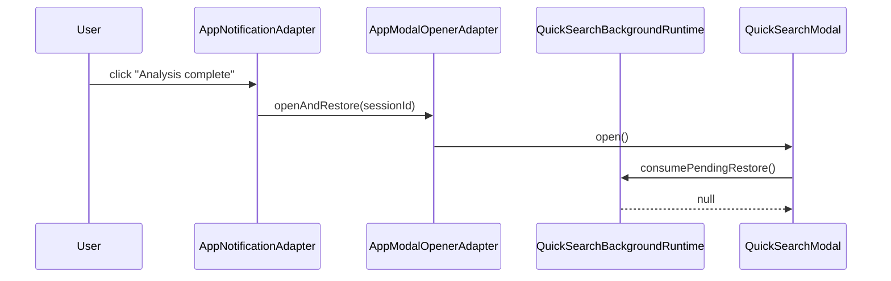
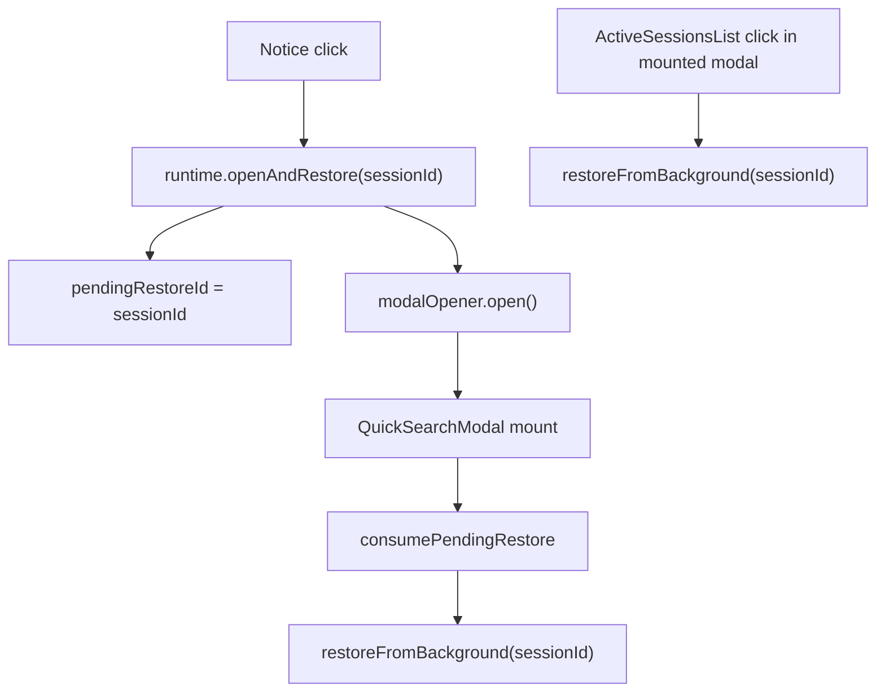

# Peak Assistant Modernization Review Fix: T10 Restore Entrypoints

## 中文摘要

Codex 独立验证了 T10 的 build、专项测试、T8/T9 回归测试和 boundary audit。大的架构方向成立：

- `src/service/BackgroundSessionManager.ts` 已删除。
- `QuickSearchBackgroundRuntime` 已归 `AppRuntimeRegistry` / `AppContext` 所有。
- service-side background runtime 不再 import UI store、QuickSearchModal、AppContext、Notice。
- boundary audit 从 T9 后的 404 降到 396。

但 T10 还不能接受，因为有两个 restore entrypoint 现在会“点了但没有真正恢复 session”。

这两个问题都在 T10 核心用户路径里，不是审美问题，也不是小命名问题。先做 T10R review fix，再让 Codex 写正式 Owner Review Packet。

## Finding 1: Notice 点击只打开 modal，没有设置 pending restore

证据：

```text
src/app/quick-search/background/AppNotificationAdapter.ts:40
span.addEventListener('click', () => this.modalOpener.openAndRestore(input.sessionId));

src/app/quick-search/background/AppModalOpenerAdapter.ts:22-27
openAndRestore(_sessionId: string): void {
  const ctx = AppContext.getInstance();
  const modal = new QuickSearchModal(ctx);
  modal.open();
}

src/service/search/background/QuickSearchBackgroundRuntimeImpl.ts:145-148
openAndRestore(sessionId: string): void {
  this.pendingRestoreId = sessionId;
  this.deps.modalOpener.openAndRestore(sessionId);
}
```

现在 Notice click 直接调用 `AppModalOpenerAdapter.openAndRestore`，绕过了 `QuickSearchBackgroundRuntimeImpl.openAndRestore`。但 `pendingRestoreId` 是 runtime 私有状态，只有 runtime 的 `openAndRestore()` 会写它。

结果：



用户看到 modal 打开了，但 session 没有 restore。

## Finding 2: Active Sessions 点击只写 requestRestore，当前 modal 不会重新触发 mount effect

证据：

```text
src/ui/view/quick-search/SearchModal.tsx:100-103
useEffect(() => {
  const pendingId = AppContext.tryGetQuickSearchBackgroundRuntime()?.consumePendingRestore();
  if (pendingId) restoreFromBackground(pendingId);
}, [restoreFromBackground]);

src/ui/view/quick-search/SearchModal.tsx:378-381
<ActiveSessionsList
  onRestore={(sessionId) => {
    AppContext.tryGetQuickSearchBackgroundRuntime()?.requestRestore(sessionId);
  }}
/>
```

`consumePendingRestore()` 只在 modal mount effect 里跑。Active Sessions 列表就在已经打开的 modal 里；点击它只设置 runtime pending id，但不会触发 mount effect 再跑一次。

结果：

```mermaid
sequenceDiagram
  participant User
  participant List as ActiveSessionsList
  participant Runtime as QuickSearchBackgroundRuntime
  participant Effect as SearchModal mount effect

  Effect->>Runtime: consumePendingRestore()
  Runtime-->>Effect: null
  User->>List: click active session
  List->>Runtime: requestRestore(sessionId)
  Note over Effect: already ran; no restore happens
```

用户点击 Active Sessions 里的 session，但当前 modal 不会恢复那条 session。

## Target Shape



The rule:

```text
If opening a new modal, use runtime.openAndRestore(sessionId).
If the modal is already mounted, call restoreFromBackground(sessionId) directly.
Do not use requestRestore(sessionId) as a same-screen restore command.
```

## Send To Claude Code

````md
# T10R Review Fix: Quick Search Background Restore Entrypoints

Branch:
codex/peak-modernization-refactor

Context:
- T10 landed in commits:
  - 5a21111b refactor(quick-search-background): add runtime contract, ports, types, registry slot (T10 part 1)
  - c2c153cb refactor(quick-search-background): add app adapters and composition (T10 part 2)
  - 2daa8b3f refactor(quick-search-background): migrate UI + retire singleton + add T10 guards (T10 part 3)
- Codex independently verified build/tests/audit, but found two restore-entrypoint bugs.
- Source doc: docs/superpowers/refactor-ops/t10-review-fix-restore-entrypoints-handoff.md

## Goal

Fix two T10 restore paths before Codex accepts T10:

1. Clicking a background-session Notice must both open Quick Search and set the runtime pending restore id.
2. Clicking an item in `ActiveSessionsList` inside an already mounted Quick Search modal must restore immediately, not only write a pending restore id.

## Required fix 1: Notice click must route through runtime ownership

Current broken path:

```text
AppNotificationAdapter click
-> AppModalOpenerAdapter.openAndRestore(sessionId)
-> opens QuickSearchModal
-> no pendingRestoreId was set
-> SearchModal consumePendingRestore() returns null
```

Preferred fix:

- Change `QuickSearchNotificationPort` so each `showSession*` call can receive an `onRestore` callback, or add an equivalent callback to `QuickSearchSessionNotification`.
- In `QuickSearchBackgroundRuntimeImpl.fireNotification`, pass a callback that calls `this.openAndRestore(session.id)`.
- In `AppNotificationAdapter`, the click handler should call that callback, not `modalOpener.openAndRestore()` directly.
- Keep `AppNotificationAdapter` as the owner of `Notice`; keep `QuickSearchBackgroundRuntimeImpl` as the owner of `pendingRestoreId`.

Acceptable shape:

```ts
export interface QuickSearchSessionNotification {
  sessionId: string;
  title: string | null;
  query: string;
  onRestore: () => void;
}
```

or:

```ts
showSessionComplete(input: QuickSearchSessionNotification, onRestore: () => void): void;
```

Do not make `AppModalOpenerAdapter` reach into runtime directly unless there is a strong reason; that creates a circular ownership smell.

## Required fix 2: Active Sessions restore should be direct

Current broken path:

```tsx
<ActiveSessionsList
  onRestore={(sessionId) => {
    AppContext.tryGetQuickSearchBackgroundRuntime()?.requestRestore(sessionId);
  }}
/>
```

This only writes pending restore. The modal is already mounted, so the mount effect will not run again.

Fix:

```tsx
<ActiveSessionsList onRestore={restoreFromBackground} />
```

or an equivalent handler that directly calls `restoreFromBackground(sessionId)`.

Keep `requestRestore` / `consumePendingRestore` for cases where a new modal is being opened.

## Tests required

Update or add tests so both bugs cannot return.

At minimum:

1. Runtime / notification test:
   - Fake notification port captures the restore callback.
   - Trigger plan-ready or completed notification.
   - Invoke captured callback.
   - Assert modal opener was called.
   - Assert `runtime.consumePendingRestore()` returns the session id.

2. Source guard for `SearchModal.tsx`:
   - The `ActiveSessionsList` restore handler must not only call `requestRestore(sessionId)`.
   - Prefer asserting the source contains `onRestore={restoreFromBackground}` or a named handler that calls `restoreFromBackground(sessionId)`.

Keep existing T10 architecture guards.

## Verification required

Run:

```bash
npm run build
npm run test -- test/app-runtime-registry.test.ts test/quick-search-background-runtime-ports.test.ts test/quick-search-background-source-guard.test.ts
npm run test -- test/ambient-runtime-ports.test.ts test/ambient-source-guard.test.ts test/vault-review-runtime-ports.test.ts test/vault-review-source-guard.test.ts
node scripts/audit/boundary-baseline.mjs --out /tmp/t10r-boundary-baseline.md
```

Expected:

- Build passes.
- T10 tests pass with the two new assertions.
- Boundary count should remain around 396. If it changes, explain why.
- No service-side imports of UI / AppContext / Obsidian Notice are reintroduced.

## Implementation note required

Return:

```md
## T10R Implementation Note

Commit:
- ...

中文摘要:
- 修了什么:
- 为什么原 T10 restore path 会断:
- 现在 Notice click 怎么恢复:
- 现在 ActiveSessionsList click 怎么恢复:
- 用户可见行为:

Changed files:
- ...

Tests:
- ...

Verification:
- ...

Boundary audit:
- ...

Not changed:
- ...
```
````

## Codex Acceptance Gate

Codex will not write the final accepted T10 Owner Review Packet until:

- Notice click restore is fixed and tested.
- Active Sessions in-mounted-modal restore is fixed and guarded.
- T10 tests, T8/T9 regression tests, build, and boundary audit pass.
