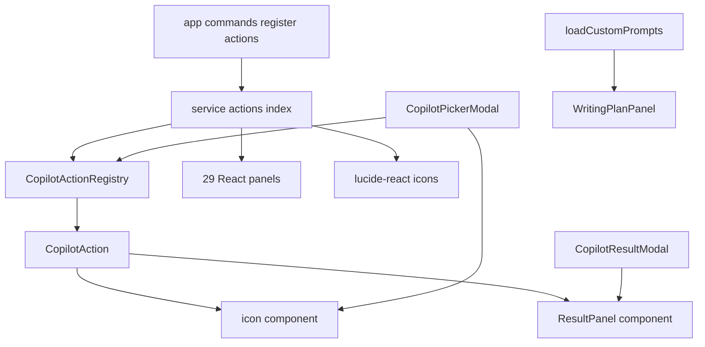
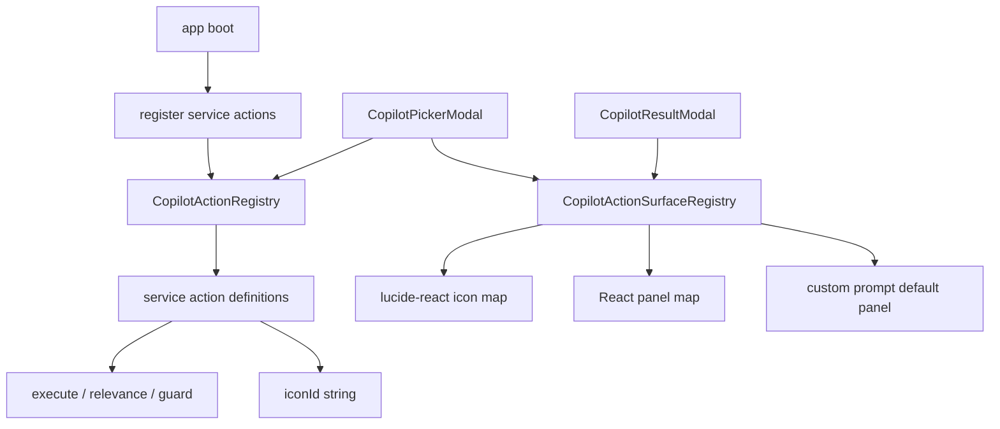
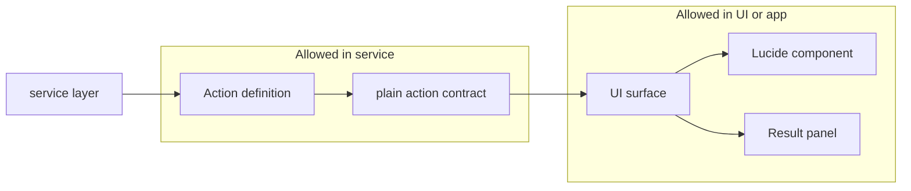
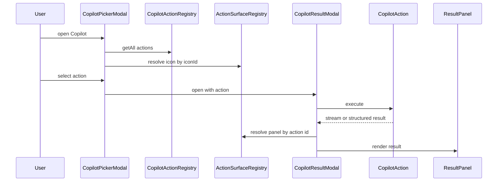

# Peak Assistant Modernization Handoff: T11 Copilot Action Registry Boundary Wave

Branch:
`codex/peak-modernization-refactor`

Source-of-truth docs:

- `docs/superpowers/specs/2026-06-01-peak-system-architecture-modernization-handbook.html`
- `docs/superpowers/specs/2026-06-02-ambient-push-current-work-state-product-technical-review.html`
- `docs/superpowers/specs/2026-06-03-obsidian-plugin-command-gateway-capstone-review.html`

Current operating rules:

- Codex owns architecture reports, diagrams, task design, and review packets.
- Claude Code owns implementation only.
- User manually authorizes each handoff.
- Owner-facing explanations should be Chinese-first. Keep code symbols, commands, test names, and commit messages in English.

## 中文摘要

T11 要处理的是 **Copilot Action Registry 的 UI 边界污染**。

现在 `src/service/copilot/actions/index.ts` 是 boundary audit 里的最大单点 offender：它在 service 层直接 import 了 29 个 `src/ui/view/copilot/panels/*` React panel，并且 `CopilotActionRegistry.ts` 的 `CopilotAction` 类型里直接带着：

```ts
icon: LucideIcon;
ResultPanel: React.ComponentType<...>;
```

这意味着 service 层不只是知道“有哪些 Copilot action”，还知道“每个 action 用哪个 React icon、哪个 React panel 渲染”。这会让 Copilot 后续变得难维护：新增 action 时必须同时理解业务执行、UI panel、icon、registry mutation；而且 service -> ui 的反向依赖会一直卡住模块化。

T11 的目标是把 Copilot action 拆成两层：

```text
service: action definition / execution / relevance / guard
ui or app surface: icon binding / result panel binding / picker display
```

做完后，service 层仍然可以保留 action 执行逻辑，但不能再 import React panel、不能再保存 `ResultPanel`、不能再把 `LucideIcon` 放进 service action 类型。UI 通过 action id 或 `iconId` 去找 panel 和 icon。

这是一轮中等偏大的 closure wave。预期 15-40 个文件，2-4 个小 commit。不要再做 2 行小修；但如果需要重写 Copilot Agent Loop、Vault Auto Review、Chat、Ambient、Command Gateway，必须停下来。

Claude Code may start implementation after a short read-only investigation in the same session. Do not wait for a second approval unless a stop condition is hit.

## Review Entry Points

| Review item | Status | Why open it |
| --- | --- | --- |
| This T11 handoff | Ready to send | 当前建议发给 Claude Code 的实现任务。 |
| [`2026-06-14-t10-owner-review-packet.md`](../audits/2026-06-14-t10-owner-review-packet.md) | Previous accepted packet | T10 接受结论：下一步推荐 Copilot Action Registry。 |
| [`README.md`](./README.md) | Operating rules | 包含 task size policy、runtime ownership、review access、code reading guide、visual map 规则。 |
| [`architecture-scorecard.md`](./architecture-scorecard.md) | Score ledger | T11 完成后由 Codex 更新分数和趋势。 |
| `/tmp/t11-pre-codex-boundary-baseline.md` | Local evidence | T11 前 Codex 复跑 baseline：396 findings，`actions/index.ts` 单文件 30 flagged edges。 |

## Why T11 Is This Target

Confirmed from current code and T11 pre-baseline:

- Boundary audit total: **396** flagged edges.
- `service -> ui`: **45**.
- Top offender: `src/service/copilot/actions/index.ts`, **30** flagged edges.
- Those 30 edges are almost entirely Copilot result panel imports.
- `src/service/copilot/CopilotActionRegistry.ts` imports `LucideIcon` from `lucide-react`.
- `CopilotAction` includes both `icon: LucideIcon` and `ResultPanel: React.ComponentType`.
- `registerAllCopilotActions()` mutates every action by assigning `action.ResultPanel = panel`.
- `loadCustomPrompts()` dynamically imports `WritingPlanPanel` from the service action file.

This is a clean modularity cut because the problem is not action execution itself. The problem is that service action definitions have become UI view models.

## Current Shape



How to read this:

- `service actions index` should be about action semantics and execution.
- Instead it currently imports UI panels and icons, then writes UI components into each action object.
- `CopilotResultModal` can render because `action.ResultPanel` exists, but that convenience is exactly the reverse dependency.
- Custom prompts repeat the same pattern through a dynamic import of `WritingPlanPanel`.

## Target Shape



Target rules:

- `src/service/copilot/actions/index.ts` may define actions, register actions, and execute actions.
- `src/service/copilot/actions/index.ts` must not import from `@/ui/view/copilot/panels/*`.
- `CopilotActionRegistry.ts` must not import React or `lucide-react`.
- `CopilotAction` must not include `ResultPanel`.
- Prefer `iconId: CopilotActionIconId` or another plain serializable ID over `icon: LucideIcon`.
- UI/app surface code resolves `action.id` and `action.iconId` into actual React components.
- Custom prompts use the same surface binding rule as built-in actions.

## Boundary Map



The key distinction:

| Concern | Owner after T11 |
| --- | --- |
| Action id / label / description | service action definition |
| Relevance / guard | service action definition |
| Execute generator | service action definition |
| `iconId` | service action definition as plain metadata |
| Real Lucide icon component | UI/app surface registry |
| Real React result panel | UI/app surface registry |
| Built-in action registration | service or app boot, but no UI panel mutation |
| Custom prompt loading | app boot or service registry, but no service-side panel import |

## User Flow After T11



This is the whole reason for T11: UI still renders exactly as before, but the service action does not carry the React component.

## What T11 Should Change

### 1. Split service action contract from UI surface binding

Recommended service shape:

```ts
export type CopilotActionIconId =
  | 'sparkles'
  | 'tag'
  | 'message-square-text'
  | 'link'
  | 'file-text'
  | string;

export interface CopilotAction {
  id: string;
  label: string;
  description: string;
  iconId: CopilotActionIconId;
  category: 'document' | 'vault' | 'writing';
  intentTab?: 'document' | 'vault' | 'setting';
  requiresDocument?: boolean;
  relevance(ctx: DocumentContext): number;
  guard?(ctx: DocumentContext): string | null;
  execute(ctx: DocumentContext, signal?: AbortSignal): AsyncGenerator<LLMStreamEvent, ActionResult | void>;
}
```

Do not keep `icon: LucideIcon` in service. Do not keep `ResultPanel`.

### 2. Remove UI panel imports from service actions

Retire this old path:

```text
src/service/copilot/actions/index.ts
  -> import "@/ui/view/copilot/panels/*"
  -> const PANEL_MAP
  -> action.ResultPanel = panel
  -> dynamic import WritingPlanPanel
```

After T11, this file should register action definitions only.

Acceptable names:

- `BUILT_IN_COPILOT_ACTIONS`
- `registerBuiltInCopilotActions`
- `registerAllCopilotActions`

The exact name matters less than the boundary:

```text
service action registration != UI surface registration
```

### 3. Add a UI/app action surface registry

Recommended new file shape:

```text
src/ui/view/copilot/copilot-action-surfaces.tsx
```

or:

```text
src/app/copilot/actions/CopilotActionSurfaceRegistry.tsx
```

Either location is acceptable as long as:

- it is not under `src/service/**`;
- it is the only place that imports all Copilot result panels;
- `CopilotPickerModal` resolves icons through it;
- `CopilotResultModal` resolves panels through it;
- custom action ids such as `custom-*` have a default panel, probably `WritingPlanPanel`.

Suggested API:

```ts
export function getCopilotActionIcon(iconId: CopilotActionIconId): LucideIcon;
export function getCopilotResultPanel(actionId: string): CopilotResultPanel;
export function hasCopilotResultPanel(actionId: string): boolean;
```

### 4. Update UI callers

Update at least:

- `src/ui/view/copilot/CopilotPickerModal.tsx`
  - Replace `item.action.icon` with `getCopilotActionIcon(item.action.iconId)`.
  - Keep visible behavior unchanged.

- `src/ui/view/copilot/CopilotResultModal.tsx`
  - Replace `const Panel = action.ResultPanel`.
  - Use `getCopilotResultPanel(action.id)`.
  - Missing panel should fail loudly in development or show an honest fallback in production. Do not silently render nothing.

- `src/ui/view/copilot/copilot-command-model.ts`
  - It may keep using service actions for label/description/relevance.
  - It should not require UI components in the action type.

### 5. Update custom prompt handling

Current problem:

```text
service actions index -> dynamic import WritingPlanPanel -> action.ResultPanel = WritingPlanPanel
```

Target:

```text
CustomPromptRegistry.buildAction -> returns service action with iconId
UI/app surface registry -> custom-* resolves to WritingPlanPanel
```

If custom prompts must be loaded during app boot, move that boot wiring into an app-level helper. Do not import UI panels from service just to make custom prompts render.

### 6. Update tests and source guards

Add or update tests with names close to:

- `test/copilot-action-surface-source-guard.test.ts`
- `test/copilot-action-surface-registry.test.ts`
- Existing:
  - `test/copilot-auto-planner.test.ts`
  - `test/copilot-command-model.test.ts`
  - `test/copilot-intent-hub.test.ts`

Required guard assertions:

- `src/service/copilot/actions/index.ts` has no `@/ui/view/copilot/panels` imports.
- `src/service/copilot/actions/index.ts` has no `ResultPanel`.
- `src/service/copilot/actions/index.ts` has no `lucide-react` import.
- `src/service/copilot/CopilotActionRegistry.ts` has no `React.ComponentType`.
- `src/service/copilot/CopilotActionRegistry.ts` has no `lucide-react` import.
- `src/service/copilot/CustomPromptRegistry.ts` has no `ResultPanel`.
- `src/service/copilot/CustomPromptRegistry.ts` has no `lucide-react` import.
- No production code writes `action.ResultPanel`.
- The panel map lives outside `src/service/**`.
- Every built-in action id has a result panel binding.
- `custom-*` actions have an explicit default panel binding.

## What T11 Should Not Change

Do not do these in T11:

- Do not port every `AppContext.getInstance()` inside Copilot action `execute()` functions.
- Do not rewrite `buildCopilotAgentStream`.
- Do not rewrite `CopilotMetaAgentStream`.
- Do not touch `src/service/copilot/vault/*` unless a type compile fix is unavoidable.
- Do not redesign Copilot UI.
- Do not change prompts, schemas, action result shapes, or action behavior.
- Do not change SQLite schema, stored review history, or vault markdown output.
- Do not start Current Work State / Ambient Push.
- Do not start Command Gateway.
- Do not add service-layer module runtime singletons such as `let currentRuntime = null`.
- Do not add scattered mutable defaults.

Important: T11 is a **surface boundary wave**, not a Copilot execution ports wave. The remaining `AppContext` and SQLite dependencies inside action execution are known debt for a later task.

## Expected Boundary Delta

Expected good outcome:

- Total flagged edges: roughly **396 -> 366**.
- `service -> ui`: roughly **45 -> 15**.
- `src/service/copilot/actions/index.ts`: **30 -> 0** flagged UI panel edges.
- `service/core -> Obsidian side-effect`: likely unchanged.
- `service -> app`: likely unchanged, because execution dependencies remain out of scope.

If the delta is much smaller, explain why. If the delta is much larger because unrelated areas were changed, stop and report.

## Recommended Commit Split

Use multiple small commits inside one Claude session:

1. `refactor(copilot): split action definitions from UI surfaces`
   - Remove `ResultPanel`.
   - Replace `icon` with `iconId`.
   - Add UI/app surface registry.

2. `refactor(copilot): migrate picker and result modal to surface registry`
   - Update `CopilotPickerModal`.
   - Update `CopilotResultModal`.
   - Update command model and affected tests.

3. `test(copilot): add action surface boundary guards`
   - Add source guards.
   - Add panel binding completeness guard.
   - Verify custom prompt fallback binding.

If the work is smaller than expected, two commits are fine. Avoid one giant unreviewable commit if many files change.

## Code Reading Guide Claude Must Return

The implementation note must tell the owner to read changed files in this order:

1. `src/service/copilot/CopilotActionRegistry.ts`
   - Inspect the new action contract.
   - Confirm there is no React component, `LucideIcon`, or `ResultPanel`.

2. `src/service/copilot/actions/index.ts`
   - Inspect built-in action definitions and registration.
   - Confirm action behavior is still there but UI panel imports are gone.

3. `src/ui/view/copilot/copilot-action-surfaces.tsx` or equivalent
   - Inspect icon map and result panel map.
   - Confirm all panel imports live here, not in service.

4. `src/ui/view/copilot/CopilotPickerModal.tsx`
   - Inspect how action icons are resolved for suggested intents and all capabilities.

5. `src/ui/view/copilot/CopilotResultModal.tsx`
   - Inspect how result panel is resolved and how missing panels are handled.

6. `src/service/copilot/CustomPromptRegistry.ts`
   - Inspect custom action creation.
   - Confirm custom prompt actions no longer carry panel components.

7. New or changed tests
   - Inspect source guards before behavior tests.

The implementation note must also say the first debug file to open if:

- icons disappear in the picker;
- a built-in action opens but no result panel appears;
- a custom prompt action opens but no result panel appears;
- boundary audit does not drop.

## Required Verification

Run:

```bash
npm run build
npm run test -- test/copilot-auto-planner.test.ts test/copilot-command-model.test.ts test/copilot-intent-hub.test.ts
npm run test -- test/copilot-action-surface-source-guard.test.ts test/copilot-action-surface-registry.test.ts
node scripts/audit/boundary-baseline.mjs --out /tmp/t11-boundary-baseline.md
```

If the exact new test names differ, run the equivalent tests and report the actual names.

Also run these grep checks and report results:

```bash
rg "ResultPanel" src/service src/ui test
rg "@/ui/view/copilot/panels" src/service
rg "lucide-react" src/service/copilot/CopilotActionRegistry.ts src/service/copilot/actions/index.ts src/service/copilot/CustomPromptRegistry.ts
rg "action\\.ResultPanel|\\.ResultPanel\\s*=" src
```

Recommended regression checks:

```bash
npm run test -- test/vault-review-source-guard.test.ts
npm run test -- test/quick-search-background-source-guard.test.ts test/quick-search-background-runtime-ports.test.ts
```

Manual Obsidian QA is recommended if practical:

- Open Copilot picker.
- Confirm suggested intents still show icons.
- Run one built-in document action and confirm the expected result panel renders.
- If the vault has custom prompts, run one custom prompt and confirm it renders with the default panel.

## Implementation Note Required From Claude Code

After implementation and commit, report:

```md
## Implementation note

中文摘要:
- 本轮在全局架构里的位置:
- 为什么做这个:
- 用户可见行为是否变化:
- 最重要的边界变化:
- 还没有解决的旧路径:
- 下一步建议:

Commit:
- <hash and message>

Changed files grouped by purpose:
- Service action contract:
- Built-in action definitions:
- UI/app surface registry:
- UI callers:
- Custom prompts:
- Tests / guards:
- Docs:

Code reading guide:
- Read first:
- Then read:
- Optional / only if debugging:
- Main symbols to inspect:
- Files intentionally not changed:

Visual dependency maps:
- Before/after action ownership map.
- Action selection and result render sequence.
- Custom prompt surface fallback path.
- State explicitly that there is no escaped newline sequence inside Mermaid node labels.

Boundary audit delta:
- Total flagged:
- service -> ui:
- `src/service/copilot/actions/index.ts` flagged edges:
- service -> app:
- service/core -> Obsidian side-effect:
- Explanation for unchanged categories:

Mutable global state:
- New module-level mutable defaults introduced:
- Existing module-level mutable defaults preserved:
- Why any preserved global is temporary:

Runtime ownership:
- Runtime owner before:
- Runtime owner after:
- Any service-layer runtime singleton introduced or preserved:

Verification:
- ...

Known remaining old paths:
- ...

Suggested next task:
- ...
```

The implementation note must be Chinese-readable. English is fine for symbols and commands, but the owner should not need to parse a long English-only report to understand what happened.

## Stop Conditions

Claude Code must stop and report before proceeding if:

- It needs to touch more than 50 production files.
- It discovers `CopilotAction` is used by non-Copilot UI in a way that requires a wider app model migration.
- It cannot remove `ResultPanel` without changing user-visible result behavior.
- It must rewrite action execution dependencies to make the UI surface split compile.
- It needs to modify Chat, Ambient, Command Gateway, or Vault Review runtime internals.
- It needs to change persisted data, settings, SQLite schema, or vault files.

## Acceptance Criteria

T11 can be accepted when:

- `src/service/copilot/actions/index.ts` no longer imports UI panels.
- `CopilotAction` no longer contains `ResultPanel`.
- `CopilotActionRegistry.ts` no longer imports `lucide-react` or React component types.
- Picker icons still render through UI/app surface resolution.
- Result panels still render through UI/app surface resolution.
- Custom prompts have a default surface binding without service-side panel import.
- Source guards prevent `ResultPanel` and service-side panel imports from returning.
- `npm run build` passes.
- Targeted tests pass.
- Boundary audit shows the expected `service -> ui` drop or explains any gap.
