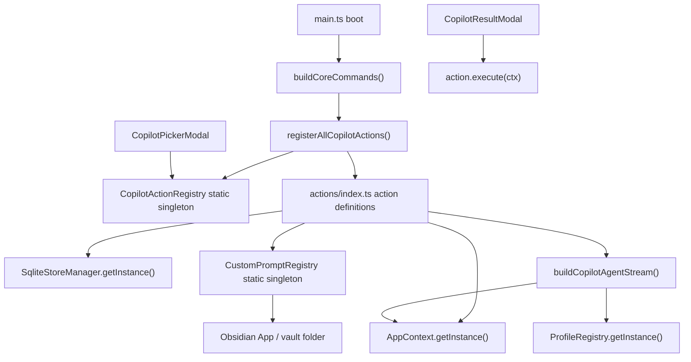
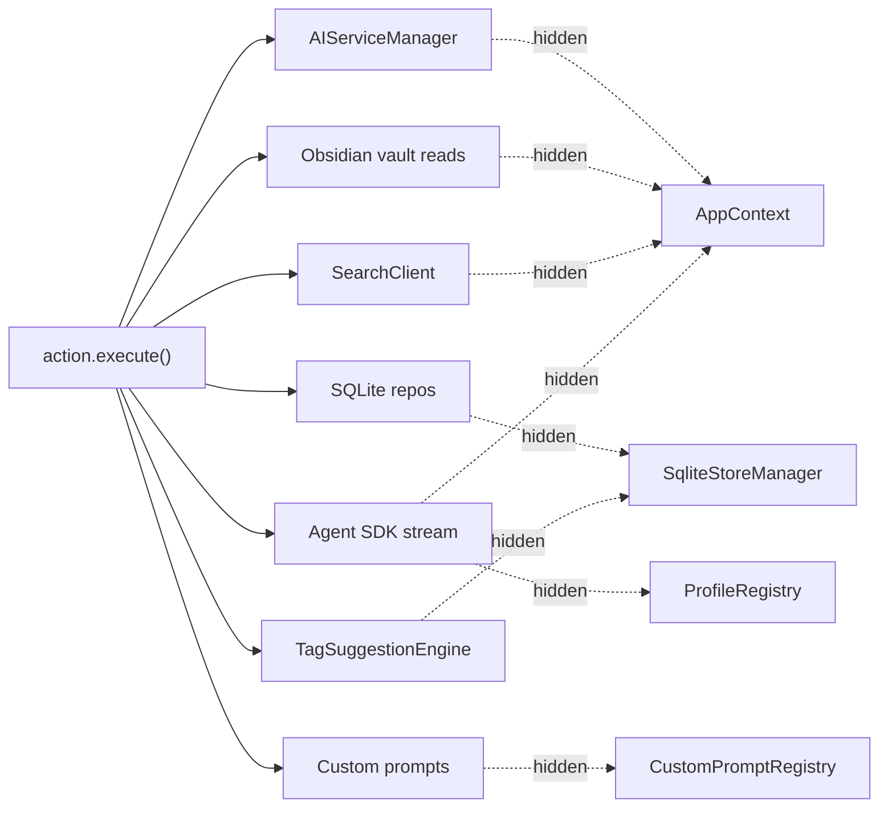
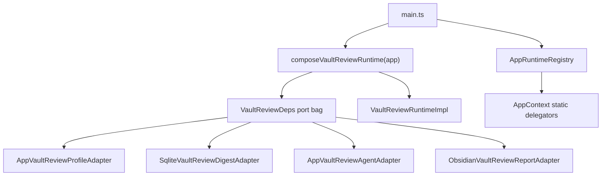
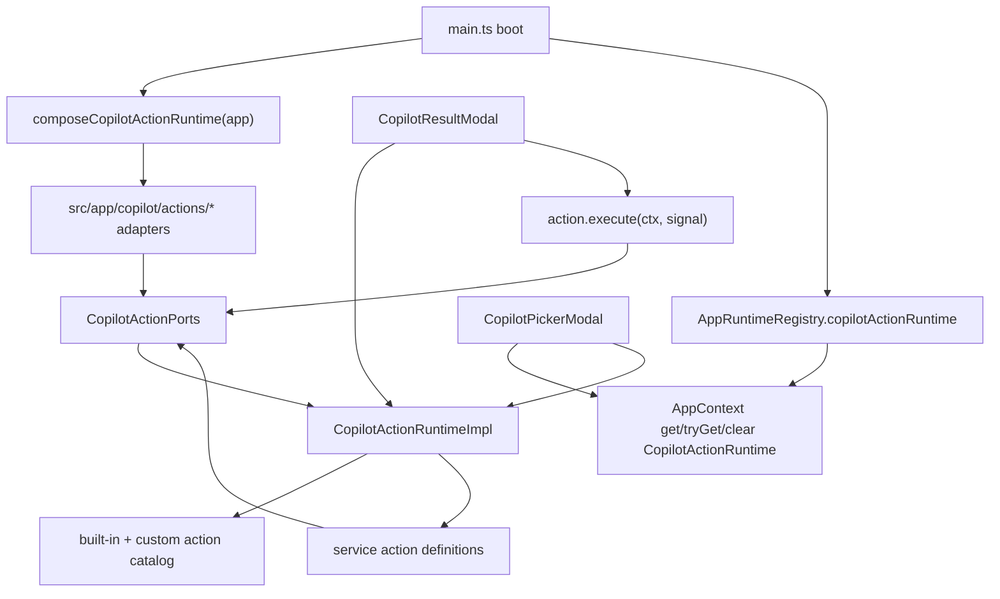
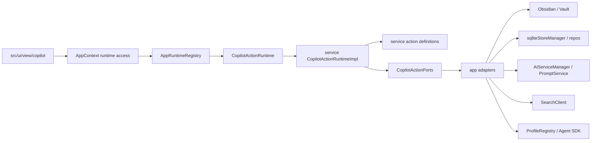
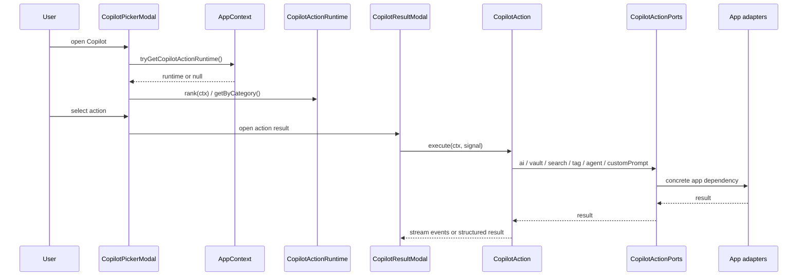
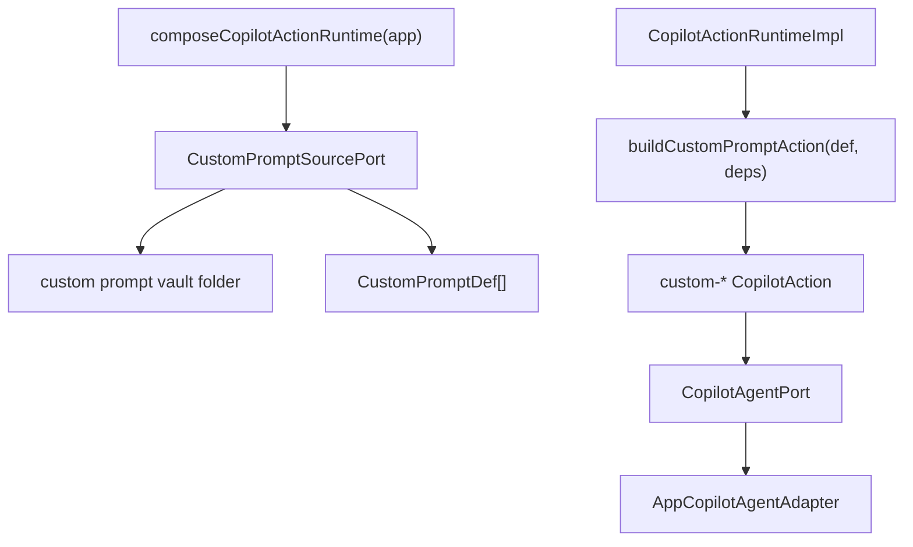
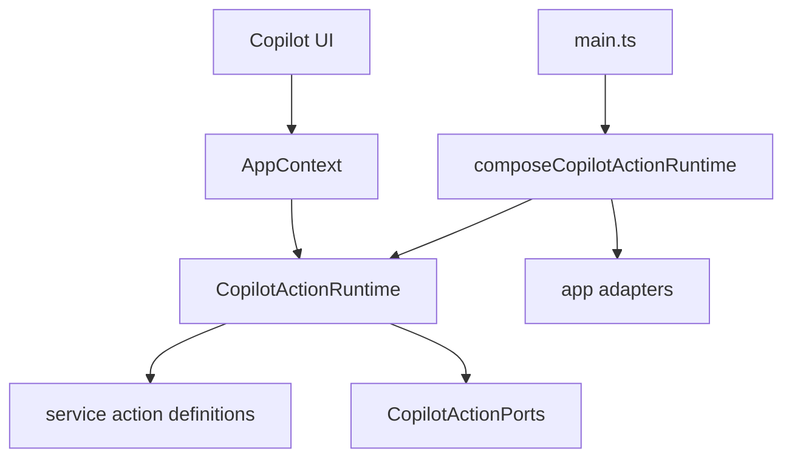
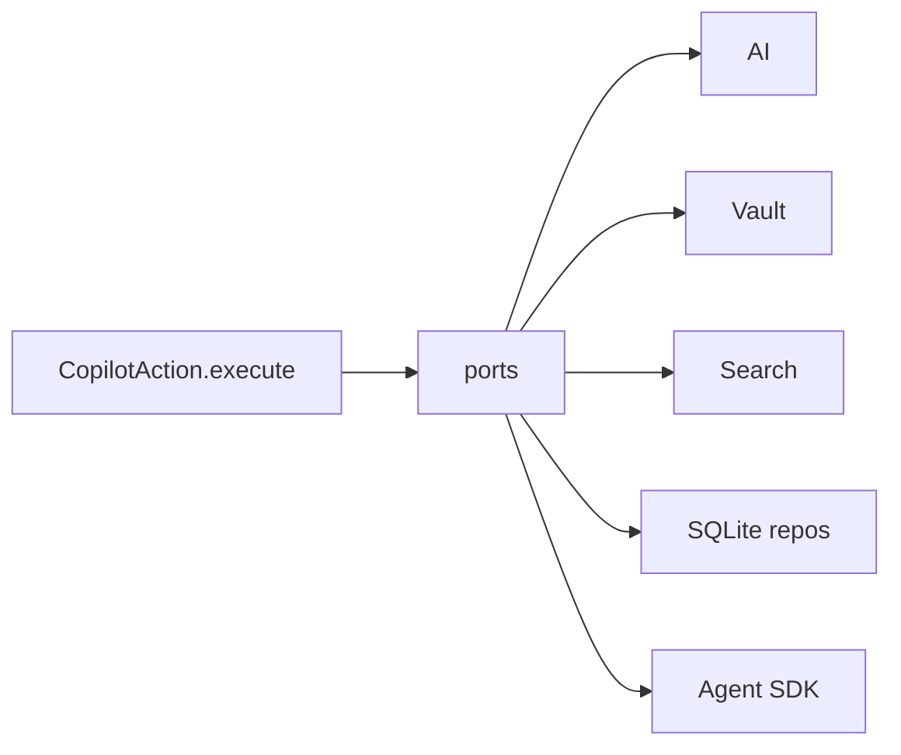
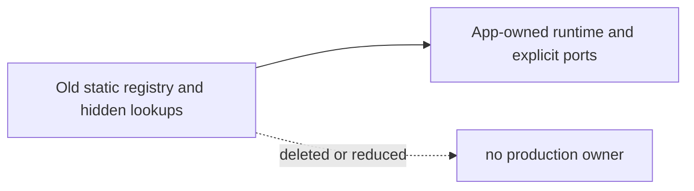

# Peak Assistant Modernization Handoff: T11B Copilot Execution Ports / Registry Ownership Wave

Branch:
`codex/peak-modernization-refactor`

Source-of-truth docs:

- `docs/superpowers/specs/2026-06-01-peak-system-architecture-modernization-handbook.html`
- `docs/superpowers/specs/2026-06-02-ambient-push-current-work-state-product-technical-review.html`
- `docs/superpowers/specs/2026-06-03-obsidian-plugin-command-gateway-capstone-review.html`

Current operating rules:

- Codex owns architecture reports, diagrams, task design, review packets, and scorecards.
- Claude Code owns implementation only.
- Owner-facing explanations should be Chinese-first. Keep code symbols, commands, test names, and commit messages in English.
- Every implementation note must include changed code files, reading order, dependency maps, verification, and known remaining old paths.
- Do not introduce a second runtime path. Delete, reduce, or app-own the old path when replacing it.

Claude Code may start implementation after a short read-only investigation in the same session. Do not wait for a second approval unless a stop condition is hit.

## 中文摘要

T11B 要处理的是 **Copilot 手动 action 的执行依赖和 registry ownership**。

T11 已经完成第一半：`src/service/copilot/actions/index.ts` 不再 import 29 个 React result panel，`CopilotAction` 也不再携带 `LucideIcon` / `ResultPanel`。所以现在可以做第二半：action 的 `execute()` 仍然藏着大量 service-side service locator：

- `AppContext.getInstance()`
- `SqliteStoreManager.getInstance()`
- `CopilotActionRegistry.getInstance()`
- `CustomPromptRegistry.getInstance()`
- `ProfileRegistry.getInstance()`

这些依赖让 Copilot action 仍然很难 fake、很难测试、也很难让用户看懂“执行一个 action 到底需要哪些能力”。T11B 的目标是把这批依赖收敛成：

```text
app boot / composition
  -> app-owned CopilotActionRuntime
  -> service-side action definitions
  -> explicit CopilotActionPorts / deps
  -> UI only reads runtime/catalog and triggers action
```

做完后，手动 Copilot action catalog 应该由 app 层组合和持有；service action 定义通过 ports/deps 访问 AI、Vault、Search、SQLite repo、custom prompts、agent stream。不要再让 `actions/index.ts` 自己到处拿 `AppContext` 和 SQLite 单例。

这轮允许比前几轮大：预期 **20-60 个文件，3-5 个 commit**。但它仍然是一个 bounded wave，不是重写整个 Copilot。

## Review Entry Points

| Review item | Status | Why open it |
| --- | --- | --- |
| This T11B handoff | Ready to send | 当前建议发给 Claude Code 的实现任务。 |
| [`2026-06-14-t11-owner-review-packet.md`](../audits/2026-06-14-t11-owner-review-packet.md) | Previous accepted packet | T11 接受结论和下一步依据。 |
| [`t11-copilot-action-registry-boundary-wave-handoff.md`](./t11-copilot-action-registry-boundary-wave-handoff.md) | Previous handoff | T11 已完成的 UI surface split。 |
| [`architecture-scorecard.md`](./architecture-scorecard.md) | Score ledger | T11B 完成后由 Codex 更新分数和趋势。 |
| `/tmp/t11b-pre-codex-boundary-baseline.md` | Local evidence | Codex 复跑 baseline：367 findings，service AppContext count 86。 |

## Why T11B Is Next

Current verified state after T11:

| Metric | Current |
| --- | ---: |
| Total flagged edges | 367 |
| service -> ui | 16 |
| service -> app | 62 |
| service/core -> Obsidian side-effect | 17 |
| service AppContext substring count | 86 |

T11 removed the biggest UI boundary offender, but it intentionally did not touch execution dependencies:

- `src/service/copilot/actions/index.ts` still has many `AppContext.getInstance()` calls inside action execution.
- `src/service/copilot/actions/index.ts` still reaches `SqliteStoreManager.getInstance()` for tag/dedupe related actions.
- `src/service/copilot/CopilotActionRegistry.ts` still owns a static singleton.
- `src/service/copilot/CustomPromptRegistry.ts` still owns a static singleton and imports Obsidian/AppContext.
- `src/service/copilot/actions/agent-actions.ts` still resolves AppContext and ProfileRegistry directly.
- `src/app/commands/Register.ts` still calls `registerAllCopilotActions()` while building command palette entries.

This is the right next wave because the visual/action catalog split is already done. T11B can now focus on runtime and execution ownership without also moving UI panels.

## Current Mental Model

### 1. Current Runtime Ownership



How to read:

- Boot currently registers actions as a command side effect.
- `CopilotActionRegistry` is a service module singleton, not app-owned runtime state.
- Action execution pulls concrete dependencies from inside service code.
- UI reads the service singleton directly.

### 2. Current Execution Dependency Shape



How to read:

- The action catalog looks simple from UI, but every action hides its own dependency lookup.
- That is why tests need source scans rather than fake ports.
- T11B should make these dependencies visible at composition time.

### 3. Existing App-Owned Runtime Pattern To Copy



How to read:

- T11B should copy this shape.
- Concrete Obsidian/sqlite/profile/agent dependencies belong in `src/app/copilot/actions/*` adapters or composition.
- Service code should receive ports/deps and orchestrate.

## Target Shape

### 1. Ownership After T11B



Target rule:

```text
service/copilot/actions/* defines behavior;
app/copilot/actions/* supplies concrete dependencies;
AppRuntimeRegistry owns the long-lived runtime;
UI gets the runtime through AppContext or ServiceContext.
```

### 2. Target Module Boundaries



Allowed direction:

```text
ui -> app runtime accessor -> service runtime contract -> ports -> app adapters -> concrete side effects
```

Not allowed direction:

```text
service action -> AppContext / sqliteStoreManager / ProfileRegistry / UI store / React panel
```

### 3. Manual Action Run Sequence



Important:

- The user-visible flow should stay the same.
- The difference is where dependencies are resolved.
- The runtime may return the same `CopilotAction` shape, but its closures must be created from explicit deps.

### 4. Custom Prompt Shape



Target rule:

- `CustomPromptRegistry` should not be a production singleton.
- It can become a plain parser/loader class, or be replaced by a `CustomPromptSourcePort`.
- Obsidian folder scanning belongs in an app adapter.
- Custom prompt action execution should call an injected agent port, not `buildCopilotAgentStream()` with hidden AppContext/ProfileRegistry.

## Scope

Allowed:

- Add `src/service/copilot/actions/CopilotActionRuntime.ts` or equivalent runtime contract.
- Add `src/service/copilot/actions/CopilotActionRuntimeImpl.ts` or equivalent app-owned runtime implementation.
- Add `src/service/copilot/actions/CopilotActionPorts.ts` or equivalent port/deps definitions.
- Refactor `src/service/copilot/actions/index.ts` so built-in actions are created from explicit deps/ports.
- Refactor `src/service/copilot/actions/agent-actions.ts` so agent execution can run through injected deps or an app adapter.
- Refactor `src/service/copilot/TagSuggestionEngine.ts` to accept repo/data ports instead of using `SqliteStoreManager.getInstance()`.
- Refactor `src/service/copilot/CustomPromptRegistry.ts` into a plain parser/loader or move concrete vault loading behind an app adapter.
- Add app composition under `src/app/copilot/actions/*`.
- Add `CopilotActionRuntime` binding to `src/app/runtime/AppRuntimeRegistry.ts` and `src/app/context/AppContext.ts`.
- Update `main.ts` to compose and bind the runtime at plugin boot.
- Update `src/app/commands/Register.ts` so building command palette entries no longer registers Copilot actions.
- Update `src/ui/view/copilot/CopilotPickerModal.tsx` and related manual-action callers to use the app-owned runtime instead of `CopilotActionRegistry.getInstance()`.
- Add fake-port tests and source guards.
- Delete, empty, or reduce old singleton paths to thin test-only helpers if needed.

Not allowed:

- Do not implement Command Gateway. That remains the later capstone.
- Do not implement Current Work State / Session Thought Trace.
- Do not rewrite Chat.
- Do not rewrite Ambient.
- Do not rewrite Vault Auto Review T9 runtime.
- Do not migrate all Copilot result panels away from `AppContext`; panel-level Obsidian/AppContext usage is a separate UI/application surface issue.
- Do not rewrite `CopilotMetaAgentStream` or `VaultMetaAgentStream` wholesale unless a tiny adapter is required for manual action execution.
- Do not change SQLite schema.
- Do not change user-facing prompts, action labels, result panel visuals, or command names unless required to preserve behavior.
- Do not add a service-layer module runtime singleton like `let currentRuntime = null`.
- Do not keep both `CopilotActionRegistry.getInstance()` and a new runtime as two production owners.

## Implementation Requirements

### 1. Runtime contract

Create a runtime contract with a minimal, reviewable surface. Suggested shape:

```ts
export interface CopilotActionRuntime {
	getAll(): CopilotAction[];
	get(id: string): CopilotAction | undefined;
	getByCategory(category: CopilotActionCategory): CopilotAction[];
	rank(ctx: DocumentContext): Array<{ action: CopilotAction; score: number }>;
	refreshCustomPrompts?(): Promise<void>;
	dispose?(): void;
}
```

The exact method names can differ, but the runtime must become the owner of the action catalog for production.

### 2. Explicit action deps / ports

Create explicit deps for action execution. Suggested grouping:

```ts
export interface CopilotActionPorts {
	ai: CopilotActionAiPort;
	vault: CopilotActionVaultPort;
	search: CopilotActionSearchPort;
	tags: CopilotActionTagPort;
	agent: CopilotActionAgentPort;
	customPrompts: CopilotCustomPromptPort;
	clock?: CopilotActionClockPort;
}
```

Keep ports practical. Do not make 40 tiny ports if 5-7 cohesive ports are easier to read.

### 3. Built-in actions created from deps

Replace production singleton registration with factory/composition:

```ts
export function createBuiltInCopilotActions(deps: CopilotActionPorts): CopilotAction[] {
	return [
		// action objects close over deps, not AppContext/SqliteStoreManager
	];
}
```

Acceptable alternatives:

- `createCopilotActionRuntime(deps)`
- `createCopilotActionCatalog(deps)`
- `registerBuiltInCopilotActions(runtime, deps)`

Not acceptable:

- `actions/index.ts` continues calling `AppContext.getInstance()`.
- `actions/index.ts` continues calling `SqliteStoreManager.getInstance()`.
- `registerAllCopilotActions()` remains a production boot side effect from `buildCoreCommands()`.

### 4. App composition point

Add a single app-level composition file:

```text
src/app/copilot/actions/composeCopilotActionRuntime.ts
```

It should be the only place that wires:

- Obsidian `App`;
- `AppContext` concrete dependencies;
- `AIServiceManager`;
- `SearchClient`;
- `sqliteStoreManager` / SQLite repos;
- `ProfileRegistry`;
- custom prompt vault folder;
- Agent SDK bridge/profile setup.

### 5. App-owned runtime binding

Add Copilot action runtime to:

- `src/app/runtime/AppRuntimeRegistry.ts`
- `src/app/context/AppContext.ts`
- `main.ts` boot
- `main.ts` unload cleanup

Follow the same semantics as T6R/T8/T9/T10:

- fail-loud `getCopilotActionRuntime()`;
- soft `tryGetCopilotActionRuntime()`;
- double-bind throws;
- clear on unload;
- optional `dispose()` is called during clear.

### 6. UI access

Manual Copilot UI should get the runtime through app-owned access:

- `CopilotPickerModal` should not call `CopilotActionRegistry.getInstance()`.
- Result execution should use action objects sourced from the runtime.
- If UI can mount before runtime is bound, show a clear empty/loading/fallback state instead of throwing in React render.

Keep T11 surface registry intact:

- `src/ui/view/copilot/copilot-action-surfaces.tsx` remains the owner of icon/panel binding.
- T11B should not move result panels back into service.

### 7. Old path retirement

Production source should have zero live references to:

```text
CopilotActionRegistry.getInstance()
CustomPromptRegistry.getInstance()
registerAllCopilotActions() from buildCoreCommands()
```

Acceptable temporary outcomes:

- `CopilotActionRegistry` becomes a plain class with no static singleton.
- `CopilotActionRegistry` is deleted if runtime replaces it cleanly.
- `CustomPromptRegistry` becomes a plain parser class with no static singleton.
- A legacy export remains only as a thin factory wrapper for tests, not as production runtime ownership.

## Required Source Guards

Add or update tests that scan source files and fail if old hidden dependency paths return.

At minimum:

```text
test/copilot-action-runtime-source-guard.test.ts
test/copilot-action-runtime-ports.test.ts
```

Guard expectations:

- `src/service/copilot/actions/index.ts` has no live `AppContext.getInstance`.
- `src/service/copilot/actions/index.ts` has no live `SqliteStoreManager.getInstance`.
- `src/service/copilot/actions/index.ts` has no live `CopilotActionRegistry.getInstance`.
- `src/service/copilot/actions/index.ts` has no live `CustomPromptRegistry.getInstance`.
- `src/service/copilot/actions/agent-actions.ts` has no live `AppContext.getInstance`.
- `src/service/copilot/actions/agent-actions.ts` has no live `ProfileRegistry.getInstance`.
- `src/service/copilot/TagSuggestionEngine.ts` has no live `SqliteStoreManager.getInstance`.
- `src/service/copilot/CustomPromptRegistry.ts` has no live `AppContext` value import.
- `src/service/copilot/CustomPromptRegistry.ts` has no live Obsidian value import if it remains under service.
- `src/service/copilot/CopilotActionRegistry.ts` has no `private static instance` and no static `getInstance()`.
- `src/ui/view/copilot/CopilotPickerModal.tsx` has no `CopilotActionRegistry.getInstance()`.
- `src/app/commands/Register.ts` does not call `registerAllCopilotActions()`.
- `src/app/runtime/AppRuntimeRegistry.ts` owns `copilotActionRuntime`.
- No new service-layer module-level mutable runtime binding is introduced.

Use the existing source-guard style from T8/T9/T10/T11. Strip comments before matching so historical comments do not fail the guard.

## Required Fake-Port Tests

Add fake-port tests that prove manual action execution can run without Obsidian, SQLite, AppContext, or real provider calls.

Minimum representative coverage:

| Area | Example action | What fake should prove |
| --- | --- | --- |
| AI structured call | review/correct/extract concept style action | Action calls `ai.queryStructured` through port. |
| AI stream call | polish/rewrite/write style action | Action calls `ai.queryTextStream` or equivalent through port. |
| Vault/search | smart connections / semantic link style action | Action calls search/vault ports, not AppContext. |
| Tags | suggest tags | `TagSuggestionEngine` or tag port can run with fake repo/data inputs. |
| Custom prompt | `custom-*` action | Prompt file definition becomes action and execution calls injected agent port. |
| Runtime catalog | get/rank/category | Runtime returns built-in and custom actions without singleton state. |
| Runtime ownership | bind/try/get/clear | AppRuntimeRegistry double-bind and clear semantics work. |

Do not chase perfect coverage of every action in this wave. Cover enough representative action families that the boundary is real.

## Visual Dependency Maps Required In Claude Output

Claude's implementation note must include diagrams like these, updated to the final code:

### Final ownership map



### Final action execution map



### Old path deletion map



Avoid escaped newline markers in Mermaid labels. Use short labels or `<br/>` only when necessary.

## Code Reading Guide Required From Claude

Claude's final implementation note must list changed code files in this reading order:

1. Runtime contract:
   - `src/service/copilot/actions/CopilotActionRuntime.ts` or equivalent.
2. Ports:
   - `src/service/copilot/actions/CopilotActionPorts.ts` or equivalent.
3. Runtime implementation:
   - `src/service/copilot/actions/CopilotActionRuntimeImpl.ts` or equivalent.
4. Built-in action factory:
   - `src/service/copilot/actions/index.ts`.
5. Custom prompt loader/parser:
   - `src/service/copilot/CustomPromptRegistry.ts` or replacement.
6. Tag suggestion deps:
   - `src/service/copilot/TagSuggestionEngine.ts` or replacement.
7. App composition:
   - `src/app/copilot/actions/composeCopilotActionRuntime.ts`.
   - Any app adapters under `src/app/copilot/actions/*`.
8. Runtime registry:
   - `src/app/runtime/AppRuntimeRegistry.ts`.
   - `src/app/context/AppContext.ts`.
   - `main.ts`.
9. UI callers:
   - `src/ui/view/copilot/CopilotPickerModal.tsx`.
   - Any result modal/picker runtime access changes.
10. Tests:
   - new fake-port tests.
   - new source guards.
   - updated T11 action surface tests.

For each file, say:

- what changed;
- what symbol to inspect first;
- whether it is contract/runtime/adapter/UI/test;
- whether user-visible behavior changed.

## Expected Boundary Delta

Do not overfit to exact numbers. Scanner behavior is import-edge based, not semantic.

Expected direction:

- `service AppContext` count should drop meaningfully.
- `src/service/copilot/actions/index.ts` should no longer be a service-locator cluster.
- `service -> app` may drop modestly if service files stop importing AppContext.
- `service -> ui` should remain at or below 16; it must not increase.
- No new service-side mutable runtime singleton should appear.

Report exact before/after:

```bash
node scripts/audit/boundary-baseline.mjs --out /tmp/t11b-boundary-baseline.md
```

## Required Verification

Run:

```bash
npm run build
npm run test -- test/copilot-action-runtime-source-guard.test.ts test/copilot-action-runtime-ports.test.ts
npm run test -- test/copilot-action-surface-source-guard.test.ts test/copilot-action-surface-registry.test.ts
npm run test -- test/copilot-auto-planner.test.ts test/copilot-command-model.test.ts test/copilot-intent-hub.test.ts
node scripts/audit/boundary-baseline.mjs --out /tmp/t11b-boundary-baseline.md
```

Also run exact grep checks:

```bash
rg "AppContext\\.getInstance|SqliteStoreManager\\.getInstance|CopilotActionRegistry\\.getInstance|CustomPromptRegistry\\.getInstance|ProfileRegistry\\.getInstance" src/service/copilot/actions src/service/copilot/TagSuggestionEngine.ts src/service/copilot/CustomPromptRegistry.ts
rg "private static instance|static getInstance\\(" src/service/copilot/CopilotActionRegistry.ts src/service/copilot/CustomPromptRegistry.ts
rg "registerAllCopilotActions" src/app/commands/Register.ts main.ts src/service/copilot
rg "@/ui/view/copilot/panels|lucide-react|ResultPanel" src/service/copilot
rg "let .*Runtime.*= null|let .*runtime.*= null|let current.*= null" src/service src/core
```

Expected:

- The first grep may still find out-of-scope files such as `CopilotMetaAgentStream`, `CopilotArtifactApply`, `CopilotReviewHistoryService`, `CopilotReviewSession`, and UI panels if searched broadly. For this wave, the key scoped files listed above must be clean.
- `main.ts` is the real plugin entry file. There is no `src/main.ts`.
- Comment-only hits are acceptable only if source guards strip comments and pass.

## Stop Conditions

Stop and ask before proceeding if:

- Moving execution dependencies requires rewriting Chat, Ambient, Command Gateway, or Vault Auto Review runtime.
- A clean runtime needs SQLite schema changes.
- UI behavior or result panel visuals must change to complete the boundary work.
- The action runtime would require two production owners to keep behavior alive.
- The old singleton cannot be deleted or reduced to non-production use.
- The diff exceeds roughly 80 source files or becomes a broad Copilot rewrite.
- Existing T11 surface guard conflicts with the new runtime design.

## Implementation Note Required From Claude Code

After implementation and commit, report:

```md
## Implementation note

中文摘要:
- 本轮在全局架构里的位置:
- 为什么做这个:
- 用户可见行为是否变化:
- 最大边界变化:
- 最大删除/退役:
- 还没有解决的旧路径:
- 下一步建议:

Commit:
- <hash and message>

Changed files grouped by purpose:
- Runtime contract:
- Ports / deps:
- Runtime implementation:
- App adapters / composition:
- Registry / AppContext / main.ts:
- UI callers:
- Tests:
- Deleted or reduced old path:

Code reading guide:
- Read first:
- Then read:
- Optional / only if debugging:
- Main symbols to inspect:
- Files intentionally not changed:

Visual dependency maps:
- Final ownership map:
- Final action execution map:
- Old path deletion map:

Runtime ownership:
- Owner before:
- Owner after:
- App-level composition point:
- Service-layer singleton removed:
- Any service-layer singleton preserved and why:

Ports / fakeability:
- Ports added:
- Representative fake-port tests:
- What can now run without Obsidian/sqlite/AppContext:

Boundary audit delta:
- total flagged:
- service -> ui:
- service -> app:
- service AppContext count:
- scoped grep checks:

Verification:
- ...

Known remaining old paths:
- ...

Suggested next task:
- ...
```

## Owner Acceptance Checklist

Codex should accept T11B only if:

- The manual Copilot action catalog has one app-owned production runtime.
- `CopilotActionRegistry.getInstance()` is gone from production code.
- `buildCoreCommands()` no longer registers actions as a side effect.
- Action execution in `actions/index.ts` uses injected deps/ports.
- Custom prompts are no longer a production service singleton that imports AppContext/Obsidian from service.
- Tag suggestion execution no longer reaches SQLite singleton from service.
- New fake-port tests prove representative action families.
- Source guards prevent the old service locator pattern from returning.
- T11 UI surface split remains intact.
- The implementation note includes readable Chinese explanation, changed file reading order, and diagrams.
