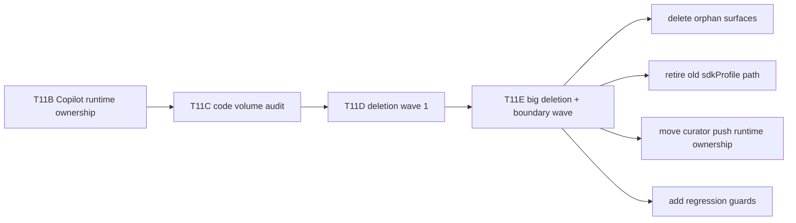
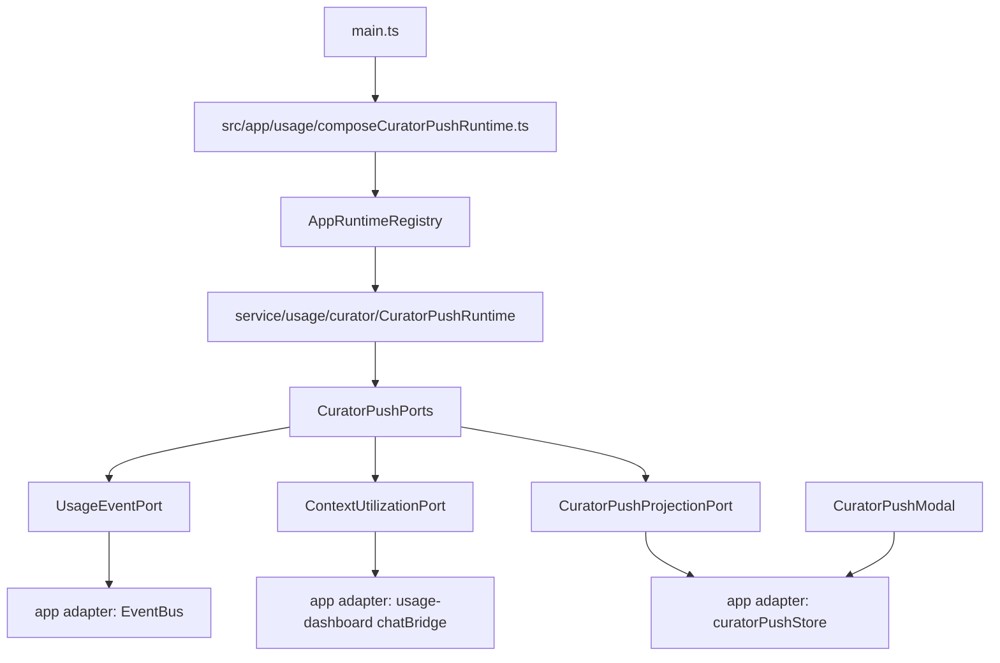

# Peak Assistant Modernization Handoff: T11E Big Deletion + Boundary Wave

Use this as the next Claude Code implementation prompt.

This supersedes the smaller Wave 2A-only prompt in `t11e-product-decision-packet-for-deletion-wave-2.md`. The owner asked for a bigger step. This task is therefore a combined wave:

1. delete approved orphan/runtime-inventory leftovers;
2. retire the old test-only SDK profile path;
3. move Usage Dashboard Curator Push out of service-layer UI/store/singleton ownership;
4. add source guards so these paths do not creep back.

Do **not** use this task to start Current Work State, Chat modernization, or Command Gateway.

## 1. Current Position



T11D proved we can safely delete. T11E should be meaningfully larger: it should delete old code and close one real remaining service -> UI boundary offender.

## 2. Work Packages

### Package A: Delete legacy Prompt Templates modal path

Confirmed evidence:

- `openPromptTemplates()` exists in `src/app/commands/PeakCommandActions.ts`.
- No command registration exposes it.
- `docs/progress.md` says the Advanced settings Prompt Templates section was removed.
- `src/ui/view/prompt-template/*` is an orphan modal path, not the reusable prompt engine.

Implement:

- Delete `src/ui/view/prompt-template/*`.
- Remove `PromptTemplateModal` import and `openPromptTemplates()` from `src/app/commands/PeakCommandActions.ts`.
- Remove stale comments that refer only to `PromptTemplateList UI`, especially in `src/service/chat/service-manager.ts`.

Do **not** delete:

- `src/service/prompt/*`
- `src/core/template/*`
- `templates/config/*`
- `src/service/prompt/PromptId.ts`
- prompt-related Copilot actions

### Package B: Remove AmbientContract from runtime source

Confirmed evidence:

- `src/service/ambient/AmbientContract.ts` is descriptive dependency inventory.
- It is not consumed by runtime code.
- `test/ambient-source-guard.test.ts` special-cases it because it contains historical locator strings.

Implement:

- Delete `src/service/ambient/AmbientContract.ts`.
- Update `test/ambient-source-guard.test.ts` so no `AmbientContract.ts` exemptions remain.
- If a short historical note is useful, add it to the T11E implementation note only; do not create another source file.

Do **not** touch:

- `src/service/ambient/AmbientRuntime.ts`
- `src/service/ambient/ports/*`
- `src/app/ambient/*`
- `src/ui/store/ambientPushStore.ts`
- `src/ui/store/morningBriefingStore.ts`

### Package C: Remove stale chat-view context-utilization future hook

Confirmed evidence:

- `src/ui/view/chat-view/integration/useCurrentContextUtilization.ts` is not imported by production code.
- Usage Dashboard already has its own active hook at `src/ui/view/usage-dashboard/integration/useCurrentContextUtilization.ts`.
- `src/ui/view/usage-dashboard/integration/chatBridge.ts` only points to the chat hook in a future-wire-up comment.

Implement:

- Delete `src/ui/view/chat-view/integration/useCurrentContextUtilization.ts`.
- Update `src/ui/view/usage-dashboard/integration/chatBridge.ts` comments so they no longer point to the deleted chat hook.
- Keep the existing usage-dashboard context bridge behavior intact.

Do **not** delete:

- `src/ui/view/chat-view/integration/messageReceiptSlot.ts`
- `src/ui/view/usage-dashboard/integration/useCurrentContextUtilization.ts`
- `src/ui/view/usage-dashboard/integration/chatBridge.ts`
- `src/ui/view/usage-dashboard/components/ContextRing.tsx`

### Package D: Retire old `vault-sdk/sdkProfile` path

Confirmed evidence:

- Active SDK env materialization uses `src/core/profiles/materialize.ts`.
- `src/service/agents/core/sdkAgentPool.ts` imports `toAgentSdkEnv` from `@/core/profiles/materialize`.
- Old `src/service/agents/vault-sdk/sdkProfile.ts` is imported only by `test/sdk-profile.test.ts`.
- `src/app/settings/types.ts` still carries the old `vaultSearch.sdkProfile` shape/default.

Implement:

- Delete `src/service/agents/vault-sdk/sdkProfile.ts`.
- Delete `test/sdk-profile.test.ts`.
- Remove `vaultSearch.sdkProfile` from `src/app/settings/types.ts` type/defaults.
- If any loader/migration code references `vaultSearch.sdkProfile`, remove or ignore it explicitly after verifying with `rg`.
- Ensure `test/profile-registry.test.ts` remains the canonical coverage for `core/profiles/materialize.ts`.

Do **not** touch:

- `src/core/profiles/*`
- `src/service/agents/core/sdkAgentPool.ts`
- `test/profile-registry.test.ts`
- provider/profile settings unrelated to `vaultSearch.sdkProfile`

### Package E: Move Usage Dashboard Curator Push to app-owned runtime

Current problem:

`src/service/usage/CuratorRuntimePushService.ts` violates several modernization rules:

- service-layer singleton: `CuratorRuntimePushService.getInstance()`;
- service imports Obsidian `App`;
- service imports UI store: `useCuratorPushStore`;
- service imports UI integration bridge: `getCurrentContextUtilization`.

This should become an app-composed runtime with explicit ports, following the T8/T9/T10/T11B pattern.

#### Target shape



Implement one coherent version of this shape:

- Replace `src/service/usage/CuratorRuntimePushService.ts` with a dependency-light runtime, for example:
  - `src/service/usage/curator/CuratorPushRuntime.ts`
  - `src/service/usage/curator/CuratorPushPorts.ts`
  - `src/service/usage/curator/types.ts`
- The service runtime must not import:
  - `obsidian`
  - `@/app/*`
  - `@/ui/*`
  - `EventBus`
  - `AppContext`
  - Zustand stores
- Runtime should keep current behavior:
  - `usagePreviewEnabled` gates pushes;
  - high context ratio uses threshold `0.8`;
  - high spend uses threshold `$1.0`;
  - max one push per session;
  - dismissed keys suppress the same key for the session;
  - `dispose()` unsubscribes and resets projection/session state.
- Add app-layer composition, for example:
  - `src/app/usage/composeCuratorPushRuntime.ts`
  - app adapter for `EventBus` usage events;
  - app adapter for `getCurrentContextUtilization`;
  - app adapter for `useCuratorPushStore`.
- Add an app-owned binding in `src/app/runtime/AppRuntimeRegistry.ts`:
  - `setCuratorPushRuntime`
  - `getCuratorPushRuntime`
  - `tryGetCuratorPushRuntime`
  - `clearCuratorPushRuntime`
- Update `main.ts`:
  - remove direct import of `CuratorRuntimePushService`;
  - compose and bind the curator runtime at plugin boot;
  - keep `mountCuratorPushRoot()` for the React modal/slots;
  - clear the runtime on unload via `AppRuntimeRegistry` / `AppContext` path.

Do **not** change:

- `UsageTrackingService`
- `UsageOutcomeService`
- `UsageOptimizationService`
- dashboard SQL/repos
- `CuratorPushModal` visual behavior, except type import paths if needed
- `mountCuratorPushRoot()` behavior, except comments/imports if needed

## 3. Required Tests / Guards

Add or update tests near the existing style:

### Curator runtime fake-port tests

Create `test/curator-push-runtime-ports.test.ts` or similar.

Required coverage:

- high context ratio produces `context-near-limit` payload;
- high spend produces `high-spend` payload;
- `usagePreviewEnabled: false` suppresses pushes;
- first push throttles later pushes in same session;
- dismissed key suppresses that same signal;
- `dispose()` unsubscribes and resets projection state;
- fake ports prove runtime does not need Obsidian, EventBus, or Zustand.

### Curator source guard

Create `test/curator-push-runtime-source-guard.test.ts` or similar.

Required coverage:

- new `src/service/usage/curator/*` files have no imports from `@/ui/*`, `@/app/*`, `obsidian`, `EventBus`, or `AppContext`;
- no `CuratorRuntimePushService.getInstance` remains in `src` / `main.ts`;
- `src/service/usage` no longer imports `curatorPushStore`;
- `main.ts` imports app composition, not service singleton.

### Existing guard updates

Update:

- `test/ambient-source-guard.test.ts`
  - remove `AmbientContract.ts` exemptions.

Existing tests expected to stay green:

- `test/profile-registry.test.ts`
- `test/ambient-source-guard.test.ts`
- `test/usage-log-repo.test.ts`
- `test/usage-outcome-service.test.ts`
- `test/curator-validation.test.ts`

## 4. Verification Commands

Run:

```bash
npm run build
npm run audit:boundary
npm run test -- test/profile-registry.test.ts
npm run test -- test/ambient-source-guard.test.ts
npm run test -- test/usage-log-repo.test.ts test/usage-outcome-service.test.ts test/curator-validation.test.ts
npm run test -- test/curator-push-runtime-ports.test.ts test/curator-push-runtime-source-guard.test.ts
```

Run scoped rg checks:

```bash
rg -n "openPromptTemplates|PromptTemplateModal|PromptTemplateList|src/ui/view/prompt-template" src test main.ts
rg -n "AmbientContract|chat-view/integration/useCurrentContextUtilization" src test main.ts
rg -n "vaultSearch\\.sdkProfile|service/agents/vault-sdk/sdkProfile|DEFAULT_SDK_PROFILE|readProfileFromSettings" src test main.ts
rg -n "CuratorRuntimePushService|getInstance\\(\\)\\.init\\(this\\.app|curatorPushStore|usage-dashboard/integration/chatBridge" src/service src/app main.ts test
```

Expected after-state:

- No live `openPromptTemplates` / `PromptTemplateModal` hits.
- No `AmbientContract` source/test exemptions.
- No old chat-view context utilization hook.
- No old `vaultSearch.sdkProfile` type/defaults.
- No old `CuratorRuntimePushService.getInstance` singleton path.
- New service runtime has no UI/app/Obsidian imports.
- App layer is the only place that touches EventBus + usage-dashboard store/bridge for Curator Push.

## 5. Expected Impact

Estimated deletion/reduction:

```text
Prompt Templates modal path: ~433 LOC
AmbientContract source inventory: ~286 LOC
chat-view context future hook: ~72 LOC
old sdkProfile path + test + settings defaults: ~250-350 LOC
Curator service singleton replaced by smaller runtime + adapters/tests: mixed, likely net small or medium
```

This task may not show huge net deletion because Package E adds ports/tests/adapters, but it should improve the import graph:

- service -> UI should drop by at least 2 edges from removing `CuratorRuntimePushService` imports;
- service AppContext count should not increase;
- service/core Obsidian side-effect count should not increase;
- no new module-level service singleton should appear.

## 6. Anti-Goals

Do not:

- start Current Work State;
- start Command Gateway;
- modify Chat runtime architecture;
- delete `messageReceiptSlot.ts`;
- delete `core/po/graph.po.ts`;
- delete `core/profiles/*`;
- rewrite Usage Dashboard UI;
- touch database schema unless a build/test proves it is required;
- add compatibility facades that keep old business paths alive.

## 7. Owner Code Reading Guide After Implementation

Your implementation note must tell the owner to read in this order:

1. `git show --name-status <commit>`
   - See the big deletion / movement set.
2. `src/app/usage/composeCuratorPushRuntime.ts`
   - See how app-owned composition wires EventBus, context, and UI projection.
3. `src/service/usage/curator/CuratorPushRuntime.ts`
   - See the pure runtime behavior and thresholds.
4. `src/service/usage/curator/CuratorPushPorts.ts`
   - See the fakeable boundaries.
5. `src/app/runtime/AppRuntimeRegistry.ts`
   - Confirm Curator runtime is app-owned.
6. `main.ts`
   - Confirm boot/unload path.
7. `test/curator-push-runtime-ports.test.ts`
   - Understand behavior with fake ports.
8. `test/curator-push-runtime-source-guard.test.ts`
   - Understand what cannot regress.
9. `src/app/settings/types.ts`
   - Confirm old `vaultSearch.sdkProfile` is gone while `core/profiles/*` remains.

## 8. Implementation Note Required Format

When done, provide:

- Chinese summary.
- Commit hash.
- Files changed grouped by package A-E.
- Exact deletion LOC and net LOC delta.
- Boundary audit before/after:
  - total flagged;
  - service -> UI;
  - service -> app;
  - service/core Obsidian side-effect;
  - service AppContext count.
- Verification command results.
- Preserved/protected files explicitly not touched.
- Code reading guide.
- Suggested next task.

