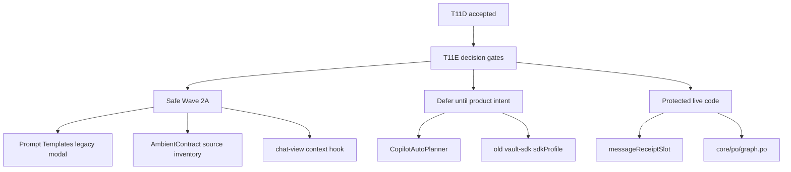
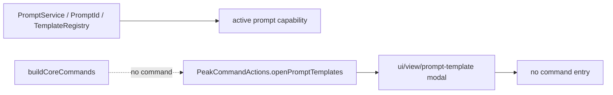
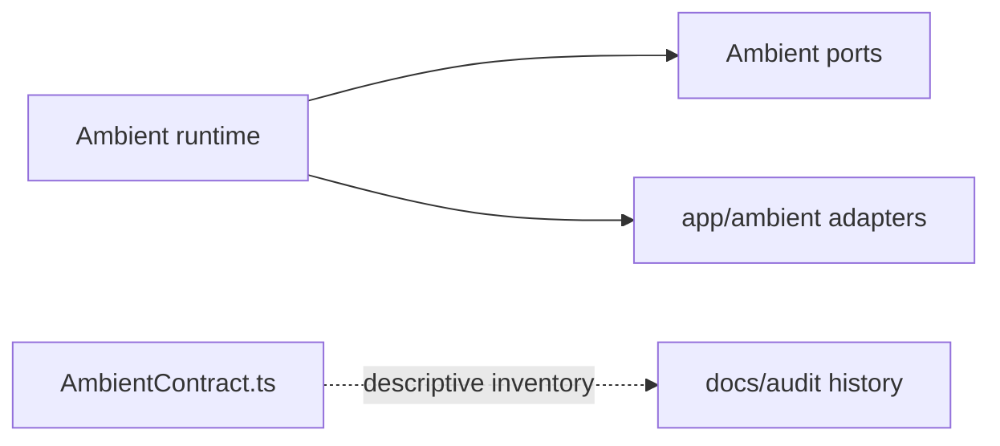
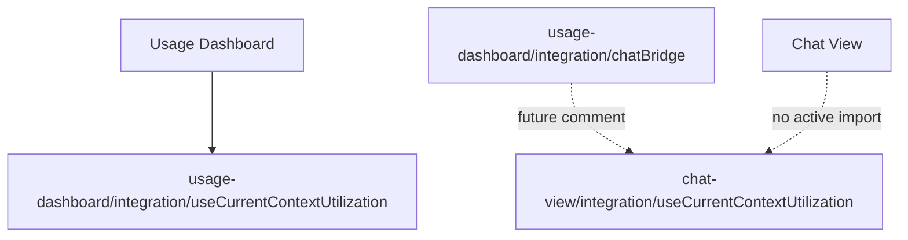

# T11E Product Decision Packet for Deletion Wave 2

Status: **superseded for implementation** by [`t11e-big-deletion-boundary-wave-handoff.md`](./t11e-big-deletion-boundary-wave-handoff.md).

This packet remains useful as the smaller decision map, but the owner later asked for a larger implementation step. Use the big handoff as the prompt to Claude Code.

Purpose: decide which T11C/T11D leftovers are product surfaces and which are old scaffolding. This packet is intentionally owner-facing: no source edits yet, only decisions and a Claude Code handoff draft.

Recommended owner decision:

```text
Approve Wave 2A:
- delete Prompt Templates legacy modal surface;
- move/delete AmbientContract runtime-source inventory;
- delete chat-view context-utilization future hook and stale bridge comment;
- keep messageReceiptSlot;
- defer CopilotAutoPlanner and sdkProfile until product/settings intent is clearer.
```

Why this shape: it gives the next Claude task a bigger deletion batch without mixing in uncertain product roadmap code.

## 1. Current Map



How to read:

- Wave 2A should delete/move code whose product surface is already missing or duplicated.
- Defer means “do not delete silently”, not “keep forever”.
- Keep means production references exist now.

## 2. Decision Table

| Gate | Evidence | Recommendation | Why |
| --- | --- | --- | --- |
| Prompt Templates legacy modal | `openPromptTemplates()` exists, but command registration does not expose it. `docs/progress.md` says the Advanced settings Prompt Templates section was removed. `src/ui/view/prompt-template/*` is 433 LOC. | **Approve delete** | The reusable prompt engine is not this modal. Deleting the orphan modal should not remove prompt/template capability. |
| AmbientContract source inventory | `src/service/ambient/AmbientContract.ts` is descriptive inventory. Tests special-case it because it intentionally contains string references. It is 286 LOC in runtime `src/`. | **Approve move/delete** | This belongs in docs/audit history, not active runtime source, unless it is used by a compiler or contract runner. |
| Chat-view context utilization hook | `src/ui/view/chat-view/integration/useCurrentContextUtilization.ts` is 72 LOC and only referenced as a future target by usage-dashboard `chatBridge.ts`. Usage Dashboard already has its own `integration/useCurrentContextUtilization.ts`. | **Approve delete stale future hook** | This is a future wire-up placeholder. Keeping it makes the dashboard/chat boundary look more real than it is. |
| `messageReceiptSlot` | `MessageViewItemRetained` imports it directly. | **Keep** | It is live production integration code, not a dead barrel. |
| CopilotAutoPlanner | `src/service/copilot/CopilotAutoPlanner.ts` is test-only, 154 LOC. It models “Auto” behavior across Copilot tabs. | **Defer** | This may be a real future product concept. Delete only after owner says “no Copilot Auto Planner”. |
| old `vault-sdk/sdkProfile` | `src/service/agents/vault-sdk/sdkProfile.ts` is test-only, 163 LOC, but `src/app/settings/types.ts` still has `vaultSearch.sdkProfile`. New active SDK path uses `core/profiles/materialize.ts`. | **Defer to ProfileRegistry cleanup** | It is likely old, but deletion should include a settings-type/default cleanup and must not touch the new `core/profiles/*` path. |
| `core/po/graph.po.ts` | Many production imports from search, sqlite repos, app ambient, copilot, tools, and tests. | **Keep protected** | T11C initially over-included it; T11D review corrected that. |

## 3. Visual Ownership Model

### Prompt Templates



Decision: delete the legacy modal path only. Do not delete PromptService, PromptId, TemplateRegistry, or templates/config.

### AmbientContract



Decision: move the inventory meaning to docs and remove runtime source if no code consumes it.

### Chat Context Hook



Decision: either wire the real path now or delete the future hook. For Wave 2A, delete is cleaner.

## 4. Recommended Wave 2A Scope

Approved deletes/moves:

- Remove `src/ui/view/prompt-template/*`.
- Remove `PromptTemplateModal` import and `openPromptTemplates()` from `src/app/commands/PeakCommandActions.ts`.
- Remove stale `PromptTemplateList UI` comment in `src/service/chat/service-manager.ts` if it only refers to the deleted modal.
- Delete `src/service/ambient/AmbientContract.ts`.
- Update `test/ambient-source-guard.test.ts` to remove the `AmbientContract.ts` special cases.
- Delete `src/ui/view/chat-view/integration/useCurrentContextUtilization.ts`.
- Update `src/ui/view/usage-dashboard/integration/chatBridge.ts` comment so it no longer points to a deleted future hook.

Protected:

- Do not touch `src/service/prompt/*`, `src/core/template/*`, `templates/config/*`, or `PromptId`.
- Do not touch `src/ui/view/chat-view/integration/messageReceiptSlot.ts`.
- Do not touch `src/core/po/graph.po.ts`.
- Do not touch `src/core/profiles/*` or `src/service/agents/core/sdkAgentPool.ts`.

Deferred:

- `src/service/copilot/CopilotAutoPlanner.ts` and `test/copilot-auto-planner.test.ts`.
- `src/service/agents/vault-sdk/sdkProfile.ts`, `test/sdk-profile.test.ts`, and `src/app/settings/types.ts` `vaultSearch.sdkProfile`.

Expected deletion size:

```text
Prompt Templates modal path: ~433 LOC
AmbientContract source inventory: ~286 LOC
Chat-view future hook: ~72 LOC
plus import/function/comment/test-guard cleanup
estimated Wave 2A: ~800 LOC
```

## 5. Claude Code Prompt Draft

Use this only if the owner approves the recommended Wave 2A scope.

```text
Task: T11E Wave 2A - delete approved product-decision leftovers

Context:
- We are on the Peak Assistant modernization branch after T11D commit da6ef34b.
- T11D accepted the first deletion wave and removed confirmed orphan debug/UI/service/core code.
- Codex owner review packet: docs/superpowers/audits/2026-06-25-t11d-owner-review-packet.md
- T11E decision packet: docs/superpowers/refactor-ops/t11e-product-decision-packet-for-deletion-wave-2.md

Owner-approved scope:
1. Delete the legacy Prompt Templates modal path:
   - src/ui/view/prompt-template/*
   - PromptTemplateModal import and openPromptTemplates() in src/app/commands/PeakCommandActions.ts
   - stale comments that mention PromptTemplateList UI if they only referred to this deleted modal.
   Do NOT delete PromptService, PromptId, TemplateRegistry, templates/config, or prompt-related Copilot actions.

2. Delete/move AmbientContract runtime-source inventory:
   - delete src/service/ambient/AmbientContract.ts
   - update test/ambient-source-guard.test.ts so it no longer special-cases AmbientContract.ts.
   Do NOT touch AmbientRuntime, Ambient ports, app/ambient adapters, ambient stores, or T8 runtime behavior.

3. Delete the stale chat-view context-utilization future hook:
   - delete src/ui/view/chat-view/integration/useCurrentContextUtilization.ts
   - update src/ui/view/usage-dashboard/integration/chatBridge.ts comment so it no longer points to the deleted chat hook.
   Do NOT delete src/ui/view/chat-view/integration/messageReceiptSlot.ts.
   Do NOT delete usage-dashboard/integration/useCurrentContextUtilization.ts.

Protected files/areas:
- src/core/po/graph.po.ts
- src/ui/view/chat-view/integration/messageReceiptSlot.ts
- src/core/profiles/*
- src/service/agents/core/sdkAgentPool.ts
- src/service/prompt/*
- src/core/template/*
- templates/config/*
- PromptId / PromptService / TemplateRegistry

Deferred, do not touch in this task:
- src/service/copilot/CopilotAutoPlanner.ts
- test/copilot-auto-planner.test.ts
- src/service/agents/vault-sdk/sdkProfile.ts
- test/sdk-profile.test.ts
- src/app/settings/types.ts vaultSearch.sdkProfile

Rules:
- No new runtime path.
- No behavior changes except removing orphan/unreachable surfaces.
- Prefer deletion over forwarding.
- Do not introduce new module-level mutable singletons.
- Keep changes scoped to the approved files.
- If a supposedly orphan file has a live production import, stop and list it as preserved instead of forcing deletion.

Verification:
- npm run build
- npm run audit:boundary
- npm run test -- test/ambient-source-guard.test.ts
- npm run test -- test/sdk-profile.test.ts
- npm run test -- test/copilot-auto-planner.test.ts
- rg -n "openPromptTemplates|PromptTemplateModal|PromptTemplateList|src/ui/view/prompt-template|AmbientContract|chat-view/integration/useCurrentContextUtilization" src test main.ts
- git diff --stat
- source LOC removed via git diff --numstat

Implementation note must include:
- 中文摘要。
- Exact files deleted/modified.
- Why each deletion is safe.
- Any candidates intentionally left untouched.
- Boundary audit after-state.
- LOC delta.
- Code reading guide for the owner.
```

## 6. Owner Reading Guide

Before approving Wave 2A, read only these:

1. `src/app/commands/PeakCommandActions.ts`
   - Look at `openPromptTemplates()`.
   - Question: do you still want this as a command/palette surface?

2. `src/ui/view/prompt-template/PromptTemplateModal.tsx`
   - Question: is this UI still part of the product, or old settings-era UI?

3. `src/service/ambient/AmbientContract.ts`
   - Question: should this descriptive inventory live in `src/`, or only in docs?

4. `src/ui/view/usage-dashboard/integration/chatBridge.ts`
   - Look at the comment pointing to chat-view hook.
   - Question: do we want to wire the real chat hook now, or delete the placeholder?

5. `src/service/copilot/CopilotAutoPlanner.ts`
   - Read for product intent only.
   - Question: is Copilot Auto a real future UX?

6. `src/service/agents/vault-sdk/sdkProfile.ts` and `src/core/profiles/materialize.ts`
   - Compare old vs new profile env materialization.
   - Question: can old `vaultSearch.sdkProfile` be retired in a later ProfileRegistry cleanup?

## 7. Codex Recommendation

My recommendation:

- Approve Wave 2A exactly as drafted.
- Do not decide CopilotAutoPlanner or sdkProfile in the same Claude task.
- After Wave 2A lands, run a bigger boundary task targeting:
  - `src/service/usage/CuratorRuntimePushService.ts` service -> UI store coupling;
  - `src/service/chat/service-conversation.ts` chat store coupling;
  - `src/core/document/loader/*` core -> service/app type leaks.

That would be a real architecture cleanup wave, not another tiny orphan deletion pass.
