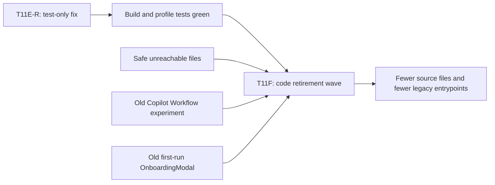

# T11F Code Retirement Wave Handoff

Date: 2026-06-25  
Prepared by: Codex  
Intended implementer: Claude Code  
Mode: deletion-first architecture cleanup

## Why This Exists

The owner is correct that the recent fix did not delete enough code. `dd6750b0` was only a test assertion fix. The repo still has about:

- `140,316` tracked `src/**/*.ts(x)` lines.
- `147,859` tracked `src` lines overall.
- `358` boundary audit findings after T11E-R.

T11F should therefore not be another small port extraction. It should retire code paths.

## Current Evidence

Confirmed by Codex on 2026-06-25:

```bash
npm run test -- test/profile-registry.test.ts
npm run build
npm run audit:boundary
```

Results:

- T11E-R is green: profile-registry 30/30, build passes.
- Boundary audit after T11E-R: `358` total findings.
- A static reachability scan from `main.ts` found only four production-unreachable source files above 30 LOC:
  - `src/service/skills/SkillExecutor.ts` — 308 LOC.
  - `src/service/copilot/CopilotAutoPlanner.ts` — 155 LOC.
  - `src/core/providers/openai-compatible/OpenAICompatibleService.ts` — 95 LOC.
  - `src/ui/view/vault-lint/components/PriorityActionsList.tsx` — 71 LOC.

This means a larger reduction now requires product-aware retirement, not just orphan cleanup.

## Mental Model



## Target Outcome

Implement Packages A, B, and C in one commit unless hard evidence shows one package is unsafe. If a package is unsafe, do not half-delete it; leave it intact and explain why in the implementation note.

Expected gross source deletion target:

- Package A: about 629 source LOC.
- Package B: about 522 source LOC plus action wiring cleanup.
- Package C: about 776 source LOC, while keeping shared provider form components.
- Total expected source deletion: about 1,900 LOC before small wiring adjustments.

The goal is net negative source lines, not new abstraction.

## Package A — Delete Confirmed Unreachable Files

Delete:

- `src/service/skills/SkillExecutor.ts`
- `src/service/copilot/CopilotAutoPlanner.ts`
- `src/core/providers/openai-compatible/OpenAICompatibleService.ts`
- `src/ui/view/vault-lint/components/PriorityActionsList.tsx`
- `test/copilot-auto-planner.test.ts`

Then update tests that reference deleted source files:

- `test/vault-lint-runner.test.ts`
  - Remove `PriorityActionsList.tsx` from any source-file inventory assertion.
  - Keep the rest of Vault Lint test behavior unchanged.

Do not delete:

- `src/service/skills/SkillRegistry.ts`
- `src/service/skills/SkillParser.ts`
- `src/service/skills/types.ts`
- `src/service/skills/builtin/index.ts`

Reason: the registry/parser path is still used by `main.ts` and by Harness skill lifting. Only the old executor is unreachable.

## Package B — Retire Old Copilot Workflow Experiment

The `run-workflow` action is a legacy IFTTT-style experiment. It is live only through the Copilot action catalog, but it is not part of the current modernization spine and adds service/UI surface area.

Delete:

- `src/service/workflow/WorkflowAgent.ts`
- `src/service/workflow/WorkflowRunner.ts`
- `src/service/workflow/types.ts`
- `src/ui/view/copilot/panels/WorkflowPanel.tsx`

Remove wiring:

- `src/service/copilot/actions/index.ts`
  - Delete the `runWorkflowAction` definition.
  - Remove it from the returned action list.
- `src/ui/view/copilot/copilot-action-surfaces.tsx`
  - Remove the `WorkflowPanel` import.
  - Remove the `'run-workflow': WorkflowPanel` mapping.
- `src/service/copilot/intent-hub.ts`
  - Remove `run-workflow` from special intent routing.
- `test/copilot-intent-hub.test.ts`
  - Remove or rewrite the assertion that expects `run-workflow` to map to `setting`.

Do not touch other Copilot actions.

## Package C — Retire Old First-Run Onboarding Modal

There are now two onboarding surfaces:

- Old general setup: `OnboardingModal`.
- Current capability-binding wizard: `HarnessOnboardingModal`.

T11F should keep the current wizard and retire the old first-run modal path.

Change:

- In `main.ts`, replace the lazy `require('@/ui/view/modals/OnboardingModal')` first-run path with `HarnessOnboardingModal`.
  - Use `new HarnessOnboardingModal(appContext, { isReRun: false }).open()`.
  - Prefer a normal import if it fits existing main.ts style.

Delete:

- `src/ui/view/modals/OnboardingModal.tsx`
- `src/ui/view/modals/onboarding/IndexConfigStep.tsx`
- `src/ui/view/modals/onboarding/IndexErrorDialog.tsx`
- `src/ui/view/modals/onboarding/IndexProgressDisplay.tsx`
- `src/ui/view/modals/onboarding/indexingStartup.ts`
- `test/onboarding-indexing-startup.test.ts`

Keep:

- `src/ui/view/modals/onboarding/ProviderForm.tsx`

Reason: `HarnessOnboardingModal` still imports and uses `ProviderForm`.

If build evidence shows a deleted onboarding component is still used by Harness, stop and report. Do not re-create a second onboarding system.

## Explicit Non-Goals

Do not touch these in T11F:

- Quick Search runtime.
- Chat runtime.
- Ambient runtime.
- Curator Push runtime.
- Command Gateway.
- `ReportOrchestrator`.
- `analysisDocPersistence`.
- Gap Analysis / Knowledge Intuition.
- PatternDiscovery.
- GraphFullscreen.

Reason: these may need a product decision or a dedicated boundary wave. T11F is a retirement wave, not a broad architecture rewrite.

## Required Source Guards

After deletion, these commands should return no production hits except intentional docs/tests if noted:

```bash
rg -n "SkillExecutor|CopilotAutoPlanner|OpenAICompatibleService|PriorityActionsList" src test main.ts
rg -n "run-workflow|WorkflowPanel|WorkflowAgent|WorkflowRunner|service/workflow" src test main.ts
rg -n "\bOnboardingModal\b|IndexConfigStep|IndexErrorDialog|IndexProgressDisplay|indexingStartup" src test main.ts
```

Allowed remaining hit:

- `ProviderForm.tsx` may remain, but comments should no longer mention the deleted general `OnboardingModal`.

## Required Verification

Run:

```bash
npm run build
npm run test -- test/copilot-intent-hub.test.ts test/vault-lint-runner.test.ts test/harness-onboarding-state.test.ts test/onboarding-state-machine.test.ts
npm run test -- test/profile-registry.test.ts
npm run audit:boundary
```

Also run:

```bash
git diff --stat
git diff --numstat
```

The implementation note must include:

- Exact files deleted.
- Exact files modified.
- Gross deleted source LOC and net source LOC delta.
- Boundary audit before/after.
- Confirmation that no Gap Analysis / Knowledge Intuition / Quick Search / Chat files were touched.
- Confirmation that no new runtime singleton, `let currentRuntime`, or service-layer default mutable singleton was introduced.

## Claude Code Prompt

Use this prompt directly:

```text
Implement T11F Code Retirement Wave in the Peak Assistant plugin.

Goal: deletion-first cleanup. Do not add new architecture unless required to keep existing wiring compiling. Implement Packages A, B, and C from docs/superpowers/refactor-ops/t11f-code-retirement-wave-handoff.md in one commit if safe.

Package A:
- Delete confirmed unreachable files:
  - src/service/skills/SkillExecutor.ts
  - src/service/copilot/CopilotAutoPlanner.ts
  - src/core/providers/openai-compatible/OpenAICompatibleService.ts
  - src/ui/view/vault-lint/components/PriorityActionsList.tsx
  - test/copilot-auto-planner.test.ts
- Update test/vault-lint-runner.test.ts so it no longer expects PriorityActionsList.tsx.
- Do not delete SkillRegistry, SkillParser, service/skills/types.ts, or builtin skills.

Package B:
- Retire the old Copilot run-workflow experiment.
- Delete:
  - src/service/workflow/WorkflowAgent.ts
  - src/service/workflow/WorkflowRunner.ts
  - src/service/workflow/types.ts
  - src/ui/view/copilot/panels/WorkflowPanel.tsx
- Remove runWorkflowAction from src/service/copilot/actions/index.ts.
- Remove WorkflowPanel import and 'run-workflow' panel mapping from src/ui/view/copilot/copilot-action-surfaces.tsx.
- Remove run-workflow special routing from src/service/copilot/intent-hub.ts.
- Update test/copilot-intent-hub.test.ts accordingly.

Package C:
- Retire the old first-run OnboardingModal path in favor of HarnessOnboardingModal.
- In main.ts, replace the first-run no-profile lazy OnboardingModal require with HarnessOnboardingModal:
  new HarnessOnboardingModal(appContext, { isReRun: false }).open()
- Delete:
  - src/ui/view/modals/OnboardingModal.tsx
  - src/ui/view/modals/onboarding/IndexConfigStep.tsx
  - src/ui/view/modals/onboarding/IndexErrorDialog.tsx
  - src/ui/view/modals/onboarding/IndexProgressDisplay.tsx
  - src/ui/view/modals/onboarding/indexingStartup.ts
  - test/onboarding-indexing-startup.test.ts
- Keep src/ui/view/modals/onboarding/ProviderForm.tsx because HarnessOnboardingModal still uses it.

Do not touch:
- Quick Search runtime
- Chat runtime
- Ambient runtime
- Curator Push runtime
- Command Gateway
- ReportOrchestrator
- analysisDocPersistence
- Gap Analysis / Knowledge Intuition
- PatternDiscovery
- GraphFullscreen

Verification required:
- npm run build
- npm run test -- test/copilot-intent-hub.test.ts test/vault-lint-runner.test.ts test/harness-onboarding-state.test.ts test/onboarding-state-machine.test.ts
- npm run test -- test/profile-registry.test.ts
- npm run audit:boundary
- rg -n "SkillExecutor|CopilotAutoPlanner|OpenAICompatibleService|PriorityActionsList" src test main.ts
- rg -n "run-workflow|WorkflowPanel|WorkflowAgent|WorkflowRunner|service/workflow" src test main.ts
- rg -n "\bOnboardingModal\b|IndexConfigStep|IndexErrorDialog|IndexProgressDisplay|indexingStartup" src test main.ts

Expected implementation note:
- Commit hash.
- Deleted files grouped by package.
- Modified files grouped by package.
- Gross deleted source LOC and net source LOC delta.
- Boundary audit before/after.
- Verification results.
- Explicit statement that Gap Analysis / Knowledge Intuition / Quick Search / Chat were not touched.
- Explicit statement that no new runtime singleton, service-layer mutable default, or dual system was introduced.
```
