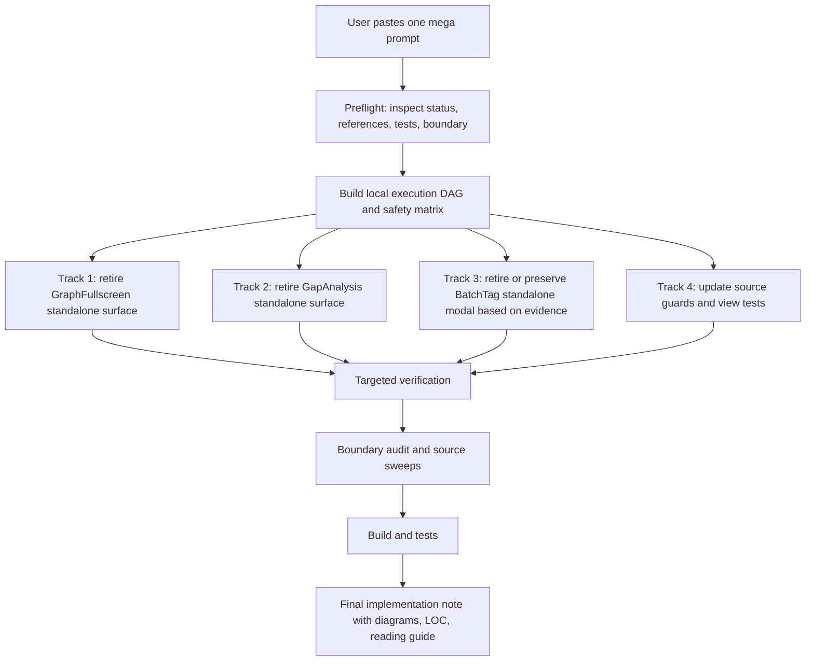

# T11G Single-Prompt Mega Wave Handoff

Date: 2026-06-26  
Prepared by: Codex  
Type: one-shot Claude Code implementation prompt

## 1. 核心改动

这份文档替代之前的小步 `T11G-A / T11G-B` 说法。

新的工作方式：

- 用户只给 Claude Code **一次 prompt**。
- Claude 先在本地分析依赖关系和风险，画出自己的 execution DAG。
- Claude 按 DAG 自动完成所有可安全执行的代码退役、合并、测试和报告。
- 不要每完成一个小包就停下来让用户再次搬运 prompt。
- 如果某个 track 发现产品/依赖风险，就跳过该 track，继续执行其它安全 track，并在 final implementation note 里说明。

这轮目标不是“最大胆乱删”，而是“单次输入、批量执行、按证据自动收敛”。

## 2. 为什么要改成 single-prompt

用户真实需求：

- 减少反复复制 Claude/Codex 内容的时间损耗。
- 一次性推进更大范围改造，而不是每次只动几十行或一两个文件。
- 仍然保留架构控制、代码理解、DAG 依赖、阅读 guide、验证和报告。
- 不要 vibe coding；Claude 负责编码，Codex 负责设计、审计、owner review。

所以 T11G 之后的 prompt 应该长一点、边界更清楚、执行更完整。

## 3. 这轮大任务的执行 DAG



读法：

- `Preflight` 和 `DAG` 是必须先做的。
- GraphFullscreen / GapAnalysis / BatchTag 是并列候选，Claude 可以先分析再决定执行顺序。
- 如果 BatchTag 无法证明是重复 surface，可以跳过 BatchTag，但不能因此停掉整个任务。
- 最后只输出一份 implementation note。

## 4. Single-Prompt Scope

### 必须尝试执行

1. Retire `GraphFullscreenView` as a standalone Obsidian view.
2. Retire `GapAnalysisView` as a standalone Obsidian view.
3. Analyze and, if safe, retire `BatchTagModal` as a standalone palette/modal surface.
4. Update command registration, view registration, tests, and source guards.
5. Run verification and produce one final implementation note.

### 必须保护

Do not delete these capabilities in this mega wave:

- `src/service/search/index/helper/structural/*`
- `src/core/storage/sqlite/repositories/StructuralAnalysisRepo.ts`
- `runStructuralAnalysis`
- `getStructuralAnalysisRepo`
- structural MCP tools and graph inspector tools
- `src/service/agents/KnowledgeIntuitionAgent.ts`
- `src/service/agents/intuition-helper/*`
- `knowledge_intuition_json` readers
- Quick Search core report/session/runtime code
- Chat runtime
- Ambient runtime
- Curator Push runtime
- Command Gateway
- Provider/Profile code

### 允许跳过但不能中断

If Claude cannot prove a candidate is safe:

- keep that candidate;
- record the exact import/entry/product reason;
- continue other independent tracks;
- do not ask the user mid-task unless the working tree is unsafe or tests reveal a real behavioral regression.

## 5. Candidate Evidence Snapshot

Confirmed from code before this handoff:

| Candidate | Evidence | Default action |
| --- | --- | --- |
| GraphFullscreen standalone view | `GRAPH_FULLSCREEN_VIEW_TYPE`, ViewManager registration, Quick Search `V2SourcesView` popout entry | Remove standalone leaf/popup surface; keep in-place source/graph UI |
| GapAnalysis standalone view | `peak-gap-analysis` command, `openGapAnalysis()`, ViewManager registration, `src/ui/view/gap-analysis/*` | Remove standalone view and command; keep structural engine/repo/tools |
| BatchTag standalone modal | `peak-batch-tag`, `openBatchTagSuggestions()`, `BatchTagModal`, `BatchTagPanel`, `TagSuggestionPanel` | Retire standalone modal only if tag capability remains covered |
| Structural engine | `runStructuralAnalysis`, `StructuralAnalysisRepo`, MCP/tools/digest users | Keep protected |
| Knowledge Intuition | writes/reads `knowledge_intuition_json`; feeds context | Keep protected |
| Copilot panels | many active action panels | Do not directly delete in this wave |

## 6. Mega Prompt For Claude Code

Copy the whole block below into Claude Code once.

```text
Task: T11G Single-Prompt Mega Wave — product surface retirement + guarded cleanup

You are working in:
/Users/zhangjike/code/my-code/mobius-highestpeak-kb/.obsidian/plugins/obsidian-peak-assistant

Context:
- Branch should be codex/peak-modernization-refactor.
- T11F was accepted at commit 79947556.
- Codex handoff: docs/superpowers/refactor-ops/t11g-product-retirement-decision-map.md
- Goal: do one larger implementation wave from one prompt. Do NOT stop after each subtask asking the user to paste another prompt.
- You may internally split work into tracks and DAG dependencies, but the user-facing result must be one completed implementation note.

Operating rules:
1. First inspect git status and current references. Do not overwrite unrelated user/Codex changes.
2. Build a short local execution DAG before editing:
   - what can be done in parallel;
   - what must be sequenced;
   - what is protected;
   - what gets skipped if unsafe.
3. Execute all safe tracks in one working session.
4. If a track is unsafe or ambiguous, skip that track with evidence and keep going with independent tracks.
5. Do not create a new replacement view or duplicate runtime.
6. Do not introduce service-layer mutable singleton state.
7. Prefer deletion over forwarding for retired surfaces.
8. No broad formatting.
9. Do not run two npm test invocations concurrently. This repo's test runner writes temp-test.js and parallel tests can race.

Track 1 — Retire GraphFullscreen standalone surface:
- Inspect:
  - src/ui/view/graph-fullscreen/GraphFullscreenView.tsx
  - src/app/view/types.ts
  - src/app/view/ViewManager.ts
  - src/ui/view/quick-search/components/V2SourcesView.tsx
- Remove GraphFullscreen as a standalone Obsidian view if no protected in-place graph rendering depends on the file.
- Remove GRAPH_FULLSCREEN_VIEW_TYPE and ViewManager registration.
- Remove or replace the Quick Search popout/expand entry that opens the standalone graph leaf.
- Keep the normal in-place Quick Search source/graph display.
- If a dependency proves GraphFullscreen is more than a popout view, keep it and document why.

Track 2 — Retire GapAnalysis standalone surface:
- Inspect:
  - src/ui/view/gap-analysis/*
  - src/app/view/types.ts
  - src/app/view/ViewManager.ts
  - src/app/commands/Register.ts
  - src/app/commands/PeakCommandActions.ts
  - test/view-switch-standalone-views.test.ts
- Remove GapAnalysisView, its standalone view type, ViewManager registration, activateGapAnalysisView, command registration, and openGapAnalysis().
- Delete view-only gap-analysis UI/store files only if they are used solely by the standalone view.
- Update tests that assert standalone view types.
- Keep protected structural capability code:
  - runStructuralAnalysis
  - src/service/search/index/helper/structural/*
  - StructuralAnalysisRepo
  - getStructuralAnalysisRepo
  - IndexService structural analysis wiring
  - maintenance recompute if it still runs structural analysis
  - structural MCP/tools/search graph inspector/digest usage
- If any gap-analysis file is shared by protected capability code, keep that file and document why.

Track 3 — Analyze and conditionally retire BatchTag standalone modal:
- Inspect:
  - src/app/commands/Register.ts
  - src/app/commands/PeakCommandActions.ts
  - src/ui/view/copilot/BatchTagModal.tsx
  - src/ui/view/copilot/panels/BatchTagPanel.tsx
  - src/ui/view/copilot/panels/TagSuggestionPanel.tsx
  - src/service/copilot/actions/index.ts
  - src/ui/view/copilot/copilot-action-surfaces.tsx
- Determine whether the standalone palette/modal path duplicates an existing Copilot tag-suggestion capability.
- If safe:
  - remove the standalone peak-batch-tag command and openBatchTagSuggestions();
  - delete BatchTagModal if it is no longer used;
  - keep the Copilot tag suggestion action/panel capability unless proven dead.
- If not safe:
  - keep BatchTag standalone path;
  - document the exact reason, entrypoint, and product behavior that still makes it unique.
- Do not delete tag suggestion capability broadly.

Track 4 — Cleanup and guards:
- Update imports, view type lists, tests, and comments affected by the retired surfaces.
- Add or adjust source-guard tests only if the repo has nearby guard-test patterns and the change is low-risk.
- Remove stale comments that mention retired standalone views, but do not rewrite unrelated docs.

Protected areas for this task:
- Do NOT delete src/service/search/index/helper/structural/*
- Do NOT delete src/core/storage/sqlite/repositories/StructuralAnalysisRepo.ts
- Do NOT delete runStructuralAnalysis or getStructuralAnalysisRepo
- Do NOT delete src/service/agents/KnowledgeIntuitionAgent.ts
- Do NOT delete src/service/agents/intuition-helper/*
- Do NOT delete knowledge_intuition_json readers/writers
- Do NOT touch Chat runtime
- Do NOT touch Ambient runtime
- Do NOT touch Curator Push runtime
- Do NOT touch Command Gateway
- Do NOT touch Provider/Profile code
- Do NOT refactor Quick Search report/session/runtime beyond the exact GraphFullscreen popout entry.

Required verification:
1. npm run build
2. npm run audit:boundary
3. npm run test -- test/view-switch-standalone-views.test.ts
4. Run any nearby tests you changed.
5. Source guards:
   rg -n "GRAPH_FULLSCREEN_VIEW_TYPE|GraphFullscreenView|graph-fullscreen|GAP_ANALYSIS_VIEW_TYPE|GapAnalysisView|openGapAnalysis|peak-gap-analysis" src test main.ts
   rg -n "BatchTagModal|openBatchTagSuggestions|peak-batch-tag" src test main.ts
   rg -n "runStructuralAnalysis|StructuralAnalysisRepo|getStructuralAnalysisRepo|find-structural-holes|knowledge_intuition_json" src test main.ts
6. git diff --stat
7. git diff --numstat -- src

Expected source-guard interpretation:
- First sweep should be empty or only documented/intentional non-live references.
- Second sweep should be empty if BatchTag standalone was retired; otherwise must show the live reason for keeping it.
- Third sweep must still show protected structural and knowledge-intuition capability references.

Commit:
- If all required verification passes, create one commit with an English message:
  refactor(modernization): T11G retire standalone product surfaces
- If BatchTag was skipped, use:
  refactor(modernization): T11G retire graph and gap standalone surfaces

Final implementation note must be in Chinese and include:
- 中文摘要。
- The execution DAG you used.
- What was changed, grouped by track.
- What was intentionally skipped and why.
- Exact files deleted/modified.
- Exact source guards and how to read their output.
- Proof that structural engine/repo/tools still exist.
- Proof that Knowledge Intuition context was not deleted.
- Boundary audit before/after if available.
- LOC delta from git diff --numstat.
- Code Reading Guide for the owner:
  1. files to read in order;
  2. key symbols;
  3. what each file proves;
  4. what not to worry about.
- Verification results.
```

## 7. Owner Reading Guide

如果 Claude 完成这次 mega wave，你读代码时按这个顺序：

1. `src/app/view/types.ts`
   - 看 standalone view type 列表减少了什么。

2. `src/app/view/ViewManager.ts`
   - 看被退役的 view registration 是否真的消失。

3. `src/app/commands/Register.ts`
   - 看 palette 入口减少了什么。

4. `src/app/commands/PeakCommandActions.ts`
   - 看 `openGapAnalysis` / `openBatchTagSuggestions` 等函数是否被删除或保留。

5. `src/ui/view/quick-search/components/V2SourcesView.tsx`
   - 看 GraphFullscreen popout 入口如何处理。

6. `src/service/search/index/helper/structural/orchestrator.ts`
   - 确认 structural engine 仍然保留。

7. `src/core/storage/sqlite/repositories/StructuralAnalysisRepo.ts`
   - 确认 structural data repo 仍然保留。

8. `src/service/chat/context/slots/VaultIntuitionSlot.ts`
   - 确认 Knowledge Intuition context 没被误删。

## 8. 成功标准

这轮成功不是“所有候选都必须删掉”。

成功标准是：

- 用户只需要输入一次 prompt。
- Claude 自动分析依赖并执行所有安全项。
- 至少完成 GraphFullscreen 和 GapAnalysis standalone surface 的退役，除非代码证据证明它们不可安全退役。
- BatchTag 如果安全就一起退役；如果不安全就保留并解释。
- 结构能力、知识直觉能力、Quick Search 核心、Chat/Ambient/Command Gateway 不被误伤。
- 最终 report 让 owner 能读懂代码变化，而不是只看到一堆 diff。

## 9. T11G 之后的节奏规则

之后 Codex 给 Claude 的任务默认应该是这种形态：

- 一个大 prompt；
- 内部有 DAG；
- 多个 independent tracks；
- 每个 track 有 skip rule；
- 一次 final implementation note；
- Codex 再做 owner review。

不要再把 owner 变成 prompt 搬运工。
