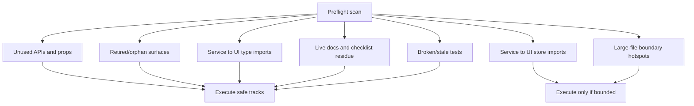

# T11H Scan-First Bulk Boundary Wave Handoff

Date: 2026-06-26  
Prepared by: Codex  
Type: one-shot Claude Code mega prompt

## 1. Owner Summary

T11G 的问题不是方向错，而是体量仍然偏小。`-1,201` LOC 对一个 13.7 万行的 `src` 来说不是“大改造”。T11H 改成 **scan-first bulk execution**：

- 不再由 Codex 手工挑 2-3 个候选。
- Claude 必须先扫描多个候选池，产出候选矩阵。
- 同一个 prompt 内执行所有 low-risk / medium-risk candidates。
- high-risk candidates 只记录，不停下来问用户。
- 如果最后只动很少代码，Claude 必须用候选矩阵解释为什么其它候选不能安全执行。

这轮目标是“更大但仍可控”：多 track、大扫描、一次 final note。

## 2. What Counts As Big Enough

不要用纯 LOC 作为唯一指标，但这轮不能只做一个小 cleanup。

Expected shape:

- at least 6-10 candidate clusters scanned;
- at least 3 independent tracks attempted;
- execute all safe tracks, not just the first easy track;
- reduce code volume, boundary findings, or live API surface in more than one area;
- if net deletion is below about 2k LOC, final note must explain the skipped candidate pool with evidence.

Do not manufacture churn just to hit a number. A correct large wave is one that removes or simplifies multiple real ownership surfaces.

## 3. Candidate Pools To Scan



T11H must scan these pools:

1. **Unused UI API / prop dust**
   - Confirm and remove `MultiLensGraph.onExpand` if no caller remains.
   - Scan for similar optional props or exported helpers that became unused after T11D-T11G.

2. **Retired / orphan surfaces**
   - Search command registrations, view registrations, modals, panels, and action surfaces.
   - Do not delete active product features blindly.

3. **Service -> UI type-only imports**
   - Current audit still has 14 `service -> ui` edges.
   - Safe target: move framework-agnostic graph/report/search types out of UI folders into `core` or `service` neutral type modules.
   - Be careful: ReactFlow-specific UI types should stay UI-side unless a neutral shape can be separated.

4. **Service -> UI store imports**
   - Examples from boundary audit:
     - `ReportOrchestrator` -> `useSearchSessionStore`
     - `SystemPromptSlot` / `service-conversation` -> `chatViewStore`
     - `analysisDocPersistence` -> quick-search callbacks/store types
   - These are larger. Execute only if a bounded port/type extraction is clear; otherwise record as T11I candidates.

5. **Live docs/checklist residue**
   - Update active progress/checklist docs so they do not instruct the owner to verify retired commands.
   - Do not mass rewrite historical specs/plans unless they are currently used as live guidance.

6. **Large-file boundary hotspots**
   - Scan largest files, but do not split files just for aesthetics.
   - Execute only if the change reduces dependency direction, old paths, or API surface.

7. **Stale tests / guards**
   - Fix tests that reference retired symbols.
   - Add source guards only when they protect against regression and do not become noisy.

## 4. Mega Prompt For Claude Code

Copy the whole block below into Claude Code once.

```text
Task: T11H Scan-First Bulk Boundary Wave

You are working in:
/Users/zhangjike/code/my-code/mobius-highestpeak-kb/.obsidian/plugins/obsidian-peak-assistant

Context:
- Branch: codex/peak-modernization-refactor.
- T11G accepted commit: 06d9442a.
- Codex owner review: docs/superpowers/audits/2026-06-26-t11g-owner-review-packet.md
- New operating rule: do one larger scan-first prompt with an internal DAG. Do not stop after one tiny cleanup.

Goal:
Run a scan-first bulk modernization wave. First discover a broad candidate pool, then execute all low-risk and medium-risk candidates in the same Claude session. Skip high-risk candidates with evidence, but keep going.

Preflight:
1. Inspect git status. Do not overwrite unrelated Codex docs or user changes.
2. Read:
   - docs/superpowers/audits/2026-06-26-t11g-owner-review-packet.md
   - docs/superpowers/refactor-ops/t11h-scan-first-bulk-boundary-wave-handoff.md
   - AGENTS.md Codex Collaboration Rules / architecture rules
3. Run or inspect:
   - npm run audit:boundary
   - find src -type f \( -name '*.ts' -o -name '*.tsx' \) -print | xargs wc -l | sort -nr | head -80
   - rg scans for T11G-retired symbols and obvious unused API dust.

Mandatory candidate matrix before editing:
Produce a compact table in your notes with at least these columns:
- candidate id
- files
- kind: delete / type move / boundary extraction / test guard / docs-live-cleanup / skip
- expected benefit
- risk
- decision: execute now / skip with reason
- verification

You do NOT need to ask the user after this matrix unless a stop condition appears. Continue implementation in the same session.

Candidate pools to scan:

Pool A — Unused UI API / prop dust:
- Confirm if src/ui/component/mine/multi-lens-graph/MultiLensGraph.tsx still has unused onExpand API after T11G.
- If no caller remains, remove the prop, related button branch, title text, and any tests/docs that treated it as live.
- Scan nearby graph components for similar dead props/helpers caused by T11G.

Pool B — Retired/orphan surfaces:
- Search active code for retired command/view/modal/panel residue:
  GRAPH_FULLSCREEN_VIEW_TYPE, GraphFullscreenView, graph-fullscreen,
  GAP_ANALYSIS_VIEW_TYPE, GapAnalysisView, openGapAnalysis, peak-gap-analysis,
  BatchTagModal, BatchTagPanel, openBatchTagSuggestions, peak-batch-tag.
- Clean live docs/checklists only. Do not rewrite historical specs/plans unless they are active guidance.
- Search for view registrations or command callbacks that point to missing/non-live surfaces.

Pool C — Service -> UI type-only imports:
- Inspect current `npm run audit:boundary` Service -> UI list.
- Try to eliminate safe type-only edges by moving framework-agnostic types out of UI folders.
- Known likely candidate:
  - src/ui/component/mine/multi-lens-graph/types.ts is imported by service/agents/*.
  - If safe, split neutral graph data types into a non-UI module, for example src/core/graph/lensGraphTypes.ts or another local neutral path.
  - Keep ReactFlow Node/Edge UI-specific types in UI if needed.
- Update all imports and tests.
- Do not move React components or UI-only layout logic into core/service.

Pool D — Service -> UI store imports:
- Inspect:
  - src/service/agents/report/ReportOrchestrator.ts
  - src/service/chat/context/slots/SystemPromptSlot.ts
  - src/service/chat/service-conversation.ts
  - src/service/search/analysisDocPersistence.ts
- Execute only bounded improvements:
  - type-only extraction to neutral modules;
  - adapter/port extraction if it is small and testable;
  - moving pure markdown/persistence helper out of UI callback modules if behavior stays identical.
- Skip if the fix requires redesigning Chat runtime, Quick Search runtime, or report orchestration in this wave.
- If skipped, record exact reason and next-wave shape.

Pool E — Stale tests / source guards:
- Fix tests that reference retired symbols or old assumptions.
- Add source guards only if they are deterministic and not comment-sensitive noise.

Pool F — Large-file hotspots:
- Inspect top 20 largest files.
- Execute only if there is an obvious local deletion or boundary cleanup with low risk.
- Do NOT split files just to inflate diff size.

Protected areas:
- Do not touch Command Gateway.
- Do not implement Current Work State / new Ambient Push product behavior.
- Do not rewrite Chat runtime or Quick Search runtime wholesale.
- Do not delete KnowledgeIntuitionAgent or intuition-helper.
- Do not delete StructuralAnalysisRepo, runStructuralAnalysis, structural tools, or graph inspector.
- Do not change persisted SQLite schema.
- Do not change model/provider/profile behavior.
- Do not add service-layer mutable singleton state.
- Do not add a second runtime path.

Expected execution:
- Execute all Pool A/B/C safe items.
- Execute Pool D/E/F items only when bounded and evidence-backed.
- Prefer 2-5 coherent commits if that improves reviewability, but one final implementation note.
- If total code deletion is small, final note must include a candidate matrix proving why bigger candidates were skipped.

Required verification:
Run sequentially, not in parallel:
- npm run build
- npm run audit:boundary
- npm run test -- test/view-switch-standalone-views.test.ts
- Any tests touched by moved types or boundary extraction
- rg source guards for retired symbols
- rg source guards for old service -> ui imports you attempted to remove
- git diff --stat
- git diff --numstat -- src test docs

Required final implementation note:
Write in Chinese first.
Include:
- 中文摘要
- Candidate matrix: executed and skipped
- Execution DAG
- Changed files grouped by track
- Deleted/reduced old paths
- Boundary audit before/after
- Service -> UI edge delta, especially if Pool C/D executed
- LOC delta
- Source guards and how to read them
- Verification commands and results
- Code Reading Guide:
  1. files to read in order
  2. key symbols
  3. what changed
  4. what remains intentionally old
- Next-wave candidates with exact blockers

Commit message:
- If substantial boundary cleanup happened:
  refactor(modernization): T11H bulk boundary cleanup wave
- If mostly API/docs dust plus type moves:
  refactor(modernization): T11H scan-first cleanup wave
```

## 5. Owner Acceptance Criteria

T11H should not be accepted if:

- it only removes `MultiLensGraph.onExpand` and stops;
- it does not produce a candidate matrix;
- it executes one tiny safe item but leaves other safe candidates untouched;
- it fails to explain skipped high-risk candidates;
- it touches protected capabilities without clear evidence;
- it cannot show build/test/audit/source-guard results.

T11H can be accepted even if deletion is below the desired size, but only if the skipped candidate matrix is convincing.
