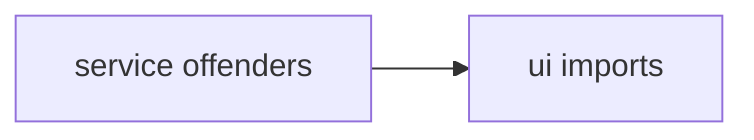
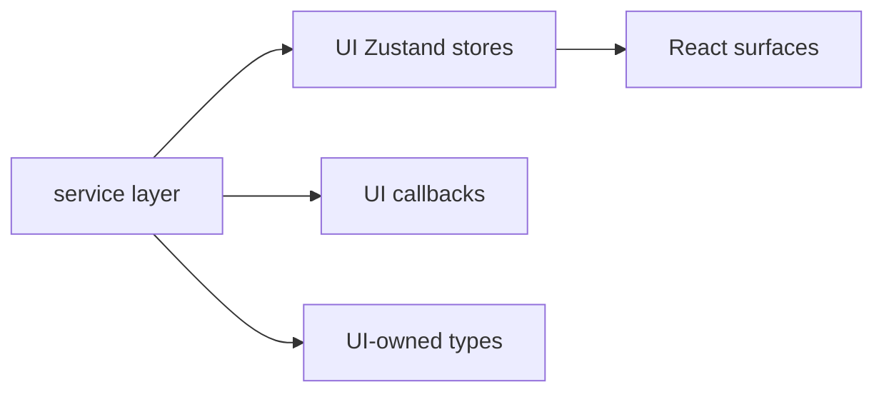
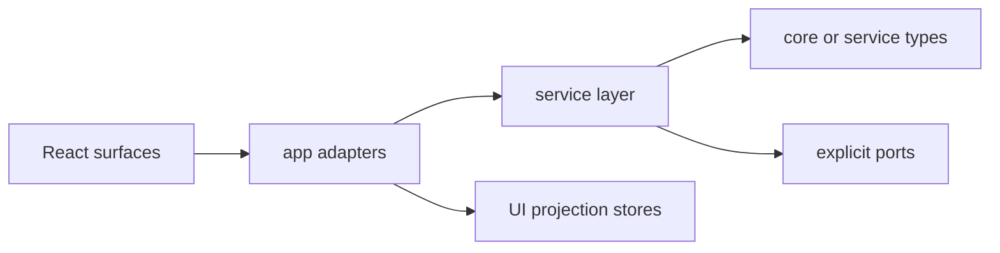

# Peak Assistant Modernization Handoff: T11I Hard Service-to-UI Boundary Wave

Branch:
`codex/peak-modernization-refactor`

## Owner Summary

这是一轮带硬指标的边界清理，不是 opportunistic cleanup。

目标很具体：把当前 boundary audit 里的 `service -> ui` 反向依赖从 **10** 降到 **<=2**。如果做不到，不能把结果称为 major wave；最多只能标成 minor cleanup 或 partial。

为什么现在做：

- T11H 是安全的小清理，但没有达到用户要求的“大步伐”。
- 当前剩余 `service -> ui` 只有 10 条，已经足够集中，适合一次性打穿。
- 这轮完成后，service 层将更像真正的业务层：不再直接读 Zustand store、UI callbacks、UI display helpers。

## Source-of-truth Docs

- `docs/superpowers/specs/2026-06-01-peak-system-architecture-modernization-handbook.html`
- `docs/superpowers/specs/2026-06-02-ambient-push-current-work-state-product-technical-review.html`
- `docs/superpowers/specs/2026-06-03-obsidian-plugin-command-gateway-capstone-review.html`
- `docs/superpowers/refactor-ops/README.md`
- `docs/superpowers/refactor-ops/architecture-scorecard.md`

## Current Evidence

Fresh audit after T11H:

```text
Files scanned: 832
Total flagged edges: 344
service -> ui: 10
core -> upstream: 77
service -> app: 56
```

Current `service -> ui` offenders:

| File | UI import | Required? |
| --- | --- | --- |
| `src/service/search/analysisDocPersistence.ts` | `quick-search/callbacks/save-ai-analyze-to-md` | Required |
| `src/service/search/analysisDocPersistence.ts` | `quick-search/store/v2SessionTypes` | Required |
| `src/service/search/analysisDocPersistence.ts` | `quick-search/store/sessionSnapshot` type | Required |
| `src/service/search/analysisDocPersistence.ts` | `quick-search/store/aiAnalysisStore` type | Required |
| `src/service/agents/report/ReportOrchestrator.ts` | `quick-search/store/searchSessionStore` | Required |
| `src/service/agents/report/ReportOrchestrator.ts` | `quick-search/store/searchSessionStore` type | Required |
| `src/service/chat/context/slots/SystemPromptSlot.ts` | `chat-view/store/chatViewStore` | Required |
| `src/service/chat/service-conversation.ts` | `chat-view/store/chatViewStore` | Required |
| `src/service/copilot/CopilotReviewArtifactBuilder.ts` | `quick-search/types/search-steps` | Optional |
| `src/service/agents/SynthesizeAgent.ts` | `quick-search/store/searchSessionStore` type | Optional |

## Phase 1 Must Be Read-Only Investigation

Claude Code must **not edit files, run formatters, stage files, or commit** in the first response.

First response must be an audit plan only. After Codex/user reviews and approves that plan, Claude Code may implement the approved DAG.

Required first response:

````md
## T11I Read-only Investigation

Files inspected:
- <list exact files>

Current dependency map:


Candidate matrix:
| Track | Required / Optional / Forbidden | Files | Proposed change | Expected service->ui delta | Risk | Implement now? |
| --- | --- | --- | --- | ---: | --- | --- |

Dependency DAG:
- Step 1:
- Step 2:
- Step 3:

Expected Impact Contract result:
- service -> ui before:
- service -> ui expected after:
- Required tracks expected complete:
- Tracks likely to skip:
- Does this look achievable as a major wave?

Exact file plan:
- New files:
- Modified files:
- Deleted files:
- Tests / guards:

Risks / stop conditions:
- ...

Verification plan:
- ...
````

Codex will audit this plan before implementation. If the plan cannot credibly hit `service -> ui <=2`, do not start coding.

## Impact Contract

This task counts as a major wave only if this contract is met.

Primary metric target:

- `service -> ui` reverse-direction imports: **10 -> <=2**.

Minimum acceptable delta:

- `service -> ui` must drop by at least **6**.
- Required tracks A, B, and C below must all be attempted.
- If only optional tracks land, do not commit as T11I major wave.

Required tracks:

1. Track A — `analysisDocPersistence` must stop importing UI callbacks and UI store/snapshot types.
2. Track B — `ReportOrchestrator` must stop importing `useSearchSessionStore` and `V2Section` from the UI store.
3. Track C — Chat runtime mode/capability reads must stop importing `useChatViewStore` from service files.

Optional tracks:

1. Track D — move `CopilotReviewArtifactBuilder` display helpers out of UI if low risk.
2. Track E — move `SynthesizeAgent` `Round` type dependency out of UI if low risk.

Skip budget:

- Claude Code may skip **at most one required track**, and only with concrete code evidence.
- If two or more required tracks are unsafe, stop before commit and return a blocker report.
- Optional tracks may be skipped without blocking the commit if the primary target is met.

Forbidden scope:

- Do not rewrite Chat UI or Quick Search UI behavior wholesale.
- Do not change SQLite schema.
- Do not implement Ambient Current Work State.
- Do not implement Command Gateway.
- Do not touch Knowledge Intuition, Structural Analysis engine, or Command Gateway.
- Do not add service-layer module runtime singletons.
- Do not add new `AppContext.getInstance()` shortcuts in service files as a way to bypass UI imports.

Stop / commit rule:

- If `service -> ui <=2`, commit and write the implementation note as "T11I major wave".
- If `service -> ui` drops by at least 6 but remains above 2 due one justified required skip, commit and label it "partial, not counted as full major wave".
- If `service -> ui` drops by less than 6, do not call it T11I major wave. Either stop without commit or commit only if the implementation note labels it "minor cleanup".

## Architecture Intent

Before:



After:



Rules:

- UI may import service types or call service/app runtime.
- App adapters may import UI stores when they are explicitly projection adapters.
- Service must not import UI stores, UI callbacks, or UI display helpers.
- If a type is shared by service and UI, move it to `src/core/**` or `src/service/**` based on ownership.

## Required Implementation Shape

### Track A — `analysisDocPersistence`

Goal:

- `src/service/search/analysisDocPersistence.ts` has zero `@/ui/*` imports.

Likely shape:

- Move `V2Section`, `Round`, `Annotation`, `V2AnalysisSnapshotData`, and pure snapshot serialization helpers out of `src/ui/view/quick-search/store/v2SessionTypes.ts` into a neutral service/core module.
- Move `V2SessionSnapshot` and its pure clone helpers out of `src/ui/view/quick-search/store/sessionSnapshot.ts` if service needs the type.
- Keep Zustand store action/state implementation in UI, but make it import the neutral types.
- Replace `saveAiAnalyzeResultToMarkdown` / `persistAnalysisDocToPath` UI callback dependency with a service/core vault persistence helper or a small port. The service may call a non-UI helper; UI may also call the same helper if needed.
- Preserve markdown output compatibility.

Acceptance:

- `analysisDocPersistence.ts` still has the same public API.
- Auto-save folder fallback behavior remains unchanged.
- Existing `test/analysis-doc-persistence-port.test.ts` still passes or is updated to guard `@/ui/*` imports too.

### Track B — `ReportOrchestrator`

Goal:

- `src/service/agents/report/ReportOrchestrator.ts` has zero `@/ui/*` imports.

Likely shape:

- Move `V2Section` type to the same neutral module used by Track A.
- Replace direct `useSearchSessionStore.getState()` calls with an explicit `ReportSessionPort` / `ReportOrchestratorStatePort` injected into the constructor, or pass callbacks in method options.
- App/UI code that constructs or calls `ReportOrchestrator` should provide the adapter that reads/writes `useSearchSessionStore`.
- Keep the report generation behavior and streaming/status updates unchanged.

Acceptance:

- `ReportOrchestrator.generateReport`, `regenerateSection`, and any section update path still update UI through an adapter, not direct service import.
- Tests or source guards prove `ReportOrchestrator.ts` no longer imports `@/ui`.

### Track C — Chat runtime mode/capability reads

Goal:

- `src/service/chat/context/slots/SystemPromptSlot.ts` and `src/service/chat/service-conversation.ts` have zero `@/ui/*` imports.

Likely shape:

- Introduce a small explicit `ChatRuntimeStatePort` or `ChatCapabilityStatePort` with:
  - `getChatMode()`
  - `isWebSearchEnabled()`
  - `isVaultSearchEnabled()`
- App/UI composition should adapt `useChatViewStore` to that port.
- `SystemPromptSlot` and `ConversationService` should receive the port through constructor/context/pipeline setup, not import Zustand directly.
- If constructor changes ripple through `AIServiceManager`, keep the change bounded and documented.

Acceptance:

- System prompt capabilities still reflect current UI toggles.
- `ConversationService.streamChat` still respects `chatMode` and web search toggle.
- No new service-side `AppContext.getInstance()` shortcuts are introduced to read these toggles.

### Track D — `CopilotReviewArtifactBuilder` optional

Goal:

- Remove the `@/ui/view/quick-search/types/search-steps` import if low risk.

Likely shape:

- Move `v2ToolDisplay`, `extractV2Summary`, and `unwrapToolOutput` to a neutral display/format helper if they are not React-specific.
- If the helper is deeply tied to Quick Search UI, skip and explain.

### Track E — `SynthesizeAgent` optional

Goal:

- Remove type-only `Round` import from UI if Track A moved the type.

Likely shape:

- Import `Round` from the neutral module created by Track A.

## Code Reading Guide Required In Implementation Note

Claude Code must include a Chinese code reading guide:

1. Neutral type modules created or moved.
2. Ports/adapters introduced for Quick Search report/session state.
3. Ports/adapters introduced for Chat runtime state.
4. Changed service files.
5. Changed UI/app adapter files.
6. Tests/source guards.

For each file, list:

- What to inspect.
- What behavior stayed the same.
- What old dependency was removed.
- Where to debug if it breaks.

## Verification Required

Run:

```bash
npm run build
npm run test -- test/analysis-doc-persistence-port.test.ts
npm run audit:boundary
```

Also add and run targeted tests/source guards for this wave:

```bash
npm run test -- <new service-ui-boundary guard test>
```

Required source checks:

```bash
rg -n "from ['\"]@/ui" src/service
rg -n "useChatViewStore|useSearchSessionStore" src/service
rg -n "from ['\"]@/ui/view/quick-search/store" src/service
```

Expected after-state:

- `npm run build` passes.
- `service -> ui` in boundary audit is `<=2`.
- No `@/ui/*` import remains in the required-track files.
- Any remaining `service -> ui` imports are listed with a reason and future owner.

## Implementation Note Required From Claude Code

After implementation and commit, report:

```md
## Implementation note — T11I

中文摘要:
- 本轮是否满足 Impact Contract:
- service -> ui before/after:
- 哪些 required tracks 完成:
- 哪些 tracks 跳过，为什么:
- 用户可见行为是否变化:
- 最重要的边界变化:
- 还剩哪些 service -> ui:
- 下一步建议:

Commit:
- <hash and message>

Changed files grouped by purpose:
- Neutral types/helpers:
- Ports:
- App/UI adapters:
- Service files:
- Tests/source guards:
- Deleted/reduced old dependencies:

Code reading guide:
- Read first:
- Then read:
- Optional:
- Debug entry:

Impact Contract result:
- Primary metric target:
- Actual:
- Minimum acceptable delta:
- Classification: major wave / partial / minor cleanup

Verification:
- npm run build:
- npm run test -- test/analysis-doc-persistence-port.test.ts:
- npm run test -- <new guard test>:
- npm run audit:boundary:
- rg checks:

Boundary audit delta:
- total:
- service -> ui:
- service -> app:
- core -> upstream:
- service/core -> Obsidian side-effect:
```
