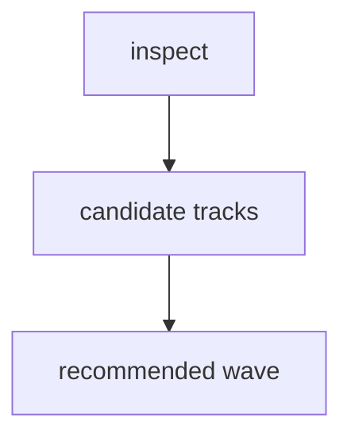

# Peak Assistant Modernization Handoff: T11J Big-Bucket Boundary Investigation

Branch:
`codex/peak-modernization-refactor`

## Owner Summary

T11I 已经把最危险的 `service -> ui` 反向依赖清零。现在 `total flagged` 仍然高，是因为剩下的大桶不是 UI 反向依赖，而是：

- `core -> upstream`: 79
- `service -> app`: 56
- `service/core -> Obsidian types`: 75
- `ui -> app`: 112

T11J 不允许直接实现。第一轮必须 read-only 调查：比较 `core -> upstream`、`service -> app`、`service/core -> Obsidian types` 三个大桶，并判断是否能形成一个 **combined mega wave**。目标不是少 20 条边，也不是单桶小胜，而是至少两个大桶联合，把 `total flagged` 打到百级 delta。

## Source-of-truth Docs

- `docs/superpowers/specs/2026-06-01-peak-system-architecture-modernization-handbook.html`
- `docs/superpowers/refactor-ops/README.md`
- `docs/superpowers/refactor-ops/architecture-scorecard.md`
- `docs/superpowers/audits/2026-06-26-t11i-owner-review-packet.md`

## Current Baseline After T11I

From `npm run audit:boundary` after `b1c2fd0f`:

```text
Files scanned: 844
Total flagged: 338
service -> ui: 0
core -> ui: 0
core -> upstream: 79
service -> app: 56
service/core -> Obsidian side-effect: 16
service/core -> Obsidian types: 75
ui -> app: 112
```

## Phase 1 Must Be Read-only Investigation

Claude Code must **not edit files, run formatters, stage files, or commit** in the first response.

First response must compare candidate waves and recommend one implementation plan.

Required first response:

````md
## T11J Read-only Investigation

Files inspected:
- <exact files>

Current metric snapshot:
- total flagged:
- core -> upstream:
- service -> app:
- service/core -> Obsidian types:
- service/core -> Obsidian side-effect:
- service -> ui:
- core -> ui:

Candidate bucket matrix:
| Bucket | Current count | Candidate files | Proposed boundary move | Expected delta | Risk | Include in mega wave? |
| --- | ---: | --- | --- | ---: | --- | --- |

Recommended T11J implementation wave:
- Bucket plan: single bucket / combined buckets
- Primary metric target:
- Minimum acceptable delta:
- Stretch target:
- Required tracks:
- Optional tracks:
- Forbidden scope:
- Skip budget:
- Stop / commit rule:

Dependency DAG:


Exact file plan:
- New files:
- Modified files:
- Deleted files:
- Tests / guards:

Expected before/after:
| Metric | Before | Expected after | Delta |
| --- | ---: | ---: | ---: |

Risks / stop conditions:
- ...

Verification plan:
- ...

Does this qualify as a major wave?
- Yes / No, with evidence.
````

Codex/user will audit this investigation before implementation.

## Candidate Bucket A — Core/Service Type Ownership Correction

Problem:

`core` still imports `@/service/**` and `@/app/**`, so it is not a true bottom layer. T11I removed `core -> ui`, but introduced or exposed some `core -> service` type edges through the moved Quick Search types.

Inspect at minimum:

- `src/core/search/sessionSnapshot.ts`
- `src/core/search/v2SessionTypes.ts`
- `src/core/storage/vault/search-docs/analysisSnapshotTypes.ts`
- `src/core/storage/vault/search-docs/AiSearchAnalysisDoc.ts`
- `src/core/storage/vault/search-docs/analysis-markdown-builder.ts`
- `src/core/storage/vault/search-docs/analysis-markdown-parser.ts`
- `src/service/agents/shared-types.ts`
- `src/service/search/types.ts`
- top `core/document/loader/*` offenders from the audit

Good outcomes:

- Move truly shared, framework-agnostic data shapes down to a better neutral layer.
- Or move modules that are not really core out of `src/core/**` into `src/service/**`.
- Reduce `core -> upstream` materially without reintroducing `core -> ui` or `service -> ui`.

Bad outcomes:

- Creating a fake `core` package that still imports `service`.
- Moving large agent/search business concepts into `core` just to reduce a number.
- Breaking persisted markdown / snapshot compatibility.

For this bucket to qualify as part of a mega wave, the proposed implementation should credibly target:

- `core -> upstream`: `79 -> <=30`, or
- at least `-45` `core -> upstream` edges with no `service -> ui` / `core -> ui` regression.

## Candidate Bucket B — Service-to-App Leak Wave

Problem:

`service -> app` remains 56, mostly through `AppContext.getInstance()` and app settings types. This means many services still know how to find the app shell instead of receiving explicit ports/deps.

Inspect at minimum:

- `src/service/search/analysisDocPersistence.ts`
- `src/service/agents/report/ReportOrchestrator.ts`
- `src/service/agents/SynthesizeAgent.ts`
- `src/service/chat/service-conversation.ts`
- `src/service/chat/service-manager.ts`
- `src/service/prompt/PromptService.ts`
- `src/service/tools/system-info.ts`
- `src/service/tools/content-reader.ts`
- `src/service/tools/types.ts`
- high-frequency agent files using `AppContext.getInstance()`

Good outcomes:

- Add ports/deps where one app adapter can remove multiple `AppContext` references.
- Continue the T11I pattern: service sees intent-shaped ports, app adapter owns AppContext/Obsidian shell.
- Prioritize hot paths already touched in T11I if they give real metric movement.

Bad outcomes:

- Adding module-level default dependencies.
- Replacing `AppContext.getInstance()` with another hidden service locator.
- Rewriting Chat, Quick Search UI, Ambient, or Command Gateway.

For this bucket to qualify as part of a mega wave, the proposed implementation should credibly target:

- `service -> app`: `56 -> <=15`, or
- at least `-40` `service -> app` edges with no `service -> ui` / `core -> ui` regression.

## Candidate Bucket C — Obsidian Types / Side-effect Cleanup

Include this if it can be combined with Bucket A or B without turning the task into unrelated churn.

For this bucket to qualify as part of a mega wave, the investigation should find a concentrated cluster with a clear port/adapter cut and credibly target:

- `service/core -> Obsidian types`: `75 -> <=35`, or
- at least `-35` `service/core -> Obsidian types` edges with no `service -> ui` / `core -> ui` regression.

Do not choose this as the only T11J bucket unless it can hit that threshold cleanly.

## Global Impact Contract For The Future Implementation

The implementation wave proposed by this investigation can count as T11J major wave only if it has:

- one primary metric target;
- target: `total flagged 338 -> <=230` (`-108`) through coordinated buckets;
- minimum acceptable delta: at least `-90` total flagged movement;
- stretch target: `total flagged <=210` (`-128`) if the investigation finds a safe three-bucket cut;
- at least two primary buckets must qualify by their bucket-specific threshold above;
- if only one bucket qualifies, this is not a T11J major wave even if the code change is useful;
- zero regression on `service -> ui` and `core -> ui`;
- no new service-layer module singleton / mutable default dependency;
- no new core import of `@/ui/**`;
- no UI redesign or product behavior rewrite.

If Claude cannot find a credible plan that meets at least `-90` total flagged movement and at least two qualifying bucket tracks, it must stop after investigation and say so. It may propose a smaller task, but that task must be labeled **partial/minor**, not T11J major wave.

## Verification Expected For The Future Implementation

The implementation plan must include:

```bash
npm run build
npm run audit:boundary
```

Plus targeted source guards, for example:

```bash
rg -n "from ['\"]@/ui" src/service src/core
rg -n "from ['\"]@/app" <target files>
rg -n "AppContext\\.getInstance" <target files>
```

If tests are added, run them serially. Do not run multiple `npm run test` commands in parallel.

## Do Not Touch

- Command Gateway / T12
- Ambient Current Work State
- Chat UI redesign
- Quick Search UI redesign
- SQLite schema
- Provider/model/profile behavior
- Any path that would reintroduce `service -> ui`
