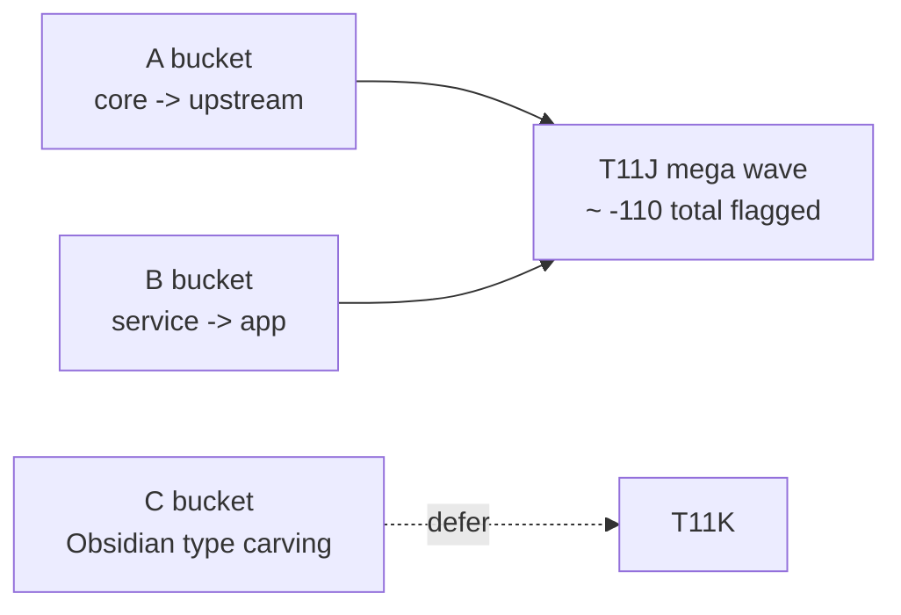

# T11J Read-only Investigation — Codex Review

## Verdict

批准进入实现，但必须带修正。

Claude 的 read-only investigation 这次达到了“大波次调查”的基本门槛：

- 不是单点修补，而是把 `core -> upstream` 和 `service -> app` 两个大桶合并成一个 coordinated wave。
- 预期 delta 是 `total flagged 338 -> ~228`，约 `-110`，满足 T11J 的 `<=230` target。
- 两个主桶都过线：`core -> upstream 79 -> ~12`，`service -> app 56 -> ~15`。
- 主动放弃 Bucket C 的 Obsidian type carving，避免一轮里同时重写 loader file-handle 语义，判断是对的。

但实现前要收紧四个边界，否则这轮容易从“大清理”变成“大搬家”。

## Approved Shape

可以执行一个 combined mega wave：



Approved required tracks:

- A1: 纯类型 relocation，例如 prompt id、agent shared types、chat/search/ambient/usage/lint/index/cascade/structural types。
- A2: settings 类型和默认值拆分，但只能搬纯 config/data shape。
- A3: document loader / rerank / TagService 对 AIServiceManager 的依赖改成窄 port。
- B1: agents 改为接收显式 LLM/prompt dependency，而不是自己读 AppContext。
- B2: vault-read tools 改为显式 vault reader port。
- B3: `analysisDocPersistence` / `service-manager` / `service-conversation` 继续去隐式 AppContext。
- B4: search graph tools 显式接收 SearchClient。

Deferred:

- Bucket C: `TFile` / `App` / Obsidian file-handle 抽象。这个值得做，但应该单独作为 T11K，不要和 T11J 混在一起。

## Required Corrections

### 1. A2 settings split must keep runtime helpers out of core

可以把这些搬到 core config：

- pure interfaces
- pure default objects
- pure enum/string literal unions
- pure folder-path builders that accept all required inputs as arguments

不要把这些搬进 core：

- `AppContext.getInstance()`
- Obsidian `normalizePath` import if it can be avoided with a pure helper
- any helper that reads current plugin settings implicitly
- any helper that depends on app boot state

Recommended shape:

```text
src/core/config/settingsTypes.ts
  pure types + defaults only

src/core/config/folderPaths.ts
  pure path helpers that receive rootFolder explicitly

src/app/settings/types.ts
  compatibility re-export shim
  app-only wrapper for "use current settings" helpers
```

Hard rule: after T11J, `src/core/**` must not import `@/app/settings/types`; it should import from `@/core/config/**`.

### 2. A3 port name must match the actual surface

Do not create a vague god-port.

For core document loaders, the needed surface appears to be `queryText(...)`. A narrow name like `DocumentSummaryLlmPort` or `TextGenerationPort` is acceptable.

For agents that need `renderPrompt(...)` or `queryStream(...)`, do not silently expand `IDocSummarizer`. Either:

- keep them out of A3 and handle them through a separate prompt/LLM port, or
- define a clearly named broader interface, for example `PromptLlmPort`, with only the exact methods those agents need.

Bad:

```ts
interface IDocSummarizer {
  queryText(...): Promise<string>;
  renderPrompt(...): Promise<string>;
  queryStream(...): AsyncIterable<...>;
}
```

Good:

```ts
interface DocumentSummaryLlmPort {
  queryText(...): Promise<string>;
}

interface PromptRenderPort {
  renderPrompt(...): Promise<string>;
}
```

### 3. Re-export shims are compatibility only, not second source of truth

Old files may remain as shims to avoid a massive import churn, but they must be one-line or thin re-exports.

Allowed:

```ts
export * from '@/core/search/searchTypes';
```

Not allowed:

```ts
// duplicate interfaces here while the core version also exists
```

This matters because the project rule is no dual system.

### 4. Boundary tests must not encode a fake floor

The investigation proposed tests that assert `<=14` or `<=15`. That is fine for a temporary regression guard, but the test name and message must make clear it is a post-T11J floor, not the final architecture target.

Prefer:

- `test/t11j-boundary-regression.test.ts`
- assertion messages that say "T11J floor"

Avoid making it sound like `core -> upstream <=14` is the ideal final state. The final target is still zero lower-layer upstream imports.

## Stop Conditions

Stop before commit if any of these happen:

- `core -> upstream` remains above 30.
- `service -> app` remains above 15.
- `total flagged` remains above 248. This is the hard minimum floor; target is `<=230`.
- `service -> ui` or `core -> ui` becomes non-zero.
- Any new `src/core/**` import of `@/app/context/AppContext` appears.
- Any new service-layer mutable singleton/default dependency appears.
- Settings split creates duplicated default objects instead of one source of truth.
- AI manager port becomes a generic "everything AIServiceManager can do" interface.
- The change starts redesigning Chat, Quick Search UI, Ambient, Command Gateway, or SQLite schema.

## Expected Impact Contract

| Metric | Before | Minimum after | Target after |
| --- | ---: | ---: | ---: |
| Total flagged | 338 | <=248 | <=230 |
| `core -> upstream` | 79 | <=30 | ~12 |
| `service -> app` | 56 | <=15 | ~15 |
| `service -> ui` | 0 | 0 | 0 |
| `core -> ui` | 0 | 0 | 0 |
| `service/core -> Obsidian types` | 75 | 75 | 75 |

## Required Verification

Run serially:

```bash
npm run build
npm run audit:boundary
npm run test -- test/t11j-boundary-regression.test.ts
npm run test -- test/service-ui-boundary.test.ts
npm run test -- test/analysis-doc-persistence-port.test.ts
```

Recommended source checks:

```bash
rg -n "from ['\"]@/ui" src/service src/core
rg -n "from ['\"]@/app" src/core
rg -n "AppContext\\.getInstance" src/core src/service
rg -n "let\\s+current[A-Z]" src/service
```

## Message To Send Back To Claude

```md
Codex reviewed the T11J read-only investigation. Approved to implement, but with these corrections.

Proceed with the combined A+B mega wave, targeting:
- total flagged 338 -> <=230, hard minimum <=248
- core -> upstream 79 -> <=30, target around 12
- service -> app 56 -> <=15
- service -> ui must stay 0
- core -> ui must stay 0

Required tracks:
- A1 pure type relocation
- A2 settings/config split
- A3 narrow AI manager port for core document/rerank/tag usage
- B1 agents explicit LLM/prompt dependency
- B2 vault-read tools explicit vault reader port
- B3 analysisDocPersistence/service-manager/service-conversation explicit deps
- B4 search graph tools explicit SearchClient

Corrections before coding:
1. A2 settings split: move only pure types/defaults/pure path helpers to `src/core/config/**`. Keep any `AppContext.getInstance()` / current-setting wrapper in `src/app/settings/types.ts` or another app module.
2. A3 port: do not make `IDocSummarizer` a god-port. Core loaders should depend on a narrow `queryText`-style port. If agents need `renderPrompt` or `queryStream`, use a separate clearly named port.
3. Old service/app type files may remain only as thin re-export shims. No duplicated interfaces/defaults.
4. Boundary tests may assert the T11J floor, but the test name/message must say this is a T11J regression floor, not the final architecture target.
5. Do not include Bucket C / TFile-to-VaultFile carving in this wave. Save it for T11K.

Hard stop before commit if:
- total flagged remains >248,
- core -> upstream remains >30,
- service -> app remains >15,
- service -> ui or core -> ui becomes non-zero,
- any new core import of AppContext appears,
- any new service-layer mutable singleton/default dependency appears,
- settings defaults become duplicated,
- Chat/Quick Search UI/Ambient/Command Gateway/SQLite schema gets redesigned.

Run verification serially:
- npm run build
- npm run audit:boundary
- npm run test -- test/t11j-boundary-regression.test.ts
- npm run test -- test/service-ui-boundary.test.ts
- npm run test -- test/analysis-doc-persistence-port.test.ts

Implementation note must include:
- exact before/after boundary table
- changed files grouped by track
- which old files became re-export shims
- confirmation that Bucket C was not touched
- confirmation that no Codex-owned docs were staged
```
