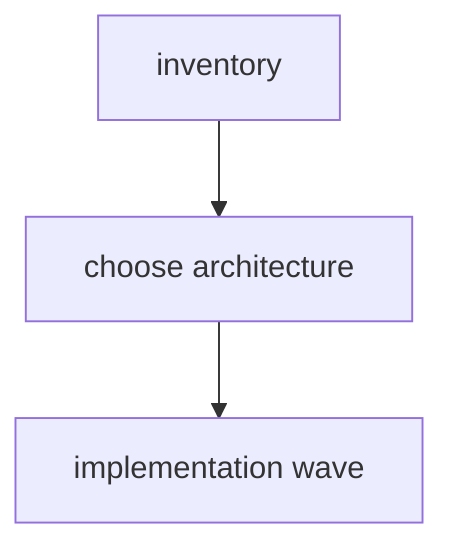

# Peak Assistant Modernization Handoff: T11K Obsidian File-Handle Boundary Investigation

Branch:
`codex/peak-modernization-refactor`

## Owner Summary

T11J 已经把两个大桶打下来了：

- `core -> upstream`: `79 -> 11`
- `service -> app`: `56 -> 15`
- `service -> ui`: still `0`
- `core -> ui`: still `0`

现在最大的剩余架构债是 Obsidian concrete type / file-handle coupling:

- `service/core -> Obsidian types`: `81`
- `service/core -> Obsidian side-effect surface`: `16`
- `core -> upstream`: `11`
- `total flagged`: `236`

T11K 不允许直接实现。第一轮必须 read-only investigation：先判断这些 `App` / `TFile` / `TFolder` / `Vault` / `MetadataCache` 依赖到底代表什么语义，再决定是抽中性 file handle / vault port，还是把 Obsidian-backed 实现从 `src/core/**` 迁出到 app/service adapter 层。

目标不是机械替换类型名。目标是让 owner 能看懂：**哪些模块是真 core，哪些只是放在 core 里的 Obsidian-backed infrastructure。**

## Source-of-truth Docs

- `docs/superpowers/specs/2026-06-01-peak-system-architecture-modernization-handbook.html`
- `docs/superpowers/refactor-ops/README.md`
- `docs/superpowers/refactor-ops/architecture-scorecard.md`
- `docs/superpowers/audits/2026-06-26-t11j-owner-review-packet.md`

## Current Baseline After T11J

From Codex rerun of `npm run audit:boundary` after `a14c4135`:

```text
Files scanned: 861
Total flagged: 236
service -> ui: 0
core -> ui: 0
core -> upstream: 11
service -> app: 15
service/core -> Obsidian side-effect: 16
service/core -> Obsidian types: 81
ui -> app: 113
```

Top relevant clusters:

```text
src/core/document/loader/*                         repeated App/TFile imports
src/core/document/loader/helper/DocumentLoaderManager.ts
src/core/document/resource/*
src/core/utils/obsidian-utils.ts
src/core/utils/vault-utils.ts
src/core/storage/vault/ChatStore.ts
src/core/storage/vault/chat-docs/ChatDocName.ts
src/service/chat/* and context/*
src/service/agents/*
src/service/search/index/*
src/service/tools/search-graph-inspector/*
```

## Phase 1 Must Be Read-only Investigation

Claude Code must **not edit files, run formatters, stage files, or commit** in the first response.

The first response must answer:

- Is `src/core/document/loader/**` really core, or is it Obsidian-backed infrastructure that should live outside core?
- If we keep loader interfaces in core, what exact neutral file shape is needed?
- Which Obsidian imports are only type handles, and which are real side-effect runtime dependencies?
- Which bucket can safely move 35+ edges without behavior churn?
- What is the smallest implementation wave that still deserves to be called T11K major?

Required first response:

````md
## T11K Read-only Investigation

Files inspected:
- <exact files>

Current metric snapshot:
- total flagged:
- service/core -> Obsidian types:
- service/core -> Obsidian side-effect:
- core -> upstream:
- service -> app:
- service -> ui:
- core -> ui:

Obsidian coupling inventory:
| Cluster | Files | Symbols used | Runtime use or type-only? | Real behavior dependency | Candidate move |
| --- | --- | --- | --- | --- | --- |

Candidate architecture options:
| Option | Description | Expected delta | Risk | Reversibility | Include in T11K? |
| --- | --- | ---: | --- | --- | --- |

Recommended T11K implementation wave:
- Architecture choice:
- Primary metric target:
- Minimum acceptable delta:
- Stretch target:
- Required tracks:
- Optional tracks:
- Forbidden scope:
- Skip budget:
- Stop / commit rule:

Dependency DAG:


Exact file plan:
- New files:
- Modified files:
- Deleted / moved files:
- Tests / guards:

Expected before/after:
| Metric | Before | Expected after | Delta |
| --- | ---: | ---: | ---: |

Code reading guide for owner:
1. `<file>` — why read it first
2. `<file>` — what changed
3. `<test>` — what proves it

Visual maps to include in the implementation note:
- before dependency map
- after dependency map
- file-handle ownership map
- old-path / guard map

Risks / stop conditions:
- ...

Verification plan:
- ...

Does this qualify as a major wave?
- Yes / No, with evidence.
````

Codex/user will audit this investigation before implementation.

## Candidate Bucket A — Document Loader Ownership

Problem:

`src/core/document/loader/**` is currently under `core`, but the implementations receive Obsidian `App`, resolve vault files, check `TFile`, scan `app.vault.getFiles()`, and read file contents. That looks less like pure core and more like Obsidian-backed infrastructure.

Inspect at minimum:

- `src/core/document/loader/BaseDocumentLoader.ts`
- `src/core/document/loader/helper/DocumentLoaderManager.ts`
- all concrete loaders under `src/core/document/loader/*DocumentLoader.ts`
- `src/core/document/loader/types.ts`
- `src/core/document/resource/FolderResourceLoader.ts`
- `src/core/document/resource/helper/ResourceKindDetector.ts`
- `src/core/document/resource/helper/ResourceLoaderManager.ts`
- `main.ts` loader initialization
- `src/service/search/index/indexService.ts` loader call sites

Must answer:

- Should pure loader interfaces stay in `src/core/document/loader/types.ts`?
- Should concrete Obsidian loaders move to `src/app/document-loader/**` or `src/service/document-loader/**`?
- Or should they remain in core but accept a neutral `VaultFileRef` / `VaultReaderPort`?
- Which path removes more real coupling with less risk?

Good outcomes:

- Core document model stays pure.
- Obsidian `App` / `TFile` / `TFolder` are owned by app/service adapters.
- Search indexing still gets the same `Document` output.
- No persisted index/schema/markdown compatibility change.

Bad outcomes:

- Renaming `TFile` to `VaultFileRef` while still secretly storing Obsidian objects.
- Moving large implementation files without clarifying ownership.
- Creating a second document-loading runtime path.
- Breaking binary loaders, image summaries, or ignore-pattern behavior.

For this bucket to qualify, the proposed implementation should credibly target:

- at least `-30` `service/core -> Obsidian types` edges, or
- moving concrete loaders out of `core` so the remaining core loader surface is interfaces/types only.

## Candidate Bucket B — Core Vault / Obsidian Utils Split

Problem:

Some utility files under `src/core/utils/**` are not pure utilities. They read `AppContext`, touch Obsidian vault/workspace, and import `TFile/TFolder`.

Inspect at minimum:

- `src/core/utils/obsidian-utils.ts`
- `src/core/utils/vault-utils.ts`
- `src/core/utils/markdown-utils.ts`
- callers of `ensureFolder`, `readFileAsText`, `readFileAsBase64`, `openFile`, `openAttachment`, `getPluginDirAbsolute`
- app-side adapters that already own vault writes, for example `src/app/quick-search/AppAnalysisDocVaultWriterAdapter.ts`

Possible moves:

- Split pure path/string helpers into `src/core/utils/**`.
- Move Obsidian runtime helpers to `src/app/obsidian/**` or `src/app/vault/**`.
- Keep legacy import shims only if needed, but service/core must not import app-owned concrete helpers after the wave.

For this bucket to qualify, the proposed implementation should credibly target:

- `core -> upstream`: `11 -> <=5`, and
- at least `-4` core `AppContext` / app-import edges, without raising `service -> app`.

## Candidate Bucket C — Service Agent / Chat Type Handles

Problem:

Many service files import Obsidian `App` or `TFile` only as constructor or context handles. Some are acceptable service infrastructure; some should be ports.

Inspect at minimum:

- `src/service/chat/types.ts`
- `src/service/chat/context/BuildUserProfileRunner.ts`
- `src/service/chat/context/UserProfileService.ts`
- `src/service/chat/context/ContextBuilder.ts`
- `src/service/agents/AIGraphAgent.ts`
- `src/service/agents/VaultSearchAgent.ts`
- `src/service/agents/VaultSearchAgentSDK.ts`
- `src/service/agents/ai-graph/*`
- `src/service/search/support/cost-estimator.ts`
- `src/service/tools/search-graph-inspector/explore-folder.ts`

This bucket is optional for T11K. Include it only if the investigation finds a concentrated, low-risk type-handle cut.

For this bucket to qualify, the proposed implementation should credibly target:

- at least `-10` `service/core -> Obsidian types` edges, with no new `service -> app` or `service -> ui` edges.

## Global Impact Contract For The Future Implementation

The implementation wave proposed by this investigation can count as T11K major only if it has:

- target: `service/core -> Obsidian types 81 -> <=40`;
- hard minimum: `service/core -> Obsidian types <=50`;
- target: `total flagged 236 -> <=190`;
- hard minimum: `total flagged <=205`;
- `core -> upstream <=8`, preferred `<=5`;
- `service -> app <=15` with no regression;
- `service -> ui = 0` and `core -> ui = 0`;
- no new module-level mutable runtime singleton/default dependency;
- no duplicate document-loading runtime path;
- no SQLite schema or persisted markdown format change;
- no UI redesign, Ambient work, Chat feature work, or Command Gateway work.

If Claude cannot find a credible plan that reaches at least the hard minimums, it must stop after investigation and say so. It may propose a smaller task, but that task must be labeled **partial/minor**, not T11K major wave.

## Verification Expected For The Future Implementation

The implementation plan must include:

```bash
npm run build
npm run audit:boundary
npm run test -- test/t11j-boundary-regression.test.ts
npm run test -- test/service-ui-boundary.test.ts
```

Likely new guards:

```bash
npm run test -- test/t11k-obsidian-boundary-regression.test.ts
```

Recommended source checks:

```bash
rg -n "from ['\"]obsidian" src/core/document src/core/utils
rg -n "from ['\"]@/app" src/core
rg -n "from ['\"]@/ui" src/service src/core
rg -n "let\\s+current[A-Z]|let\\s+default[A-Z].*=\\s*null" src/service src/core
```

If tests are added, run them serially. Do not run multiple `npm run test` commands in parallel.

## Implementation Note Requirements

If this later proceeds to implementation, Claude's final note must include:

- exact before/after boundary table;
- changed files grouped by track;
- code reading guide for the owner;
- at least four small Mermaid diagrams:
  - before dependency map;
  - after dependency map;
  - file-handle ownership map;
  - old-path / guard map;
- explicit statement of whether concrete document loaders still live in `core`;
- explicit statement of whether any old import path remains as compatibility shim;
- confirmation that Bucket C was included or explicitly deferred;
- confirmation that no Codex-owned docs were staged.

Do not put `\n` inside Mermaid node labels; use short labels and explain underneath.

## Do Not Touch

- Command Gateway / T12
- Ambient Current Work State
- Chat UI redesign
- Quick Search UI redesign
- SQLite schema
- Provider/model/profile behavior
- RunEnvelope semantics
- T11J core config/type ports, unless directly required by the file-handle decision
