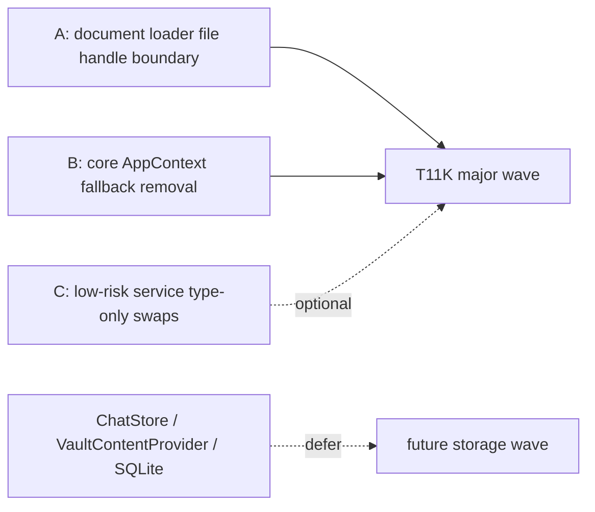
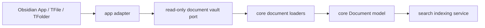

# T11K Read-only Investigation — Codex Review

## Verdict

批准进入实现，但必须带修正。

Claude 这次 read-only investigation 的方向是对的：T11K 应该集中打掉 `service/core -> Obsidian types` 这个大桶，而不是继续做零碎 cleanup。当前最大收益点确实在 `src/core/document/loader/**`：这些文件名义上在 core，但还直接拿着 Obsidian `App` / `TFile` / `TFolder` 读 vault。

不过，调查里提出的 `IVaultReader` surface 偏宽，容易长成新的 Vault god-port。T11K 的目标不是把 Obsidian API 换个名字搬进 core，而是让 loader 只看到“读文档所需的最小中性文件能力”。

## Approved Shape

可以执行一个 T11K combined wave：



Approved required tracks:

- Track A: document loaders stay in `src/core/document/loader/**`, but must depend on a narrow read-only vault file port instead of Obsidian `App` / `TFile`.
- Track B: remove `AppContext` fallback from core utilities and retarget remaining settings imports from app config to core config.
- Track C: optional type-only swaps in service files, only when the semantic fit is obvious and low-risk.

Deferred:

- Do not move `ChatStore`, `chat-docs`, `VaultContentProvider`, or SQLite storage in T11K.
- Do not redesign Chat, Quick Search, Ambient, Command Gateway, or persisted schemas.

## Required Corrections Before Coding

### 1. Port must be narrow and read-only

Do not create a generic `IVaultReader` that mirrors broad Obsidian `Vault`.

Prefer names that reveal the use case:

- `DocumentVaultReaderPort`
- `VaultFileReaderPort`
- `VaultMetadataResolverPort` if metadata must be split out

The loader-facing port may include only methods needed by current loaders/resource loaders, for example:

```ts
interface DocumentVaultReaderPort {
  readText(path: string): Promise<string>;
  readBinary(path: string): Promise<ArrayBuffer>;
  getFile(path: string): VaultFileRef | null;
  listFiles(): VaultFileRef[];
  listMarkdownFiles(): VaultFileRef[];
  getFolder(path: string): VaultFolderRef | null;
  listFolderChildren(path: string): Array<VaultFileRef | VaultFolderRef>;
}

interface VaultMetadataResolverPort {
  resolveLinkPath(linkText: string, sourcePath: string): string | null;
  getFileCache(path: string): unknown;
}
```

Do not include write/event/workspace methods in this port:

- no `create`
- no `modify`
- no `delete`
- no `getRoot`
- no `vault.on`
- no `workspace`
- no `adapter` pass-through

If another file needs those capabilities, that is a different port or a future wave.

### 2. Neutral file shape must not wrap raw Obsidian objects

Allowed:

```ts
type VaultFileRef = {
  path: string;
  name: string;
  basename: string;
  extension: string;
  stat: { ctime: number; mtime: number; size: number };
};
```

Not allowed:

```ts
type VaultFileRef = {
  path: string;
  raw: TFile;
};
```

`TFile` / `TFolder` should be owned by the app adapter only, for example `src/app/vault/AppDocumentVaultReaderAdapter.ts`.

### 3. Use neutral method names

Avoid Obsidian-shaped names in the port:

- `getAbstractFileByPath`
- `cachedRead`
- `metadataCache`

Prefer neutral names:

- `getFile`
- `readText`
- `readBinary`
- `resolveLinkPath`

The adapter can call Obsidian internally. The core loader should not speak Obsidian vocabulary.

### 4. Track B source checks must be honest

Claude's investigation says:

```bash
rg -n "from ['\"]obsidian" src/core/document src/core/utils
```

should show zero, but this is only true if Obsidian-backed runtime helpers are moved out of `src/core/utils/**`.

Correct rule:

- `src/core/document/loader/**` must have zero `from 'obsidian'`.
- `src/core/utils/path-utils.ts` must have zero `from 'obsidian'`.
- `src/core/utils/vault-utils.ts` / `obsidian-utils.ts` may remain Obsidian-backed only if the implementation note explicitly labels them residual Obsidian-backed core infrastructure.
- If those runtime helpers stay in core, do not claim `src/core/utils/**` is pure.

Better implementation if safe:

- split pure path helpers to `src/core/utils/path-utils.ts`;
- move runtime Obsidian helpers to `src/app/vault/**` or `src/app/obsidian/**` only if this does not increase `service -> app`;
- otherwise keep them in core temporarily but remove `AppContext` fallback and document the residual debt.

### 5. `service -> app` guard must stay at 15, not 16

T11J ended at `service -> app = 15`. T11K must not loosen the guard to 16.

Use:

```text
service -> app <= 15
```

not:

```text
service -> app <= 16
```

### 6. `embedClient` should not receive a broad manager

`src/core/embeddings/embedClient.ts` currently uses `AppContext` only to dispatch usage telemetry. Do not replace that with a broad AI manager or service locator.

Prefer a small explicit dependency:

- `EmbeddingUsageReporterPort`
- optional `onUsageRecorded`
- or a narrow event sink passed from app composition

The shape should say what `embedClient` actually needs, not smuggle app/runtime ownership back in.

## Impact Contract

| Metric | Before T11K | Hard minimum | Target |
| --- | ---: | ---: | ---: |
| Total flagged | 236 | <=205 | <=190-195 |
| `service/core -> Obsidian types` | 81 | <=50 | <=40-45 |
| `core -> upstream` | 11 | <=8 | <=5-6 |
| `service -> app` | 15 | <=15 | 15 or lower |
| `service -> ui` | 0 | 0 | 0 |
| `core -> ui` | 0 | 0 | 0 |

If the implementation misses the hard minimum, do not commit it as T11K major. Report it as partial progress.

## Ownership Map



After T11K, this should be true:

- app adapter knows Obsidian concrete objects;
- core loaders know neutral file refs and read ports;
- service/search receives the same `Document` output as before;
- no second document-loading runtime path appears.

## Hard Stop Conditions

Stop before commit if any of these happen:

- `total flagged > 205`
- `service/core -> Obsidian types > 50`
- `core -> upstream > 8`
- `service -> app > 15`
- `service -> ui > 0`
- `core -> ui > 0`
- any new `src/core/**` import of `AppContext`
- any new service/core module-level mutable singleton/default binding
- loader-facing port contains write/delete/event/workspace methods
- neutral file shape secretly stores raw `TFile` / `TFolder`
- persisted markdown, SQLite schema, or index schema changes
- Codex-owned docs are staged

## Required Verification

Run serially:

```bash
npm run build
npm run audit:boundary -- --out /tmp/t11k-after.md
npm run test -- test/t11k-obsidian-boundary-regression.test.ts
npm run test -- test/t11j-boundary-regression.test.ts
npm run test -- test/service-ui-boundary.test.ts
npm run test -- test/analysis-doc-persistence-port.test.ts
npm run test -- test/report-session-port.test.ts
npm run test -- test/chat-runtime-state-port.test.ts
```

Required source checks:

```bash
rg -n "from ['\"]obsidian" src/core/document/loader src/core/document/resource
rg -n "from ['\"]@/app" src/core
rg -n "from ['\"]@/ui" src/service src/core
rg -n "AppContext\\.getInstance|AppContext\\.getApp" src/core
rg -n "let\\s+current[A-Z]|let\\s+default[A-Z].*=\\s*null" src/service src/core
```

Expected:

- loader/resource checks should be empty or only show explicitly deferred non-loader files with explanation;
- core app import should drop versus T11J, ideally zero if Track B lands cleanly;
- UI boundary checks remain zero;
- mutable singleton check should show no new hits.

## Implementation Note Requirements

Claude's final implementation note must include:

- Chinese summary first.
- Commit hash and exact commit message.
- Before/after metric table.
- Changed files grouped by Track A / B / C / tests.
- Owner code reading guide with 8-12 files in recommended reading order.
- Mermaid diagrams:
  - before dependency map;
  - after dependency map;
  - file-handle ownership map;
  - old-path / guard map.
- Explicit skipped/deferred list.
- Confirmation that no Codex-owned docs were staged.
- Confirmation that no raw `TFile` / `TFolder` escapes the app adapter into loader-facing core APIs.

## Message To Send Back To Claude

```md
Codex reviewed the T11K read-only investigation. Approved to implement, but with corrections.

Proceed with T11K as a combined Track A + Track B wave. Track C is optional.

Impact Contract:
- total flagged 236 -> <=205 hard minimum, target <=190-195
- service/core -> Obsidian types 81 -> <=50 hard minimum, target <=40-45
- core -> upstream 11 -> <=8 hard minimum, target <=5-6
- service -> app must stay <=15
- service -> ui must stay 0
- core -> ui must stay 0

Required Track A:
- Keep concrete document loaders in `src/core/document/loader/**`, but make them depend on a narrow read-only vault file port.
- Add the app adapter in `src/app/vault/**`; it is the only place that may hold Obsidian `App` / `TFile` / `TFolder`.
- Loader-facing core APIs must use neutral plain-data file refs only.

Required Track B:
- Remove `AppContext` fallback/imports from core utilities and `embedClient`.
- Split pure path helpers into `src/core/utils/path-utils.ts`.
- Retarget `markdown-utils` settings import to `@/core/config/settingsTypes`.
- If Obsidian-backed runtime helpers remain in `src/core/utils/**`, label them as residual debt in the implementation note. Do not claim all core utils are pure.

Optional Track C:
- Only do low-risk type-only service swaps when the semantic fit is obvious.
- Do not broaden the document vault port just to satisfy unrelated service files.

Corrections:
1. Do not create a broad `IVaultReader` god-port. Use a narrow read-only port such as `DocumentVaultReaderPort` / `VaultFileReaderPort`, and split metadata into `VaultMetadataResolverPort` if needed.
2. The port must not include create/modify/delete/getRoot/vault.on/workspace/adapter pass-through.
3. Neutral `VaultFileRef` / `VaultFolderRef` must not store raw `TFile` / `TFolder`.
4. Use neutral method names like `readText`, `readBinary`, `getFile`, `listFiles`, `resolveLinkPath`; avoid Obsidian-shaped names like `getAbstractFileByPath` or `cachedRead` in core-facing ports.
5. The T11K regression guard must use `service -> app <=15`, not <=16.
6. `embedClient` should receive a narrow usage reporter/event sink, not a broad manager/service locator.

Hard stop before commit if:
- total flagged >205,
- service/core -> Obsidian types >50,
- core -> upstream >8,
- service -> app >15,
- service -> ui or core -> ui becomes non-zero,
- any new core import/use of AppContext appears,
- any new service/core mutable module singleton/default appears,
- the loader-facing port contains write/delete/event/workspace methods,
- any raw `TFile` / `TFolder` escapes through the neutral file shape,
- persisted markdown/SQLite/index schema changes,
- Codex-owned docs are staged.

Run verification serially:
- npm run build
- npm run audit:boundary -- --out /tmp/t11k-after.md
- npm run test -- test/t11k-obsidian-boundary-regression.test.ts
- npm run test -- test/t11j-boundary-regression.test.ts
- npm run test -- test/service-ui-boundary.test.ts
- npm run test -- test/analysis-doc-persistence-port.test.ts
- npm run test -- test/report-session-port.test.ts
- npm run test -- test/chat-runtime-state-port.test.ts

Source checks:
- rg -n "from ['\"]obsidian" src/core/document/loader src/core/document/resource
- rg -n "from ['\"]@/app" src/core
- rg -n "from ['\"]@/ui" src/service src/core
- rg -n "AppContext\\.getInstance|AppContext\\.getApp" src/core
- rg -n "let\\s+current[A-Z]|let\\s+default[A-Z].*=\\s*null" src/service src/core

Implementation note must include:
- Chinese summary
- commit hash
- before/after boundary table
- changed files grouped by track
- code reading guide
- Mermaid diagrams for dependency/ownership/guards
- skipped/deferred list
- confirmation no Codex docs were staged
- confirmation no raw TFile/TFolder escapes into loader-facing APIs
```
