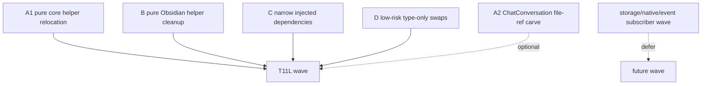

# T11L Read-only Investigation — Codex Review

## Verdict

批准进入实现，但必须带修正。

Claude 的 T11L investigation 这次覆盖了正确的大桶：`core -> upstream`、`service -> app`、`service/core -> Obsidian side-effect`、`service/core -> Obsidian types`。它没有跳过用户关心的 Obsidian side-effect / type debt，方向是对的，也符合“大步伐”的要求。

但 implementation plan 里有三处需要收紧，否则容易变成“指标好看，但语义藏起来”：

- `ChatConversation.file: TFile -> VaultFileRef` 的影响面比调查写得大，很多 UI/app 调用需要 live `TFile` 来 open source file。
- Track C 的 `{ app, searchClient, settings }` bag 太接近 raw app pass-through，不能作为 service boundary 的默认形状。
- Track B 的 side-effect delta 要按实际 import 文件计算；如果文件仍然保留 `App` / `TFile` / `TFolder`，只能说移除了 pure helper side-effect，不要夸成整个文件纯化。

## Approved Shape

可以执行 T11L combined wave，但要把 required/optional track 调整为下面形状。



Required:

- A1: core upstream pure-helper relocation.
- B: pure side-effect cleanup: `normalizePath`, `parseYaml`, `stringifyYaml`, and one safe `Notice` callback if it stays narrow.
- C: service `AppContext` removal by narrow dependencies, not raw app bag.
- D: low-risk type-only swaps that do not require live Obsidian behavior.

Optional:

- A2: `ChatConversation.file` carve. Only include if implementation can prove all live `TFile` consumers are handled by app/UI boundary re-resolution without behavior churn. If not, defer and compensate with another low-risk side-effect/type candidate.

Deferred:

- SQLite/native/storage substrate.
- vault event subscriber cleanup.
- broad AppContext decomposition for `indexService`, `buildBackboneMap`, `WorkingThemeInferrer`.
- workspace/fileManager ports unless the investigation can keep them tiny.

## Required Corrections Before Coding

### 1. ChatConversation carve is optional, not required

The investigation treats `ChatConversation.file: TFile -> VaultFileRef` as a straightforward precondition for core purity. It is not.

Current usage includes UI/app paths like:

- `src/ui/view/chat-view/components/HeaderRetained.tsx`
- `src/ui/view/project-list-view/ConversationsSection.tsx`
- `src/ui/view/project-list-view/ProjectsSection.tsx`
- `src/ui/view/chat-view/chatNavigation.ts`
- `src/ui/store/chatDataStore.ts`

Some of these call `openSourceFile(app, conversation.file)` or otherwise expect a live Obsidian file object. That makes this a behavior-sensitive carve.

Corrected rule:

- Required A1 target is `core -> upstream 6 -> <=2` by moving pure helpers only.
- `core -> upstream = 0` is stretch, not required.
- `ChatConversation.file` may move to `VaultFileRef` only if every live `TFile` consumer is updated at the app/UI boundary to re-resolve by path.
- If A2 is skipped, T11L must still hit `total flagged <=165` by compensating in side-effect/type-only cleanup.

### 2. Do not move `IgnoreService` singleton as-is into core

`IgnoreService` is pure, but it is currently a singleton service:

```ts
private static instance: IgnoreService | null = null;
```

Moving it unchanged to `src/core/utils/IgnoreService.ts` would preserve a global runtime pattern inside core.

Preferred shape:

- rename/split to a pure matcher, for example `src/core/search/IgnoreMatcher.ts` or `src/core/document/ignore/IgnoreMatcher.ts`;
- expose `createIgnoreMatcher(patterns)` or a small `IgnoreMatcher` class without static global instance;
- let `DocumentLoaderManager` own its matcher instance;
- update `buildBackboneMap` to receive/use the matcher without importing a service singleton.

If Claude decides the singleton cannot be removed safely in this wave, it may move only the pure matching helper and leave the singleton service outside the required track. Do not create a new core singleton.

### 3. Track C cannot use raw `app` bag as the default boundary

The investigation proposes a `ToolDeps` bag exactly shaped like:

```ts
{ app, searchClient, settings }
```

That is too close to an app-shell pass-through. It may reduce `@/app/context/AppContext` imports, but it does not improve the architecture enough if service logic still receives a raw Obsidian `App` for unrelated operations.

Corrected rule:

- Prefer narrow dependencies by use case:
  - `SearchClientLike`
  - `VaultFileReader` / existing `DocumentVaultReaderPort`
  - `VaultStatsReader`
  - `VaultPersonaReader`
  - `AnalysisHistoryPort`
  - `TemplateManager` where already needed
- A small deps object is allowed only if every field is a narrow capability, not raw `app`.
- If a file truly needs raw `App`, skip that file from Track C and list it as deferred.
- Do not introduce `AppServicesPort`, `ToolDeps` with raw `app`, or any broad "everything app" object.

### 4. Side-effect cleanup must report real residual Obsidian imports

Track B is valid, but its numbers must be honest.

Example:

- replacing `normalizePath` in `PromptService` may remove the side-effect symbol;
- but `PromptService` can still import `App` / `TFile`, so it is not pure or Obsidian-free.

Implementation note must distinguish:

- pure helper side-effect removed;
- remaining Obsidian type/runtime dependency still present;
- file fully Obsidian-free.

Do not claim `src/core/utils/vault-utils.ts` or `src/core/utils/obsidian-utils.ts` are pure if they still import `App`, `TFile`, `TFolder`, workspace/editor helpers, or vault operations.

### 5. YAML dependency must be explicit and stable

The repo already imports `js-yaml` in `src/core/template-engine-helper.ts`, but `package.json` currently lists `@types/js-yaml` and `yaml`, not a direct `js-yaml` runtime dependency.

Allowed options:

- use the existing direct `yaml` package for new `yaml-utils`; or
- add `js-yaml` as a direct runtime dependency if matching existing `js-yaml` behavior is important.

Not allowed:

- rely silently on a transitive `js-yaml` dependency.

Implementation note must say which choice was made and why.

### 6. File plan count must be corrected

The investigation says "New files (3)" but lists seven new files. Correct this in the final implementation note.

This is minor, but it matters for owner trust during a large wave.

## Corrected Impact Contract

T11L can still qualify as a major wave, but the contract should allow A2 to be skipped if it proves too behavior-sensitive.

Hard minimum:

| Metric | Before T11L | Hard minimum after |
| --- | ---: | ---: |
| Total flagged | 199 | <=165 |
| `core -> upstream` | 6 | <=2 |
| `service -> app` | 15 | <=8 |
| `service/core -> Obsidian side-effect` | 16 | <=10 |
| `service/core -> Obsidian types` | 48 | <=35 |
| `service -> ui` | 0 | 0 |
| `core -> ui` | 0 | 0 |

Stretch:

```text
total flagged <=150
core -> upstream = 0
service -> app <=5
service/core -> Obsidian side-effect <=8
service/core -> Obsidian types <=30
```

If A2 ChatConversation carve is skipped:

- `core -> upstream <=2` is still acceptable.
- Claude must compensate elsewhere to keep `total flagged <=165` and `Obsidian types <=35`.
- The implementation note must explicitly say A2 was skipped due to live TFile consumer risk.

## Stop Conditions

Hard stop before commit if any of these happen:

- `total flagged >165`
- `core -> upstream >2`
- `service -> app >8`
- `service/core -> Obsidian side-effect >10`
- `service/core -> Obsidian types >35`
- `service -> ui >0`
- `core -> ui >0`
- raw `App` is introduced as a generic service deps bag
- a new core/service module-level singleton appears
- `DocumentVaultReaderPort` is widened for unrelated service/chat/tool needs
- `ChatConversation.file` changes break or complicate UI open-source-file behavior
- service imports app concrete adapters
- Codex-owned docs are staged

## Required Verification

Run serially:

```bash
npm run build
npm run audit:boundary -- --out /tmp/t11l-after.md
npm run test -- test/t11l-remaining-boundary-regression.test.ts
npm run test -- test/t11k-obsidian-boundary-regression.test.ts
npm run test -- test/t11j-boundary-regression.test.ts
npm run test -- test/service-ui-boundary.test.ts
npm run test -- test/analysis-doc-persistence-port.test.ts
npm run test -- test/report-session-port.test.ts
npm run test -- test/chat-runtime-state-port.test.ts
```

Additional source checks:

```bash
rg -n "from ['\"]@/service" src/core
rg -n "from ['\"]@/app" src/service
rg -n "AppContext\\.getInstance\\(|AppContext\\.getApp" src/service
rg -n "from ['\"]@/ui" src/service src/core
rg -n "AppServicesPort|ObsidianServices|VaultEverythingPort|ToolDeps" src
rg -n "let\\s+current[A-Z]|let\\s+default[A-Z].*=\\s*null" src/service src/core
```

If using YAML replacement:

```bash
rg -n "parseYaml|stringifyYaml" src/service src/core
```

Expected: remaining hits should not import from `obsidian`.

## Message To Send Back To Claude

```md
Codex reviewed the T11L read-only investigation. Approved to implement, but with corrections.

Proceed with a combined T11L wave targeting:
- total flagged 199 -> <=165
- core -> upstream 6 -> <=2
- service -> app 15 -> <=8
- service/core -> Obsidian side-effect 16 -> <=10
- service/core -> Obsidian types 48 -> <=35
- service -> ui must remain 0
- core -> ui must remain 0

Required tracks:
1. A1 core-upstream pure-helper relocation.
2. B pure Obsidian helper cleanup: normalizePath / parseYaml / stringifyYaml / one safe Notice callback.
3. C service AppContext removal through narrow dependencies.
4. D low-risk type-only swaps.

Corrections before coding:
1. Treat `ChatConversation.file: TFile -> VaultFileRef` as optional/stretch, not required. It has UI/app live-TFile consumers (`openSourceFile(app, conversation.file)` style). Only do it if every live consumer is handled at the app/UI boundary by resolving from path. Otherwise skip it and compensate elsewhere while keeping `total <=165`.
2. Do not move `IgnoreService` singleton as-is into core. Prefer `IgnoreMatcher` / `createIgnoreMatcher(patterns)` without static global instance, owned by `DocumentLoaderManager` or passed explicitly.
3. Do not create a raw `{ app, searchClient, settings }` ToolDeps bag. Use narrow dependencies (`SearchClientLike`, `DocumentVaultReaderPort`, `VaultStatsReader`, `AnalysisHistoryPort`, `TemplateManager`, etc.). If a file truly needs raw `App`, skip that file.
4. Track B must report residual Obsidian imports honestly. Removing `normalizePath` does not make a file pure if it still imports `App`, `TFile`, or uses vault/workspace.
5. YAML replacement must use a direct dependency. Either use existing direct `yaml`, or add `js-yaml` as direct runtime dependency. Do not rely on transitive `js-yaml`.
6. Correct the final file-plan count; the investigation said "New files (3)" but listed seven.

Hard stop before commit if:
- total flagged >165
- core -> upstream >2
- service -> app >8
- service/core -> Obsidian side-effect >10
- service/core -> Obsidian types >35
- service -> ui or core -> ui becomes non-zero
- raw App appears as a generic service deps bag
- new module-level singleton/default appears in core/service
- DocumentVaultReaderPort is widened for unrelated needs
- ChatConversation file-ref carve breaks UI source-file open behavior
- service imports app concrete adapters
- Codex-owned docs are staged

Run verification serially:
- npm run build
- npm run audit:boundary -- --out /tmp/t11l-after.md
- npm run test -- test/t11l-remaining-boundary-regression.test.ts
- npm run test -- test/t11k-obsidian-boundary-regression.test.ts
- npm run test -- test/t11j-boundary-regression.test.ts
- npm run test -- test/service-ui-boundary.test.ts
- npm run test -- test/analysis-doc-persistence-port.test.ts
- npm run test -- test/report-session-port.test.ts
- npm run test -- test/chat-runtime-state-port.test.ts

Source checks:
- rg -n "from ['\"]@/service" src/core
- rg -n "from ['\"]@/app" src/service
- rg -n "AppContext\\.getInstance\\(|AppContext\\.getApp" src/service
- rg -n "from ['\"]@/ui" src/service src/core
- rg -n "AppServicesPort|ObsidianServices|VaultEverythingPort|ToolDeps" src
- rg -n "let\\s+current[A-Z]|let\\s+default[A-Z].*=\\s*null" src/service src/core

Implementation note must include:
- Chinese summary
- before/after table for all five metrics
- which side-effect files became pure vs still have residual Obsidian type/runtime dependency
- whether ChatConversation carve was included or skipped, with reason
- changed files grouped by track
- code reading guide
- Mermaid diagrams for side-effect ownership, type-handle ownership, core purity, guard map
- confirmation no Codex docs staged
```

