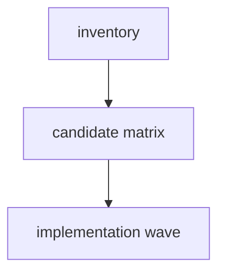

# Peak Assistant Modernization Handoff: T11L Remaining Boundary Investigation

Branch:
`codex/peak-modernization-refactor`

## Owner Summary

T11K 已经把 document loader / resource loader 集群从 Obsidian `App` / `TFile` / `TFolder` 中解耦出来：

- `total flagged`: `236 -> 199`
- `service/core -> Obsidian types`: `81 -> 48`
- `core -> upstream`: `11 -> 6`
- `service -> app`: still `15`
- `service -> ui`: `0`
- `core -> ui`: `0`

现在不是“不处理 Obsidian types / side-effect”。恰恰相反，T11L 的 read-only investigation 必须把它们作为候选大桶，并区分：

- **Obsidian side-effect surface (`16`)**：真实运行时副作用，更优先。这里包括 `Notice`、`requestUrl`、`Platform`、vault/chat IO、`parseYaml/stringifyYaml`、workspace/editor helpers 等。
- **Obsidian type handles (`48`)**：有一部分是 type-only，可以通过 neutral type / port / adapter 消掉；有一部分是 runtime file/vault ownership，不能机械替换。

T11L 仍然不能直接实现。第一轮必须 read-only investigation，目标是找出下一次真正大波次，而不是又做 2-3 个小修。

## Source-of-truth Docs

- `docs/superpowers/specs/2026-06-01-peak-system-architecture-modernization-handbook.html`
- `docs/superpowers/refactor-ops/README.md`
- `docs/superpowers/refactor-ops/architecture-scorecard.md`
- `docs/superpowers/audits/2026-06-26-t11k-owner-review-packet.md`
- `docs/superpowers/refactor-ops/t11k-readonly-investigation-codex-review.md`

## Current Baseline After T11K

From Codex rerun of `npm run audit:boundary` after `8ad1f78c`:

```text
Files scanned: 866
Total flagged: 199
service -> ui: 0
core -> ui: 0
core -> upstream: 6
service -> app: 15
service/core -> Obsidian side-effect: 16
service/core -> Obsidian types: 48
ui -> app: 114
```

Remaining `core -> upstream`:

```text
src/core/document/loader/helper/DocumentLoaderManager.ts -> @/service/search/IgnoreService
src/core/document/loader/helper/textRank.ts -> @/service/search/support/segmenter
src/core/eventBus.ts -> @/service/chat/types (type-only)
src/core/storage/sqlite/repositories/SearchClickRepo.ts -> @/service/search/support/porter-stemmer
src/core/storage/vault/ChatStore.ts -> @/service/chat/types (type-only)
src/core/utils/format-utils.ts -> @/service/tools/search-graph-inspector/boolean-expression-parser
```

Remaining `service/core -> Obsidian side-effect`:

```text
src/core/platform.ts
src/core/providers/testProviderConnection.ts
src/core/storage/sqlite/DatabaseHealthVerifier.ts
src/core/storage/sqlite/NativeModuleManager.ts
src/core/storage/sqlite/SqliteStoreManager.ts
src/core/storage/vault/ChatStore.ts
src/core/storage/vault/chat-docs/ChatDocName.ts
src/core/template/VaultContentProvider.ts
src/core/utils/obsidian-utils.ts
src/core/utils/vault-utils.ts
src/service/chat/context/ResourceSummaryService.ts
src/service/copilot/CopilotReviewHistoryService.ts
src/service/prompt/PromptService.ts
src/service/search/index/indexService.ts
src/service/skills/SkillParser.ts
```

Remaining `service -> app`:

```text
src/service/agents/KnowledgeIntuitionAgent.ts
src/service/chat/context/slots/PrevAnalysisSlot.ts
src/service/context/WorkingThemeInferrer.ts
src/service/context/context-tools/getRecentAnalysisResultTool.ts
src/service/copilot/CopilotArtifactApply.ts
src/service/copilot/CopilotReviewHistoryService.ts
src/service/copilot/CopilotReviewSession.ts
src/service/search/index/helper/backbone/buildBackboneMap.ts
src/service/search/index/indexService.ts
src/service/tools/content-reader.ts
src/service/tools/search-graph-inspector/common.ts
src/service/tools/search-graph-inspector/explore-folder.ts
src/service/tools/search-graph-inspector/local-search.ts
src/service/tools/search-graph-inspector/recent-change-whole-vault.ts
src/service/tools/system-info.ts
```

## Phase 1 Must Be Read-only Investigation

Claude Code must **not edit files, run formatters, stage files, or commit** in the first response.

The first response must answer:

- Which remaining bucket can safely move the largest real boundary metric?
- Which `Obsidian side-effect` imports are true side effects that should move behind app adapters/ports now?
- Which `Obsidian types` imports are type-only and safe to neutralize now?
- Which `Obsidian types` imports are runtime ownership and should be deferred?
- Can one implementation wave credibly hit at least three buckets at once without regressing `service -> app` or reintroducing UI imports?
- Which candidates must be skipped because moving them would create a second runtime path or move storage too early?

Required first response:

````md
## T11L Read-only Investigation

Files inspected:
- <exact files>

Current metric snapshot:
- total flagged:
- core -> upstream:
- service -> app:
- service/core -> Obsidian side-effect:
- service/core -> Obsidian types:
- service -> ui:
- core -> ui:

Remaining boundary inventory:
| Bucket | Files | Current count | Runtime or type-only? | Candidate move | Expected delta | Risk |
| --- | --- | ---: | --- | --- | ---: | --- |

Obsidian side-effect triage:
| File | Symbol(s) | Real side effect? | Proposed treatment | Include in T11L? |
| --- | --- | --- | --- | --- |

Obsidian type-handle triage:
| File group | Symbol(s) | Type-only or runtime? | Proposed neutral shape / port | Include in T11L? |
| --- | --- | --- | --- | --- |

Candidate architecture options:
| Option | Description | Metrics touched | Expected delta | Risk | Include in implementation wave? |
| --- | --- | --- | ---: | --- | --- |

Recommended T11L implementation wave:
- Architecture choice:
- Primary metric target:
- Minimum acceptable delta:
- Stretch target:
- Required tracks:
- Optional tracks:
- Forbidden scope:
- Skip budget:
- Stop / commit rule:

Dependency DAG:


Exact file plan:
- New files:
- Modified files:
- Deleted / moved files:
- Tests / guards:

Expected before/after:
| Metric | Before | Expected after | Delta |
| --- | ---: | ---: | ---: |

Code reading guide for owner:
1. `<file>` — why read it first
2. `<file>` — what changed
3. `<test>` — what proves it

Visual maps to include in the implementation note:
- side-effect ownership before/after
- type-handle ownership before/after
- core purity before/after
- old-path / guard map

Risks / stop conditions:
- ...

Verification plan:
- ...

Does this qualify as a major wave?
- Yes / No, with evidence.
````

Codex/user will audit this investigation before implementation.

## Candidate Bucket A — Core Upstream Purity (`6`)

Problem:

`src/core/**` should not import `src/service/**`. After T11K only six edges remain, and they are concrete enough to classify.

Inspect at minimum:

- `src/core/document/loader/helper/DocumentLoaderManager.ts`
- `src/service/search/IgnoreService.ts`
- `src/core/document/loader/helper/textRank.ts`
- `src/service/search/support/segmenter.ts`
- `src/core/eventBus.ts`
- `src/service/chat/types.ts`
- `src/core/storage/sqlite/repositories/SearchClickRepo.ts`
- `src/service/search/support/porter-stemmer.ts`
- `src/core/storage/vault/ChatStore.ts`
- `src/core/utils/format-utils.ts`
- `src/service/tools/search-graph-inspector/boolean-expression-parser.ts`

Possible moves:

- Move pure algorithm helpers (`segmenter`, `porter-stemmer`, boolean expression parser) to `src/core/**`.
- Move pure types used by core out of service type files.
- Replace `DocumentLoaderManager -> IgnoreService` with a narrow ignore-pattern function/port or pure matcher owned by core.

For this bucket to qualify:

- `core -> upstream`: `6 -> <=2`, stretch `0`.

Bad outcomes:

- Moving service runtime classes into core.
- Creating duplicated parser/type definitions.
- Keeping old service files with duplicate source of truth instead of thin re-export shims.

## Candidate Bucket B — Service AppContext / App Shell Leaks (`15`)

Problem:

Some service files still read app shell through `AppContext`. This hides dependencies from capability contracts and makes tests harder.

Inspect at minimum:

- all files listed in `service -> app` above
- existing app adapters in `src/app/**`
- recently created ports from T11I/T11J/T11K

Possible moves:

- Create or reuse narrow ports for vault reads, active document reads, search graph inspection, recent analysis lookup, or copilot history persistence.
- Move app-owned wiring to `src/app/**`, but do not make service import app concrete modules.
- For tool clusters, prefer one app-owned tool dependency bundle over many per-file singleton lookups.

For this bucket to qualify:

- `service -> app`: `15 -> <=8`, stretch `<=5`.

Bad outcomes:

- Service imports an app adapter directly.
- `AppContext.getInstance()` just moves from one service file to another.
- A broad "AppServicesPort" god-object appears.

## Candidate Bucket C — Obsidian Side-effect Surface (`16`)

Problem:

This is the bucket the owner explicitly does not want to leave untouched. It represents actual runtime side effects or Obsidian concrete helpers in service/core.

Inspect at minimum:

- `src/core/platform.ts`
- `src/core/providers/testProviderConnection.ts`
- `src/core/storage/sqlite/DatabaseHealthVerifier.ts`
- `src/core/storage/sqlite/NativeModuleManager.ts`
- `src/core/storage/sqlite/SqliteStoreManager.ts`
- `src/core/storage/vault/ChatStore.ts`
- `src/core/storage/vault/chat-docs/ChatDocName.ts`
- `src/core/template/VaultContentProvider.ts`
- `src/core/utils/obsidian-utils.ts`
- `src/core/utils/vault-utils.ts`
- `src/service/chat/context/ResourceSummaryService.ts`
- `src/service/copilot/CopilotReviewHistoryService.ts`
- `src/service/prompt/PromptService.ts`
- `src/service/search/index/indexService.ts`
- `src/service/skills/SkillParser.ts`

Classify every file:

- **Move now**: side effects that can be wrapped behind existing/narrow ports without storage redesign.
- **Split pure helper now**: imports only for `normalizePath`, `parseYaml`, `stringifyYaml`, or other pure helpers.
- **Defer storage substrate**: SQLite/native/chat-vault files where moving ownership needs a dedicated storage wave.
- **Keep with explicit rationale**: if Obsidian import is acceptable infrastructure for now.

For this bucket to qualify:

- `service/core -> Obsidian side-effect`: `16 -> <=10`, stretch `<=8`.

Bad outcomes:

- Hiding side effects by moving them to a random service module.
- Port surface exposes `App`, `TFile`, `Notice`, `Vault`, or `Workspace`.
- Storage substrate is moved casually and breaks chat/history/index persistence.

## Candidate Bucket D — Obsidian Type Handles (`48`)

Problem:

Many remaining Obsidian imports are type-only `App`, `TFile`, `TFolder`, `Vault`, `MetadataCache`, `EventRef`. Type-only still shapes architecture, but it is lower priority than real side effects.

Inspect at minimum:

- agent files under `src/service/agents/**`
- chat context files under `src/service/chat/**`
- copilot files under `src/service/copilot/**`
- search/index files under `src/service/search/index/**`
- usage/skills files listed by the audit

Classify every group:

- Type-only and safe to neutralize with existing `VaultFileRef`, active file context, or app-owned dependency ports.
- Runtime event subscription or vault ownership; defer or create a specific port.
- Service constructor app dependency; can become a narrow port only if all callers can be updated without app import regression.

For this bucket to qualify:

- `service/core -> Obsidian types`: `48 -> <=35`, stretch `<=30`.

Bad outcomes:

- Mechanical rename from `TFile` to `VaultFileRef` while still requiring live Obsidian behavior.
- Broadening `DocumentVaultReaderPort` to cover unrelated chat/agent/search needs.
- Losing `EventRef` cleanup semantics in event subscribers.

## Impact Contract For A Real T11L Major

T11L implementation should only start after the read-only investigation shows a plausible plan that hits at least **three** of the four buckets below.

Hard minimum:

| Metric | Before T11L | Hard minimum after |
| --- | ---: | ---: |
| Total flagged | 199 | <=165 |
| `core -> upstream` | 6 | <=2 |
| `service -> app` | 15 | <=8 |
| `service/core -> Obsidian side-effect` | 16 | <=10 |
| `service/core -> Obsidian types` | 48 | <=35 |
| `service -> ui` | 0 | 0 |
| `core -> ui` | 0 | 0 |

Stretch:

```text
total flagged <=150
core -> upstream = 0
service -> app <=5
service/core -> Obsidian side-effect <=8
service/core -> Obsidian types <=30
```

If the investigation cannot credibly hit at least `total <=165` plus three bucket floors, do not implement. Return a smaller named plan, but label it **minor/partial**, not T11L major.

## Forbidden Scope

- No Chat UI redesign.
- No Current Work State / Ambient product work.
- No Command Gateway work; it remains T12 capstone.
- No SQLite schema or persisted markdown format changes.
- No broad god-port such as `AppServicesPort`, `ObsidianServices`, or `VaultEverythingPort`.
- No service importing app concrete adapters.
- No new service/core module-level runtime singleton/default binding.
- No reintroducing `service -> ui` or `core -> ui`.
- Do not broaden `DocumentVaultReaderPort` from T11K for unrelated needs.

## Verification Plan For Implementation Wave

Run serially:

```bash
npm run build
npm run audit:boundary -- --out /tmp/t11l-after.md
npm run test -- test/t11k-obsidian-boundary-regression.test.ts
npm run test -- test/t11j-boundary-regression.test.ts
npm run test -- test/service-ui-boundary.test.ts
npm run test -- test/analysis-doc-persistence-port.test.ts
npm run test -- test/report-session-port.test.ts
npm run test -- test/chat-runtime-state-port.test.ts
```

Likely new guard:

```text
test/t11l-remaining-boundary-regression.test.ts
```

It should lock:

- `total flagged <=165`
- `core -> upstream <=2`
- `service -> app <=8`
- `service/core -> Obsidian side-effect <=10`
- `service/core -> Obsidian types <=35`
- `service -> ui = 0`
- `core -> ui = 0`

Implementation note must include:

- Chinese summary first.
- Before/after metric table.
- Which side-effect files moved / split / deferred.
- Which type-handle groups moved / skipped.
- Code reading guide.
- Mermaid diagrams:
  - side-effect ownership before/after;
  - type-handle ownership before/after;
  - core purity before/after;
  - guard map.
- Confirmation no Codex-owned docs were staged.

