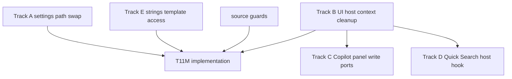

# T11M Read-only Investigation — Codex Review

## Verdict

批准进入实现，但必须带修正。

Claude 的 T11M investigation 方向是对的：它没有承诺把 `UI -> app = 114` 机械清零，而是把它拆成 settings path、direct AppContext、Copilot panel vault writes、Quick Search runtime access、strings/template loading、legitimate app-shell exceptions 六类。

这符合当前 owner 诉求：不是只让 boundary audit 数字变小，而是让 UI 层依赖 app shell 的方式变得可读、可控、可解释。

但 implementation wave 里有四处需要收紧，否则容易变成“把 AppContext 藏进 hook 里”：

- `useServiceContext().app` 不能成为新的全局逃生口。
- `CopilotPanelVaultPort` 是高权限写入面，不能放成 vague panel god-port。
- `useQuickSearchHost()` 不能返回 raw `obsidianApp`。
- 这轮必须同时报告 audit delta 和 raw UI vault/editor operation delta。

## Approved Shape

可以执行 T11M combined UI -> app wave，但要按下面形状收紧。



Required:

- A: `@/app/settings/types` UI imports repath to `@/core/config/settingsTypes` or `@/core/config/folderPaths` according to imported symbol.
- B: direct UI `AppContext` imports reduced, but only through named context fields/capabilities.
- C: Copilot panel vault/editor writes moved behind explicit app-owned adapter + UI-facing port/hook.
- D: Quick Search direct `AppContext` access moved behind a Quick Search-specific host hook.
- E: UI strings/template loading should not reach `AppContext.getInstance().manager`.

Deferred:

- Scanner allowlist for legitimate app-shell exceptions.
- Command imports from `PeakCommandActions`.
- Full `UI -> app = 0`.
- ChatConversation file-ref carve.

## Required Corrections Before Coding

### 1. Do not make `useServiceContext().app` the new AppContext

It is acceptable that `ServiceContext` is the single React provider bridge.

It is **not** acceptable to simply replace:

```ts
AppContext.getInstance().app.vault.modify(...)
```

with:

```ts
const { app } = useServiceContext();
app.vault.modify(...)
```

That lowers the scanner count but leaves the same raw UI side effect scattered across components.

Corrected rule:

- `useServiceContext()` may expose stable global services already present in the app context.
- Raw `app` should be used only in documented low-risk read/navigation cases.
- Copilot panel writes must go through Track C.
- Quick Search operations should go through Track D.
- Implementation note must report remaining raw UI `app.vault`, `app.workspace`, and `app.fileManager` call sites after the wave.

Required source checks:

```bash
rg -n "\\.vault\\.(create|modify|trash|delete|read|cachedRead)|\\.workspace\\.activeEditor|\\.fileManager\\." src/ui/view/copilot
rg -n "\\.vault\\.(create|modify|trash|delete|read|cachedRead)|\\.workspace\\.openLinkText|\\.workspace\\.activeEditor" src/ui/view/quick-search
```

The first command should be near zero outside the new hook/adapter boundary. Any remaining hit needs a one-line justification.

### 2. `CopilotPanelVaultPort` must be explicit and high-permission

The proposed Track C is valuable. It attacks the worst cluster: many Copilot panels directly call `app.vault.*`, `app.workspace.activeEditor`, `writeTagsToFrontmatter`, or `applyCopilotArtifactsToContext`.

But the port must not become a generic panel bag.

Corrected rule:

- Put the interface in a clearly named neutral/service-side contract location, for example `src/service/copilot/ports/CopilotPanelPorts.ts` or equivalent. Avoid mixing it into the existing action-runtime port file unless the relationship is explicit.
- Method names must be operation-specific. No `runPanelAction`, `doVaultOperation`, `withApp`, `getApp`, `getVault`, or `getWorkspace`.
- Do not expose raw `App`, `Vault`, `Workspace`, `FileManager`, or `AppContext`.
- Split if helpful:
  - `CopilotPanelFileWritePort`
  - `CopilotPanelEditorPort`
  - `CopilotPanelNavigationPort`
- The app adapter should own all real Obsidian write/editor calls.

Important extra fix:

- `src/service/copilot/CopilotArtifactApply.ts` currently reaches `AppContext.getInstance().app`.
- If Track C touches artifact application, do not wrap that service-side AppContext leak. Either move artifact application into the app adapter or refactor the helper so the app adapter supplies the concrete file/editor operations.
- This can lower `service -> app` from 8 to 7, but that is optional. The non-negotiable part is: do not create a new wrapper around a hidden service-side AppContext dependency.

### 3. `useQuickSearchHost()` cannot return raw `obsidianApp`

The Quick Search host hook is a good idea because Quick Search has its own runtime/history/search-agent surface. But the investigation listed `obsidianApp` as a possible accessor. That is too broad.

Corrected rule:

Prefer named operations:

- `quickSearchRuntime`
- `searchSettings`
- `analysisHistory`
- `createSearchAgent`
- `createVaultSearchAgent`
- `createAiGraphAgent`
- `createConversationFromAnalysis`
- `readVaultFileText`
- `openVaultPath`
- `saveAnalysisToVault`
- `devFlags`

Avoid returning:

- `app`
- `appContext`
- `vault`
- `workspace`
- `manager` unless the caller truly needs a manager-level operation and no narrower method is available.

If a raw app escape remains, it must be limited to one documented composition/helper file, not spread through hooks/components.

### 4. Metrics must distinguish imports from behavior

T11M can reduce `UI -> app` imports materially, but that alone is not enough.

Implementation note must report:

- boundary audit `UI -> app` before/after;
- direct UI `AppContext` import file count before/after;
- UI `@/app/settings/types` imports before/after;
- raw UI vault/editor operation hits before/after for Copilot;
- raw UI vault/workspace operation hits before/after for Quick Search;
- remaining legitimate app-shell exceptions.

This prevents a fake win where the import graph improves but raw UI writes stay scattered.

### 5. Correct small accounting issues

The investigation says "New files (5)" but lists six files plus a test. Final implementation note must use correct counts.

The verification list repeats `test/chat-runtime-state-port.test.ts`; run it once.

Use file/import counts consistently:

- audit `UI -> app` count comes from `npm run audit:boundary`;
- direct `AppContext` import count should be file count or import-line count, explicitly named;
- call-site count is separate and should not be compared directly to audit edge count.

## Corrected Impact Contract

T11M can qualify as a major wave if it improves both the scanner and real UI side-effect ownership.

Hard minimum:

| Metric | Before T11M | Hard minimum after |
| --- | ---: | ---: |
| Total flagged | 163 | <=130 |
| `UI -> app` | 114 | <=80 |
| direct UI `AppContext` import files | ~87 | <=55 |
| UI `@/app/settings/types` imports | 15 | 0 |
| raw Copilot panel vault/editor write call sites | current baseline to be measured | <=8 or every residual justified |
| `service -> app` | 8 | <=8 |
| `service -> ui` | 0 | 0 |
| `core -> ui` | 0 | 0 |

Stretch:

```text
total flagged <=110
UI -> app <=65
direct UI AppContext import files <=35
raw Copilot panel vault/editor write call sites <=3
Quick Search raw app/vault/workspace call sites isolated to one host/helper boundary
```

If Track C proves too large:

- Claude may skip up to 6 Copilot panel files, as proposed.
- But skipped panels must be explicitly listed with operation and risk.
- The wave still must pass `UI -> app <=80` and avoid god-context shortcuts.

## Stop Conditions

Hard stop before commit if any of these happen:

- `UI -> app >80`
- direct UI `AppContext` import files >55
- `service -> ui >0`
- `core -> ui >0`
- `service -> app >8`
- a generic `useAppShell`, `UiAppServices`, `AppShellEverything`, `UIHostGod`, `EverythingPort`, or similar appears
- `useQuickSearchHost()` returns raw `app`, `appContext`, `vault`, or `workspace` without an explicit documented exception
- Copilot panel port exposes raw `App`, `Vault`, `Workspace`, `FileManager`, or `AppContext`
- UI panels import app concrete adapters directly
- service-side `CopilotArtifactApply` keeps or gains hidden AppContext use while the new app adapter merely wraps it
- settings defaults are duplicated in UI
- a second Quick Search or Copilot runtime path appears
- Codex-owned docs are staged

## Required Verification

Run serially:

```bash
npm run build
npm run audit:boundary -- --out /tmp/t11m-ui-app-after.md
npm run test -- test/t11m-ui-app-boundary-regression.test.ts
npm run test -- test/t11l-remaining-boundary-regression.test.ts
npm run test -- test/t11k-obsidian-boundary-regression.test.ts
npm run test -- test/t11j-boundary-regression.test.ts
npm run test -- test/service-ui-boundary.test.ts
npm run test -- test/report-session-port.test.ts
npm run test -- test/chat-runtime-state-port.test.ts
npm run test -- test/analysis-doc-persistence-port.test.ts
```

Additional source checks:

```bash
rg -n "from ['\"]@/app/context/AppContext" src/ui
rg -n "from ['\"]@/app/settings/types" src/ui
rg -n "from ['\"]@/app/quick-search" src/ui
rg -n "from ['\"]@/ui" src/service src/core
rg -n "from ['\"]@/app" src/service
rg -n "UiAppServices|AppShellEverything|UIHostGod|useAppShell|EverythingPort|ToolDeps" src
rg -n "\\.vault\\.(create|modify|trash|delete|read|cachedRead)|\\.workspace\\.activeEditor|\\.fileManager\\." src/ui/view/copilot
rg -n "\\.vault\\.(create|modify|trash|delete|read|cachedRead)|\\.workspace\\.openLinkText|\\.workspace\\.activeEditor" src/ui/view/quick-search
rg -n "AppContext\\.getInstance\\(\\)\\.app" src/service/copilot/CopilotArtifactApply.ts src/service/copilot/frontmatterTagWriter.ts
```

## Message To Send Back To Claude

```md
Codex reviewed the T11M read-only investigation. Approved to implement, but with corrections.

Proceed with a combined T11M UI -> app wave targeting:
- total flagged 163 -> <=130
- UI -> app 114 -> <=80
- direct UI AppContext import files ~87 -> <=55
- UI @/app/settings/types imports 15 -> 0
- service -> ui must remain 0
- core -> ui must remain 0
- service -> app must remain <=8

Required tracks:
1. Track A settings path swap: repath UI imports from @/app/settings/types to @/core/config/settingsTypes or @/core/config/folderPaths according to imported symbol. Do not duplicate defaults.
2. Track B ServiceContext cleanup: reduce direct UI AppContext imports through named context fields/capabilities. Do not make useServiceContext().app the blanket replacement for all raw app work.
3. Track C Copilot panel write boundary: move Copilot panel vault/editor writes behind explicit app-owned adapter + UI-facing port/hook. Method names must be concrete operations. No raw App/Vault/Workspace/FileManager/AppContext exposed.
4. Track D Quick Search host hook: create a quick-search-specific composed hook with named operations. It must not return raw app/appContext/vault/workspace except for a documented one-file escape if absolutely necessary.
5. Track E strings/template cleanup: replace UI string files' AppContext manager access with the existing TemplateManager.getInstance() pattern.

Corrections before coding:
- Do not simply replace AppContext.getInstance().app.vault.* with useServiceContext().app.vault.*. That only hides the dependency from the scanner.
- CopilotPanelVaultPort is high-permission. Place it in a clear port/contract location, keep it operation-specific, and consider splitting file/editor/navigation concerns if the interface grows.
- If Track C touches applyCopilotArtifactsToContext, do not wrap the current service-side AppContext leak. Move artifact application into the app adapter or refactor the helper so concrete file/editor operations are supplied by the app adapter.
- useQuickSearchHost() should expose operations like readVaultFileText/openVaultPath/saveAnalysisToVault/createSearchAgent, not obsidianApp.
- Final implementation note must report both import metrics and raw UI vault/editor operation metrics.
- Correct the new-file count; the investigation said New files (5) but listed more.

Hard stop before commit if:
- UI -> app >80
- direct UI AppContext import files >55
- service -> ui >0 or core -> ui >0
- service -> app >8
- a god hook/object appears: useAppShell, UiAppServices, AppShellEverything, UIHostGod, EverythingPort, ToolDeps
- Copilot/Quick Search introduces a second runtime path
- UI panels import app concrete adapters directly
- settings defaults are duplicated in UI
- Codex-owned docs are staged

Verification:
npm run build
npm run audit:boundary -- --out /tmp/t11m-ui-app-after.md
npm run test -- test/t11m-ui-app-boundary-regression.test.ts
npm run test -- test/t11l-remaining-boundary-regression.test.ts
npm run test -- test/t11k-obsidian-boundary-regression.test.ts
npm run test -- test/t11j-boundary-regression.test.ts
npm run test -- test/service-ui-boundary.test.ts
npm run test -- test/report-session-port.test.ts
npm run test -- test/chat-runtime-state-port.test.ts
npm run test -- test/analysis-doc-persistence-port.test.ts

Additional source checks:
rg -n "from ['\"]@/app/context/AppContext" src/ui
rg -n "from ['\"]@/app/settings/types" src/ui
rg -n "from ['\"]@/app/quick-search" src/ui
rg -n "from ['\"]@/ui" src/service src/core
rg -n "from ['\"]@/app" src/service
rg -n "UiAppServices|AppShellEverything|UIHostGod|useAppShell|EverythingPort|ToolDeps" src
rg -n "\\.vault\\.(create|modify|trash|delete|read|cachedRead)|\\.workspace\\.activeEditor|\\.fileManager\\." src/ui/view/copilot
rg -n "\\.vault\\.(create|modify|trash|delete|read|cachedRead)|\\.workspace\\.openLinkText|\\.workspace\\.activeEditor" src/ui/view/quick-search
rg -n "AppContext\\.getInstance\\(\\)\\.app" src/service/copilot/CopilotArtifactApply.ts src/service/copilot/frontmatterTagWriter.ts
```

