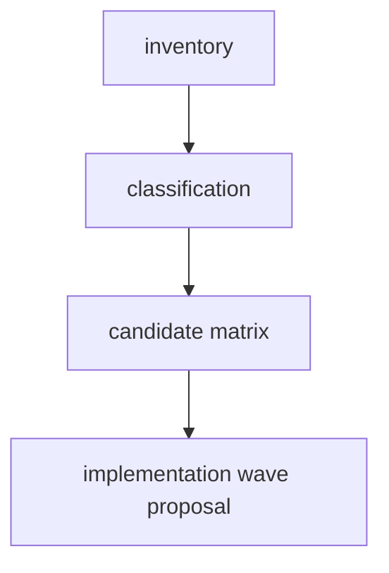

# Peak Assistant Modernization Handoff: T11M UI -> App Boundary Investigation

Branch:
`codex/peak-modernization-refactor`

## Owner Summary

After T11L the boundary audit is down to `163` total flagged edges, but `114` of those are `UI -> app shell` informational edges.

This does **not** mean the last 114 are all equally bad. UI code necessarily touches Obsidian view lifecycle, modals, settings screens, and app-hosted runtimes. But right now those dependencies are scattered across React components, hooks, panels, strings, callbacks, and view classes. That makes the UI harder to understand and makes the owner feel like the architecture is still not modular.

T11M is therefore **read-only investigation first**. Do not implement in the first response.

The goal is to classify the 114 `UI -> app` edges and propose one credible large implementation wave that reduces real coupling without hiding it behind a fake god context.

## Current Baseline After T11L

From Codex rerun:

```bash
npm run audit:boundary -- --out /tmp/t11m-ui-app-baseline.md
```

Snapshot:

```text
Files scanned: 868
Total flagged: 163
UI -> app shell: 114
service/core -> Obsidian types: 34
service -> app: 8
service/core -> Obsidian side-effect: 5
core -> upstream: 2
service -> ui: 0
core -> ui: 0
```

UI import target distribution:

```text
88  @/app/context/AppContext
15  @/app/settings/types
4   @/app/commands/PeakCommandActions
3   @/app/view/types
2   @/app/view/ViewManager
1   @/app/quick-search/SearchSessionReportAdapter
1   @/app/quick-search/AppAnalysisDocVaultWriterAdapter
```

AppContext file distribution by area:

```text
26  view/copilot/panels/
8   view/
6   view/quick-search/hooks/
4   view/quick-search/components/
4   view/copilot/
3   view/quick-search/callbacks/
3   view/modals/
3   view/chat-view/
2   view/usage-dashboard/hooks/
2   view/usage-dashboard/components/
2   view/settings/tabs/
2   view/quick-search/
2   view/modals/harness-onboarding/
2   view/copilot/vault/
```

## Phase 1 Must Be Read-only Investigation

Claude Code must **not edit files, run formatters, stage files, or commit** in the first response.

The first response must answer:

- Which `UI -> app` edges are legitimate app-shell composition and should remain allowed?
- Which edges are simply settings type/default imports that can move to `core/config` or UI-local projection types?
- Which edges are UI components reaching for app runtime because `ServiceContext` is incomplete?
- Which edges are Copilot panel vault/app operations that should move behind action/runtime APIs instead of UI panels calling `AppContext.getInstance().app`?
- Which Quick Search edges should become a QuickSearch UI/runtime port or app-owned surface adapter?
- Which edges are string/template loading and should move behind a strings/template provider?
- What is the largest safe implementation wave that improves real modularity, not only the scanner number?

Required first response:

````md
## T11M Read-only Investigation: UI -> App Boundary

Files inspected:
- <exact files>

Current metric snapshot:
- total flagged:
- UI -> app:
- AppContext imports in UI:
- settings/types imports in UI:
- commands imports in UI:
- app adapter imports in UI:
- service -> ui:
- core -> ui:

UI -> app inventory:
| Bucket | Files | Count | Why UI reaches app | Real coupling severity | Candidate treatment | Expected delta | Risk |
| --- | --- | ---: | --- | --- | --- | ---: | --- |

Import target breakdown:
| Import target | Count | Typical caller | Should remain? | Proposed owner |
| --- | ---: | --- | --- | --- |

Area breakdown:
| UI area | AppContext count | Dominant usage | Candidate pattern | Include in T11M? |
| --- | ---: | --- | --- | --- |

Legitimate app-shell exceptions:
| File / area | Why allowed | How to document or guard |
| --- | --- | --- |

Candidate architecture options:
| Option | Description | Metrics touched | Expected delta | Real modularity gain | Risk | Include? |
| --- | --- | --- | ---: | --- | --- | --- |

Recommended implementation wave:
- Architecture choice:
- Primary metric target:
- Minimum acceptable delta:
- Stretch target:
- Required tracks:
- Optional tracks:
- Forbidden scope:
- Skip budget:
- Stop / commit rule:

Dependency DAG:


Exact file plan:
- New files:
- Modified files:
- Deleted / moved files:
- Tests / guards:

Expected before/after:
| Metric | Before | Expected after | Delta |
| --- | ---: | ---: | ---: |

Code reading guide for owner:
1. `<file>` — why read it first
2. `<file>` — what changed or would change
3. `<test>` — what proves it

Visual maps to include in the implementation note:
- UI host boundary before/after
- settings ownership before/after
- Copilot panel runtime access before/after
- Quick Search UI/runtime access before/after
- allowed app-shell exception map

Risks / stop conditions:
- ...

Verification plan:
- ...

Does this qualify as a major wave?
- Yes / No, with evidence.
````

Codex/user will audit this investigation before implementation.

## Candidate Bucket A — Settings Types / Defaults (`15`)

Problem:

Some UI files import from `@/app/settings/types`. This may be type-only, but it keeps UI tied to app shell settings ownership.

Inspect at minimum:

- `src/ui/view/SettingsView.tsx`
- `src/ui/view/settings/hooks/useSettingsUpdate.ts`
- `src/ui/view/settings/components/MCPServerSection.tsx`
- `src/ui/view/settings/ProfilesTab.tsx`
- `src/ui/view/settings/tabs/AdvancedTab.tsx`
- `src/ui/view/settings/tabs/AISetupTab.tsx`
- `src/ui/view/settings/tabs/OverviewTab.tsx`
- `src/ui/view/settings/tabs/KnowledgeIndexTab.tsx`
- `src/ui/view/settings/tabs/ToolsTab.tsx`
- `src/ui/view/usage-dashboard/screens/BudgetAlerts.tsx`
- `src/ui/view/chat-view/hooks/useChatSession.ts`
- `src/ui/view/chat-view/components/messages/MessageListRendererRetained.tsx`
- `src/ui/component/mine/LLMOutputControlSettings/constants.tsx`

Possible treatments:

- Prefer importing neutral settings types/defaults from `src/core/config/*` if already available.
- If `app/settings/types` contains app-bound wrappers, split pure settings shape/defaults from app wrapper helpers.
- Do not duplicate defaults in UI.

Bad outcomes:

- Moving app-only plugin settings helpers into UI.
- Creating a second settings source of truth.
- Hardcoding defaults in components.

## Candidate Bucket B — ServiceContext / UI Host Boundary (`88 AppContext imports`)

Problem:

The repo already has `src/ui/context/ServiceContext.tsx`, but many UI components still call `AppContext.getInstance()` directly. This means UI dependency access is scattered.

Inspect at minimum:

- `src/ui/context/ServiceContext.tsx`
- `src/ui/react/ReactElementFactory.tsx`
- every direct `AppContext` import in `src/ui/**`

Classify direct AppContext usage by need:

- `app` / vault reads
- `manager`
- `eventBus`
- `searchClient`
- `viewManager`
- `plugin/settings`
- runtime registry getters
- modal/view constructor typing
- template/string loading

Possible treatments:

- Expand `ServiceContext` only with **named, narrow UI host capabilities**, not a generic god bag.
- Consider a `UiHostContext` or `SurfaceHostPort` only if it is clearer than adding more raw services.
- Move one-time view/modal constructor dependencies to app/view composition where appropriate.

Bad outcomes:

- Replacing 88 imports with one `useAppShell()` that exposes all of `AppContext`.
- Making UI less readable by passing dozens of props manually.
- Hiding real Obsidian operations under vague names.

## Candidate Bucket C — Copilot Panel Cluster (`26`)

Problem:

`src/ui/view/copilot/panels/*` is the largest AppContext cluster. Many panels call `AppContext.getInstance().app` to read/modify the current file, write frontmatter, or apply artifacts.

Inspect at minimum:

- all files under `src/ui/view/copilot/panels/`
- `src/ui/view/copilot/CopilotPickerModal.tsx`
- `src/ui/view/copilot/CopilotResultModal.tsx`
- `src/ui/view/copilot/CopilotAutoRunModal.tsx`
- `src/service/copilot/actions/*`
- `src/app/copilot/actions/*`

Possible treatments:

- Move repeated panel-side vault/app operations behind Copilot action runtime APIs.
- Add narrow UI-facing functions such as `runPanelAction`, `applyArtifacts`, `readCurrentFile`, or `writeFrontmatter` only if they match existing runtime concepts.
- Keep the UI responsible for selection/interaction, not Vault CRUD.

Bad outcomes:

- Panel components importing app adapters directly.
- Duplicating Copilot action execution paths.
- Breaking current manual action flows just to lower import counts.

## Candidate Bucket D — Quick Search UI Runtime Cluster

Problem:

Quick Search hooks/components still reach for `AppContext` for search agents, background runtime, AI analysis history, context provider, and app-owned adapters.

Inspect at minimum:

- `src/ui/view/quick-search/hooks/useSearchSession.ts`
- `src/ui/view/quick-search/SearchModal.tsx`
- `src/ui/view/quick-search/hooks/useAIAnalysisResult.ts`
- `src/ui/view/quick-search/hooks/useVaultSearch.ts`
- `src/ui/view/quick-search/hooks/useContinueAnalysis.ts`
- `src/ui/view/quick-search/hooks/useAIAnalysisPostAIInteractions.ts`
- `src/ui/view/quick-search/components/ActiveSessionsList.tsx`
- `src/ui/view/quick-search/callbacks/open-source-file.ts`
- `src/ui/view/quick-search/callbacks/save-ai-analyze-to-md.ts`
- `src/app/quick-search/SearchSessionReportAdapter.ts`
- `src/app/quick-search/AppAnalysisDocVaultWriterAdapter.ts`

Possible treatments:

- Build a Quick Search UI host adapter or runtime access object composed in app layer.
- Ensure UI does not import app concrete adapters directly unless that file is itself an app shell.
- Reuse T10 Quick Search background runtime rather than adding a second runtime path.

Bad outcomes:

- Reopening service -> ui or service -> app leaks.
- Creating parallel Quick Search execution paths.
- Moving app adapters into UI under new names.

## Candidate Bucket E — Strings / Template Loading

Problem:

Some UI string files call `AppContext` to load templates or fallback strings.

Inspect at minimum:

- `src/ui/view/chat-view/chatStrings.ts`
- `src/ui/view/settings/settingsStrings.ts`
- `src/ui/view/onboarding/onboardingStrings.ts`
- `src/ui/view/usage-dashboard/components/InlineReceipt.tsx`
- `src/ui/view/usage-dashboard/components/WhatWasThisAbout.tsx`

Possible treatments:

- Provide UI strings through a template/string provider at surface composition.
- Keep fallback constants local, but move runtime template loading out of generic component files.

Bad outcomes:

- Replacing template loading with hardcoded UI strings.
- Making i18n/template ownership less clear.

## Candidate Bucket F — Legitimate App Shell Exceptions

Some files may remain `UI -> app` by design:

- Obsidian view classes that are constructed by app/view lifecycle.
- Modal classes that are app-shell surfaces.
- `ReactElementFactory.tsx` or `ServiceContext.tsx` if they are the single bridge.
- type-only view constants if they are the app/view registry contract.

The investigation must propose:

- which exceptions remain allowed;
- how to document them;
- whether the boundary scanner needs an allowlist category so `total flagged` stops feeling misleading.

Do not edit the scanner in the read-only response. Just propose the rule.

## Corrected Impact Contract For A Possible Implementation Wave

T11M implementation should not promise `UI -> app = 0`. That would be fake.

Hard minimum for a future implementation wave:

| Metric | Before T11M | Hard minimum after |
| --- | ---: | ---: |
| `UI -> app` | 114 | <=80 |
| direct UI `AppContext` imports | 88 | <=55 |
| `service -> ui` | 0 | 0 |
| `core -> ui` | 0 | 0 |
| `service -> app` | 8 | <=8 |
| total flagged | 163 | <=130 |

Stretch:

```text
UI -> app <=60
direct UI AppContext imports <=40
total flagged <=110
settings/types imports from app <=3
no UI import of app concrete quick-search adapters
```

The implementation can qualify as a major wave only if:

- it lowers real direct `AppContext` usage across at least two UI areas;
- it does not merely introduce one broad `useAppContext()` wrapper;
- it improves owner comprehension through a small set of named UI host capabilities;
- it preserves `service -> ui = 0` and `core -> ui = 0`;
- build/tests/source guards pass.

## Stop Conditions

Hard stop before commit if any of these happen:

- `service -> ui` becomes non-zero.
- `core -> ui` becomes non-zero.
- `service -> app` increases above 8.
- A generic `UiAppServices`, `AppShellEverything`, `UIHostGodContext`, or similar god object appears.
- UI components import app concrete adapters instead of consuming a composed capability.
- Settings defaults are duplicated in UI.
- A second Quick Search or Copilot runtime path appears.
- The implementation only moves imports without reducing the number of places a human must understand.
- Codex-owned docs are staged.

## Required Verification For A Future Implementation

Run serially:

```bash
npm run build
npm run audit:boundary -- --out /tmp/t11m-ui-app-after.md
npm run test -- test/t11l-remaining-boundary-regression.test.ts
npm run test -- test/t11k-obsidian-boundary-regression.test.ts
npm run test -- test/t11j-boundary-regression.test.ts
npm run test -- test/service-ui-boundary.test.ts
npm run test -- test/report-session-port.test.ts
npm run test -- test/chat-runtime-state-port.test.ts
```

Additional source checks:

```bash
rg -n "from ['\"]@/app/context/AppContext" src/ui
rg -n "from ['\"]@/app/settings/types" src/ui
rg -n "from ['\"]@/app/quick-search" src/ui
rg -n "from ['\"]@/ui" src/service src/core
rg -n "from ['\"]@/app" src/service
rg -n "UiAppServices|AppShellEverything|UIHostGod|EverythingPort|ToolDeps" src
```

## Message To Send Back To Claude

```md
Please perform T11M read-only investigation only. Do not edit files, format, stage, or commit.

Goal: classify and plan a real UI -> app boundary wave after T11L.

Current baseline:
- total flagged 163
- UI -> app 114
- direct UI AppContext imports 88
- UI app/settings/types imports 15
- UI app/commands imports 4
- UI app/view imports 5
- UI app/quick-search adapter imports 2
- service -> ui 0
- core -> ui 0

Use this handoff:
docs/superpowers/refactor-ops/t11m-ui-app-boundary-investigation-handoff.md

First response must be read-only and include:
- exact files inspected
- UI -> app inventory by bucket
- import target breakdown
- area breakdown
- legitimate app-shell exceptions
- candidate architecture options
- recommended implementation wave with Impact Contract
- dependency DAG
- exact file plan
- expected before/after metrics
- code reading guide
- visual maps
- risks / stop conditions
- verification plan

Do not promise UI -> app = 0. The goal is to reduce scattered direct AppContext usage and improve owner comprehension without creating a UI god context.
```

