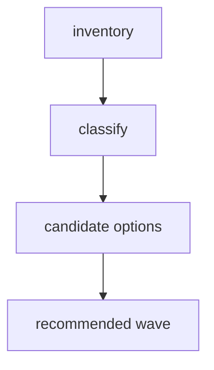

# Peak Assistant Modernization Handoff: T11N Remaining Boundary Tail Investigation

Branch:
`codex/peak-modernization-refactor`

## Owner Summary

After T11M the boundary audit is down to **95** findings.

This is no longer one giant messy bucket. The remaining findings are small enough to classify manually, and that is exactly why T11N must start with a read-only investigation.

Do **not** implement in the first response.

The goal of T11N investigation is to answer:

- Which remaining edges are legitimate app-shell/view-wrapper edges?
- Which remaining edges are real architecture debt worth one more large implementation wave?
- Which raw UI vault/editor operations remain after Copilot panels were cleaned?
- Which `service/core -> Obsidian` findings are storage/native substrate work that should be deferred?
- What single implementation wave can safely move a meaningful metric, without returning to tiny prompts?

## Current Baseline After T11M

Codex rerun:

```bash
npm run audit:boundary -- --out /tmp/t11m-codex-after.md
```

Snapshot:

```text
Files scanned: 874
Total flagged: 95
UI -> app shell: 46
service/core -> Obsidian types: 35
service -> app: 7
service/core -> Obsidian side-effect: 5
core -> upstream: 2
service -> ui: 0
core -> ui: 0
Direct UI AppContext import files: 33
UI -> @/app/settings/types: 0
```

Important context:

- T11M was accepted as a major wave.
- Copilot result panels now have 0 raw vault/editor ops under `src/ui/view/copilot/panels/`.
- Raw UI vault/editor operations still exist outside that target, about 25 by source scan.
- `ServiceContext.app` still exists and must be treated as a known escape hatch, not a solved boundary.
- `TemplateManager.setInstance()` is a compatibility singleton. Do not spread that pattern.

## Phase 1 Must Be Read-only Investigation

Claude Code must **not edit files, run formatters, stage files, or commit** in the first response.

You may run read-only commands:

```bash
npm run audit:boundary -- --out /tmp/t11n-baseline.md
rg -n "from ['\"]@/app/context/AppContext" src/ui
rg -n "from ['\"]@/app" src/ui
rg -n "from ['\"]@/app/context/AppContext" src/service src/core
rg -n "from ['\"]obsidian['\"]" src/service src/core
rg -n "\bapp\.vault\.(read|modify|create|trash|cachedRead)|\bapp\.workspace\.activeEditor|\bapp\.fileManager\.|\bapp\.workspace\.openLinkText" src/ui
rg -n "AppContext\.getInstance\(\)\.app\.(vault|workspace|fileManager)" src/ui src/service src/core
```

You may inspect files with `sed`, `nl`, `rg`, and `git show`.

Do not use the investigation to add scanner allowlists. We need classification and owner understanding first.

## Required Investigation Output

Return exactly one report in this shape:

````md
## T11N Read-only Investigation: Remaining Boundary Tail

Files inspected:
- <exact files>

Current metric snapshot:
| Metric | Count | Notes |
| --- | ---: | --- |
| total flagged |  |  |
| UI -> app |  |  |
| direct UI AppContext import files |  |  |
| raw UI vault/editor operations |  |  |
| service/core -> Obsidian types |  |  |
| service/core -> Obsidian side-effect |  |  |
| service -> app |  |  |
| core -> upstream |  |  |
| service -> ui |  | should remain 0 |
| core -> ui |  | should remain 0 |

Residual classification:
| Bucket | Files / examples | Count | Legitimate or debt? | Owner | Candidate treatment | Expected delta | Risk |
| --- | --- | ---: | --- | --- | --- | ---: | --- |

Legitimate app-shell exceptions:
| File / area | Why allowed | How to document or guard |
| --- | --- | --- |

Real debt candidates:
| Candidate | Files | Metrics touched | Expected delta | Real modularity gain | Risk | Include in T11N implementation? |
| --- | --- | --- | ---: | --- | --- | --- |

Raw UI vault/editor operation inventory:
| File | Operation | Why UI needs it today | Proposed owner | Include? |
| --- | --- | --- | --- | --- |

Service/core tail inventory:
| File | Current dependency | Why it remains | Proposed treatment | Include? |
| --- | --- | --- | --- | --- |

Recommended implementation wave:
- Architecture choice:
- Primary metric target:
- Minimum acceptable delta:
- Stretch target:
- Required tracks:
- Optional tracks:
- Forbidden scope:
- Skip budget:
- Stop / commit rule:

Dependency DAG:


Exact file plan:
- New files:
- Modified files:
- Deleted / moved files:
- Tests / guards:

Expected before/after:
| Metric | Before | Expected after | Delta |
| --- | ---: | ---: | ---: |

Visual maps to include if implementation happens:
- remaining boundary overview
- raw UI vault/editor before/after
- legitimate app-shell exception map
- service/core substrate defer map

Code reading guide for owner:
1. `<file>` - why read it first
2. `<file>` - what it proves
3. `<test>` - what will guard it

Risks / stop conditions:
- ...

Does this qualify as a major wave?
- Yes / No, with evidence.

Message to send back to Codex:
- <one paragraph summary>
````

Codex/user will audit this investigation before implementation.

## Candidate Bucket A: Legitimate UI App-Shell Exceptions

Some `UI -> app` edges may be acceptable because Obsidian view classes and modals are app-hosted shells.

Inspect at minimum:

- `src/ui/view/ChatView.ts`
- `src/ui/view/QuickSearchModal.tsx`
- `src/ui/view/SettingsModal.tsx`
- `src/ui/view/UsageDashboardView.ts`
- `src/ui/react/ReactElementFactory.tsx`
- `src/ui/context/ServiceContext.tsx`
- `src/ui/view/ConversationOutlineView.ts`
- `src/ui/view/ChatStudioView.ts`

Questions:

- Is this file a true Obsidian view/modal wrapper?
- Does it just receive `AppContext` to boot React?
- Is the app dependency part of lifecycle ownership rather than business logic?
- Should this be documented as an allowed app-shell exception instead of rewritten?

Bad outcomes:

- Moving view lifecycle into service/core.
- Creating a fake `UiAppShellPort` that simply exposes all of `AppContext`.
- Lowering the number by hiding legitimate app-shell boundaries.

## Candidate Bucket B: Raw UI Vault and Editor Operations

T11M cleaned Copilot result panels, but raw UI vault/editor operations remain elsewhere.

Inspect at minimum:

- `src/ui/view/quick-search/SearchModal.tsx`
- `src/ui/view/quick-search/callbacks/save-ai-analyze-to-md.ts`
- `src/ui/view/quick-search/callbacks/useStreamdownWikilinkClick.ts`
- `src/ui/view/quick-search/callbacks/open-source-file.ts`
- `src/ui/view/copilot/CopilotPickerModal.tsx`
- `src/ui/view/copilot/CopilotReviewHistoryModal.tsx`
- `src/ui/view/copilot/vault/VaultAutoRunModal.tsx`
- `src/ui/component/mine/streamdown/WikilinkHoverPreview.tsx`
- `src/ui/component/mine/resource-preview-hover.tsx`
- `src/ui/view/chat-view/components/messages/MessageViewItemRetained.tsx`
- `src/ui/view/morning-briefing/BriefingCard.tsx`
- `src/ui/view/ambient-push/PushCard.tsx`
- `src/ui/view/chat-view/view-Messages.tsx`

Questions:

- Which of these are pure navigation/open-link operations?
- Which are file write operations?
- Which belong behind an app-owned `VaultPreviewPort`, `VaultOpenPort`, or feature-specific host?
- Which are acceptable because the component is itself a small display adapter?
- Which can be grouped into one meaningful implementation wave?

Bad outcomes:

- Moving all UI raw operations into one giant `VaultUiPort`.
- Passing raw `app` through a new hook with a nicer name.
- Breaking file preview, wikilink click, or Chat artifact save behavior without tests.

## Candidate Bucket C: Quick Search Tail

T11M introduced `useQuickSearchHost()`, but Quick Search still has a tail of direct app imports and injected-app helper calls.

Inspect at minimum:

- `src/ui/view/quick-search/hooks/useQuickSearchHost.ts`
- `src/ui/view/quick-search/hooks/useSearchSession.ts`
- `src/ui/view/quick-search/components/ActiveSessionsList.tsx`
- `src/ui/view/quick-search/callbacks/open-source-file.ts`
- `src/ui/view/quick-search/callbacks/save-ai-analyze-to-md.ts`
- `src/ui/view/quick-search/callbacks/useStreamdownWikilinkClick.ts`
- `src/app/quick-search/SearchSessionReportAdapter.ts`
- `src/app/quick-search/AppAnalysisDocVaultWriterAdapter.ts`

Questions:

- Should Quick Search get app-owned adapters similar to Copilot panel adapters?
- Is `useQuickSearchHost()` already the right containment point, or should some helper files move under `src/app/quick-search/*`?
- Which functions can be tested with fake operations?
- What is the expected `UI -> app` and raw op delta?

Bad outcomes:

- Enlarging `useQuickSearchHost()` into a god hook.
- Moving service agents into UI.
- Creating a second Quick Search runtime path.

## Candidate Bucket D: Service/Core Tail

After T11M, service/core tail remains:

```text
service -> app: 7
service/core -> Obsidian side-effect: 5
service/core -> Obsidian types: 35
core -> upstream: 2
```

Inspect at minimum from the audit:

- `src/service/agents/KnowledgeIntuitionAgent.ts`
- `src/service/context/WorkingThemeInferrer.ts`
- `src/service/copilot/CopilotReviewHistoryService.ts`
- `src/service/copilot/CopilotReviewSession.ts`
- `src/service/search/index/helper/backbone/buildBackboneMap.ts`
- `src/service/search/index/indexService.ts`
- `src/service/tools/search-graph-inspector/explore-folder.ts`
- `src/core/eventBus.ts`
- `src/core/storage/vault/ChatStore.ts`
- `src/core/platform.ts`
- `src/core/providers/testProviderConnection.ts`
- `src/core/storage/sqlite/DatabaseHealthVerifier.ts`
- `src/core/storage/sqlite/NativeModuleManager.ts`
- `src/core/storage/sqlite/SqliteStoreManager.ts`

Questions:

- Are these part of one coherent implementation wave, or should they be deferred?
- Which are storage/native substrate and risky to touch now?
- Which are type-only and could be moved to neutral core types?
- Which would materially lower `total flagged` without large product risk?

Bad outcomes:

- Mixing SQLite/native substrate changes into a UI cleanup wave.
- Reintroducing service-layer singletons.
- Turning `AppHandle` into a permanent generic dependency.

## Major-Wave Gate For The Future Implementation

The investigation may recommend implementation only if it can define a real Impact Contract.

Minimum bar for a T11N implementation wave:

- Move at least one high-impact bucket materially.
- Prefer total flagged `95 -> <=70` if safe.
- If targeting raw UI vault/editor ops, reduce them by at least 10 call sites or explain why the safe maximum is lower.
- Keep `service -> ui = 0` and `core -> ui = 0`.
- Do not raise `service -> app` above 7.
- Do not add a new god hook, god port, service-layer singleton, or module-level mutable runtime binding.

If the investigation cannot find that size of safe wave:

- Say so.
- Recommend a smaller tail cleanup honestly.
- Do not label it a major wave.

## Protected Scope

Do not touch in the investigation or proposed implementation unless the report proves it is necessary:

- Current Work State / Ambient Push product redesign
- Command Gateway / T12 capstone
- Chat core runtime behavior
- provider/model selection logic
- SQLite schema migrations
- Vault Lint runtime
- Copilot action execution runtime
- Mobile/native module boot behavior

## Verification Requirements For Any Later Implementation

Expected verification:

```bash
npm run build
npm run audit:boundary -- --out /tmp/t11n-after.md
npm run test -- test/t11m-ui-app-boundary-regression.test.ts
npm run test -- test/t11l-remaining-boundary-regression.test.ts test/t11k-obsidian-boundary-regression.test.ts test/t11j-boundary-regression.test.ts test/service-ui-boundary.test.ts
```

Add a new T11N regression test only if implementation introduces a meaningful new floor or source invariant.

## Final Reminder

This first T11N response is read-only.

The best answer is not "I found 3 easy imports to move." The best answer is a clear residual map plus a credible single implementation wave, or an honest explanation that the remaining debt is now too fragmented for one major wave.

