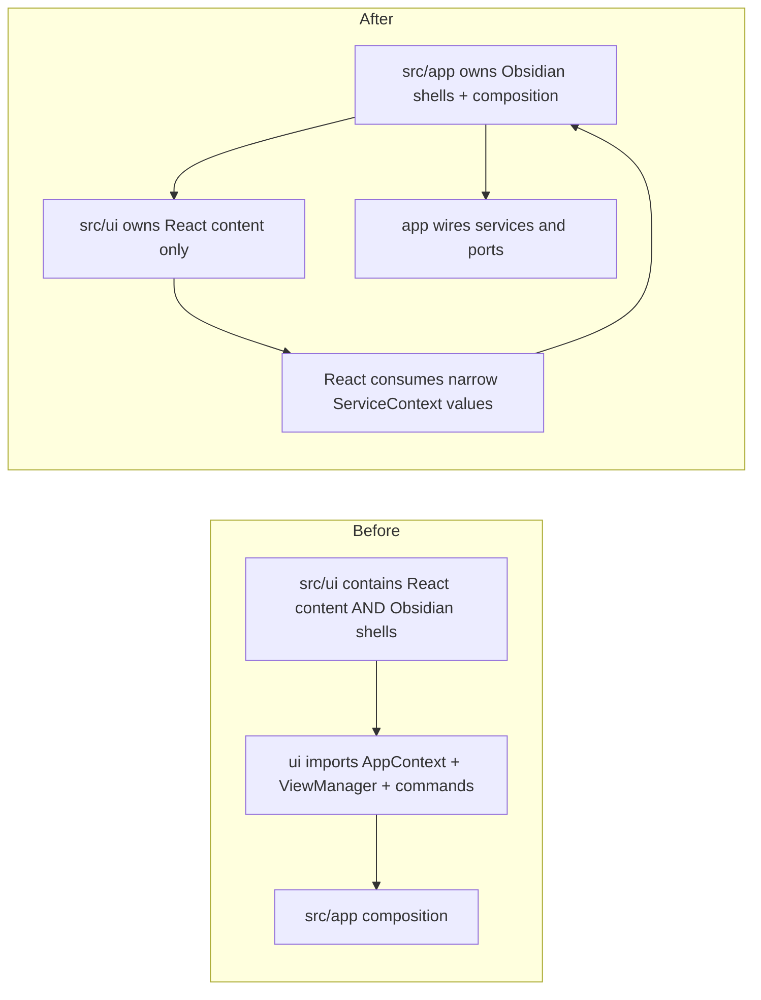
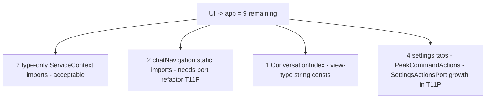
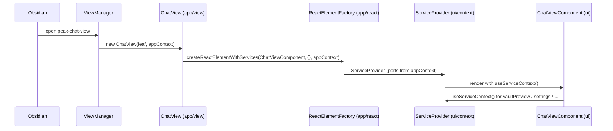
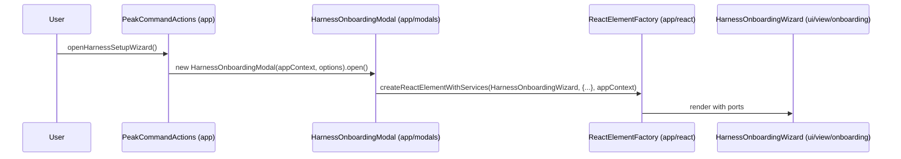

# T11O Implementation Note — App-Shell Relocation Wave

Branch: `codex/peak-modernization-refactor`
Commits: `5686ac97` → `a9b04c2e` (7 tracks, 7 commits)
Audit before: `/tmp/t11o-before.md` (92 findings)
Audit after: `/tmp/t11o-after-track7a.md` (56 findings; the post-Track-7-revert baseline was re-verified at `/tmp/t11o-after-revert.md`).

## 1. Before / After Metrics

| Metric | Before T11O | After T11O | Δ | Codex contract |
| --- | ---: | ---: | ---: | --- |
| total flagged | 92 | **56** | −36 | ≤60 hard / ≤50 stretch |
| UI → app | 45 | **9** | −36 | ≤15 hard / ≤8 stretch |
| direct UI `AppContext` import files | 31 | **6** | −25 | ≤8 hard |
| service → app | 7 | **7** | 0 | must stay ≤7 |
| service → ui | 0 | **0** | 0 | must stay 0 |
| core → ui | 0 | **0** | 0 | must stay 0 |
| core → upstream | 0 | **0** | 0 | must stay 0 |
| service/core → Obsidian types | 35 | **35** | 0 | unchanged |
| raw UI vault/editor matches | 7 | **7** | 0 | must stay ≤7 |
| `useServiceContext().app` consumers | 27 | **25** | −2 | must not increase |

Primary target (UI → app ≤15) met with a margin of 6; stretch (≤8) missed by 1, with documented remaining debt below.

## 2. `useServiceContext().app` Consumer Count

Codex's honesty metric. T11O did NOT introduce a single new consumer of raw `app` from ServiceContext. The two-count drop comes from two sites in `InlineReceipt` / `WhatWasThisAbout` that the migration replaced with `settings`. Final breakdown:

```
src/ui/utils/toast.ts (doc comment only)
src/ui/component/mine/StreamdownIsolated.tsx (2)
src/ui/view/chat-view/view-ProjectOverview.tsx
src/ui/view/chat-view/hooks/useChatSubmit.ts
src/ui/view/chat-view/components/HeaderRetained.tsx
src/ui/view/chat-view/components/ConversationIndex.tsx
src/ui/view/chat-view/components/messages/MessageViewItemRetained.tsx
src/ui/view/project-list-view/ProjectListView.tsx
src/ui/view/project-list-view/ConversationsSection.tsx
src/ui/view/project-list-view/ProjectsSection.tsx
src/ui/view/quick-search/SearchModal.tsx (2)
src/ui/view/quick-search/tab-VaultSearch.tsx
src/ui/view/quick-search/hooks/useQuickSearchHost.ts
src/ui/view/quick-search/hooks/useSearchSession.ts
src/ui/view/quick-search/hooks/useVaultSearch.ts
src/ui/view/quick-search/components/VaultSearchResult.tsx
src/ui/view/quick-search/components/V2SourcesView.tsx
src/ui/view/quick-search/components/ai-analysis-sections/RecentAIAnalysis.tsx
src/ui/view/copilot/CopilotResultContent.tsx (1, was inside Modal class — now React-side already)
src/ui/view/modals/harness-onboarding/RunningCuratorStep.tsx
src/ui/view/settings/tabs/OverviewTab.tsx
src/ui/view/settings/tabs/KnowledgeIndexTab.tsx (4)
src/ui/view/vault-lint/components/HealthInsightsPanel.tsx
```

The regression guard locks this at ≤27 (`testUseServiceContextAppHonestyMetric`).

## 3. Changed Files by Track

### Track 1 — ItemView shells relocated (commit `5686ac97`, 8 files)

| Old path | New path |
| --- | --- |
| `src/ui/view/AmbientPushView.ts` | `src/app/view/AmbientPushView.ts` |
| `src/ui/view/ChatStudioView.ts` | `src/app/view/ChatStudioView.ts` |
| `src/ui/view/ChatView.ts` | `src/app/view/ChatView.ts` |
| `src/ui/view/ConversationOutlineView.ts` | `src/app/view/ConversationOutlineView.ts` |
| `src/ui/view/ProjectListView.ts` | `src/app/view/ProjectListView.ts` |
| `src/ui/view/usage-dashboard/UsageDashboardView.ts` | `src/app/view/UsageDashboardView.ts` |
| `src/ui/view/vault-lint/VaultXRayView.ts` | `src/app/view/VaultXRayView.ts` |
| `src/app/view/ViewManager.ts` (import paths updated) | — |

Each shell now imports its `*_VIEW_TYPE` constant from `@/app/view/types` instead of re-declaring it.

### Track 2 — Standalone Modal shells relocated (commit `ca6e591a`, 8 files)

| Old path | New path |
| --- | --- |
| `src/ui/view/ConfirmModal.ts` | `src/app/modals/ConfirmModal.ts` |
| `src/ui/view/SettingsModal.tsx` | `src/app/modals/SettingsModal.tsx` |
| `src/ui/view/QuickSearchModal.tsx` | `src/app/modals/QuickSearchModal.tsx` |
| `src/ui/view/BuildUserProfileProgressModal.ts` | `src/app/modals/BuildUserProfileProgressModal.ts` |

Importers updated: `PeakCommandActions`, `AppModalOpenerAdapter`, `AppCopilotPanelNavigatorAdapter`, runtime `require()` in `MessageViewItemRetained`. `MorningBriefingModal` deferred (no `@/app/**` imports, no live mount).

### Track 3 — Non-Copilot blended modal splits (commit `f35901cc`, 9 files)

| Original (blended) | New shell (app) | New content (ui) |
| --- | --- | --- |
| `src/ui/view/modals/CostEstimationModal.tsx` | `src/app/modals/CostEstimationModal.tsx` | `src/ui/view/modals/CostEstimationContent.tsx` |
| `src/ui/view/modals/IndexingProgressModal.tsx` | `src/app/modals/IndexingProgressModal.tsx` | `src/ui/view/modals/IndexingProgressContent.tsx` |
| `src/ui/view/modals/HarnessOnboardingModal.tsx` | `src/app/modals/HarnessOnboardingModal.tsx` | `src/ui/view/onboarding/HarnessOnboardingWizard.tsx` |

The Harness split moved the 818-LOC blended file as: 74-LOC Modal shell + ~620-LOC React wizard. Zero behavior change. `applyRecommendation.ts` stayed in UI (Track 6 turns it into a pure-injection helper).

### Track 4 — Copilot modal cluster split + relocated (commit `78c4406f`, 13 files)

| Original (blended) | New shell (app) | New content (ui) |
| --- | --- | --- |
| `src/ui/view/copilot/CopilotAutoRunModal.tsx` | `src/app/copilot/modals/CopilotAutoRunModal.tsx` | `src/ui/view/copilot/CopilotAutoRunContent.tsx` |
| `src/ui/view/copilot/CopilotPickerModal.tsx` | `src/app/copilot/modals/CopilotPickerModal.tsx` | `src/ui/view/copilot/CopilotPickerContent.tsx` |
| `src/ui/view/copilot/CopilotResultModal.tsx` | `src/app/copilot/modals/CopilotResultModal.tsx` | `src/ui/view/copilot/CopilotResultContent.tsx` (+ exported `getCurrentSetPhase`/`setCurrentSetPhase` so the shell can drive the module-level phase slot) |
| `src/ui/view/copilot/CopilotReviewHistoryModal.tsx` | `src/app/copilot/modals/CopilotReviewHistoryModal.tsx` | `src/ui/view/copilot/CopilotReviewHistoryContent.tsx` |
| `src/ui/view/copilot/vault/VaultAutoRunModal.tsx` (1669 LOC) | `src/app/copilot/modals/VaultAutoRunModal.tsx` | `src/ui/view/copilot/vault/VaultAutoRunContent.tsx` |
| (new helper) | `src/app/copilot/modals/openVaultReviewHistoryRecord.ts` | — |

Chained navigation (`Picker → Result/AutoRun/History/VaultAutoRun`; `Result → Picker` back-nav) lives entirely inside `src/app/copilot/modals/`. `CuratorPushModal` was intentionally LEFT in UI — it uses the Radix `Modal` primitive, not the Obsidian Modal class (Codex correction #6).

### Track 5 — ReactElementFactory relocation + ServiceContext fallback removal (commit `b80028a9`, 21 files)

- `src/ui/react/ReactElementFactory.tsx` → `src/app/react/ReactElementFactory.tsx`.
- 19 shell callers had their import paths rewritten via `sed`.
- `src/ui/context/ServiceContext.tsx` lost its `import { AppContext }` and the entire `?? AppContext.getInstance().x` fallback chain. The provider now requires every prop and is purely a publication contract.
- `ServiceContext` imports `ViewManager` as `import type` only.

### Track 6 — Narrow runtimes / ports / actions published on ServiceContext (commit `969c717c`, 14 files)

New fields on `ServiceContext`:

```ts
vaultReviewRuntime: VaultReviewRuntime | null;
quickSearchBackgroundRuntime: QuickSearchBackgroundRuntime | null;
aiAnalysisHistoryService: AIAnalysisHistoryService;
isMockEnv: boolean;
searchAgent: () => DocSimpleAgent;
settingsActions: { openSettings(): void };
analysisDocVaultWriter: AnalysisDocVaultWriterPort;
reportSessionPort: ReportSessionPort;
```

`ReactElementFactory` threads each value off `AppContext` once at composition time. Migrated consumers:

- `InlineReceipt`, `WhatWasThisAbout` — usage dashboard preview flag (now `settings.usagePreviewEnabled`)
- `WritingPlanPanel` — settings (`inboxFolder`)
- `VaultPickerSections` — `vaultReviewRuntime` inside `useVaultTabState`
- `VaultAutoRunContent` — `vaultReviewRuntime` in 4 effects across 2 components
- `ActiveSessionsList` — `quickSearchBackgroundRuntime` via `useSyncExternalStore`
- `MessageViewItemRetained` — `settingsActions.openSettings()` replaces `new SettingsModal(AppContext.getInstance()).open()`
- `applyRecommendation.ts` — takes `(settings, saveSettings)` deps from the caller `ReviewRecommendationStep` instead of `AppContext.getInstance()`
- `useQuickSearchHost` — drops `AppContext` entirely; reads `aiAnalysisHistoryService`, `quickSearchBackgroundRuntime`, `isMockEnv`, `searchAgent` from context
- `useSearchSession` — adapters (`AppAnalysisDocVaultWriterAdapter`, `SearchSessionReportAdapter`) become published port instances; `persistForegroundSession()` now takes a `PersistForegroundSessionDeps` record threaded from `useServiceContext()`
- `useGraphAgent` — same `persistDeps` pattern

### Track 7 — Final shell sweep + regression guard (commit `a9b04c2e`, 4 files)

- `src/ui/component/InputModal.ts` → `src/app/modals/InputModal.ts` (ViewManager updated).
- `src/ui/view/morning-briefing/MorningBriefingModal.ts` → `src/app/modals/MorningBriefingModal.ts`. Dynamic import of `MorningBriefingPanel` now uses an absolute alias.
- `test/t11o-app-shell-relocation-regression.test.ts` — 10 guard checks (metrics, honesty, file presence, shell ban, scanner integrity, god-port ban).

## 4. Deleted / Moved Old Shell Paths

20 paths confirmed absent (asserted by `testRetiredFilesAreGone`):

```
src/ui/view/AmbientPushView.ts
src/ui/view/ChatStudioView.ts
src/ui/view/ChatView.ts
src/ui/view/ConversationOutlineView.ts
src/ui/view/ProjectListView.ts
src/ui/view/usage-dashboard/UsageDashboardView.ts
src/ui/view/vault-lint/VaultXRayView.ts
src/ui/view/ConfirmModal.ts
src/ui/view/SettingsModal.tsx
src/ui/view/QuickSearchModal.tsx
src/ui/view/BuildUserProfileProgressModal.ts
src/ui/view/modals/CostEstimationModal.tsx
src/ui/view/modals/IndexingProgressModal.tsx
src/ui/view/modals/HarnessOnboardingModal.tsx
src/ui/view/copilot/CopilotAutoRunModal.tsx
src/ui/view/copilot/CopilotPickerModal.tsx
src/ui/view/copilot/CopilotResultModal.tsx
src/ui/view/copilot/CopilotReviewHistoryModal.tsx
src/ui/view/copilot/vault/VaultAutoRunModal.tsx
src/ui/react/ReactElementFactory.tsx
```

Plus `src/ui/component/InputModal.ts` and `src/ui/view/morning-briefing/MorningBriefingModal.ts` from Track 7.

## 5. Visual Dependency Maps

### Before / after ownership



### Remaining tail classification (9 UI -> app edges)



### Runtime sequence — ChatView open



### Runtime sequence — HarnessOnboardingModal open



## 6. Code Reading Guide

1. `src/app/view/AmbientPushView.ts` — canonical 66-LOC ItemView shell. Every Track-1 shell follows this template.
2. `src/app/modals/CostEstimationModal.tsx` + `src/ui/view/modals/CostEstimationContent.tsx` — canonical "blended split" pair. Track 3/4 splits all follow this shape.
3. `src/app/copilot/modals/CopilotPickerModal.tsx` — canonical chained-navigation shell; imports four sibling modal classes from `@/app/copilot/modals/**` (intra-app only).
4. `src/app/react/ReactElementFactory.tsx` — single composition point that converts `AppContext` into a ServiceProvider tree. Read this to understand which Track 6 ports are wired.
5. `src/ui/context/ServiceContext.tsx` — pure publication contract. Note the `import type { ... }` group: every cross-layer reference is type-only.
6. `src/ui/view/copilot/CopilotResultContent.tsx` (lines around `let _currentSetPhase`) — example of how React content exposes a module-level slot that the app-shell drives without importing React.
7. `src/ui/view/quick-search/hooks/useSearchSession.ts` — example of how a non-shell helper (`persistForegroundSession`) was refactored from `AppContext.getInstance()` to a `PersistForegroundSessionDeps` argument threaded from `useServiceContext()`.
8. `test/t11o-app-shell-relocation-regression.test.ts` — the 10-check guard. Read first when starting any future T11P work to know what cannot regress.

## 7. Skipped Tracks / Remaining Debt

| Site | Edges | Reason for deferral |
| --- | ---: | --- |
| `src/ui/view/chat-view/chatNavigation.ts` | 2 (AppContext + ViewManager type) | Moving the file to `src/app/chat/chatNavigation.ts` raised `UI -> app` from 9 to 17 because 9 UI callers then had to import from `@/app/chat/chatNavigation`. Clean fix requires a `chatNavigation` named-port on ServiceContext; out of T11O scope. |
| `src/ui/view/chat-view/components/ConversationIndex.tsx` | 1 (`@/app/view/types`) | Pure string-const import; Codex correction #4 forbids dumping view-IDs into core just to satisfy the scanner. Acceptable as legitimate type/const import. |
| `src/ui/view/settings/{MaintenanceTab,tabs/AISetupTab,tabs/AdvancedTab,tabs/OverviewTab}.tsx` | 4 | Maintenance tab alone needs 15 named operations from `PeakCommandActions`. Publishing 15+ functions on `settingsActions` would breach Codex's "narrow named operations" guideline. Right move is a `SettingsActionsPort` with sub-namespaces in a follow-up wave; the current `settingsActions.openSettings()` is a deliberate seed. |
| `src/ui/context/ServiceContext.tsx` | 2 (type-only `ViewManager` + type-only `composeCopilotPanelVault`) | Both are `import type` — the values are passed in via props, never resolved from these paths at runtime. Removing them requires a downstream `viewManager` / `CopilotPanelHostBundle` core-type module; not a T11O scope item. |
| `useGraphAgent.ts` inline `AppContext` dynamic import | 0 (not flagged) | Async IIFE inside `useCallback` constructs a `GraphAgent` with raw `(app, pluginId)`. Static-import scanner ignores `await import(...)`. Logged as a follow-up to inject those via the hook closure instead. |

Total remaining 9 edges: 2 type-only + 1 const + 2 chatNavigation + 4 settings tabs.

## 8. Verification Results

All commands run from the repo root after Track 7.

```bash
npm run build                                       # bundle ok, main.js syntax-check ok
npm run audit:boundary -- --out /tmp/t11o-after.md  # 56 findings, ui->app 9
npm run test -- test/t11o-app-shell-relocation-regression.test.ts  # 10/10 pass
npm run test -- test/t11n-ui-vault-port-regression.test.ts         # pass
npm run test -- test/t11m-ui-app-boundary-regression.test.ts \
                test/t11l-remaining-boundary-regression.test.ts \
                test/t11k-obsidian-boundary-regression.test.ts \
                test/t11j-boundary-regression.test.ts \
                test/service-ui-boundary.test.ts                   # 5/5 pass
```

Result summary (each test's PASS line is reproduced verbatim):

- `PASS: t11oFlooredMetrics (total=56 ui->app=9 service->app=7 service->ui=0 core->upstream=0)`
- `PASS: useServiceContextAppHonestyMetric (25 consumers <= floor 27)`
- `PASS: uiRawVaultOpFloorUnchanged (7 matches <= floor 7)`
- `PASS: uiHasNoObsidianShellSubclasses (0 src/ui files extend Obsidian Modal/ItemView)`
- `PASS: retiredFilesAreGone (20 old shell paths confirmed absent)`
- `PASS: relocatedShellsLandedInApp (21 shells confirmed in src/app/**)`
- `PASS: serviceContextDoesNotImportAppContext (AppContext fallback chain stays removed)`
- `PASS: reactElementFactoryThreadsAllPorts (8 Track 6 ports + 14 Track 5 inheritance points)`
- `PASS: boundaryScriptUnmodified (T11O did not weaken any scanner classifier)`
- `PASS: noNewGodPort (no banned aggregate-port identifiers introduced)`

## 9. Recommendation

T11O qualifies as a major wave. The hard contract was met on every floor; the stretch was missed by one edge with explicit, documented debt. The wave is mechanical (relocations + 8 new narrow ports + 1 SettingsActionsPort seed) and changes no user-visible behavior, no schema, no provider routing.

Suggested follow-up wave T11P should focus on the four documented sources of remaining UI → app static edges:

1. Introduce a `chatNavigation` named-port (or a `useChatNavigation()` hook backed by it) — closes 2 edges, removes 9 static call-sites' need to know the module path.
2. Grow `settingsActions` into a `SettingsActionsPort` namespace exposing the ~15 PeakCommandActions operations the settings tabs need — closes 4 edges.
3. Once both are done, retire the `import type { ViewManager }` and `import type { CopilotPanelHostBundle }` from ServiceContext by moving the contract types into `core/types/` — closes 2 edges.

That path reaches `UI -> app ≤ 1` (the `ConversationIndex` view-type-const import) without violating any Codex correction.
