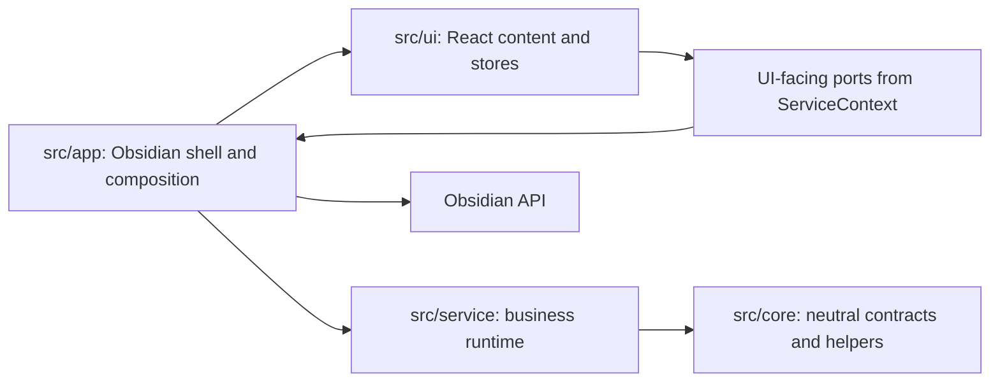
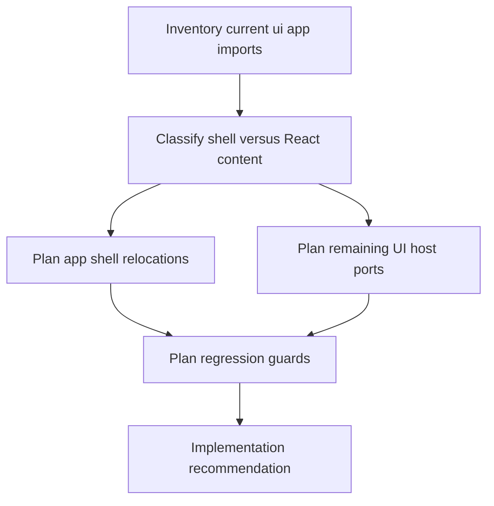
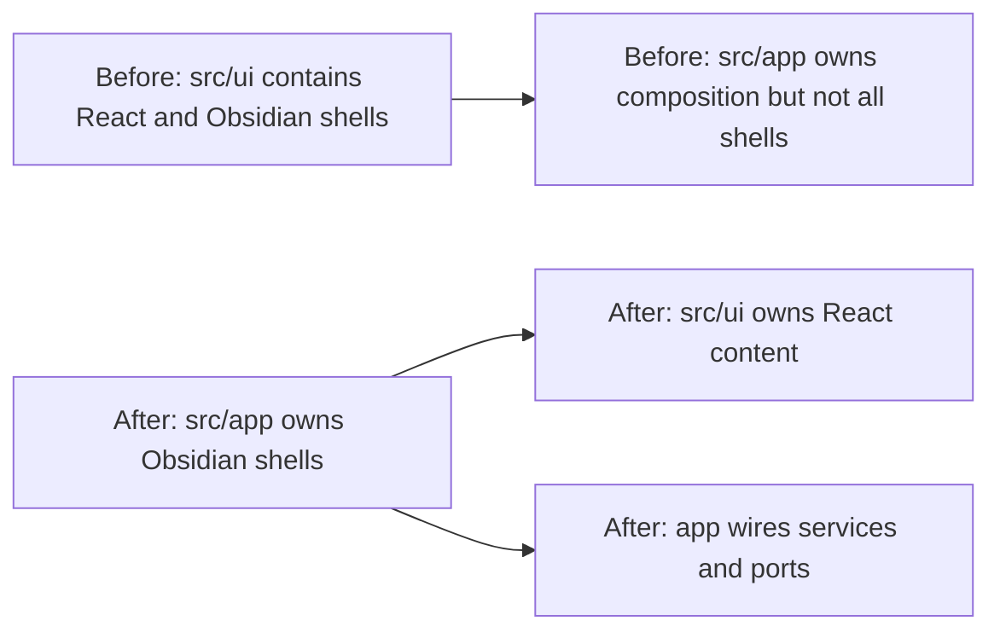
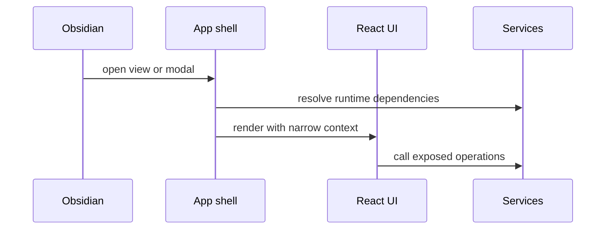
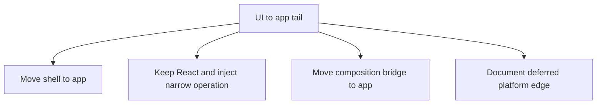

# Peak Assistant Modernization Handoff: T11O App-Shell Relocation Investigation

Branch:
`codex/peak-modernization-refactor`

## Owner Summary

After T11N, the boundary audit is down to `92` findings, but the largest visible tail is still:

```text
UI -> app: 45
```

The important correction for T11O:

This is not primarily another "add more ports" wave.

The likely real architecture move is **app-shell relocation**:

- Obsidian `ItemView`, `Modal`, command/view lifecycle, and `AppContext` wiring should physically live under `src/app/**`.
- React content, UI stores, visual components, and presentational hooks should stay under `src/ui/**`.
- `app -> ui` is normal: the app shell hosts React.
- `ui -> app` should approach zero: React UI should not know the Obsidian app shell directly.

So yes, the remaining "legitimate app-shell" edges can probably be mostly拆掉, but the safe way is to first identify which files are app shells and which are real React UI.

Do **not** implement in the first response.

T11O first response must be a read-only investigation that answers:

- Which `src/ui/**` files are actually Obsidian shell classes and should move to `src/app/**`?
- Which `src/ui/**` files are React content and must stay in UI?
- Which remaining UI imports of `AppContext`, `ViewManager`, `PeakCommandActions`, or app adapters are true debt?
- Which app-shell relocation tracks can run together in one major wave?
- What metric delta is realistic without hiding app access behind a new god context?

## Current Baseline After T11N

Codex rerun evidence:

```bash
npm run audit:boundary -- --out /tmp/t11n-codex-after.md
```

Snapshot:

```text
Files scanned: 886
Total flagged: 92
UI -> app: 45
core -> upstream: 0
service -> app: 7
service -> ui: 0
core -> ui: 0
service/core -> Obsidian types: 35
service/core -> Obsidian side-effect: 5
raw UI vault/editor operation matches: 7
```

Important T11N caveat:

- T11N accepted as a targeted raw-UI-IO port wave.
- T11N did **not** satisfy the original `total flagged <=83` hard floor.
- `total flagged = 92` is a regression floor, not a final architecture target.

## T11O Target Architecture

The desired direction is:



How to read this:

- `src/app/**` may import `src/ui/**` because app shells render React.
- `src/ui/**` should not import `src/app/**` for lifecycle, commands, or `AppContext`.
- If a file subclasses Obsidian `ItemView` or `Modal`, it is app shell even if it currently sits under `src/ui/view`.
- If a file is a React component, it should stay UI and receive narrow operations through context/props/ports.

## Phase 1 Must Be Read-only Investigation

Claude Code must **not edit files, run formatters, stage files, or commit** in the first response.

Allowed commands:

```bash
npm run audit:boundary -- --out /tmp/t11o-baseline.md
rg -n "from ['\"]@/app" src/ui
rg -n "from ['\"]@/app/context/AppContext" src/ui
rg -n "from ['\"]@/app/view|from ['\"]@/app/commands|from ['\"]@/app/quick-search|from ['\"]@/app/copilot" src/ui
find src/ui/view -type f \( -name '*View.ts' -o -name '*View.tsx' -o -name '*Modal.ts' -o -name '*Modal.tsx' \) | sort
rg -n "extends (ItemView|Modal)|new MarkdownRenderer|createRoot|ReactElementFactory|ServiceProvider|AppContext" src/ui src/app
rg -n "PeakCommandActions|ViewManager|composeCopilotPanelVault|AppAnalysisDocVaultWriterAdapter|SearchSessionReportAdapter" src/ui src/app
rg -n "\bapp\.vault\.(read|modify|create|trash|cachedRead)|\bapp\.workspace\.activeEditor|\bapp\.fileManager\.|\bapp\.workspace\.openLinkText" src/ui
```

You may inspect files with `sed`, `nl`, `rg`, `git show`, and `git grep`.

Forbidden in investigation:

- No code edits.
- No generated migrations.
- No scanner threshold or allowlist changes.
- No moving files yet.
- No commit.

Codex/user will audit the investigation before implementation.

## Investigation Buckets

### Bucket A: App-shell relocation candidates

Inspect at minimum:

- `src/ui/view/AmbientPushView.ts`
- `src/ui/view/ChatStudioView.ts`
- `src/ui/view/ChatView.ts`
- `src/ui/view/ConfirmModal.ts`
- `src/ui/view/ConversationOutlineView.ts`
- `src/ui/view/ProjectListView.ts`
- `src/ui/view/QuickSearchModal.tsx`
- `src/ui/view/SettingsModal.tsx`
- `src/ui/view/usage-dashboard/UsageDashboardView.ts`
- `src/ui/view/vault-lint/VaultXRayView.ts`
- `src/ui/view/copilot/CopilotAutoRunModal.tsx`
- `src/ui/view/copilot/CopilotPickerModal.tsx`
- `src/ui/view/copilot/CopilotResultModal.tsx`
- `src/ui/view/copilot/CopilotReviewHistoryModal.tsx`
- `src/ui/view/copilot/vault/VaultAutoRunModal.tsx`
- `src/ui/view/modals/CostEstimationModal.tsx`
- `src/ui/view/modals/HarnessOnboardingModal.tsx`
- `src/ui/view/modals/IndexingProgressModal.tsx`

Questions:

- Does this file extend `ItemView`, `Modal`, or another Obsidian shell type?
- Does it exist mainly to mount a React element?
- Does it receive or resolve `AppContext` only for lifecycle/composition?
- Can it move to `src/app/view/**`, `src/app/modals/**`, or domain-specific `src/app/<domain>/**` while the React content stays in `src/ui/**`?
- Which import call sites must update if it moves?

Bad outcomes:

- Moving large React screens into `src/app/**`.
- Renaming components just to make import paths look cleaner.
- Keeping duplicate old wrappers under `src/ui/**` after relocation.

### Bucket B: React content that must stay UI

Inspect at minimum:

- `src/ui/view/chat-studio-view/ChatStudioView.tsx`
- `src/ui/view/conversation-outline-view/ConversationOutlineView.tsx`
- `src/ui/view/project-list-view/ProjectListView.tsx`
- `src/ui/view/quick-search/SearchModal.tsx`
- `src/ui/view/settings/**`
- `src/ui/view/copilot/panels/**`
- `src/ui/view/ambient-push/**`
- `src/ui/view/morning-briefing/**`
- `src/ui/store/**`

Questions:

- Is this file presentational React, state projection, or user interaction content?
- If it imports app today, what exact operation does it need?
- Is the right fix a host prop, a ServiceContext operation, or app-shell relocation nearby?

Bad outcomes:

- Physically moving React UI into app because the scanner number improves.
- Adding `app` or `AppContext` back into ServiceContext as an escape hatch.
- Creating one giant `UiHostPort`.

### Bucket C: Bridge/context candidates

Inspect at minimum:

- `src/ui/context/ServiceContext.tsx`
- `src/ui/react/ReactElementFactory.tsx`
- `src/app/context/AppContext.ts`
- existing app composition files under `src/app/**`

Questions:

- Is `ReactElementFactory` actually app composition and should it live in `src/app/react/**`?
- Should `ServiceContext` expose only narrow grouped ports, never raw app?
- Which imports are transitional and which are permanent architecture?
- Can the app shell become the only place that creates `ServiceProvider` values?

Bad outcomes:

- Reintroducing `ServiceContext.app`.
- Adding broad top-level loose functions with unclear ownership.
- Hiding `AppContext` in a hook that still returns raw Obsidian app.

### Bucket D: Domain host hooks and command access

Inspect at minimum:

- `src/ui/view/quick-search/hooks/useQuickSearchHost.ts`
- `src/ui/view/quick-search/hooks/useSearchSession.ts`
- `src/ui/view/chat-view/chatNavigation.ts`
- `src/ui/view/settings/tabs/MaintenanceTab.tsx`
- `src/ui/view/settings/tabs/AISetupTab.tsx`
- `src/ui/view/settings/tabs/AdvancedTab.tsx`
- `src/ui/view/settings/tabs/OverviewTab.tsx`
- usage dashboard inline app callers under `src/ui/view/usage-dashboard/**`

Questions:

- Is this file app-host logic disguised as a UI hook?
- Should it move to app as a host adapter?
- Should settings tabs receive a `SettingsActionsPort` instead of importing `PeakCommandActions`?
- Is any remaining app import just a type import that can be neutralized?

Bad outcomes:

- Replacing command imports with a vague command bus.
- Moving product settings forms away from UI.
- Weak tests that only check file names and not runtime behavior.

## Required Investigation Output

Return exactly one report in this shape:

````md
## T11O Read-only Investigation: App-Shell Relocation

Files inspected:
- <exact files>

Current metric snapshot:
| Metric | Count | Notes |
| --- | ---: | --- |
| total flagged |  |  |
| UI -> app |  | largest tail |
| direct UI AppContext import files |  |  |
| UI -> app/view or app/commands |  |  |
| service -> app |  | should not increase |
| service -> ui |  | must remain 0 |
| core -> ui |  | must remain 0 |
| core -> upstream |  | must remain 0 |
| service/core -> Obsidian types |  |  |
| raw UI vault/editor operation matches |  |  |

Shell relocation inventory:
| Current file | Kind | Current app imports | Proposed target | React content dependency | Include in T11O implementation? | Risk |
| --- | --- | --- | --- | --- | --- | --- |

React UI stay-put inventory:
| Current file / area | Why it stays UI | Current app need | Proposed dependency shape | Include? | Risk |
| --- | --- | --- | --- | --- | --- |

Bridge/context inventory:
| File | Current responsibility | Problem | Proposed owner | Include? |
| --- | --- | --- | --- | --- |

Candidate implementation waves:
| Track | Files | Dependency order | Expected metric delta | Real modularity gain | Risk | Include? |
| --- | --- | --- | ---: | --- | --- | --- |

Recommended T11O implementation wave:
- Architecture choice:
- Primary metric target:
- Minimum acceptable delta:
- Stretch target:
- Required tracks:
- Optional tracks:
- Forbidden scope:
- Skip budget:
- Stop / commit rule:

Dependency DAG:


Expected before/after:
| Metric | Before | Expected after | Delta |
| --- | ---: | ---: | ---: |
| total flagged | 92 |  |  |
| UI -> app | 45 |  |  |
| direct UI AppContext import files |  |  |  |
| service -> app | 7 |  |  |
| service -> ui | 0 | 0 | 0 |
| core -> ui | 0 | 0 | 0 |
| core -> upstream | 0 | 0 | 0 |

Visual dependency maps to include in implementation note:
1. Before/after app-shell ownership map.
2. UI-to-app remaining tail map.
3. React content versus Obsidian shell split map.
4. Runtime entry sequence for one moved view and one moved modal.

Code reading guide for owner:
1. `<file>` - first shell file to read and why.
2. `<file>` - first React content file to read and why it stayed in UI.
3. `<file>` - app composition point that owns the relocated shell.
4. `<test>` - guard that proves the boundary did not regress.

Risks / stop conditions:
- ...

Does this qualify as a major wave?
- Yes / No, with evidence.

Message to send back to Codex:
- <one paragraph summary>
````

## Future Implementation Impact Contract

If the investigation recommends implementation, the implementation wave must meet this contract unless Codex explicitly revises it after reviewing the investigation.

Primary target:

```text
UI -> app: 45 -> <=15 hard, <=8 stretch
```

Secondary targets:

```text
total flagged: 92 -> <=60 hard, <=50 stretch
direct UI AppContext import files: current -> <=8 hard
service -> app: must stay <=7
service -> ui: must stay 0
core -> ui: must stay 0
core -> upstream: must stay 0
raw UI vault/editor operation matches: must stay <=7
```

Required tracks:

1. Move at least two domain shell clusters from `src/ui/**` to `src/app/**`.
2. Keep React content under `src/ui/**`.
3. Remove or update old import paths; no long-lived duplicate shells.
4. Add or update regression guards for the new boundary.
5. Implementation note must include diagrams and a code reading guide.

Optional tracks:

- Move `ReactElementFactory` into an app-owned composition area if investigation proves it is app shell.
- Replace settings command imports with a narrow app-provided settings action port.
- Retire temporary re-export shims if safe in the same wave.

Forbidden scope:

- Do not touch Current Work State / Ambient Push product behavior.
- Do not start Command Gateway; it remains T12 capstone.
- Do not change search/index/agent business logic except import paths required by moved shells.
- Do not change UI visual layout.
- Do not add scanner allowlists or lower thresholds.
- Do not create a new broad `AppPort`, `UiHostPort`, or `ServiceContext.app`.

Skip budget:

- A shell cluster may be skipped only if moving it would require behavior changes or many uncertain callers.
- Skipped clusters must be listed with evidence and a future owner.
- If fewer than two shell clusters can move safely, stop after investigation and do not implement.

Stop / commit rule:

- In the read-only phase: no commit.
- In implementation phase: commit only if build, boundary audit, and targeted guards pass.
- If implementation misses `UI -> app <=15`, report it as partial progress unless Codex explicitly accepts the new evidence.

## Suggested Target Directory Shape

This is a starting hypothesis, not a command to implement blindly.

```text
src/app/view/
  ChatView.ts
  ChatStudioView.ts
  ConversationOutlineView.ts
  ProjectListView.ts
  AmbientPushView.ts
  UsageDashboardView.ts
  VaultXRayView.ts

src/app/modals/
  ConfirmModal.ts
  SettingsModal.tsx
  QuickSearchModal.tsx
  CostEstimationModal.tsx
  HarnessOnboardingModal.tsx
  IndexingProgressModal.tsx

src/app/copilot/modals/
  CopilotAutoRunModal.tsx
  CopilotPickerModal.tsx
  CopilotResultModal.tsx
  CopilotReviewHistoryModal.tsx
  VaultAutoRunModal.tsx

src/ui/view/
  React screens, panels, rows, stores, and presentational components only
```

Use `git mv` in implementation if files are physically moved.

## Visual Maps Required If Implementation Happens

The implementation note must include at least these diagrams. Avoid literal `\n` inside Mermaid labels; use short labels and explanatory bullets below the diagram.

### 1. Before/After Ownership



### 2. View Runtime Sequence



### 3. Remaining Tail Classification



## Verification Plan For Future Implementation

Required:

```bash
npm run build
npm run audit:boundary -- --out /tmp/t11o-after.md
npm run test -- test/t11n-ui-vault-port-regression.test.ts
npm run test -- test/t11m-ui-app-boundary-regression.test.ts test/t11l-remaining-boundary-regression.test.ts test/t11k-obsidian-boundary-regression.test.ts test/t11j-boundary-regression.test.ts test/service-ui-boundary.test.ts
```

Add or update a T11O guard, likely:

```text
test/t11o-app-shell-relocation-regression.test.ts
```

The guard should assert:

- No `src/ui/**` import from `@/app/context/AppContext` except explicitly audited transitional files, ideally zero.
- No `src/ui/**` import from `@/app/view/*` or `@/app/commands/*`.
- `src/app/**` may import `src/ui/**` for React hosting.
- `service -> ui`, `core -> ui`, and `core -> upstream` remain zero.
- Scanner script thresholds were not weakened.

## Copyable Prompt For Claude Code

```text
Please execute the read-only investigation in:
docs/superpowers/refactor-ops/t11o-app-shell-relocation-investigation-handoff.md

Important: this first response is investigation only. Do not edit files, do not format, do not stage, and do not commit.

Goal: classify the remaining T11N `UI -> app = 45` tail and decide whether the right next implementation wave is app-shell relocation: moving Obsidian ItemView/Modal/view lifecycle shells from `src/ui/**` to `src/app/**` while keeping React content in `src/ui/**`.

Return the required T11O investigation report shape from the handoff, including:
- exact files inspected
- current metric snapshot
- shell relocation inventory
- React UI stay-put inventory
- bridge/context inventory
- candidate implementation waves
- dependency DAG
- expected before/after metrics
- visual map plan
- code reading guide
- risks and stop conditions
- a one-paragraph message back to Codex
```
