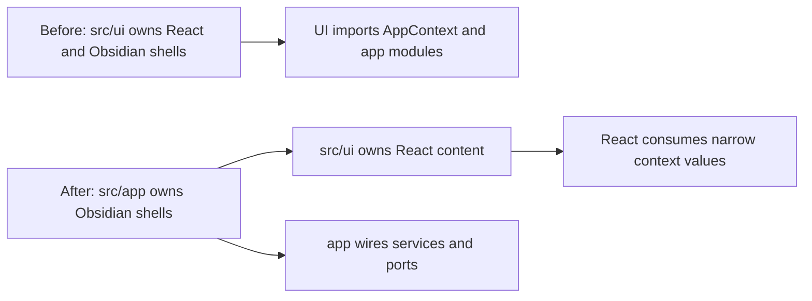

# T11O Read-only Investigation Codex Review

Source reviewed:
`/Users/zhangjike/.codex/attachments/9baebe65-1d29-4775-b688-13bcaff748c7/pasted-text.txt`

## Verdict

**Approve implementation, with corrections.**

Claude's investigation found the right next major move: the remaining `UI -> app = 45` tail is mostly app-shell placement debt. Moving Obsidian `ItemView` / `Modal` / view lifecycle shells from `src/ui/**` to `src/app/**` is the correct structural fix.

This should count as a major wave **only if** it lands the shell relocation plus boundary guards, not if it stops after a few easy file moves.

## Why This Is Worth Doing

The investigation identifies a real architectural mismatch:



The target shape is sound:

- `src/app/**` owns Obsidian `ItemView`, `Modal`, view registration, and app composition.
- `src/ui/**` owns React content, components, stores, hooks, and visual layout.
- `app -> ui` is normal because app shells host React.
- `ui -> app` should become rare and explicitly justified.

Claude's expected impact is credible enough to implement:

| Metric | Before | Expected after | Review |
| --- | ---: | ---: | --- |
| `UI -> app` | 45 | ~13-16 | Good hard-floor target |
| `total flagged` | 92 | ~62 | Good but not final |
| `service -> app` | 7 | 7 | Must hold |
| `service -> ui` | 0 | 0 | Must hold |
| `core -> ui` | 0 | 0 | Must hold |
| `core -> upstream` | 0 | 0 | Must hold |
| raw UI vault/editor matches | 7 | 7 | Must not regress |

## Required Corrections Before Implementation

### 1. Do not oversell UI purity

The investigation correctly reduces static `src/ui/** -> @/app/**` imports, but `ServiceContext` still publishes raw `app`, and many React files consume it through `useServiceContext().app`.

Implementation must report this extra metric:

```bash
rg -n "useServiceContext\\(\\).*\\bapp\\b|const \\{[^}]*\\bapp\\b[^}]*\\} = useServiceContext\\(\\)" src/ui
```

Rule:

- `UI -> app` static import reduction is the T11O primary metric.
- Do **not** claim "UI is fully pure" while `ServiceContext.app` remains available.
- No new `useServiceContext().app` consumers.
- In touched files, remove raw `app` access when there is already a narrow port or host operation.

### 2. Track 6 must not become ServiceContext sprawl

Claude proposed publishing remaining runtimes/services on `ServiceContext`. This is acceptable only if the surface is narrow and named.

Allowed:

- Existing runtime-style values already owned by `AppRuntimeRegistry`, such as `vaultReviewRuntime` or `quickSearchBackgroundRuntime`, if React genuinely needs them.
- Small grouped operations such as `settingsActions.openSettings()` if they replace direct `PeakCommandActions` imports.
- Existing app-composed ports passed through `ReactElementFactory`.

Not allowed:

- Reintroducing `ServiceContext.app`.
- Adding a broad `UiHostPort`, `AppPort`, or loose function bag.
- Publishing raw service objects just because it reduces scanner numbers.
- Constructing adapters inside `ServiceContext`; adapters must be composed in `src/app/**`.

### 3. Keep shell relocation mechanical

For moved shell files:

- Use physical moves, preferably `git mv`.
- Keep Obsidian shell classes under `src/app/view/**`, `src/app/modals/**`, or `src/app/copilot/modals/**`.
- Keep React content under `src/ui/**`.
- Do not change modal layout, styling, sizing, copy, wizard steps, or panel behavior.
- Temporary re-export shims are allowed only if necessary and should be removed in the same wave when safe.

### 4. Do not dump app view IDs into core

The investigation mentions that moving view-type constants could lower the floor. Do **not** move app view IDs to `core` just to satisfy the scanner.

Preferred order:

1. Move app shell classes and app-owned constants to `src/app/view/**`.
2. If React needs navigation, give it a narrow navigation operation.
3. Leave deeper view-type cleanup to T11P unless it is trivial and neutral.

### 5. Copilot modal cluster is all-or-nothing enough

The 5 Copilot modals have chained navigation and circular-import risk.

Correction:

- Move them as one cluster under `src/app/copilot/modals/**`.
- Split React content into UI files only where necessary.
- If fewer than 3 of the 5 can move safely, stop and report partial.
- Do not continue Track 6/7 alone to make numbers look better.

### 6. CuratorPushModal stays UI

`src/ui/view/usage-dashboard/runtime/CuratorPushModal.tsx` is a Radix/UI modal, not an Obsidian `Modal`.

Do not move it.

## Approved Implementation Contract

Primary target:

```text
UI -> app: 45 -> <=15 hard
```

Stretch:

```text
UI -> app: <=8
total flagged: <=60 hard, <=50 stretch
```

Must hold:

```text
service -> app <=7
service -> ui = 0
core -> ui = 0
core -> upstream = 0
raw UI vault/editor matches <=7
scanner thresholds unchanged
```

Additional honesty metric:

```text
useServiceContext().app consumer count: report before/after, must not increase
```

Required tracks:

1. Move ItemView shells to `src/app/view/**`.
2. Move standalone Obsidian Modal shells to `src/app/modals/**`.
3. Split non-Copilot blended modals into app shell + UI content.
4. Move/split Copilot modal cluster under `src/app/copilot/modals/**`.
5. Move `ReactElementFactory` to app composition and remove `AppContext.getInstance()` fallback from `ServiceContext`.
6. Add narrow UI-facing operations or runtime values only where needed to remove remaining static app imports.
7. Add T11O regression guard and owner-facing implementation note with diagrams.

Optional:

- `SettingsActionsPort`, if it stays narrow.
- `chatNavigation` move to `src/app/chat/chatNavigation.ts`, if it is import-path-only and low risk.

Forbidden:

- No Command Gateway.
- No Current Work State implementation.
- No visual/layout changes.
- No SQLite migrations.
- No provider/profile/index/agent business logic changes.
- No scanner threshold edits or allowlists.
- No new broad app/service locator surface.

## Required Verification

```bash
npm run build
npm run audit:boundary -- --out /tmp/t11o-after.md
npm run test -- test/t11o-app-shell-relocation-regression.test.ts
npm run test -- test/t11n-ui-vault-port-regression.test.ts
npm run test -- test/t11m-ui-app-boundary-regression.test.ts test/t11l-remaining-boundary-regression.test.ts test/t11k-obsidian-boundary-regression.test.ts test/t11j-boundary-regression.test.ts test/service-ui-boundary.test.ts
```

New T11O guard must check:

- `src/ui/react/ReactElementFactory.tsx` no longer exists.
- `src/ui/context/ServiceContext.tsx` does not import `@/app/context/AppContext`.
- Obsidian shell files moved out of `src/ui/view/**`.
- `src/ui/**` static imports from `@/app/**` are below the approved threshold.
- `service -> ui`, `core -> ui`, `core -> upstream`, and `service -> app` floors hold.
- `scripts/audit/boundary-baseline.mjs` was not weakened.

## Copyable Implementation Prompt

```text
Proceed with T11O implementation using:
docs/superpowers/refactor-ops/t11o-app-shell-relocation-investigation-handoff.md

Also apply Codex corrections from:
docs/superpowers/refactor-ops/t11o-readonly-investigation-codex-review.md

Approved direction:
- Move Obsidian ItemView / Modal / view lifecycle shells from src/ui/** to src/app/**.
- Keep React content in src/ui/**.
- Move ReactElementFactory to app composition.
- Remove AppContext.getInstance() fallback from ServiceContext.
- Add only narrow, named UI-facing operations/runtimes where needed.

Hard contract:
- UI -> app: 45 -> <=15.
- total flagged <=60 preferred.
- service -> app must stay <=7.
- service -> ui, core -> ui, core -> upstream must stay 0.
- raw UI vault/editor matches must stay <=7.
- no scanner threshold or allowlist changes.
- report useServiceContext().app consumer count before/after; it must not increase.

Required tracks:
1. ItemView shell relocation.
2. Standalone Modal shell relocation.
3. Non-Copilot blended modal split.
4. Copilot modal cluster split/move.
5. ReactElementFactory relocation + ServiceContext fallback removal.
6. Narrow remaining UI-facing operations only where necessary.
7. New T11O regression guard.

Do not change visual layout, modal behavior, provider/profile/index/agent business logic, SQLite migrations, Current Work State, or Command Gateway.

Final implementation note must include:
- before/after metrics table
- useServiceContext().app before/after count
- changed code files grouped by track
- deleted/moved old shell paths
- visual dependency maps
- code reading guide
- skipped tracks with evidence
- verification results
```
