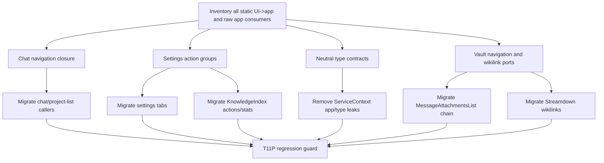

# T11P Read-only Investigation Codex Review

Status: approved to implement, with corrections.

## Review Summary

Claude's investigation is accepted as a real closure plan, not a minor cleanup.

The report found a plausible one-wave path to:

```text
UI -> app: 9 -> 0
useServiceContext().app consumers: 25 -> 0
total flagged: 56 -> about 47
```

This matches the updated T11P closure goal. The remaining UI/app debt is not conceptually blocked; it is mostly composition cleanup:

- `chatNavigation.ts` still has an `AppContext` fallback.
- Settings tabs still import `PeakCommandActions`.
- `ServiceContext` still publishes raw `app`.
- Several UI leaves use raw `app` only to perform narrow operations that already have, or can receive, a real port.

Codex approves implementation, but the implementation prompt must include the corrections below.

## Corrections Required Before Implementation

### 1. Settings actions must not become a UI descriptor god-bag

The investigation proposed `settingsActions.maintenance.groups: MaintenanceGroupDescriptor[]`. That is only acceptable if the descriptors stay presentation-neutral.

Preferred shape:

```text
settingsActions.setup.*
settingsActions.maintenance.index.*
settingsActions.maintenance.graph.*
settingsActions.maintenance.verification.*
settingsActions.knowledgeIndex.*
```

Rules:

- UI keeps labels, group order, and Lucide icons.
- App provides named operations.
- Do not move React icons, button labels, or settings layout definitions into `src/app/**`.
- Do not create a flat 20-function `SettingsActions` bag.
- Do not duplicate command logic in UI.

### 2. Vault navigation expansion must stay action-level

Expanding `VaultNavigationPort` is allowed, but only as named user actions.

Allowed examples:

```text
openLink(...)
openVaultPath(...)
openVaultPathAtLine(...)
openAttachmentSource(...)
resolveVaultPath(...)
openExternalUrl(...)
```

Forbidden:

```text
getVault()
getWorkspace()
getAbstractFileByPath()
getActiveLeaf()
openFile(file: TFile)
any raw App / Vault / Workspace / TFile escape hatch
```

The adapter may use Obsidian internally, but the UI-facing port must not expose Obsidian primitives.

### 3. Removing `app` must not be replaced by raw `plugin`

T11P's explicit target is `useServiceContext().app = 0`, but the implementation must not quietly move call sites to `plugin` as the new broad escape hatch.

Rules:

- If a UI component only needs `plugin.settings.search` or `dataStorageFolder`, expose a narrow action/stats/settings port.
- If a UI component only needs to trigger indexing, expose a named operation under `settingsActions.knowledgeIndex` or `settingsActions.maintenance`.
- Do not increase `useServiceContext().plugin` consumers.

### 4. Chat navigation must have React and non-React entry points

`useChatNavigation()` is appropriate for UI components, but app callers such as commands/events cannot use a hook.

Required shape:

```text
createChatNavigation(deps) or bindChatNavigation(deps)
useChatNavigation() wraps the same operation object for React callers
```

Rules:

- No `AppContext` fallback remains in `chatNavigation.ts`.
- No UI caller imports `@/app/**`.
- No app caller has to import React hooks.
- No raw `ViewManager` is published to solve this indirectly.

### 5. Message attachment migration needs behavior-preserving tests or focused guard

`MessageAttachmentsList.tsx` is the highest-risk track because it has nested image/file/url helpers and currently threads `app` through many levels.

Rules:

- Preserve URL behavior: external links still use `window.open(..., noopener,noreferrer)`.
- Preserve vault-file behavior: vault resources still open through app-owned navigation adapter.
- Do not change layout, hover preview behavior, image grid behavior, URL card behavior, or badges.
- If this track spirals, stop and report; do not land a half-migrated chain.

## Approved Implementation Shape

Implement T11P as one full closure wave, with these required tracks:

1. Chat navigation closure.
2. Settings actions closure.
3. ServiceContext type-only neutralization.
4. Raw `ServiceContext.app` removal.
5. Vault navigation / wikilink narrow ports.
6. Knowledge index action/stat access cleanup.
7. Message attachment app-prop removal.
8. Curator environment probe cleanup.
9. T11P regression guard.
10. Implementation note with visual dependency maps and owner code-reading guide.

## Dependency DAG



## Impact Contract

Required:

```text
UI -> app = 0
useServiceContext().app = 0
service -> app <= 7
service -> ui = 0
core -> ui = 0
core -> upstream = 0
raw UI vault/editor matches <= 7
scanner thresholds unchanged
```

Expected:

```text
total flagged <= 47
```

If `UI -> app` or `useServiceContext().app` remains above zero, Claude must mark the result partial and include exact file/call-site evidence for each remaining item.

## Required Verification

```bash
npm run build
npm run audit:boundary -- --out /tmp/t11p-after.md
npm run test -- test/t11p-remaining-ui-app-tail-regression.test.ts
npm run test -- test/t11o-app-shell-relocation-regression.test.ts
npm run test -- test/t11n-ui-vault-port-regression.test.ts
npm run test -- test/t11m-ui-app-boundary-regression.test.ts test/service-ui-boundary.test.ts
```

The T11P guard must assert:

- `src/ui/** -> @/app/** = 0`.
- `useServiceContext().app = 0`.
- `ServiceContext` does not publish raw `app`.
- `chatNavigation.ts` has no `AppContext` import or fallback.
- Settings tabs do not import or dynamically import `@/app/commands/PeakCommandActions`.
- No banned broad port names: `AppPort`, `UiHostPort`, `EverythingPort`.
- `VaultNavigationPort` does not expose raw Obsidian primitives.
- Boundary scanner thresholds/classifiers were not changed.

## Copyable Implementation Prompt

```text
Proceed with T11P implementation based on the investigation, but apply Codex's review corrections:

Read first:
docs/superpowers/refactor-ops/t11p-readonly-investigation-codex-review.md
docs/superpowers/refactor-ops/t11p-remaining-ui-app-tail-investigation-handoff.md

Implement the full closure wave:
- UI -> app must become 0.
- useServiceContext().app must become 0.
- ServiceContext must stop publishing raw app.
- service -> app must stay <= 7.
- service -> ui, core -> ui, core -> upstream must stay 0.

Corrections:
1. settingsActions must be grouped named operations. UI keeps labels/icons/layout. Do not create a flat 20-function bag and do not move UI descriptors into app.
2. VaultNavigationPort may expand only with user-level navigation operations. Do not expose raw App/Vault/Workspace/TFile or methods like getVault/getWorkspace/getAbstractFileByPath.
3. Removing app must not be replaced by raw plugin. Do not increase useServiceContext().plugin consumers.
4. Chat navigation must provide both a non-React factory/object for app callers and a useChatNavigation() hook for UI callers. No AppContext fallback remains.
5. MessageAttachmentsList migration must preserve URL opening, vault-file opening, hover preview, layout, and badges. If this track spirals, stop and report before landing a half-migrated chain.

Required verification:
npm run build
npm run audit:boundary -- --out /tmp/t11p-after.md
npm run test -- test/t11p-remaining-ui-app-tail-regression.test.ts
npm run test -- test/t11o-app-shell-relocation-regression.test.ts
npm run test -- test/t11n-ui-vault-port-regression.test.ts
npm run test -- test/t11m-ui-app-boundary-regression.test.ts test/service-ui-boundary.test.ts

Commit only if the contract is met. If any UI -> app or useServiceContext().app remains, mark the result partial with exact evidence instead of calling it closure.

Implementation note must include:
- before/after metric table
- changed files grouped by track
- visual dependency maps
- code reading guide for owner
- skipped items with evidence, if any
- verification commands and results
```
