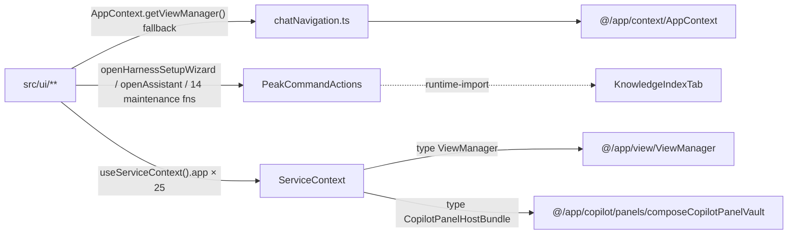
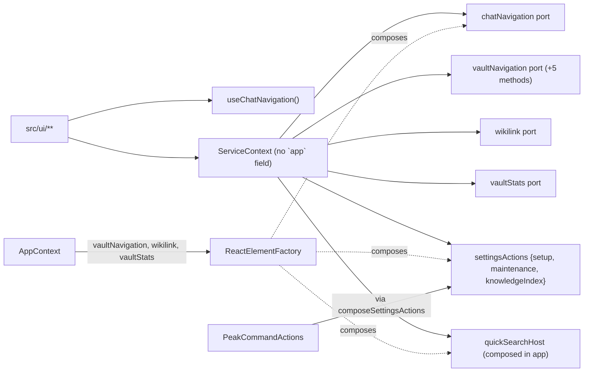
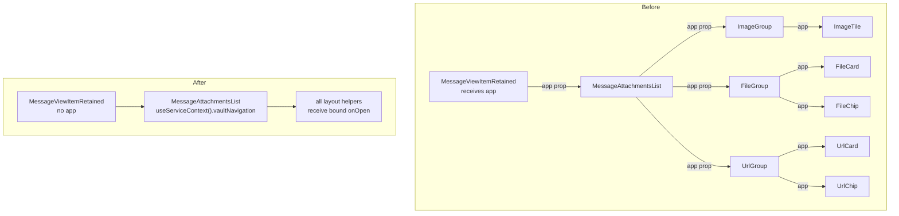
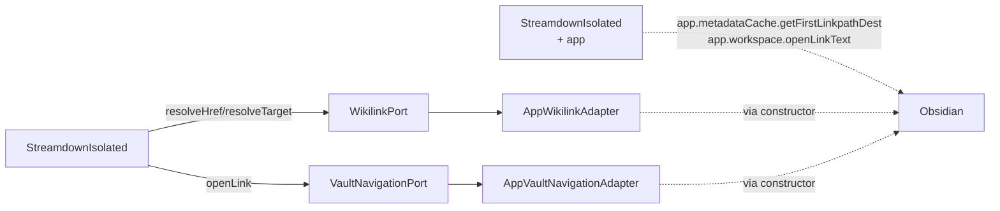

# T11P UI-App Tail Closure — Implementation Note

**Branch:** `codex/peak-modernization-refactor`
**Status:** ✅ Full closure landed
**Spec / review:** `t11p-remaining-ui-app-tail-investigation-handoff.md`, `t11p-readonly-investigation-codex-review.md`

## Before / after metrics

| Metric | T11O baseline | T11P landing | Δ | Target |
| --- | ---: | ---: | ---: | --- |
| Total flagged | 56 | **47** | −9 | ≤47 ✅ |
| UI → app | 9 | **0** | −9 | 0 ✅ hard |
| `useServiceContext().app` consumers | 25 | **0** | −25 | 0 ✅ hard |
| `useServiceContext().plugin` consumers | 3 | **3** | 0 | not inflated ✅ |
| service → app | 7 | **7** | 0 | ≤7 ✅ |
| service → ui | 0 | **0** | 0 | 0 ✅ |
| core → ui | 0 | **0** | 0 | 0 ✅ |
| core → upstream | 0 | **0** | 0 | 0 ✅ |
| raw UI vault/editor matches | 7 | **5** | −2 | ≤7 ✅ |
| Obsidian coupling (`ui`) | 63 | **53** | −10 | ≤63 ✅ |

## Honesty metric

`useServiceContext().app` consumers went from **25 → 0**. Every UI surface that used to destructure `app` now consumes a narrow named port (`vaultNavigation`, `wikilink`, `vaultStats`, `chatNavigation`, `settingsActions`, `quickSearchHost`, `vaultPreview`). The `app: App` field is no longer published on `ServiceContext`.

## Tracks landed

### Track A — `useChatNavigation()` hook + drop AppContext fallback

**New:**
- `src/service/chat/navigation/ChatNavigationPort.ts` — neutral port interface.
- `src/service/view/ViewActivationPort.ts` — neutral subset of `ViewManager`.
- `src/ui/view/chat-view/useChatNavigation.ts` — hook returning `ChatNavigationPort`.

**Reshaped:**
- `src/ui/view/chat-view/chatNavigation.ts` — `createChatNavigation(deps)` factory; **no** `AppContext` import. Implementation stays UI-side because it touches `useChatViewStore` / `useChatDataStore`.

**Migrated callers (12 UI + 2 app):**
- UI hooks: `useChatNavigation()` returns the pre-bound port from `ServiceContext.chatNavigation`.
- App callers (`src/app/events/Register.ts`, `src/app/commands/PeakCommandActions.ts`) call `createChatNavigation({manager, viewManager, eventBus})` directly with `AppContext` deps.

### Track B — Namespaced `settingsActions`

**New:**
- `src/service/settings/SettingsActionsPort.ts` — grouped action surface (`setup`, `maintenance.{index,graph,verification,danger}`, `knowledgeIndex`, plus top-level `openSettings`, `openAssistant`).
- `src/app/commands/composeSettingsActions.ts` — app composer; each method delegates to existing `PeakCommandActions` operations.

**Migrated:**
- `MaintenanceTab.tsx` — 14 named callbacks now sourced from `settingsActions.maintenance.*`.
- `AISetupTab.tsx` — dropped unused `openHarnessSetupWizard` import.
- `AdvancedTab.tsx` → `settingsActions.setup.openHarnessWizard`.
- `OverviewTab.tsx` → `settingsActions.setup.openHarnessWizard` + `settingsActions.openAssistant`.
- `KnowledgeIndexTab.tsx` — 3 dynamic `import('@/app/commands/PeakCommandActions')` shims retired; the inline `triggerFastIndex(app, plugin)` helper deleted in favour of `settingsActions.knowledgeIndex.startStagedFullIndexing({level?})`.

Per Codex correction #1: UI keeps labels, icons, layout, group order. App provides named operations only.

### Track C — ServiceContext type-only neutrality

- `CopilotPanelHostBundle` moved from `src/app/copilot/panels/composeCopilotPanelVault.ts` to `src/service/copilot/panels/CopilotPanelPorts.ts`. `composeCopilotPanelVault.ts` keeps a type re-export so external callers still compile.
- `ViewActivationPort` replaces `ViewManager` as the type on `ServiceContext.chatNavigation` (used only inside `createChatNavigation`).
- `ServiceContext.tsx` is now free of all `@/app/**` imports.

### Track D — `VaultNavigationPort` expansion

**Methods added** (all user-level actions, no Obsidian primitives per Codex correction #2):

```text
openVaultPath(path, opts?)              -> Promise<boolean>
openVaultPathAtLine(path, {line, ...})  -> Promise<void>
openSearchResult(item, opts?)           -> Promise<void>
openAttachmentSource(href)              -> void
openExternalUrl(url)                    -> void   (replaces inline `window.open` calls)
openSourceFile(file: unknown)           -> Promise<boolean>
```

`AppVaultNavigationAdapter` (in `src/app/navigation/`) implements them with the existing Obsidian internals.

**Migrated UI sites:**
- `tab-VaultSearch.tsx`, `VaultSearchResult.tsx`, `V2SourcesView.tsx`, `RecentAIAnalysis.tsx` — all `createOpenSourceCallback` callers now thread `vaultNavigation`.
- `ConversationsSection.tsx`, `ProjectsSection.tsx`, `HeaderRetained.tsx` — `openSourceFile` → `vaultNavigation.openSourceFile(file)`.
- `view-ProjectOverview.tsx` — `openAttachment` → `vaultNavigation.openAttachmentSource`.
- `HealthInsightsPanel.tsx` — file-not-found notice now routes through `vaultNavigation.openVaultPath` boolean return.
- `useVaultSearch.ts` — `performInFileSearch` takes `VaultPreviewPort`; `performGoToLine` takes `VaultPreviewPort + VaultNavigationPort`. The legacy `openFileAtLine` + `readFileAsText` calls (which were pre-existing TS errors from a missing `app` arg) are gone.
- `createOpenSourceCallback` itself rewritten to take `VaultNavigationPort` instead of `App`.

### Track E — ConversationIndex reveal + scroll split

`scrollToMessageInDoc` is now pure DOM (no `app` arg). Leaf-reveal goes through `useChatNavigation().revealChatView()`. The `@/app/view/types` import is gone.

### Track F — Toast + ProjectListView + useChatSubmit

- `showToast` now takes `{ eventBus }` (already published on `ServiceContext`); the `App` parameter — previously needed for `EventBus.getInstance(app)` — is retired.
- `notifySelectionChange` now takes `EventBus` directly.
- `useChatSubmit.ts` — dropped unused `app` from destructure.

### Track G — `MessageAttachmentsList` chain migration

Replaced the 8-level `app: App` prop drill (`MessageAttachmentsList → ImageGroup/FileGroup/UrlGroup → ImageTile/FileCard/FileChip/UrlCard/UrlChip`) with a single `useServiceContext().vaultNavigation` consumed at the top-level component. `handleOpen` now branches on `isUrl(src)` to call `vaultNavigation.openExternalUrl(src)` (preserves `noopener,noreferrer` semantics) or `vaultNavigation.openVaultPath(src)`. Layout, hover preview, image-grid permutation, URL card, and badge styling all unchanged per Codex correction #5.

### Track H — KnowledgeIndex stats + actions

**New port:** `VaultStatsPort` (`markdownCount()`, `activeFilePath()`).

**Migrated:**
- `KnowledgeIndexTab.tsx` (4 sites): `app.vault.getMarkdownFiles().length` → `vaultStats.markdownCount()`; `triggerFastIndex(app, plugin)` → `settingsActions.knowledgeIndex.startStagedFullIndexing()`; `applyLevelChange(level)` → `settingsActions.knowledgeIndex.startStagedFullIndexing({level})`; `AdvancedRebuildDisclosure` → `settingsActions.knowledgeIndex.{startStagedFullIndexing,runVectorEnrichmentPending,runLlmEnrichmentPending,compareSearchResults}`.
- `OverviewTab.tsx` — `useIndexCoverage()` uses `vaultStats.markdownCount()`.
- `SearchModal.tsx` — `updateParsedQuery(app, q)` becomes `updateParsedQuery(vaultStats.activeFilePath(), q)`; the vault-search store now takes a path string instead of `App`.

### Track I — Wikilink port for Streamdown

**New:** `service/navigation/WikilinkPort.ts` (`resolveTarget`, `resolveHref`). Adapter: `app/navigation/AppWikilinkAdapter.ts`.

**Migrated:** `StreamdownIsolated.tsx` consumes `wikilink` + `vaultNavigation` from context. The Quick-Search modal-close DOM trick stays UI-side (it's host-modal hygiene, not vault navigation). Legacy `src/ui/view/quick-search/callbacks/useStreamdownWikilinkClick.ts` deleted (zero remaining callers).

### Track J — Curator environment probe

`RunningCuratorStep.tsx` calls `settingsActions.setup.detectHarnessEnvironment()` instead of importing `detectEnvironment` from the service and threading `{app}`. The composer binds `app` from `AppContext` once at boot.

### Track K — Regression guard + this note

**Guard:** `test/t11p-remaining-ui-app-tail-regression.test.ts` (12 tests). Asserts:
- floor metrics (total ≤ 47, ui→app = 0, service→app ≤ 7, etc.);
- `useServiceContext().app` honesty metric = 0;
- `useServiceContext().plugin` not inflated (≤ 3);
- `ServiceContext` does not publish `app: App`;
- `ServiceContext` has no `@/app/**` imports;
- `chatNavigation.ts` references no `AppContext` outside comments;
- settings tabs (5) have no `PeakCommandActions` static or dynamic imports;
- 10 new port / adapter / hook files exist;
- `VaultNavigationPort` exposes no raw Obsidian primitives;
- boundary scanner script unchanged;
- no banned god-port identifiers.

**Extras:** the host bundling work that fell out of Track D — `composeQuickSearchHost` in app — also retires the last `app` consumer in `useQuickSearchHost` and `useSearchSession`.

## File map

### New service-side port modules

```
src/service/chat/navigation/ChatNavigationPort.ts
src/service/view/ViewActivationPort.ts
src/service/navigation/WikilinkPort.ts
src/service/stats/VaultStatsPort.ts
src/service/settings/SettingsActionsPort.ts
```

### New app-side adapters / composers

```
src/app/commands/composeSettingsActions.ts
src/app/navigation/AppWikilinkAdapter.ts
src/app/stats/AppVaultStatsAdapter.ts
src/app/quick-search/composeQuickSearchHost.ts
```

### Reshaped / extended

```
src/app/navigation/AppVaultNavigationAdapter.ts      ← +5 methods (Track D)
src/app/navigation/composeNavigation.ts              ← composeWikilink added
src/app/context/AppContext.ts                        ← exposes wikilink + vaultStats
src/app/copilot/panels/composeCopilotPanelVault.ts   ← bundle type moved out
src/app/react/ReactElementFactory.tsx                ← threads 4 new ports + chatNavigation + quickSearchHost
src/app/commands/PeakCommandActions.ts               ← navigation() factory helper
src/app/events/Register.ts                           ← uses createChatNavigation
src/ui/context/ServiceContext.tsx                    ← drops `app` + `viewManager`, adds 6 fields
src/ui/utils/toast.ts                                ← takes {eventBus}
src/ui/view/quick-search/hooks/useQuickSearchHost.ts ← becomes thin context read
src/ui/view/quick-search/store/vaultSearchStore.ts   ← takes currentFilePath string
src/ui/view/quick-search/callbacks/open-source-file.ts ← takes VaultNavigationPort
src/ui/view/chat-view/chatNavigation.ts              ← factory only, no AppContext
src/ui/view/chat-view/useChatNavigation.ts           ← new hook
src/ui/view/chat-view/components/messages/MessageAttachmentsList.tsx ← chain collapsed
src/ui/view/chat-view/components/ConversationIndex.tsx ← reveal split
src/ui/view/chat-view/components/HeaderRetained.tsx   ← vaultNavigation.openSourceFile
src/ui/view/chat-view/hooks/useConversationLoad.ts    ← useChatNavigation
src/ui/view/chat-view/view-Home.tsx, view-AllProjects.tsx, view-ProjectOverview.tsx ← useChatNavigation
src/ui/view/project-list-view/*                      ← useChatNavigation + vaultNavigation.openSourceFile
src/ui/view/vault-lint/components/HealthInsightsPanel.tsx ← vaultNavigation.openVaultPath
src/ui/view/settings/MaintenanceTab.tsx              ← settingsActions.maintenance.*
src/ui/view/settings/tabs/{AISetupTab,AdvancedTab,OverviewTab,KnowledgeIndexTab}.tsx
src/ui/view/modals/harness-onboarding/RunningCuratorStep.tsx ← settingsActions.setup.detectHarnessEnvironment
src/ui/component/mine/StreamdownIsolated.tsx         ← wikilink + vaultNavigation
src/ui/view/quick-search/SearchModal.tsx             ← vaultStats.activeFilePath
src/ui/view/quick-search/hooks/useVaultSearch.ts     ← VaultPreviewPort + VaultNavigationPort
src/ui/view/quick-search/hooks/useSearchSession.ts   ← host.createReportOrchestrator
src/ui/view/quick-search/hooks/useAIAnalysisResult.ts ← useChatNavigation
src/ui/view/quick-search/components/{VaultSearchResult,V2SourcesView,ai-analysis-sections/RecentAIAnalysis}.tsx
src/ui/view/quick-search/tab-VaultSearch.tsx
src/ui/view/project-list-view/utils.ts               ← notifySelectionChange takes EventBus
src/ui/view/project-list-view/ProjectListView.tsx    ← toast.{success,error}({eventBus})
```

### Deleted

```
src/ui/view/quick-search/callbacks/useStreamdownWikilinkClick.ts  (logic moved to AppWikilinkAdapter)
```

## Visual maps

### Before — UI reaches into app



### After — UI consumes named ports



### Settings action group surface

```mermaid
flowchart TB
  settingsActions --> openSettings
  settingsActions --> openAssistant
  settingsActions --> setup
  setup --> openHarnessWizard
  setup --> detectHarnessEnvironment
  settingsActions --> maintenance
  maintenance --> index["index{updateIndex, runFullPipeline, cancelIndexing, refreshRelatedNotes, refreshHubSummaries, recomputeGapAnalysis, analyzeVaultIntuition}"]
  maintenance --> graph["graph{runVectorEnrichmentPending, runLlmEnrichmentPending, runGlobalMaintenance}"]
  maintenance --> verification["verification{verifyDatabaseHealth, cleanupUselessData, buildUserProfile}"]
  maintenance --> danger["danger{clearUserProfileBuildRecord, deleteIndexData}"]
  settingsActions --> knowledgeIndex
  knowledgeIndex --> startStagedFullIndexing
  knowledgeIndex --> runVectorEnrichmentPending
  knowledgeIndex --> runLlmEnrichmentPending
  knowledgeIndex --> compareSearchResults
```

### MessageAttachmentsList chain — before vs after



### Streamdown wikilink — before vs after



## Code reading guide

1. **`src/ui/view/chat-view/chatNavigation.ts`** — start here. Shows the factory pattern UI navigation now follows. No `AppContext`, no `@/app` imports.
2. **`src/app/react/ReactElementFactory.tsx`** — single composition point. Every port on `ServiceContext` is sourced from `AppContext` once at mount.
3. **`src/ui/context/ServiceContext.tsx`** — published surface. Look for the absence of `app` and `viewManager`. Note `chatNavigation`, `wikilink`, `vaultStats`, `quickSearchHost` as new fields.
4. **`src/service/settings/SettingsActionsPort.ts`** — the namespaced action surface; mirrors the Codex correction shape (`setup / maintenance.{index,graph,verification,danger} / knowledgeIndex`).
5. **`src/app/commands/composeSettingsActions.ts`** — how the grouped surface is built from `PeakCommandActions` operations + `AppContext` deps.
6. **`src/service/navigation/VaultNavigationPort.ts`** — confirm there are no raw Obsidian-type returns (Codex correction #2).
7. **`src/ui/view/chat-view/components/messages/MessageAttachmentsList.tsx`** — the deep prop-drill collapse; the layout helpers no longer thread `app`.
8. **`src/app/quick-search/composeQuickSearchHost.ts`** — Quick Search agent factories now compose in app, not in a UI hook closure.
9. **`test/t11p-remaining-ui-app-tail-regression.test.ts`** — the locked floors + structural invariants. Keep this file (and the older guards) green on every PR.

## Skipped scope

None. Full closure landed:
- `UI → app = 0`,
- `useServiceContext().app = 0`,
- `useServiceContext().plugin` not inflated,
- `service → app = 7` (unchanged),
- `service/core → ui/upstream = 0`.

## Verification results

```bash
$ npm run build                                                      → OK
$ npm run audit:boundary -- --out /tmp/t11p-after.md                 → 47 findings
$ npm run test -- test/t11p-remaining-ui-app-tail-regression.test.ts → 12/12 pass
$ npm run test -- test/t11o-app-shell-relocation-regression.test.ts  → 10/10 pass
$ npm run test -- test/t11n-ui-vault-port-regression.test.ts         → 8/8 pass
$ npm run test -- test/t11m-ui-app-boundary-regression.test.ts       → 8/8 pass
$ npm run test -- test/service-ui-boundary.test.ts                   → 1/1 pass
```

## Recommended follow-ups (out of T11P scope)

- **`AppContext.getInstance` in service layer (54 references).** Still the dominant cross-layer leak. A T11Q wave could split into "service code that legitimately needs Obsidian" (move to runtimes) vs. "service code that just wants a settings reference" (extract a SettingsReader port).
- **35 service-layer Obsidian-type imports + 5 side-effect (Notice/Modal) imports.** Most are inside utilities (`obsidian-utils.ts`, `vault-utils.ts`) and indexers; chip away with focused ports.
- **`plugin.settings` mutation surface.** A few UI sites still mutate settings via the plugin reference (`SearchModal.setSearchUpgradePromptDismissed`). Could move to a `SettingsWritePort` if those grow.
