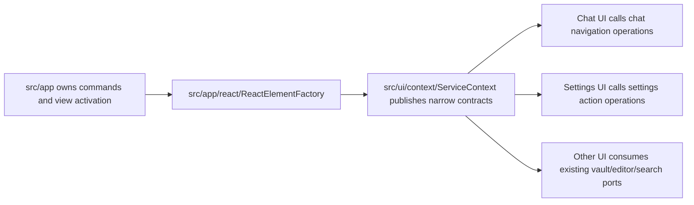
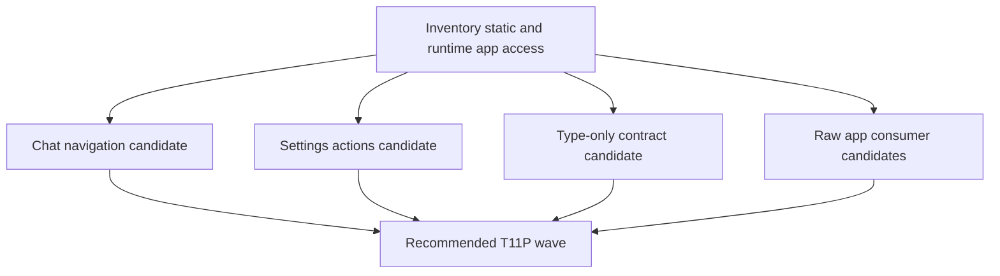

# Peak Assistant Modernization Handoff: T11P UI-App Tail Closure Investigation

Branch:
`codex/peak-modernization-refactor`

## Owner Summary

T11O succeeded: app-shell relocation moved `UI -> app` from `45` to `9`.

T11P is the next closure wave, not another small tail cleanup.

The remaining problem has two layers:

1. **Static import tail:** `src/ui/** -> @/app/** = 9`.
2. **Runtime escape hatch:** `useServiceContext().app = 25` consumers.

T11P must investigate both and aim for full closure.

Default target:

- `src/ui/** -> @/app/** = 0`
- `useServiceContext().app consumers = 0`

If full closure is not safe, the investigation must prove the exception file-by-file. A remaining edge is not acceptable just because it is annoying or requires many call-site changes.

Reducing the 9 static imports is useful, but not enough if UI still quietly uses raw `app` everywhere.

Do **not** implement in the first response.

The first response must be a read-only investigation that answers:

- Can `chatNavigation` lose its `AppContext` fallback through a narrow chat navigation port or hook?
- Can settings tabs stop importing `PeakCommandActions` through a real namespaced `SettingsActionsPort`?
- Can `ServiceContext` stop importing app-only types by moving contract shapes to neutral modules?
- Which `useServiceContext().app` consumers can be reduced in the same wave without making a god port?
- Is there enough safe work for a full T11P closure wave, or does the evidence force a named T11P-A/T11P-B split with exact blockers?

## Current Baseline After T11O

Codex rerun evidence from T11O owner review:

```bash
npm run audit:boundary -- --out /tmp/t11o-codex-review-after.md
```

Snapshot:

```text
Files scanned: 895
Total flagged: 56
UI -> app: 9
service -> app: 7
service -> ui: 0
core -> ui: 0
core -> upstream: 0
service/core -> Obsidian types: 35
service/core -> Obsidian side-effect: 5
raw UI vault/editor matches: 7
useServiceContext().app consumers: 25
```

Remaining `UI -> app` entries:

```text
src/ui/context/ServiceContext.tsx -> @/app/view/ViewManager (type-only)
src/ui/context/ServiceContext.tsx -> @/app/copilot/panels/composeCopilotPanelVault (type-only)
src/ui/view/chat-view/chatNavigation.ts -> @/app/context/AppContext
src/ui/view/chat-view/chatNavigation.ts -> @/app/view/ViewManager (type-only)
src/ui/view/chat-view/components/ConversationIndex.tsx -> @/app/view/types
src/ui/view/settings/MaintenanceTab.tsx -> @/app/commands/PeakCommandActions
src/ui/view/settings/tabs/AISetupTab.tsx -> @/app/commands/PeakCommandActions
src/ui/view/settings/tabs/AdvancedTab.tsx -> @/app/commands/PeakCommandActions
src/ui/view/settings/tabs/OverviewTab.tsx -> @/app/commands/PeakCommandActions
```

## T11P Target Architecture



How to read this:

- UI should call named operations, not import `PeakCommandActions` or `AppContext`.
- `ServiceContext` may publish narrow contracts, but must not publish raw `app` as a normal UI dependency.
- Moving a type from `@/app/**` to a neutral contract module is allowed only if the type is truly a contract, not an app implementation in disguise.
- App still owns Obsidian integration. The goal is not to delete app-layer wiring; the goal is to stop UI from reaching upward into app.

## Phase 1 Must Be Read-only Investigation

Claude Code must **not edit files, run formatters, stage files, or commit** in the first response.

Allowed commands:

```bash
npm run audit:boundary -- --out /tmp/t11p-baseline.md
rg -n "from ['\"]@/app" src/ui
rg -n "useServiceContext\\(\\).*\\bapp\\b|const \\{[^}]*\\bapp\\b[^}]*\\} = useServiceContext\\(\\)" src/ui
rg -n "chatNavigation|openConversationInChat|openChatHome|openProjectOverviewInChat|openPendingConversationInChat" src/ui src/app test
rg -n "PeakCommandActions|openHarnessSetupWizard|openAssistant|runSearchFastIndex|runFullIndexPipeline|deleteIndexData|verifyDatabaseHealthAction" src/ui/view/settings src/app/commands
rg -n "interface SettingsActions|settingsActions|CopilotPanelHostBundle|ViewManager" src/ui/context src/app/react src/app
```

You may inspect files with `sed`, `nl`, `rg`, `git show`, and `git grep`.

Forbidden in investigation:

- No edits.
- No generated code.
- No scanner allowlists or threshold changes.
- No commit.

Codex/user will audit the investigation before implementation.

## Investigation Buckets

### Bucket A: Chat navigation tail

Inspect at minimum:

- `src/ui/view/chat-view/chatNavigation.ts`
- `src/ui/view/project-list-view/ProjectListView.tsx`
- `src/ui/view/project-list-view/ConversationsSection.tsx`
- `src/ui/view/project-list-view/ProjectsSection.tsx`
- `src/ui/view/vault-lint/components/HealthInsightsPanel.tsx`
- `src/ui/view/quick-search/hooks/useAIAnalysisResult.ts`
- `src/ui/view/chat-view/hooks/useConversationLoad.ts`
- `src/ui/view/chat-view/view-Home.tsx`
- `src/ui/view/chat-view/view-AllProjects.tsx`
- `src/ui/view/chat-view/view-ProjectOverview.tsx`
- `src/ui/view/chat-view/components/messages/MessageViewItemRetained.tsx`
- app callers such as `src/app/events/Register.ts` and `src/app/commands/PeakCommandActions.ts`

Questions:

- Should `chatNavigation.ts` remain a UI module with explicit deps, or move to app?
- Can `AppContext.getViewManager/getManager/getEventBus` fallbacks be removed?
- Is the right shape a `ChatNavigationPort`, a `useChatNavigation()` hook, or an app-composed `chatNavigation` object on `ServiceContext`?
- How many `useServiceContext().app` consumers disappear if chat callers consume `chatNavigation` instead of raw `app` / `viewManager`?

Bad outcomes:

- Moving `chatNavigation.ts` to `src/app/**` and making 9 UI files import it from app.
- Publishing raw `ViewManager` as the solution.
- Creating a broad "ChatAppPort" with manager, app, viewManager, eventBus all exposed.

### Bucket B: Settings actions tail

Inspect at minimum:

- `src/ui/view/settings/MaintenanceTab.tsx`
- `src/ui/view/settings/tabs/AISetupTab.tsx`
- `src/ui/view/settings/tabs/AdvancedTab.tsx`
- `src/ui/view/settings/tabs/OverviewTab.tsx`
- `src/app/commands/PeakCommandActions.ts`
- `src/ui/context/ServiceContext.tsx`
- `src/app/react/ReactElementFactory.tsx`

Questions:

- Should `SettingsActions` become a namespaced `SettingsActionsPort`?
- Which settings actions are setup/navigation actions versus maintenance operations?
- Can `MaintenanceTab` receive action descriptors from `settingsActions.maintenance` without hardcoding app imports?
- Can `openHarnessSetupWizard` and `openAssistant` be grouped as `settingsActions.setup.openHarnessWizard()` and `settingsActions.openAssistant()`?
- Is this still narrow enough, or should settings maintenance get its own `MaintenanceActionsPort`?

Bad outcomes:

- Dumping every `PeakCommandActions` export into a flat `SettingsActions`.
- Moving React settings screens into app.
- Duplicating command logic in UI.

### Bucket C: ServiceContext type-only app imports

Inspect at minimum:

- `src/ui/context/ServiceContext.tsx`
- `src/app/view/ViewManager.ts`
- `src/app/copilot/panels/composeCopilotPanelVault.ts`
- `src/ui/view/copilot/hooks/useCopilotPanelVault.ts`

Questions:

- Can `ServiceContext` depend on a neutral `ViewActivationPort` instead of `ViewManager`?
- Can `CopilotPanelHostBundle` type move to a neutral port module without moving app implementation?
- Should this be included in T11P or left until after chat/settings ports?

Bad outcomes:

- Moving implementation types to `core` just to lower the scanner.
- Creating a type-only module that imports app again.

### Bucket D: Raw `useServiceContext().app` consumers

Inspect the 25 current consumers:

```bash
rg -n "useServiceContext\\(\\).*\\bapp\\b|const \\{[^}]*\\bapp\\b[^}]*\\} = useServiceContext\\(\\)" src/ui
```

Questions:

- Which consumers are already covered by existing ports: `vaultPreview`, `vaultNavigation`, `editorCommands`, `chatVaultWriter`, `settingsActions`, `quickSearchHost`?
- Which consumers need new narrow ports?
- Which consumers are platform-specific React surfaces that should stay for now?
- What before/after count is realistic for T11P?

Bad outcomes:

- Replacing raw `app` with a broad `obsidian` object.
- Chasing all 25 in one risky wave.
- Reporting only static import reduction and ignoring this honesty metric.

## Required Investigation Output

Return exactly one report in this shape:

````md
## T11P Read-only Investigation: Remaining UI-App Tail

Files inspected:
- <exact files>

Current metric snapshot:
| Metric | Count | Notes |
| --- | ---: | --- |
| total flagged | 56 | T11O baseline |
| UI -> app | 9 | primary static tail |
| direct UI AppContext import files | 6 |  |
| useServiceContext().app consumers | 25 | honesty metric |
| service -> app | 7 | must not increase |
| service -> ui | 0 | must remain 0 |
| core -> ui | 0 | must remain 0 |
| core -> upstream | 0 | must remain 0 |
| raw UI vault/editor matches | 7 | must not increase |

Static UI -> app inventory:
| File | Import | Why it exists | Candidate treatment | Expected delta | Risk |
| --- | --- | --- | --- | ---: | --- |

useServiceContext().app inventory:
| File | Current app usage | Existing port available? | Candidate treatment | Include in T11P? | Risk |
| --- | --- | --- | --- | --- | --- |

Candidate tracks:
| Track | Files | Dependency order | Expected static delta | Expected app-consumer delta | Real modularity gain | Risk | Include? |
| --- | --- | --- | ---: | ---: | --- | --- | --- |

Recommended implementation wave:
- Architecture choice:
- Primary metric target:
- Minimum acceptable delta:
- Stretch target:
- Required tracks:
- Optional tracks:
- Forbidden scope:
- Skip budget:
- Stop / commit rule:

Dependency DAG:


Expected before/after:
| Metric | Before | Expected after | Delta |
| --- | ---: | ---: | ---: |
| total flagged | 56 |  |  |
| UI -> app | 9 |  |  |
| useServiceContext().app consumers | 25 |  |  |
| service -> app | 7 |  |  |
| service -> ui | 0 | 0 | 0 |
| core -> ui | 0 | 0 | 0 |
| core -> upstream | 0 | 0 | 0 |

Visual maps to include if implementation happens:
1. Chat navigation before/after.
2. Settings actions before/after.
3. Raw app consumer reduction map.
4. Remaining app-bound tail after T11P.

Code reading guide for owner:
1. `<file>` - why read first.
2. `<file>` - port/contract surface.
3. `<test>` - guard that proves no regression.

Risks / stop conditions:
- ...

Does this qualify as a major wave?
- Yes / No, with evidence.

Message to send back to Codex:
- <one paragraph summary>
````

## Future Implementation Impact Contract

If the investigation recommends implementation, the implementation wave must meet this contract unless Codex explicitly revises it after reviewing the investigation.

Primary target:

```text
UI -> app: 9 -> 0 hard
```

Honesty target:

```text
useServiceContext().app consumers: 25 -> 0 hard
```

Must hold:

```text
total flagged <=47 hard
service -> app <=7
service -> ui = 0
core -> ui = 0
core -> upstream = 0
raw UI vault/editor matches <=7
scanner thresholds unchanged
```

Required tracks, if implementation proceeds:

1. Remove `chatNavigation.ts` static app imports without moving UI callers to `@/app/**`.
2. Replace settings tab `PeakCommandActions` imports with a narrow namespaced settings/maintenance action surface.
3. Remove raw `app` from `ServiceContext` and migrate consumers to existing or new narrow ports.
4. Add or update T11P regression guard.
5. Implementation note must include diagrams and a code reading guide.

Optional tracks:

- Move type-only app contract shapes out of `ServiceContext` if truly neutral.
- Reduce `ConversationIndex` view-type import through a clean app-composed navigation alternative.
- Split large UI consumers into local hooks only when those hooks consume narrow ports, not raw app.

Forbidden scope:

- Do not start Command Gateway; it remains T12 capstone.
- Do not implement Current Work State.
- Do not change Chat message/runtime behavior except dependency access.
- Do not change Settings visual layout.
- Do not move React screens to app.
- Do not add `ServiceContext.app` consumers.
- Do not keep `ServiceContext.app` unless the investigation proves an unavoidable temporary exception and Codex explicitly accepts it.
- Do not create `AppPort`, `UiHostPort`, `EverythingPort`, or a flat 20-function action bag.
- Do not edit `scripts/audit/boundary-baseline.mjs` thresholds or classifiers.

Skip budget:

- The default skip budget is zero for static `UI -> app` imports.
- The default skip budget is zero for raw `useServiceContext().app` consumers.
- A skip is allowed only with exact file, exact call, exact risk, and the smallest future track needed to remove it.
- If full closure would require changing Chat runtime behavior, Settings visual layout, or Command Gateway scope, stop after investigation and propose a named split instead of implementing a partial wave.

Stop / commit rule:

- In the read-only phase: no commit.
- In implementation: commit only if build, boundary audit, T11P guard, T11O guard, and T11N/T11M guards pass.
- If `UI -> app` remains above 3, report the wave as partial unless Codex explicitly accepts revised evidence.

## Verification Plan For Future Implementation

Required:

```bash
npm run build
npm run audit:boundary -- --out /tmp/t11p-after.md
npm run test -- test/t11p-remaining-ui-app-tail-regression.test.ts
npm run test -- test/t11o-app-shell-relocation-regression.test.ts
npm run test -- test/t11n-ui-vault-port-regression.test.ts
npm run test -- test/t11m-ui-app-boundary-regression.test.ts test/service-ui-boundary.test.ts
```

New T11P guard should assert:

- `UI -> app = 0`, unless Codex accepts a documented exception after investigation.
- `useServiceContext().app = 0`, unless Codex accepts a documented exception after investigation.
- `src/ui/view/chat-view/chatNavigation.ts` does not import `@/app/context/AppContext`.
- Settings tabs do not import `@/app/commands/PeakCommandActions`.
- `ServiceContext` does not publish raw `app` as a normal UI dependency.
- No banned broad port names.
- Scanner script unchanged.

## Copyable Prompt For Claude Code

```text
Please execute the read-only investigation in:
docs/superpowers/refactor-ops/t11p-remaining-ui-app-tail-investigation-handoff.md

Important: this first response is investigation only. Do not edit files, do not format, do not stage, and do not commit.

Goal: classify the remaining post-T11O UI/app tail:
- static UI -> app = 9
- useServiceContext().app consumers = 25

Default goal is full closure:
- static UI -> app = 0
- useServiceContext().app consumers = 0

Decide whether T11P can safely remove all remaining UI -> app and raw app access through:
1. a narrow chat navigation port/hook,
2. a namespaced SettingsActionsPort or MaintenanceActionsPort,
3. neutral type contracts for ServiceContext where appropriate,
4. selective reduction of raw app consumers.

If you believe any edge or raw app consumer cannot be removed in T11P, prove it with exact file/call-site evidence and propose the smallest named follow-up track. Do not implement in this first response.

Return the required T11P investigation report shape from the handoff, including:
- exact files inspected
- metric snapshot
- static UI -> app inventory
- useServiceContext().app inventory
- candidate tracks
- dependency DAG
- expected before/after metrics
- risks and stop conditions
- code reading guide
- a one-paragraph message back to Codex
```
