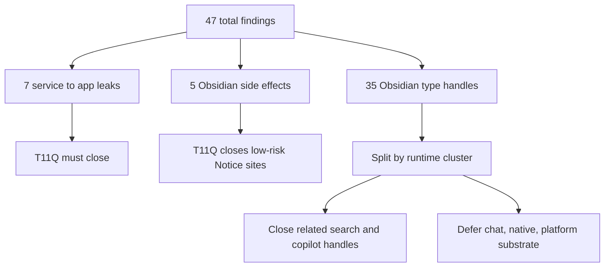
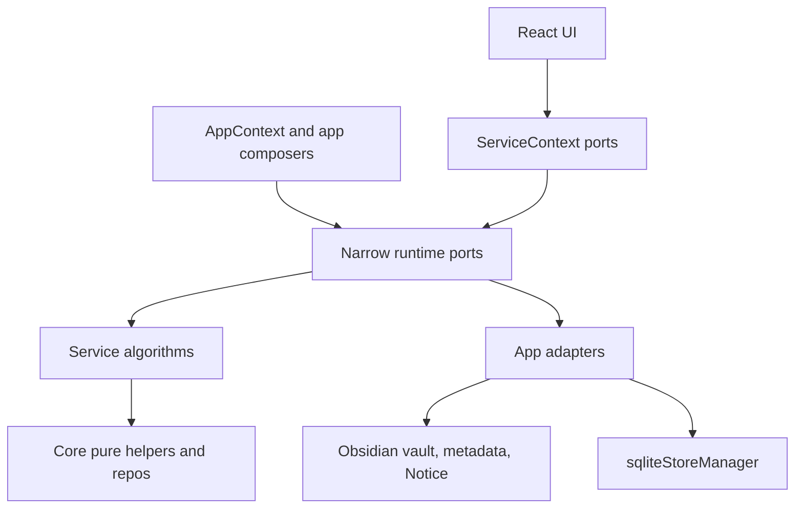
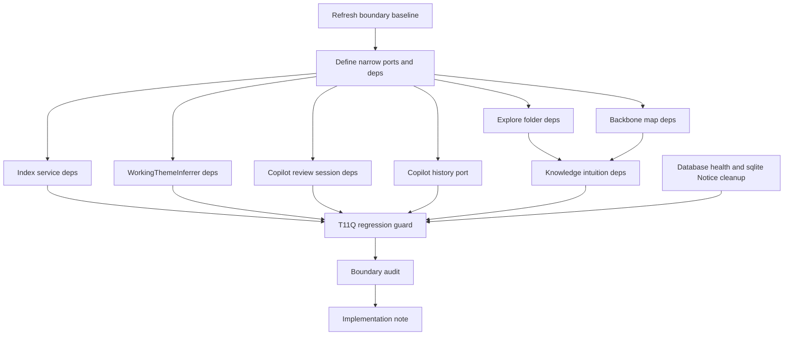
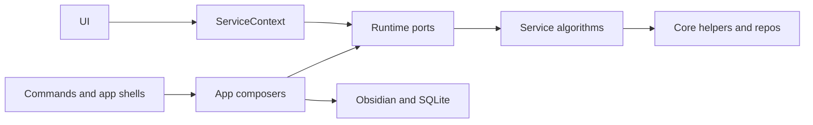

# T11Q Codex Investigation: Service/App Boundary Tail + Low-risk Substrate Cleanup

> Superseded on 2026-06-28 by `t11q-zero-boundary-hard-closure-handoff.md`.
> Owner decision changed from targeted tail cleanup to full hard拆 of all remaining boundary findings.

Status: Codex investigation complete. Claude Code should implement from the prompt in this file; it should not return another read-only investigation first.

Date: 2026-06-28

Branch:

```text
codex/peak-modernization-refactor
```

## Owner Summary

结论：还应该继续磨，但不能把剩余 47 个 `total flagged` 当成同一种债务。

T11P 已经把 UI 这边的大口子关掉了：

```text
UI -> app = 0
dynamic src/ui/** -> @/app/** = 0
useServiceContext().app = 0
```

现在 T11Q 应该做的是下一块高 ROI 工作：

1. 把剩余 7 条 `service -> app` 直接清零。
2. 顺手清理和这 7 条同一调用链上的 Obsidian `TFile` / `TFolder` / `Vault` 类型句柄。
3. 移走 2 个低风险 Obsidian side-effect：`DatabaseHealthVerifier` 和 `SqliteStoreManager` 里的 `Notice`。
4. 不在这一轮碰 `NativeModuleManager`、`core/platform.ts`、完整 Chat/Vault storage substrate；这些是独立底座迁移，不是这次的 service/app tail。

这不是退缩，而是避免“为了数字好看，把底座硬塞进一个大杂烩 port”。真正的大步伐应该有清晰边界和可验证 impact。

## Refreshed Baseline

Command:

```bash
npm run audit:boundary -- --out /tmp/t11q-baseline-refresh.md
```

Current result:

```text
Files scanned: 904
Total flagged: 47
service -> app: 7
service/core -> Obsidian side-effect: 5
service/core -> Obsidian types: 35
service -> ui: 0
core -> ui: 0
core -> upstream: 0
UI -> app: 0
```

## What The Remaining 47 Mean



How to read this:

- `service -> app` 是最清楚的反向依赖：业务层仍然偷偷拿 `AppContext`。这 7 条应该全关。
- `service/core -> Obsidian side-effect` 有不同性质：`Notice` 可以低风险上移；`requestUrl` / native module 下载 / `Platform` 是平台底座，应该单独做。
- `service/core -> Obsidian types` 不是全部都要立刻拆；和这 7 条 `service -> app` 同一调用链上的可以顺手拆，Chat/Vault storage 里的 live `TFile` 要单独迁移。

## Current High-value Leaks

### Required T11Q service -> app closure

| Bucket | File | Current leak | T11Q direction |
| --- | --- | --- | --- |
| Knowledge intuition | `src/service/agents/KnowledgeIntuitionAgent.ts` | calls `AppContext.getInstance()` for vault, rootFolder, pluginId, isMockEnv | app-composed deps/factory; no service import of `@/app/context/AppContext` |
| Working context | `src/service/context/WorkingThemeInferrer.ts` | static `AppContext.getSessionContext()` and `AppContext.getManager()` | inject working-context and LLM query deps from `SessionContextService` composition |
| Copilot review session | `src/service/copilot/CopilotReviewSession.ts` | loads profile and meta-agent deps through `AppContext` | create explicit review deps/runtime; UI consumes via `ServiceContext`, not raw app |
| Copilot review history | `src/service/copilot/CopilotReviewHistoryService.ts` | private getter returns `AppContext.getInstance().app`; service singleton owns Obsidian vault writes | app-owned history port/adapter; UI and app modals use injected port |
| Backbone map | `src/service/search/index/helper/backbone/buildBackboneMap.ts` | settings and vault root through `AppContext`; `TFolder` value import | inject settings snapshot + neutral vault tree/read deps |
| Index service | `src/service/search/index/indexService.ts` | tenant/rootFolder and enrichment reads through `AppContext` | inject index runtime deps / path classifier / markdown length reader |
| Explore folder tool | `src/service/tools/search-graph-inspector/explore-folder.ts` | vault/settings/template fallback through `AppContext`; `TFile`/`TFolder` value imports | inject explore-folder deps and neutral file/folder refs |

### Required low-risk side-effect cleanup

| File | Current side-effect | T11Q direction |
| --- | --- | --- |
| `src/core/storage/sqlite/DatabaseHealthVerifier.ts` | imports `Notice` directly | return/report health result; app command shows Notice |
| `src/core/storage/sqlite/SqliteStoreManager.ts` | imports `Notice` directly during backend unavailable path | inject/report unavailable message through init params or app-level reporter |

### Not T11Q unless it becomes trivial

| File | Why not in this wave |
| --- | --- |
| `src/core/storage/sqlite/NativeModuleManager.ts` | native binary download owns `requestUrl`, persistent Notice, filesystem, and boot recovery. This is a platform-substrate wave, not a service/app tail. |
| `src/core/platform.ts` | cross-cutting mobile/desktop substrate. Needs a platform port or injected app flag across UI/settings/search/curator, not a quick move. |
| `src/core/providers/testProviderConnection.ts` | provider connection testing is currently called from UI settings. It needs a `ProviderConnectionTester` port to avoid reintroducing UI -> app. Good optional track, but not required. |
| Chat storage files such as `ChatStore`, `PromptService`, `UserProfileService`, `ResourceSummaryService` | these still carry live vault file handles. They need a later Chat/Vault storage substrate migration, not a side quest inside T11Q. |

## Proposed Runtime Shape



The important ownership rule:

```text
App owns concrete Obsidian access.
Service owns business orchestration.
Core owns portable types/helpers/repos.
UI owns projection.
```

## T11Q Dependency DAG



## Impact Contract

This task counts as a major modernization wave only if the contract below is met.

Primary metric target:

```text
service -> app: 7 -> 0
```

Required tracks:

1. Close all 7 `service -> app` imports listed above.
2. Remove direct `AppContext` calls from those service files and their required helper path.
3. Reduce related Obsidian type handles in the same clusters:
   - `CopilotReviewHistoryService.ts`
   - `buildBackboneMap.ts`
   - `indexService.ts`
   - `explore-folder.ts`
   - `intuitionPrep.ts`
4. Move at least 2 low-risk `Notice` side-effects out of core/service:
   - `DatabaseHealthVerifier.ts`
   - `SqliteStoreManager.ts`
5. Add a T11Q regression guard.
6. Write an implementation note with Chinese summary, before/after metrics, diagrams, and code reading guide.

Optional tracks:

- `ProviderConnectionTester` port for `testProviderConnection.ts`, only if it does not reintroduce `UI -> app`.
- `envProbe.ts` platform injection, only if it is small and does not broaden the wave.

Forbidden scope:

- Do not edit boundary scanner thresholds/classifiers to make numbers look better.
- Do not reintroduce static or dynamic `src/ui/** -> @/app/**`.
- Do not publish raw `app`, `vault`, `workspace`, `TFile`, `TFolder`, or `getVault()` through a service/UI port.
- Do not create broad names such as `AppPort`, `ObsidianPort`, `EverythingPort`, `HostServices`, or `RuntimeBag`.
- Do not add service-layer mutable runtime singleton bindings such as `let currentRuntime = null` + `set/getRuntime`.
- Do not move `NativeModuleManager`, full Chat storage, Current Work State, Ambient Push product behavior, or Command Gateway.
- Do not rewrite search/indexing behavior, graph scoring, prompt semantics, or Copilot review behavior.

Hard acceptance floor:

```text
service -> app = 0
UI -> app = 0
dynamic src/ui/** -> @/app/** = 0
service -> ui = 0
core -> ui = 0
core -> upstream = 0
service/core -> Obsidian side-effect <= 3
service/core -> Obsidian types <= 29
total flagged <= 35
```

Stretch target:

```text
service/core -> Obsidian side-effect <= 2
service/core -> Obsidian types <= 26
total flagged <= 30
```

Stop / commit rule:

- If `service -> app` is not 0, do not commit. Return a blocker report with exact remaining files.
- If `UI -> app` or dynamic `src/ui/** -> @/app/**` becomes non-zero, do not commit.
- If the side-effect/type targets miss but `service -> app = 0` and `total flagged <= 36`, commit only if the implementation note labels the result as targeted closure, not full substrate completion.
- If the implementation needs to touch `NativeModuleManager` or Chat storage to hit the numbers, stop and report instead of widening silently.

## Required Verification

Run:

```bash
npm run build
npm run audit:boundary -- --out /tmp/t11q-after.md
npm run test -- test/t11q-service-app-tail-regression.test.ts
npm run test -- test/t11p-remaining-ui-app-tail-regression.test.ts
npm run test -- test/t11o-app-shell-relocation-regression.test.ts
npm run test -- test/t11n-ui-vault-port-regression.test.ts
npm run test -- test/t11m-ui-app-boundary-regression.test.ts test/service-ui-boundary.test.ts
npm run test -- test/t11l-remaining-boundary-regression.test.ts test/t11k-obsidian-boundary-regression.test.ts
npm run test -- test/copilot-review-model.test.ts
```

Also run source checks:

```bash
rg "from ['\"]@/app|import\\(['\"]@/app" src/service src/core src/ui
rg "AppContext\\.getInstance|AppContext\\.getApp|AppContext\\.getManager|AppContext\\.getSessionContext" src/service src/core
rg "from ['\"]@/app|import\\(['\"]@/app" src/ui
rg "let currentRuntime|let default[A-Z].*= null|set.*Runtime\\(" src/service src/core
```

The T11Q guard should assert:

- boundary audit reports `service -> app = 0`;
- `src/ui/**` has no static/dynamic `@/app/**` imports;
- `service/core -> Obsidian side-effect <= 3`;
- `service/core -> Obsidian types <= 29`;
- `total flagged <= 35`;
- the scanner script itself was not edited;
- no banned broad port names were introduced;
- no new service/core mutable runtime singleton binding was introduced.

## Code Reading Guide For Owner After Implementation

Read in this order:

1. New/changed port interfaces under `src/service/**/ports` or `src/core/ports`.
   - 看 port 有没有暴露 raw `App` / `Vault` / `TFile` / `TFolder`。
2. App composers/adapters under `src/app/**`.
   - 看 Obsidian 依赖是否集中在 app adapter。
3. `src/service/context/WorkingThemeInferrer.ts`.
   - 看它是否只吃注入 deps，不再拿 `AppContext`。
4. `src/service/copilot/CopilotReviewSession.ts` and history path.
   - 看 review runtime/history ownership 是否变成 app-owned。
5. `src/service/search/index/helper/backbone/buildBackboneMap.ts`.
   - 看 folder traversal 是否依赖 neutral refs/deps。
6. `src/service/tools/search-graph-inspector/explore-folder.ts`.
   - 看工具是否不再直接拿 AppContext/vault。
7. `src/service/search/index/indexService.ts`.
   - 看 rootFolder/tenant/enrichment deps 是否集中，不再散落 AppContext。
8. `src/core/storage/sqlite/DatabaseHealthVerifier.ts` and `SqliteStoreManager.ts`.
   - 看 Notice 是否上移到 app/reporting。
9. `test/t11q-service-app-tail-regression.test.ts`.
   - 看这轮的边界是否被 guard 住。
10. `/tmp/t11q-after.md` or generated audit snapshot.
   - 看最终数字有没有达到 Impact Contract。

## Copyable Claude Code Implementation Prompt

```text
Implement T11Q directly. Do not return a separate read-only investigation first; Codex already did the investigation and this prompt is the implementation contract. You may inspect files while coding, but your output should be commits + final implementation note.

Branch:
codex/peak-modernization-refactor

Read first:
- docs/superpowers/refactor-ops/t11q-codex-investigation-service-app-substrate-tail.md
- docs/superpowers/refactor-ops/claude-code-handoff-template.md
- AGENTS.md

Goal:
Close the remaining service/app boundary tail and clean the low-risk substrate side effects without reopening UI/app leaks.

Impact Contract:
- service -> app: 7 -> 0
- UI -> app = 0 must remain
- dynamic src/ui/** -> @/app/** = 0 must remain
- service -> ui = 0, core -> ui = 0, core -> upstream = 0 must remain
- service/core -> Obsidian side-effect <= 3
- service/core -> Obsidian types <= 29
- total flagged <= 35

Required tracks:
1. Remove all `@/app/context/AppContext` imports from:
   - src/service/agents/KnowledgeIntuitionAgent.ts
   - src/service/context/WorkingThemeInferrer.ts
   - src/service/copilot/CopilotReviewHistoryService.ts
   - src/service/copilot/CopilotReviewSession.ts
   - src/service/search/index/helper/backbone/buildBackboneMap.ts
   - src/service/search/index/indexService.ts
   - src/service/tools/search-graph-inspector/explore-folder.ts
2. Do not just replace `AppContext` with a raw `App` or raw `Vault` dependency in service-facing APIs. Use narrow deps/ports and app-owned adapters/composers.
3. For `CopilotReviewHistoryService`, do not keep or add a service-layer runtime singleton as the owner. Prefer app-owned composition and a narrow history port exposed to UI through ServiceContext where UI needs it.
4. For `CopilotReviewSession`, remove profile/app/pluginId/analysisHistory access through AppContext. Use explicit deps/runtime composition. Preserve review behavior.
5. For `WorkingThemeInferrer`, inject working-context and LLM query deps from the owner. Preserve debounce/threshold behavior.
6. For `KnowledgeIntuitionAgent` and `intuitionPrep`, pass required vault/rootFolder/plugin/mock/runtime deps explicitly. Also reduce the linked Obsidian `Vault`/`TFolder` handles where safe.
7. For `buildBackboneMap` and `explore-folder`, introduce narrow folder/vault traversal deps or neutral refs. Do not publish raw Obsidian objects through service ports.
8. For `indexService`, centralize rootFolder/hubFolder/tenant and markdown-read dependencies so it no longer imports `AppContext`. Do not rewrite indexing behavior.
9. Move `Notice` side effects out of:
   - src/core/storage/sqlite/DatabaseHealthVerifier.ts
   - src/core/storage/sqlite/SqliteStoreManager.ts
   App layer should display messages; core/service should return/report state.
10. Add `test/t11q-service-app-tail-regression.test.ts` with guards for the Impact Contract.
11. Write a Chinese-first implementation note under docs/superpowers/refactor-ops/ with:
   - before/after metric table;
   - changed files grouped by track;
   - Mermaid diagrams with no `\n` inside node labels;
   - code reading guide;
   - skipped/deferred tracks and why;
   - verification commands and results.

Forbidden:
- Do not edit scripts/audit/boundary-baseline.mjs thresholds/classifiers.
- Do not reintroduce static or dynamic src/ui/** -> @/app/** imports.
- Do not expose raw App/Vault/Workspace/TFile/TFolder through UI/service ports.
- Do not create broad ports named AppPort, ObsidianPort, EverythingPort, HostServices, RuntimeBag, or similar.
- Do not add service/core mutable runtime singleton bindings.
- Do not touch NativeModuleManager, full Chat storage migration, Current Work State, Ambient product behavior, or Command Gateway.
- Do not change graph scoring, indexing semantics, Copilot output semantics, or prompt content unless required by type movement.

Stop rule:
- If service -> app cannot reach 0, stop before commit and report exact blockers.
- If UI -> app becomes non-zero, stop before commit.
- If the only way to hit total flagged <=35 is to touch NativeModuleManager or Chat storage, do not do that; report it as deferred.

Verification:
Run all of:
- npm run build
- npm run audit:boundary -- --out /tmp/t11q-after.md
- npm run test -- test/t11q-service-app-tail-regression.test.ts
- npm run test -- test/t11p-remaining-ui-app-tail-regression.test.ts
- npm run test -- test/t11o-app-shell-relocation-regression.test.ts
- npm run test -- test/t11n-ui-vault-port-regression.test.ts
- npm run test -- test/t11m-ui-app-boundary-regression.test.ts test/service-ui-boundary.test.ts
- npm run test -- test/t11l-remaining-boundary-regression.test.ts test/t11k-obsidian-boundary-regression.test.ts
- npm run test -- test/copilot-review-model.test.ts

Also run:
- rg "from ['\\\"]@/app|import\\(['\\\"]@/app" src/service src/core src/ui
- rg "AppContext\\.getInstance|AppContext\\.getApp|AppContext\\.getManager|AppContext\\.getSessionContext" src/service src/core
- rg "from ['\\\"]@/app|import\\(['\\\"]@/app" src/ui
- rg "let currentRuntime|let default[A-Z].*= null|set.*Runtime\\(" src/service src/core

Commit message:
refactor(modernization): T11Q close service app boundary tail
```

## Expected After T11Q

If implemented correctly, the architecture should look like this:



Remaining after T11Q should be honest and smaller:

- Native/platform/provider network substrate remains.
- Chat/Vault live `TFile` storage remains.
- Search update listener may still be Obsidian-event integration.
- These should become later substrate waves only if the product still benefits from the extra strictness.
