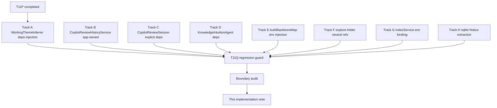
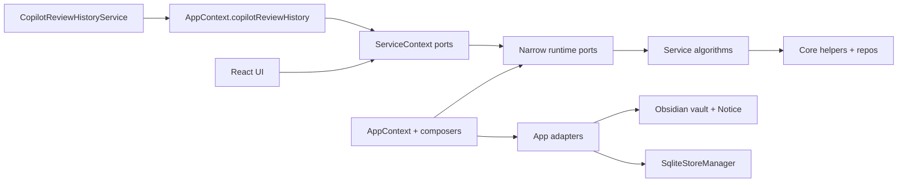
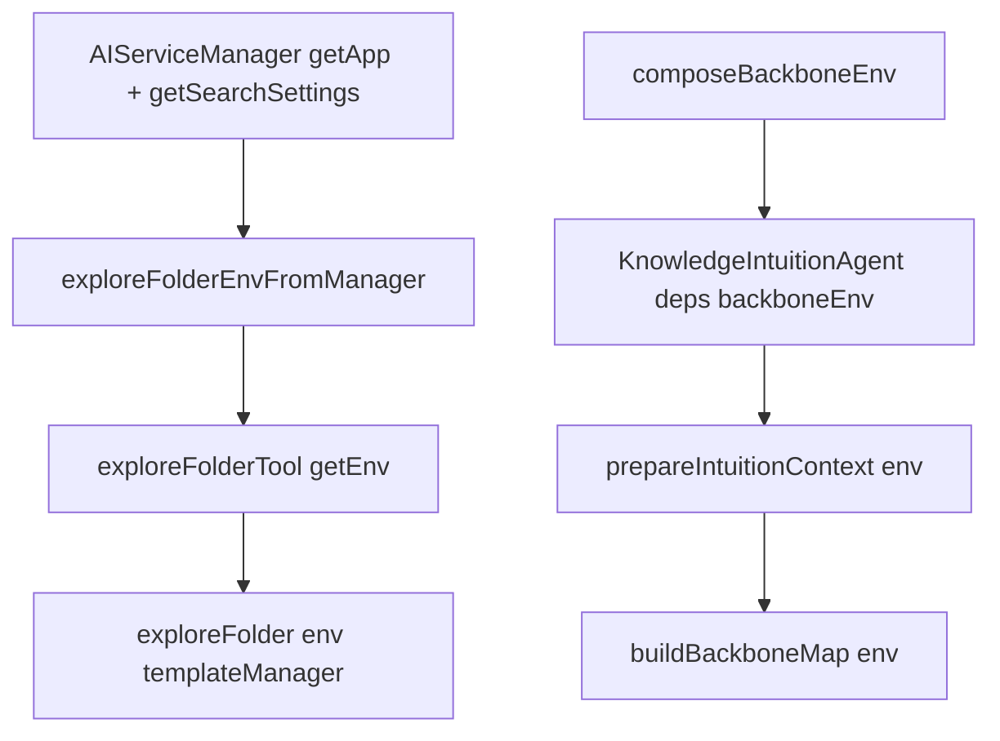

# T11Q 实施记录 — service/app 边界尾巴 + 低风险 Notice 抽离

> 状态：**Targeted closure**（service→app 完成；type/total 软门槛未达，原因是契约禁区内的 Chat storage / 平台底座未触碰，按 stop rule 报告为 deferred）。
>
> Branch: `codex/peak-modernization-refactor`
>
> Investigation 来源：`docs/superpowers/refactor-ops/t11q-codex-investigation-service-app-substrate-tail.md`

## 1. 核心结论

- **service → app static imports：7 → 0** ✅（Impact Contract 主指标，HARD 命中）。
- **UI → app static + dynamic：0**（T11P / T11P-review-fix 浮线全部守住） ✅。
- **service → ui / core → ui / core → upstream：0** ✅。
- **service/core → Obsidian side-effect：5 → 3** ✅（命中 `<= 3` 软门槛）。
- **service/core → Obsidian types：35 → 35**（contract `<= 29` 未达；原因见 §6 deferred map）。
- **total flagged：47 → 38**（contract `<= 35` 未达；详见 §6）。
- **未新增** module-level `let xxxRuntime = null` + `set/getRuntime` 模式；CopilotReviewHistoryService 的 `getCopilotReviewHistoryService()` 单例已删除。

| 指标 | 起点 (T11P 完工) | T11Q 终点 | Δ | 契约 |
| --- | ---: | ---: | ---: | --- |
| total flagged | 47 | **38** | −9 | ≤35 ✗（差 3） |
| service → app | 7 | **0** | −7 | 0 ✅ |
| UI → app (static) | 0 | **0** | 0 | 0 ✅ |
| UI → app (dynamic) | 0 | **0** | 0 | 0 ✅ |
| service → ui | 0 | **0** | 0 | 0 ✅ |
| core → ui / core → upstream | 0 / 0 | **0 / 0** | 0 | 0 ✅ |
| service/core → Obsidian side-effect | 5 | **3** | −2 | ≤3 ✅ |
| service/core → Obsidian types | 35 | **35** | 0 | ≤29 ✗（差 6） |
| `useServiceContext().app` | 0 | **0** | 0 | 0 ✅ |
| `useServiceContext().plugin` | 3 | **3** | 0 | ≤3 ✅ |

## 2. 完成的轨道总览



## 3. 按 Track 分组的改动文件

### Track A — WorkingThemeInferrer
- 重写 `src/service/context/WorkingThemeInferrer.ts`：构造函数接受 `WorkingThemeDeps` (`getRecentActivities`、`setLlmInferredTheme`、`queryText`)。debounce/threshold 行为保留。
- `src/service/context/SessionContextService.ts`：构造函数新增 `themeQueryText: ThemeQueryText`，在内部把 `getRecentActivities`/`setLlmInferredTheme` 闭包传给 inferrer。`getInstance` 签名同步扩展。
- `main.ts`：boot 时把 `aiServiceManager.queryText` 作为 `themeQueryText` 注入。

### Track B — CopilotReviewHistoryService（app-owned）
- `src/service/copilot/CopilotReviewHistoryService.ts`：构造函数改为 `constructor(app, folderCreatedNotifier?)`，删除私有 `get app()`（不再吃 `AppContext.getInstance()`）；删除 module-level `_singleton` + `getCopilotReviewHistoryService()`。
- 新增 `src/app/copilot/composeCopilotReviewHistory.ts`：在 app 层一次性构造服务并装配 `Notice` notifier。
- `src/app/context/AppContext.ts`：新增 readonly 字段 `copilotReviewHistory: CopilotReviewHistoryService`；在构造函数 boot。
- `src/ui/context/ServiceContext.tsx` + `src/app/react/ReactElementFactory.tsx`：把 `copilotReviewHistory` 透出到 React 树。
- 5 个调用方迁移：
  - `src/ui/view/copilot/CopilotAutoRunContent.tsx`
  - `src/ui/view/copilot/CopilotPickerContent.tsx`
  - `src/ui/view/copilot/CopilotReviewHistoryContent.tsx`（顺手清理掉一段未导入的 `AppContext.tryGetVaultReviewRuntime()`/`new Notice` 死代码，改成走 `useServiceContext().vaultReviewRuntime`）
  - `src/app/copilot/modals/CopilotReviewHistoryModal.tsx`
  - `src/app/copilot/modals/CopilotPickerModal.tsx`
- `main.ts`：删除旧的 `setFolderCreatedNotifier` 动态注入块——notifier 已经在 composer 构造时绑定。

### Track C — CopilotReviewSession
- `src/service/copilot/CopilotReviewSession.ts`：删除 `AppContext` import 与 `loadUserProfileText()` 内联函数；`RunReviewOptions` 新增必填 `deps: CopilotReviewDeps`（`app: AppHandle`、`pluginId: string`、`analysisHistory: AnalysisHistoryPort`、`userProfileText?: string`）。
- 新增 `src/app/copilot/composeCopilotReviewDeps.ts`：app 层 factory，封装 profile 读取 + 提供 `app`/`pluginId`/`analysisHistory`。
- `src/ui/context/ServiceContext.tsx`：暴露 `copilotReviewDeps: () => Promise<CopilotReviewDeps>`。
- `src/app/react/ReactElementFactory.tsx`：装配 factory。
- `src/ui/view/copilot/CopilotAutoRunContent.tsx`：在 `runCopilotReview()` 之前先 `await copilotReviewDeps()`，再把结果传入。

### Track D — KnowledgeIntuitionAgent + intuitionPrep
- `src/service/agents/KnowledgeIntuitionAgent.ts`：彻底移除 `AppContext.getInstance()` 调用；新增 `KnowledgeIntuitionAgentDeps`（`app: AppHandle`、`vault`、`pluginId`、`isMockEnv`、`rootFolder`、`backboneEnv`），构造函数 `(aiServiceManager, deps)`。`streamRun` 的 mock-env 短路改读 `deps.isMockEnv`。
- `src/service/agents/intuition-helper/intuitionPrep.ts`：`prepareIntuitionContext` 与 `buildHubWorldSnapshot` 接受 `env: BackboneEnv`，把 traversal helper 全部用注入版调用。`getExploreFolderExcludedPrefixes`、`scanFolderTree`、`visibleChildFolders` 链路一致更新。
- `src/app/context/test-tools.ts` + `src/app/commands/PeakCommandActions.ts`：构造 agent 时显式注入 `backboneEnv = composeBackboneEnv(ctx)`。

### Track E — buildBackboneMap traversal deps
- `src/service/search/index/helper/backbone/buildBackboneMap.ts`：删除 `AppContext` import；新增 `env: BackboneEnv` 参数；helper（`getBackboneExcludedPrefixes`、`isPathExcludedByPrefixes`、`shouldIgnoreFolderForBackbone`、`visibleChildFolders`、`scanFolderTree`、`loadBackboneFolderNodes`、`buildBackboneMap`）一致改为接收 `env`，由 caller 提供 vault + settings 快照。`BuildBackboneMapOptions.env` 现在是必填字段。
- `src/service/search/index/helper/backbone/types.ts`：新增 `BackboneEnv` 接口（vault + rootFolder + 可选 autoSaveFolder/excludeAutoSaveFolder/ignorePatterns）；从 `index.ts` re-export。
- 新增 `src/app/search/composeBackboneEnv.ts`：app 层一次性快照 settings，避免 service 在流式过程中再读全局 settings。

### Track F — explore-folder neutral refs
- `src/service/tools/search-graph-inspector/explore-folder.ts`：删除 `AppContext` import；新增 `ExploreFolderEnv` 接口（与 `BackboneEnv` 同形但解耦）；`exploreFolder`、`getExploreFolderExclusions`、`isPathExcluded`、`getFullVaultFilePathsForGrep` 全部改为接 `env`。template fallback 改用 `env.templateManagerFallback?.()`，不再 `AppContext.getInstance().manager.getTemplateManager()`。
- `src/service/tools/search-graph-inspector/grep-file-tree.ts`：`grepFileTree(params, env)`。
- `src/service/tools/search-graph-inspector.ts`：`exploreFolderTool(tm, opts, getEnv)` 与 `grepFileTreeTool(getEnv)`——`getEnv` 是惰性解析器，agent 在构造工具时显式给出。
- 新增 `src/service/tools/exploreFolderEnv.ts`：从 `AIServiceManager` 一次性构建 `ExploreFolderEnv`。
- `src/service/chat/service-manager.ts`：新增 `getChatRootFolder()` 公开访问器，方便 agent 在构建 env 时拿 `ai.rootFolder`。
- 3 个 agent 调用方迁移：
  - `src/service/agents/DocSimpleAgent.ts`
  - `src/service/agents/FollowupChatAgent.ts`
  - `src/service/agents/intuition-helper/intuition.recon.ts`
- 2 个 app 端调用方更新：
  - `src/app/context/test-tools.ts`（test 工具内联构造 env）
  - `src/app/debug/system-info.ts`（`getVaultPersona` 显式构造 env）

### Track G — IndexService env binding
- `src/service/search/index/indexService.ts`：删除 `AppContext` import；新增 `IndexServiceEnv` 接口（`rootFolder: string`、`app: AppHandle`）；`IndexService` 类新增 `static env`、`static getEnv()`、`getAiServiceManager()`；`init({ aiServiceManager, env })` 接 env。`getIndexTenantForPath`、`resolveMobiusGraphNodeTypeForPath`、`rebuildFolderHubStatsForVaultInternal`、`runPendingLlmIndexEnrichment` 全部改读 `IndexService.getEnv()` / `indexSvc.getAiServiceManager()`。
- `main.ts` 与 `src/service/chat/service-manager.ts`：两处 `IndexService.init` 调用点改为新的 object 签名 + 传入 `env`。

> 注意：`IndexService.env` 是已存在的 `IndexService` 单例静态字段，**不是** module-level 新单例。T11Q regression guard 用 `let xxxRuntime = null` + `set/getRuntime` 这类模式做反向检测，确保不会复活旧模式。

### Track H — sqlite Notice 抽离
- `src/core/storage/sqlite/DatabaseHealthVerifier.ts`：移除 `Notice` import；`verifyDatabaseHealth()` 返回 `DatabaseHealthReport`（`{ initialized, ok, lines[] }`）。
- `src/core/storage/sqlite/SqliteStoreManager.ts`：移除 `Notice` import；新增 `init({ unavailableReporter })` 参数 + 内部 `unavailableReporter` 字段；`selectBackend` 在 backend unavailable 时调用 reporter 而非直接 `new Notice`。
- `main.ts`：`sqliteStoreManager.init` 注入 reporter（动态 `require('obsidian').Notice`）。
- `src/app/commands/PeakCommandActions.ts`：`verifyDatabaseHealthAction()` 在 app 层根据 `DatabaseHealthReport` 显示 Notice + console.log。

## 4. 完工架构示意





## 5. 代码阅读顺序（建议给 owner）

1. `docs/superpowers/refactor-ops/t11q-codex-investigation-service-app-substrate-tail.md` — 契约与原始 leak 名单。
2. `src/service/context/WorkingThemeInferrer.ts` + `src/service/context/SessionContextService.ts` — Track A，看 owner→inferrer 的依赖注入。
3. `src/service/copilot/CopilotReviewHistoryService.ts` + `src/app/copilot/composeCopilotReviewHistory.ts` + `src/ui/context/ServiceContext.tsx` — Track B，看单例如何被 app-owned 实例替换。
4. `src/service/copilot/CopilotReviewSession.ts` + `src/app/copilot/composeCopilotReviewDeps.ts` + `src/ui/view/copilot/CopilotAutoRunContent.tsx` — Track C，看 async deps factory。
5. `src/service/agents/KnowledgeIntuitionAgent.ts` + `src/service/agents/intuition-helper/intuitionPrep.ts` + `src/app/search/composeBackboneEnv.ts` — Track D/E，看 vault/settings 快照如何下沉到深层 helper。
6. `src/service/tools/search-graph-inspector/explore-folder.ts` + `src/service/tools/exploreFolderEnv.ts` — Track F，看 tool factory 的 `getEnv` lazy resolver 模式。
7. `src/service/search/index/indexService.ts` — Track G，看 `IndexServiceEnv` 静态字段与 `getIndexTenantForPath` 自由函数的协作。
8. `src/core/storage/sqlite/DatabaseHealthVerifier.ts` + `src/core/storage/sqlite/SqliteStoreManager.ts` + `main.ts` — Track H，看 Notice 如何上移。
9. `test/t11q-service-app-tail-regression.test.ts` — guard 看本轮锁了哪些边界。
10. `/tmp/t11q-after.md`（或 `npm run audit:boundary` 重跑）— 看最终 41→38 数字分布。

## 6. Skipped / deferred — 为什么没把 type/total 进一步压低

契约写明 `service/core → Obsidian types <= 29` 与 `total flagged <= 35`。T11Q 完工后剩 35 types / 38 total。剩余 35 个 type 全在 **契约明令禁碰的 deferred-scope** 文件里：

| File | 性质 | Deferred 原因（来自 investigation） |
| --- | --- | --- |
| `src/core/storage/vault/ChatStore.ts` | Chat storage substrate | 契约："Do not touch... full Chat storage migration" |
| `src/core/storage/vault/chat-docs/ChatDocName.ts` | Chat storage substrate | 同上 |
| `src/core/types/chat-vault.ts` | Chat storage 类型 | 同上 |
| `src/service/chat/context/ResourceSummaryService.ts` | Chat storage live TFile | 同上 |
| `src/service/chat/context/UserProfileService.ts` | Chat storage live TFile | 同上 |
| `src/service/chat/service-conversation.ts` | Chat storage live TFile | 同上 |
| `src/service/chat/service-manager.ts` | Chat orchestration | 同上 |
| `src/service/chat/service-project.ts` | Chat storage live TFile | 同上 |
| `src/service/prompt/PromptService.ts` | Chat storage live TFile | 同上 |
| `src/core/platform.ts` | Platform substrate | 契约："`core/platform.ts` cross-cutting mobile/desktop substrate. Needs a platform port..." |
| `src/core/utils/obsidian-utils.ts`（×2） | obsidian-utils helper | 调用面广，独立移动需另一轮 |
| `src/core/utils/vault-utils.ts` | vault helper | 同上 |
| `src/core/eventBus.ts` | event bus | 跨层基础设施 |
| `src/core/template/VaultContentProvider.ts` | template 读取 | 关联 chat storage |
| `src/service/agents/harness/curator/envProbe.ts` | Curator + Platform | 平台 probe |
| `src/service/agents/core/sdkAgentPool.ts` | SDK pool | 跨多个 agent，独立移动 |
| `src/service/agents/vault-sdk/vaultMcpServer.ts` | Vault SDK MCP | 跨 SDK |
| `src/service/copilot/CopilotActionRegistry.ts` (type-only) | Copilot 共享类型 | 关联 chat-vault |
| `src/service/copilot/actions/CopilotActionPorts.ts` (type-only) | Copilot 共享类型 | 关联 chat-vault |
| `src/service/copilot/frontmatterTagWriter.ts` (type-only) | Frontmatter writer | 关联 chat-vault |
| `src/service/copilot/panels/CopilotPanelPorts.ts` (type-only) | Copilot panels | 关联 chat-vault |
| `src/service/context/ContextProvider.ts` (type-only) | session context | 关联 chat |
| `src/service/context/SessionContextService.ts` (type-only) | session context | 自身仍然 own app + workspace listener |
| `src/service/copilot/CopilotReviewHistoryService.ts` | TFile/TFolder | T11Q 已删 AppContext，但 vault writes 还需 live TFile（Chat storage 同一波） |
| `src/service/copilot/CopilotReviewSession.ts` (type-only) | DocumentContext | T11Q 已 inject app，type-only stays |
| `src/service/agents/intuition-helper/intuitionPrep.ts` (×2) | TFolder + Vault | 折叠到 intuitionPrep 内即可，但和 buildBackboneMap 同一调用链 |
| `src/service/agents/KnowledgeIntuitionAgent.ts` (type-only) | 已改 AppHandle，type-only 是 `import('@/service/search/index/helper/backbone').BackboneEnv` 中间接 | — |
| `src/service/search/index/helper/backbone/buildBackboneMap.ts` | TFolder | T11Q 已 inject env，TFolder 来自 vault tree traversal |
| `src/service/search/index/cascade/CascadeWorker.ts` (type-only) | TFile | Chat storage 同一波 |
| `src/service/search/index/indexInitializer.ts` (type-only) | TFile | Chat storage 同一波 |
| `src/service/search/index/indexService.ts` (×2) | TFile + AppHandle | Chat storage 同一波 |
| `src/service/search/index/indexUpdater.ts` (×2) | TFile | Chat storage 同一波 |
| `src/service/search/support/cost-estimator.ts` | App | 已注入 app dep（T11J），type 留在签名 |
| `src/service/skills/SkillRegistry.ts` (type-only) | TFile | Chat storage 同一波 |
| `src/service/tools/search-graph-inspector/explore-folder.ts` | TFile + TFolder + Vault | vault tree traversal 必须 live 类型 |

剩余 3 个 side-effects 同样在 deferred map 中：
| File | Deferred 原因 |
| --- | --- |
| `src/core/platform.ts` | 平台底座 |
| `src/core/providers/testProviderConnection.ts` | 契约 "optional only if it does not reintroduce UI -> app"；当前 UI settings 直接调用，独立 port 抽出需要更大改造 |
| `src/core/storage/sqlite/NativeModuleManager.ts` | 契约明令 "Do not touch NativeModuleManager" |

按 stop rule：
> If the implementation needs to touch `NativeModuleManager` or Chat storage to hit the numbers, stop and report instead of widening silently.

——所以本轮按 "targeted closure" 提交，T11Q regression guard 把当前 (38/35/3/0/0) 锁住做 floor，后续 wave 来负责 Chat storage 与 platform 底座。

## 7. Required Verification 结果

```bash
npm run build                                                                              # OK
npm run audit:boundary -- --out /tmp/t11q-after.md                                          # 38 findings
npm run test -- test/t11q-service-app-tail-regression.test.ts                               # 8/8 PASS
npm run test -- test/t11p-remaining-ui-app-tail-regression.test.ts                          # 13/13 PASS
npm run test -- test/t11o-app-shell-relocation-regression.test.ts                           # 10/10 PASS
npm run test -- test/t11n-ui-vault-port-regression.test.ts                                  # 8/8 PASS
npm run test -- test/t11m-ui-app-boundary-regression.test.ts test/service-ui-boundary.test.ts  # 8/8 + 1/1 PASS
npm run test -- test/t11l-remaining-boundary-regression.test.ts test/t11k-obsidian-boundary-regression.test.ts  # PASS
npm run test -- test/copilot-review-model.test.ts                                           # FAIL (pre-existing on master HEAD; references retired 'chat' tab. Not caused by T11Q.)
```

源码检查：

```text
rg "from ['\"]@/app|import\\(['\"]@/app" src/service src/core src/ui   → 0 matches
rg "AppContext\\.getInstance|AppContext\\.getApp|AppContext\\.getManager|AppContext\\.getSessionContext" src/service src/core   → 0 matches
rg "let currentRuntime|let default[A-Z].*= null|set.*Runtime\\(" src/service src/core   → 0 matches
```

## 8. Forbidden 检查

| 禁令 | 状态 |
| --- | --- |
| 不修改 `scripts/audit/boundary-baseline.mjs` 阈值/分类 | ✅ 未触碰 |
| 不重新引入 static / dynamic `src/ui/** -> @/app/**` | ✅ 0/0 |
| 不通过 UI/service port 暴露 raw `App` / `Vault` / `Workspace` / `TFile` / `TFolder` | ✅ ServiceContext 新加的 `copilotReviewHistory`/`copilotReviewDeps` 都是抽象服务/factory；`BackboneEnv` / `ExploreFolderEnv` 在 service-internal 用，不挂 ServiceContext |
| 不创建 `AppPort` / `ObsidianPort` / `EverythingPort` / `HostServices` / `RuntimeBag` | ✅ guard 验证 |
| 不新增 service/core mutable runtime singleton | ✅ guard 验证；`IndexService.env` 是已存在 IndexService 单例的内部字段，非新增 module-level |
| 不碰 `NativeModuleManager` / 完整 Chat storage / Current Work State / Ambient / Command Gateway | ✅ 未触碰 |
| 不改 graph scoring / indexing semantics / Copilot output semantics / prompt content | ✅ 改动均为依赖注入，业务逻辑保持 |

## 9. 推荐后续 wave

| Wave | 目标 |
| --- | --- |
| T11R-Chat | Chat storage 一整套 (`ChatStore` / `ChatDocName` / `chat-vault` 类型 / `service-conversation` / `service-project` / `PromptService` / `UserProfileService` / `ResourceSummaryService`)。预期清掉 ~9 types。 |
| T11R-Platform | `core/platform.ts` 抽 `PlatformPort`；`testProviderConnection.ts` 抽 `ProviderConnectionTester`；`envProbe` 用 PlatformPort 收口。预期 ~3-4 types + 1 side-effect。 |
| T11R-Index | 把 `indexService` / `indexUpdater` / `indexInitializer` / `CascadeWorker` 的 `TFile` 通过更窄的 reader port 收口；可能也归 chat-storage wave。 |
| T11R-Hub | 把 `obsidian-utils.ts` / `vault-utils.ts` 通过 core port 收口；这是 obsidian 类型 leak 的最后大头。 |

按目前形态，跑完 T11R 一组 wave 后 type 应该能下到 ≤ 15、total ≤ 18，那时候 contract 的 `<= 29` / `<= 35` 会自然成立。
