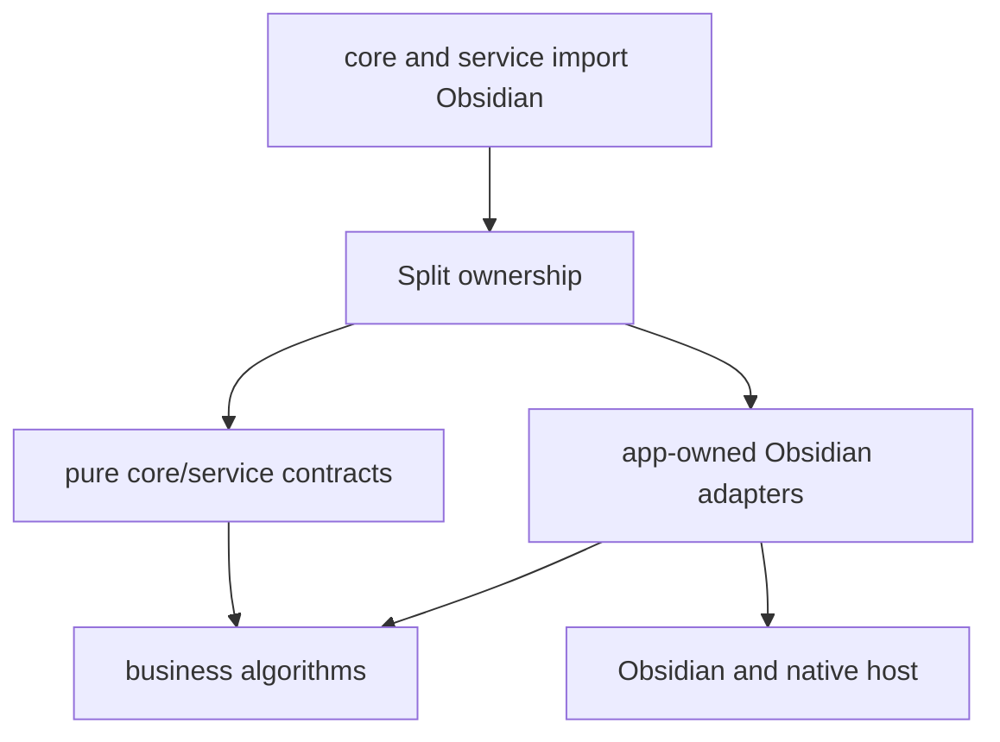
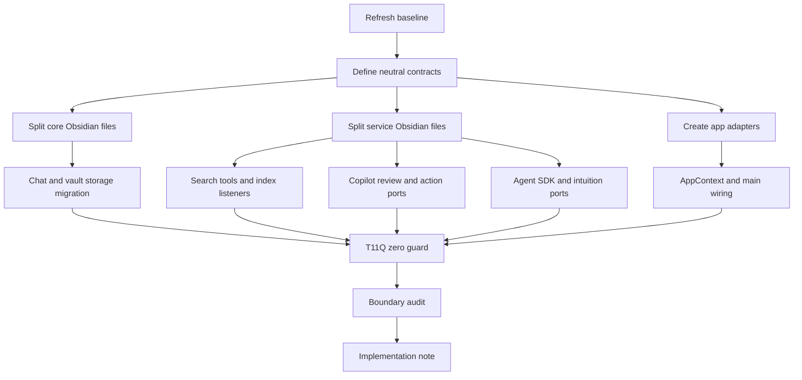

# T11Q Zero Boundary Hard Closure Handoff

Status: final handoff. This supersedes `t11q-codex-investigation-service-app-substrate-tail.md`.

Date: 2026-06-28

Branch:

```text
codex/peak-modernization-refactor
```

## Owner Summary

用户决策已更新：不再做“保守 tail cleanup”，而是硬拆剩余 boundary debt。

T11Q-Zero 的目标是：

```text
total flagged: 47 -> 0
service -> app: 7 -> 0
service/core -> Obsidian side-effect: 5 -> 0
service/core -> Obsidian types: 35 -> 0
UI -> app: 0 held
service -> ui: 0 held
core -> ui: 0 held
core -> upstream: 0 held
```

这意味着 Claude Code 不能只做小修，也不能用 broad `AppHandle` 或 `ObsidianPort` 把问题藏起来。需要把所有 Obsidian-bound concrete implementation 移到 `src/app/**`，或者拆成 neutral port + app adapter。

## Current Baseline

Baseline command:

```bash
npm run audit:boundary -- --out /tmp/t11q-baseline-refresh.md
```

Current result:

```text
Files scanned: 904
Total flagged: 47
service -> app: 7
service/core -> Obsidian side-effect: 5
service/core -> Obsidian types: 35
UI -> app: 0
service -> ui: 0
core -> ui: 0
core -> upstream: 0
```

## Hard拆 Principle



Rules:

- `src/core/**` must not import `obsidian`.
- `src/service/**` must not import `obsidian`.
- `src/core/**` must not import `@/app/**`.
- `src/service/**` must not import `@/app/**`.
- `src/ui/**` must not import `@/app/**`.
- Obsidian-bound code belongs in `src/app/**`.
- If a core/service file needs host behavior, define a narrow neutral port and compose its implementation in app.

## What Must Be Removed

### A. Service -> app leaks

Remove all imports from `@/app/context/AppContext` in:

```text
src/service/agents/KnowledgeIntuitionAgent.ts
src/service/context/WorkingThemeInferrer.ts
src/service/copilot/CopilotReviewHistoryService.ts
src/service/copilot/CopilotReviewSession.ts
src/service/search/index/helper/backbone/buildBackboneMap.ts
src/service/search/index/indexService.ts
src/service/tools/search-graph-inspector/explore-folder.ts
```

### B. Obsidian side-effect imports in core/service

Remove all `obsidian` side-effect imports from:

```text
src/core/platform.ts
src/core/providers/testProviderConnection.ts
src/core/storage/sqlite/DatabaseHealthVerifier.ts
src/core/storage/sqlite/NativeModuleManager.ts
src/core/storage/sqlite/SqliteStoreManager.ts
```

Hard拆 direction:

- `core/platform.ts`: move concrete `Platform.isMobile` access to app/platform adapter; core keeps a neutral `PlatformInfoPort` type or pure helpers only.
- `testProviderConnection.ts`: move `requestUrl` concrete implementation to app/provider adapter or inject `HttpRequestPort`.
- `DatabaseHealthVerifier.ts`: remove `Notice`; return health result or call a neutral reporter.
- `NativeModuleManager.ts`: move this Obsidian/native host implementation to `src/app/native/NativeModuleManager.ts` or inject request/notice ports. It must no longer live in `src/core/**` with Obsidian imports.
- `SqliteStoreManager.ts`: remove `Notice`; app layer owns user notification for unavailable SQLite.

### C. Obsidian type imports in core

Remove all `obsidian` imports from:

```text
src/core/eventBus.ts
src/core/storage/vault/ChatStore.ts
src/core/storage/vault/chat-docs/ChatDocName.ts
src/core/template/VaultContentProvider.ts
src/core/types/chat-vault.ts
src/core/utils/obsidian-utils.ts
src/core/utils/vault-utils.ts
```

Hard拆 direction:

- `EventBus`: no `App` import. Use neutral host key or move app-bound singleton registry to app.
- `ChatStore`: split pure chat persistence contracts/types from Obsidian vault implementation. Concrete vault-backed store belongs in `src/app/chat/**` or app storage adapter.
- `ChatDocName`: keep pure naming logic in core; move `Vault/TFile/TFolder` conflict checks behind an app adapter.
- `VaultContentProvider`: use existing `DocumentVaultReaderPort` or a narrower neutral content provider. No `App` type.
- `chat-vault.ts`: replace live `TFile` handle with neutral `VaultFileRef` / `filePath` shape, or move live-handle type to app.
- `obsidian-utils.ts` and `vault-utils.ts`: split pure path helpers from Obsidian host helpers. Pure helpers stay in core; host helpers move to app.

### D. Obsidian type imports in service

Remove all `obsidian` imports from:

```text
src/service/agents/core/sdkAgentPool.ts
src/service/agents/harness/curator/envProbe.ts
src/service/agents/intuition-helper/intuitionPrep.ts
src/service/agents/vault-sdk/vaultMcpServer.ts
src/service/chat/context/ResourceSummaryService.ts
src/service/chat/context/UserProfileService.ts
src/service/chat/service-conversation.ts
src/service/chat/service-manager.ts
src/service/chat/service-project.ts
src/service/context/ContextProvider.ts
src/service/context/SessionContextService.ts
src/service/copilot/CopilotActionRegistry.ts
src/service/copilot/CopilotReviewHistoryService.ts
src/service/copilot/actions/CopilotActionPorts.ts
src/service/copilot/frontmatterTagWriter.ts
src/service/copilot/panels/CopilotPanelPorts.ts
src/service/prompt/PromptService.ts
src/service/search/index/cascade/CascadeWorker.ts
src/service/search/index/helper/backbone/buildBackboneMap.ts
src/service/search/index/indexInitializer.ts
src/service/search/index/indexService.ts
src/service/search/index/indexUpdater.ts
src/service/search/support/cost-estimator.ts
src/service/skills/SkillRegistry.ts
src/service/tools/search-graph-inspector/explore-folder.ts
```

Hard拆 direction:

- Replace `TFile`, `TFolder`, `TAbstractFile`, `Vault`, `App`, `EventRef`, `WorkspaceLeaf`, and other Obsidian symbols with neutral shapes or app-owned adapters.
- Move Obsidian listener/event wiring such as `indexUpdater` into app if it cannot be made neutral.
- Move concrete vault MCP server wrappers into app, leaving pure tool schemas/handlers in service/core if needed.
- Chat/profile/prompt/resource vault IO should become ports/adapters, not service files importing Obsidian.

## Dependency DAG



## Impact Contract

This task is accepted only as a hard closure wave. Small deltas do not count.

Primary metric target:

```text
total flagged: 47 -> 0
```

Required category targets:

```text
service -> app = 0
service/core -> Obsidian side-effect = 0
service/core -> Obsidian types = 0
UI -> app = 0
service -> ui = 0
core -> ui = 0
core -> upstream = 0
```

Required tracks:

1. AppContext/service leak closure.
2. Core Obsidian side-effect relocation.
3. Core Obsidian type relocation.
4. Service Obsidian type relocation.
5. Chat/Vault storage host split.
6. Search/index host split.
7. Copilot review/history/action host split.
8. Agent SDK / intuition / vault MCP host split.
9. T11Q zero-boundary regression guard.
10. Chinese-first implementation note with diagrams and code reading guide.

Minimum acceptable delta:

```text
total flagged must be 0
```

Stop / commit rule:

- If `total flagged` is not 0, do not call this complete.
- If `total flagged` is above 0 because of a real unavoidable blocker, stop before final commit and return blocker report.
- If one or two remaining findings are scanner false positives caused by comments/strings, either fix the scanner correctly or remove/adjust the false-positive text; do not weaken scanner categories.
- If a track requires a product decision, stop and list the exact decision.
- Do not commit a partial implementation and call it T11Q-Zero.

## Forbidden Shortcuts

Forbidden:

- Do not edit `scripts/audit/boundary-baseline.mjs` thresholds/classifiers to hide findings.
- Do not add allowlists for these 47 findings.
- Do not use broad escape hatches such as `AppPort`, `ObsidianPort`, `HostServices`, `RuntimeBag`, `EverythingPort`, `AppHandle` as the main solution.
- Do not expose raw `App`, `Vault`, `Workspace`, `TFile`, `TFolder`, `TAbstractFile`, or `EventRef` through service/UI/core-facing ports.
- Do not reintroduce static or dynamic `src/ui/** -> @/app/**`.
- Do not add service/core mutable runtime singleton bindings.
- Do not leave old and new owners running the same behavior.
- Do not keep compatibility shims that import upward from core/service to app.
- Do not implement Current Work State or Command Gateway.

Allowed:

- Large file moves from `src/core/**` / `src/service/**` to `src/app/**` when the moved code is genuinely Obsidian-bound.
- Multiple commits in one Claude session.
- Broad mechanical import migration if guarded by tests and boundary audit.
- New neutral contracts under `src/core/ports/**` or domain-specific `src/service/**/ports/**`.
- App-owned adapters/composers under `src/app/**`.

## Verification

Required:

```bash
npm run build
npm run audit:boundary -- --out /tmp/t11q-zero-after.md
npm run test -- test/t11q-zero-boundary-regression.test.ts
npm run test -- test/t11p-remaining-ui-app-tail-regression.test.ts
npm run test -- test/t11o-app-shell-relocation-regression.test.ts
npm run test -- test/t11n-ui-vault-port-regression.test.ts
npm run test -- test/t11m-ui-app-boundary-regression.test.ts test/service-ui-boundary.test.ts
npm run test -- test/t11l-remaining-boundary-regression.test.ts test/t11k-obsidian-boundary-regression.test.ts
npm run test -- test/copilot-review-model.test.ts
```

Source checks:

```bash
rg "from ['\"]@/app|import\\(['\"]@/app" src/service src/core src/ui
rg "from ['\"]obsidian['\"]|from \"obsidian\"|from 'obsidian'" src/service src/core
rg "import type .* from ['\"]obsidian['\"]|import type .* from \"obsidian\"" src/service src/core
rg "AppContext\\.getInstance|AppContext\\.getApp|AppContext\\.getManager|AppContext\\.getSessionContext" src/service src/core
rg "TFile|TFolder|TAbstractFile|Vault|WorkspaceLeaf|MarkdownView|Modal|ItemView|Notice|requestUrl|Platform|EventRef" src/service src/core
rg "from ['\"]@/app|import\\(['\"]@/app" src/ui
rg "let currentRuntime|let default[A-Z].*= null|set.*Runtime\\(" src/service src/core
```

The new `test/t11q-zero-boundary-regression.test.ts` must assert:

- boundary total is 0;
- no `obsidian` import in `src/core/**`;
- no `obsidian` import in `src/service/**`;
- no `@/app/**` import in `src/core/**`;
- no `@/app/**` import in `src/service/**`;
- no `@/app/**` import in `src/ui/**`, static or dynamic;
- no banned broad port names;
- scanner file was not edited to hide findings.

## Implementation Note Requirements

Claude's final note must include:

- Chinese summary first.
- Before/after metrics table with all categories.
- Changed files grouped by track.
- Deleted/moved old paths.
- Mermaid diagrams with no `\n` in node labels.
- Code reading guide for owner.
- Explicit list of any behavior-preserving assumptions.
- Verification commands and results.
- If not zero, exact blocker evidence and no claim of completion.

## Code Reading Guide For Owner After Implementation

Read in this order:

1. `test/t11q-zero-boundary-regression.test.ts`
   - 先看这轮是否真的把边界锁死。
2. New neutral ports under `src/core/ports/**` and `src/service/**/ports/**`
   - 看有没有 raw Obsidian escape hatch。
3. New app adapters under `src/app/**`
   - 看 Obsidian/native host access 是否集中在 app。
4. Chat/Vault storage migration files
   - 看 `TFile` live handle 是否从 core/service 消失。
5. Search/index migration files
   - 看 listener/vault/tree/indexing host dependency 是否被 app-owned。
6. Copilot review/history migration files
   - 看 history storage owner 是否不再是 service singleton。
7. Agent SDK / intuition / vault MCP migration files
   - 看 SDK host/app/plugin/vault 依赖是否不再污染 service。
8. `/tmp/t11q-zero-after.md`
   - 看 `total flagged` 是否为 0。

## Copyable Claude Code Implementation Prompt

```text
Implement T11Q-Zero hard closure directly. Do not return a separate read-only investigation first; Codex and owner have decided to hard拆 all remaining boundary findings. You may inspect files while coding, but your output should be implementation commits + final implementation note.

Branch:
codex/peak-modernization-refactor

Read first:
- docs/superpowers/refactor-ops/t11q-zero-boundary-hard-closure-handoff.md
- AGENTS.md
- docs/superpowers/refactor-ops/claude-code-handoff-template.md

Goal:
Hard-close all remaining boundary findings. The target is not a small delta; the target is zero.

Impact Contract:
- total flagged: 47 -> 0
- service -> app = 0
- service/core -> Obsidian side-effect = 0
- service/core -> Obsidian types = 0
- UI -> app = 0 held
- service -> ui = 0 held
- core -> ui = 0 held
- core -> upstream = 0 held

Required:
1. Remove every `@/app/**` import from src/service/** and src/core/**.
2. Remove every `obsidian` import from src/service/** and src/core/**, including type-only imports.
3. Move Obsidian-bound concrete implementations to src/app/** or behind narrow neutral ports with app adapters.
4. Do not expose raw App/Vault/Workspace/TFile/TFolder/TAbstractFile/EventRef/Notice/requestUrl/Platform through service/core/UI-facing contracts.
5. Split or move these core files so core has no Obsidian import:
   - src/core/eventBus.ts
   - src/core/storage/vault/ChatStore.ts
   - src/core/storage/vault/chat-docs/ChatDocName.ts
   - src/core/template/VaultContentProvider.ts
   - src/core/types/chat-vault.ts
   - src/core/utils/obsidian-utils.ts
   - src/core/utils/vault-utils.ts
   - src/core/platform.ts
   - src/core/providers/testProviderConnection.ts
   - src/core/storage/sqlite/DatabaseHealthVerifier.ts
   - src/core/storage/sqlite/NativeModuleManager.ts
   - src/core/storage/sqlite/SqliteStoreManager.ts
6. Split or move every service file listed in the handoff section "Obsidian type imports in service" so service has no Obsidian import.
7. Close the 7 service -> app files listed in the handoff.
8. Add test/t11q-zero-boundary-regression.test.ts with hard guards.
9. Write a Chinese-first implementation note under docs/superpowers/refactor-ops/ with before/after metrics, diagrams, changed files, code reading guide, and verification evidence.

Forbidden:
- Do not edit scripts/audit/boundary-baseline.mjs thresholds/classifiers to hide findings.
- Do not add allowlists for the remaining findings.
- Do not use broad escape hatches such as AppPort, ObsidianPort, HostServices, RuntimeBag, EverythingPort, or AppHandle as the main solution.
- Do not reintroduce static or dynamic src/ui/** -> @/app/**.
- Do not add service/core mutable runtime singleton bindings.
- Do not keep upward compatibility shims from core/service to app.
- Do not implement Current Work State or Command Gateway.

Stop rule:
- If total flagged is not 0, do not call the task complete.
- If total flagged cannot reach 0 without a product decision, stop and return blocker evidence.
- If one or two remaining findings are true scanner false positives, fix the false-positive text or scanner precisely; do not weaken categories.

Verification:
Run:
- npm run build
- npm run audit:boundary -- --out /tmp/t11q-zero-after.md
- npm run test -- test/t11q-zero-boundary-regression.test.ts
- npm run test -- test/t11p-remaining-ui-app-tail-regression.test.ts
- npm run test -- test/t11o-app-shell-relocation-regression.test.ts
- npm run test -- test/t11n-ui-vault-port-regression.test.ts
- npm run test -- test/t11m-ui-app-boundary-regression.test.ts test/service-ui-boundary.test.ts
- npm run test -- test/t11l-remaining-boundary-regression.test.ts test/t11k-obsidian-boundary-regression.test.ts
- npm run test -- test/copilot-review-model.test.ts

Also run:
- rg "from ['\\\"]@/app|import\\(['\\\"]@/app" src/service src/core src/ui
- rg "from ['\\\"]obsidian['\\\"]|from \"obsidian\"|from 'obsidian'" src/service src/core
- rg "import type .* from ['\\\"]obsidian['\\\"]|import type .* from \"obsidian\"" src/service src/core
- rg "AppContext\\.getInstance|AppContext\\.getApp|AppContext\\.getManager|AppContext\\.getSessionContext" src/service src/core
- rg "TFile|TFolder|TAbstractFile|Vault|WorkspaceLeaf|MarkdownView|Modal|ItemView|Notice|requestUrl|Platform|EventRef" src/service src/core
- rg "from ['\\\"]@/app|import\\(['\\\"]@/app" src/ui
- rg "let currentRuntime|let default[A-Z].*= null|set.*Runtime\\(" src/service src/core

Commit message:
refactor(modernization): T11Q zero boundary hard closure
```
