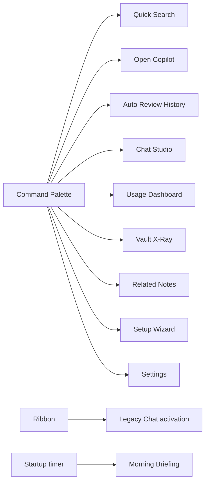
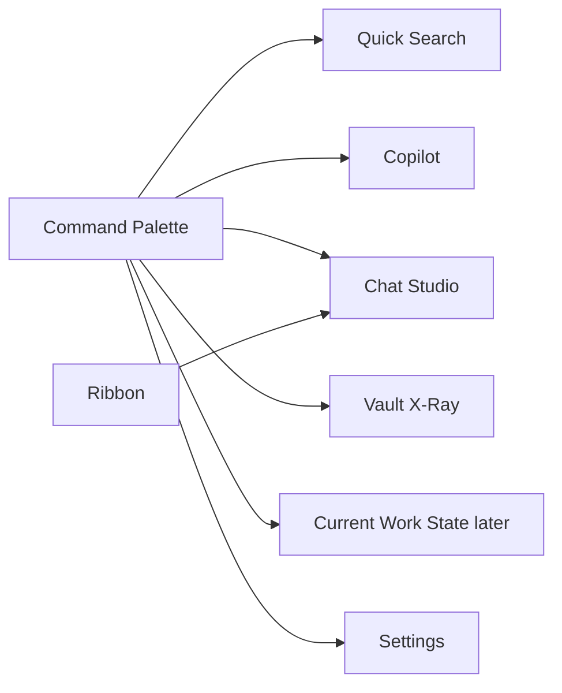

# T11R Code Distribution + Consolidation Map

> Codex owner-facing map. Purpose: show where the code actually is, what should be consolidated, what should be safely retired, what should be kept, and what needs a product decision.  
> Current caveat: working tree contains in-progress Claude changes, so numbers should be refreshed after T11Q lands.

## 先给结论

你说得对：现在不能只说“要删兼容层”。要具体到代码分布和处置。

当前读数：

- `src + styles` 约 **115k LOC**。
- 最大代码不是边界债，而是几个产品/基础设施岛。
- 真正能明显变瘦的地方：**Shared UI/CSS 组织混乱与重复 primitives、Copilot action/panel 重复实现、Quick Search V2 兼容尾巴、Morning Briefing 与 Ambient 的重复投影形态、若干 shim/dead/debug files**。**Usage Dashboard 是 owner 明确需要的产品面，不纳入退役候选；Chat 三栏 view 注册也应保护。**
- 不应该硬删的地方：**SQLite/storage、核心 search index、provider/profile 基础设施、Vault Lint 已收敛后的核心 runtime**。

推荐下一波不是继续“boundary cleanup”，而是：

**T11R Prelaunch Code Consolidation Wave：保功能，靠去重、模块化、抽象复用和兼容层退役降代码量，目标至少 -10k LOC，stretch -20k LOC。**

## 1. 代码分布总图

```mermaid
flowchart TB
  Root["Peak Assistant 115k LOC"]
  Root --> Copilot["Copilot 19.2k  合并重复 action/panel"]
  Root --> Shared["Shared UI/CSS 16.2k  收口"]
  Root --> Search["Search/Graph 14.5k  保留核心"]
  Root --> Storage["SQLite/Storage 13.2k  保留"]
  Root --> Quick["Quick Search 11.0k  清兼容尾巴"]
  Root --> Chat["Chat UI 10.2k  合并重复入口"]
  Root --> Agents["Agents/Harness 10.1k  待收口"]
  Root --> Settings["Settings/Onboarding 9.7k  瘦 fallback"]
  Root --> Usage["Usage Dashboard 8.6k  保护，只做内部瘦身"]
  Root --> Prompt["Providers/Profile/Prompt 5.8k  保留"]
  Root --> Lint["Vault Lint 2.5k  保留"]
  Root --> Ambient["Ambient/Morning 2.5k  合并投影形态"]
```



## 2. 按功能岛处置

| 区域 | LOC | 当前判断 | 怎么处理 | 原因 |
| --- | ---: | --- | --- | --- |
| Copilot | 19,208 | **重点收敛候选** | 保留功能覆盖，用 action factory + generic panels 收敛 27 个 action/panel | 27 个 action + 27 个 panel 有大量相似形态 |
| Shared UI/CSS | 16,250 | **重点收口候选** | 统一 `component` / `components` / feature component 命名；迁移到清晰 primitives/shared/feature 结构；删零引用组件 | 现在同时有 `src/ui/component`、`src/ui/components`、`settings/component`、`settings/components`，组织混乱 |
| Search Index + Graph | 14,501 | **保留核心，删边缘工具** | 保留 index/query/retriever；删未注册 inspector tool | 搜索是核心能力，不能为了 LOC 砍地基 |
| SQLite/Storage | 13,236 | **保留** | 不做大删除，只删除零引用或 owner-approved 功能退役后的 repo | 数据底座，删除风险最大 |
| Quick Search | 11,001 | **重点清兼容尾巴** | 删除 obsolete shim/no-op，保留当前 V2 与运行中 session 恢复 | 仍有 V2 命名和旧恢复逻辑 |
| Chat UI | 10,222 | **保护三栏 Obsidian 体验，内部收口** | 保留 `ChatView` / `ProjectListView` / `ConversationOutlineView` 注册；只整理 shared components、`Retained` 命名、debug layout code | 左中右三栏是 Obsidian 内必要体验，不是默认删除对象 |
| Agents/Harness | 10,071 | **待收口** | 保留 Agent SDK 主路，审计 intuition/report/harness 是否都要 | 代码多，但很多是执行能力，需产品判断 |
| Settings + Onboarding | 9,654 | **瘦身** | 大 fallback strings 移到 JSON，只留极小兜底 | TS 里字符串表过大，影响阅读 |
| Usage Dashboard | 8,635 | **保护** | 不退役 full dashboard；只允许删未用组件、重复 CSS、无入口 Curator/Optimization 子路径 | owner 明确需要 Usage Dashboard |
| Providers/Profile/Prompt | 5,837 | **保留** | 只删 legacy profile migration 和 PromptId shim | 模型/Prompt 是核心配置基础 |
| Vault Lint/XRay | 2,541 | **保留** | 不继续小修 | 已完成 foundation，代码量不大 |
| Ambient + Morning | 2,526 | **合并重复形态** | 保留 Morning capability；修路径，抽共享卡片/投影，未来并入 Current Work State | Morning 与未来 Current Work State 重叠，但不能先删功能 |

## 3. 可以直接删除或迁移后删除的技术债清单

这些不是“产品取舍”，更多是技术债。建议下一波让 Claude 全部处理。

| 文件/路径 | 当前证据 | 处置 |
| --- | --- | --- |
| `src/ui/view/quick-search/store/v2SessionTypes.ts` | 当前没有真实 import 命中，只是旧路径 shim | **删除** |
| `src/service/chat/context/profiles/AiAnalysisProfile.ts` | 静态可达性显示未引用 | **删除** |
| `src/service/chat/context/profiles/CopilotProfile.ts` | 静态可达性显示未引用 | **删除** |
| `src/service/chat/context/profiles/FollowupProfile.ts` | 静态可达性显示未引用 | **删除** |
| `src/service/chat/context/profiles/AmbientProfile.ts` | 静态可达性显示未引用 | **删除** |
| `src/service/tools/search-graph-inspector/find-structural-holes.ts` | schema 存在，但工具注册里没有对应 factory | **删除实现 + schema，或正式注册；推荐删除** |
| `src/ui/view/shared/view-utils.ts` | 静态可达性显示未引用；navigation 已转 port/adapter | **删除前再 rg 一次，若无引用就删** |
| `src/service/prompt/PromptId.ts` | 文件自称 thin re-export shim，仍有大量调用 | **迁移调用到 `src/core/prompt/PromptId.ts` 后删除** |
| `src/service/search/types.ts` | 文件自称 legacy import-path shim，仍有调用 | **迁移到 canonical search types 后删除** |
| `src/service/agents/shared-types.ts` | re-export shim，Quick Search 仍依赖 | **迁移调用后删除** |
| `src/service/chat/types.ts` | 文件自称 legacy import surface，UI/service 仍大量依赖 | **迁移到 `core/types/chat*` 后删除** |
| `src/service/ambient/types.ts` | service-level type surface，app/ui/test 仍大量依赖 | **迁移到 `core/types/ambient.ts` 后删除** |

注意：这些加起来不会立刻少 10k 行，但能让“读代码入口”干净很多。

## 4. 需要你做产品取舍的合并/保护清单

这些才是大头。你一句话决定哪些是保护面、哪些是要合并的重复实现，Claude 才能一次性大改。当前修正：**功能几乎不应该删除；Usage Dashboard 属于保护面；代码量下降主要来自重复代码、模块化抽象、复用、设计模式和兼容代码清理。**

### A. Copilot：保功能，收敛 27 个 action/panel 的重复实现

当前 evidence:

- `src/service/copilot/actions/index.ts` 定义 **27 个 built-in actions**。
- `src/ui/view/copilot/copilot-action-surfaces.tsx` 映射 **27 个 panel**。
- `src/ui/view/copilot` 约 **10.6k LOC**，整个 Copilot 岛约 **19.2k LOC**。

建议先按 launch priority 分组，但这不是删除清单：

| Action | 处置 | 理由 |
| --- | --- | --- |
| `polish` | 保留 | 核心写作动作 |
| `review` | 保留 | 核心写作动作 |
| `suggest-links` | 保留 | Obsidian-native |
| `suggest-tags` | 保留 | Obsidian-native |
| `continue-writing` | 保留 | 高频写作动作 |
| `vault-health` | 保留 | 对应 Vault Lint / XRay |

建议收敛方式：

| 重复形态 | 处置 |
| --- | --- |
| `polish` / `format-polish` / `rewrite-selection` | 保留入口，但共享一个 writing-transform action factory 和结果面板 |
| `review` / `correct-content` / `check-task-list` | 保留入口，但共享 findings/review generic panel |
| `suggest-links` / `suggest-semantic-links` / `smart-connections` / `find-related` | 保留入口，但共享 connection-list panel 和 graph/search adapter path |
| `knowledge-gaps` / `synthesize-topic` / `add-evidence` / `writing-plan` / `write-article` | 保留能力，但共享 agent-stream text/result panel |
| `extract-todos` / `find-solve-tasks` / `deduplicate-scan` / `vault-summary` | 保留能力或入口，收敛成 vault-maintenance generic result renderer |
| `prompt-audit` | 若保留，归入 internal/system group；不能为了 LOC 默认删除 |

Claude 的目标不是砍功能，而是把 27 个 bespoke panel/action body 收敛成少数 factory + generic renderer。

### B. Usage Dashboard：保留，不退役

当前 evidence:

- Usage 岛约 **8.6k LOC**。
- 有 `UsageDashboardView` command/view。
- 有 full screens: Overview / ProviderModel / OutcomeValue / BudgetAlerts / Optimization / History。
- 有 always-mounted `CuratorPushRuntime` + modal root。

建议：

| 范围 | 处置 |
| --- | --- |
| Dashboard command/view/screens | **保留** |
| UsageTracking / UsageOutcome / SQLite repos | **保留** |
| InlineReceipt / ContextRing / dashboard strings | **保留，除非有零引用证据** |
| Curator Push / Optimization | 默认保留；只有 owner 单独确认不需要时才删 |
| dashboard CSS / chart primitives | 只做去重、合并、零引用删除 |

修正后的建议：**Usage Dashboard removal 不是合法 LOC reduction strategy**。下一波 LOC reduction 应该从 Shared UI/CSS、Copilot、Morning Briefing implementation、Quick Search compat、shims/debug 来。

### C. Chat：保护 Obsidian 三栏体验，内部收口

当前 evidence:

- `ChatStudioView` 已经是三栏一体。
- 代码仍注册 `ChatView`、`ProjectListView`、`ConversationOutlineView`。
- 这不是纯历史遗留：在 Obsidian 里左/中/右三栏 leaf 是必要交互形态。
- `ViewSwitchConsistentHandler` 还在维护旧 layout 恢复逻辑。
- 组件名还有 `Retained`：`ComposerRetained` / `HeaderRetained` / `MessageListRendererRetained` / `MessageViewItemRetained`。

建议：

- **不要做 Chat Studio-only。**
- 保护三栏 view registration：
  - `src/app/view/ChatView.ts`
  - `src/app/view/ProjectListView.ts`
  - `src/app/view/ConversationOutlineView.ts`
- 允许整理 `ViewSwitchConsistentHandler` 的 debug logs 和重复分支，但不能破坏 ribbon 打开三栏布局。
- React 内容组件保留，并把 Studio 和三栏 leaf 共享同一套内容组件。
- 把 `Retained` 组件重命名成正式组件。

这条不应该作为大 LOC 删除来源；它的目标是降低阅读噪音和命名债。

### C2. Shared UI/CSS：统一 `component` / `components` 组织

当前 evidence:

- `src/ui/component/**` 和 `src/ui/components/primitives/**` 同时存在。
- `src/ui/view/settings/component/**` 和 `src/ui/view/settings/components/**` 同时存在。
- 仅这几组目录约 **104 个 TS/TSX 文件 / 11k LOC**。
- `component/shared-ui` 与 `components/primitives` 都在提供 Button / IconButton / Pill / Modal / Row 一类基础 UI，心智负担很高。

建议目标：

```text
src/ui/components/primitives/      # 真正跨产品 primitive
src/ui/components/shared/          # 通用复合组件，例如 prompt-input、diff、streamdown
src/ui/components/domain/          # 可选：chat/search/copilot 共享但不属于 primitive 的组件
src/ui/view/<feature>/components/  # 只服务单一 feature 的组件
```

Claude 需要先做引用矩阵，不能靠文件名猜未使用。可删对象只包括：

- `.DS_Store`；
- 零引用组件；
- 被新 canonical path 完全替代的旧 barrel/shim；
- 两套 Button/IconButton/Pill/Modal 等重复 primitive 中确认可统一的一套。

这条应该成为 T11R 的第一优先级之一，因为它同时解决代码量、阅读路径和 UI 一致性。

### D. Morning Briefing：保留能力，合并 standalone 实现

当前 evidence:

- `AmbientPushRuntime.tryShowMorningBriefing()` 仍存在。
- `src/app/modals/MorningBriefingModal.ts` 存在。
- `src/ui/view/morning-briefing/*` 存在。
- `main.ts` 当前动态 import 指向 `@/ui/view/morning-briefing/MorningBriefingModal`，但实际 modal 在 `src/app/modals/MorningBriefingModal.ts`。Build 通过，但这是可疑 runtime path。

建议：

- 先修正 `main.ts` 的动态 import 路径。
- 保留 Morning Briefing 能力，不直接删除 modal/panel/store。
- 把 `BriefingCard` / `MorningBriefingPanel` 和 Ambient Push/Current Work State 未来形态共享 card/list/projection primitives。
- 只有当等价的 Current Work State/Ambient projection 已经落地后，才删除 standalone shell。

## 5. 不建议删除的清单

这些是地基，删了会让项目变脆，而不是变优雅。

| 区域 | 为什么不删 |
| --- | --- |
| `src/core/storage/sqlite/**` | 搜索、usage、chat、lint、ambient 都依赖；只能跟随功能退役删 repo |
| `src/service/search/index/**` | Knowledge Index 核心；可以拆小，但不应该硬删 |
| `src/core/providers/**` | 模型/provider/profile 基础设施 |
| `src/core/template/**` + `templates/config/**` | 配置/文案外置的基础 |
| `src/service/lint/**` + `src/ui/view/vault-lint/**` | 体量小，且是已完成的架构试点 |
| `src/app/runtime/AppRuntimeRegistry.ts` | 现在是 runtime owner 汇聚点，符合之前规则 |
| `src/app/context/AppContext.ts` | 仍是 app shell composition root，不能用“讨厌 singleton”理由删除 |

## 6. 入口地图

当前用户能直接进入的主要入口：



建议合并后的目标：



也就是说：少入口，少重复心智。

## 7. 下一波我建议怎么让 Claude 做

不要让 Claude 自由发挥，也不要只发“删一点”。发一个大波次，但带明确的保功能、降重复、清兼容目标：

```text
T11R Prelaunch Code Consolidation Wave

Goal:
Reduce actual source size and owner reading complexity while preserving user-facing functionality. This is not a boundary wave and not a feature deletion wave.

Read:
- docs/superpowers/refactor-ops/t11r-code-distribution-deletion-map.md
- docs/progress.md
- AGENTS.md

First refresh metrics:
- cloc src styles.css --quiet --timeout 120
- npm run audit:boundary -- --out /tmp/t11r-before-boundary.md

Impact Contract:
- Hard: at least -10,000 LOC from src + source CSS.
- Stretch: -20,000 LOC.
- Must preserve current user-facing capabilities unless owner explicitly approves a product deletion.
- Must consolidate at least one duplicate implementation family and one old duplicate entry model.
- Must not regress:
  service -> app = 0
  service -> ui = 0
  ui -> app = 0
  core -> upstream = 0

Execution tracks:
1. Delete safe shims/dead files:
   - src/ui/view/quick-search/store/v2SessionTypes.ts
   - src/service/chat/context/profiles/*.ts
   - src/service/tools/search-graph-inspector/find-structural-holes.ts if still unregistered
   - src/ui/view/shared/view-utils.ts if still unreferenced
2. Migrate old import surfaces and delete shims:
   - src/service/prompt/PromptId.ts
   - src/service/search/types.ts
   - src/service/agents/shared-types.ts
   - src/service/chat/types.ts
   - src/service/ambient/types.ts
3. Shared UI/CSS organization consolidation:
   - Build an import matrix for src/ui/component, src/ui/components, settings/component, settings/components.
   - Pick one canonical structure and migrate callers.
   - Remove only zero-reference files or replaced compatibility barrels.
   - Consolidate duplicate primitives such as Button/IconButton/Pill/Modal where behavior matches.
4. Chat three-pane protection + internal cleanup:
   - Keep ChatView / ProjectListView / ConversationOutlineView registered.
   - Do not make Chat Studio-only.
   - Remove layout diagnostics and rename Retained components only if tests/build stay green.
5. Functionality-preserving consolidation track:
   Execute all safe consolidation tracks:
   A. Copilot action/panel matrix: preserve action coverage, but consolidate repeated action factories and result panels.
   B. Usage Dashboard protected cleanup: keep dashboard view/command/screens/tracking; only remove zero-reference dashboard internals or duplicated CSS with proof.
   C. Morning Briefing implementation consolidation: preserve briefing capability, fix stale import path, merge duplicate UI/state only after equivalent projection exists.

Stop rule:
If you cannot reach -10k LOC without deleting user-facing functionality, stop and report the exact duplicate families that remain. Do not delete features just to hit the number. Do not commit a small cleanup as T11R.

Verification:
- npm run build
- npm run audit:boundary
- affected tests
- cloc before/after
- rg deleted legacy paths

Implementation note:
- Before/after LOC by island.
- Deleted/consolidated files grouped by track and reason.
- Kept files and reason.
- Feature coverage preserved / product decisions assumed.
- Chinese code reading guide.
- Mermaid diagrams for old/new entry topology.
```

## 8. Codex 的建议决策

如果你问“我会怎么砍”，我的建议是：

1. **Usage Dashboard 保护**。这是 owner 需要的产品面，不砍 full view；只做内部去重和零引用删除。
2. **Copilot 27 actions 不砍功能，砍重复实现**。用少数 action factories + generic panels 承载现有能力。
3. **Chat 三栏 view 注册保护**。不要做 Chat Studio-only；只清理 debug、命名债和共享组件重复。
4. **Shared UI/CSS 是重点**。统一 `component/components` 结构，抽 primitives/shared/domain，删零引用和替代后的旧路径。
5. **Morning Briefing 保留能力，收敛 standalone 实现**。未来并入 Current Work State 时再删除旧 shell。
6. **所有 legacy shim 迁移后删除**。这不是最大 LOC，但会让阅读路径干净。

这才是“预上线项目”的正确姿势：**功能基本保留，同功能更少实现，少重复入口，少兼容代码，更多共享抽象。**
