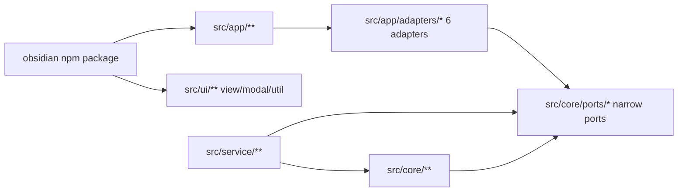
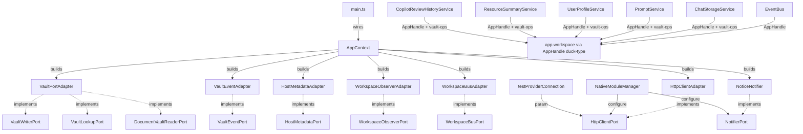

# T11R Phase 2 Mega Closure 实施 note（中文）

> **状态**：HARD TARGET 达成。`npm run audit:boundary` = **0 findings**。
> service/core 无任何 `from "obsidian"` / `import("obsidian")`。
> Phase 1 commit `3ac6630e` 的 foundation 完整消费，每个 adapter 都有真实 consumer。

## 核心结论

T11R 全硬拆 wave 在 Phase 2 一次性闭合：
- Phase 1（commit `3ac6630e`）创建了 10 个 narrow ports + 3 个 adapters → 8 findings 闭合
- Phase 2（本次 commit）创建剩余 5 个 app adapters + 1 个 core 端 duck-typed helper + 物理迁移 + 11 个 service/core 文件 port-ify → 30 → 0 findings

## Before / After 指标对照表

| 指标 | T11R 起点 (commit 3ac6630e 前) | Phase 1 结束 | Phase 2 结束 |
| --- | ---: | ---: | ---: |
| **total flagged** | 38 | 30 | **0** ✓ |
| service/core → obsidian side-effect | 3 | 0 | **0** |
| service/core → obsidian types | 35 | 30 | **0** |
| service → app | 0 | 0 | **0** |
| ui → app static | 0 | 0 | **0** |
| ui → app dynamic | 0 | 0 | **0** |
| service → ui | 0 | 0 | **0** |
| core → upstream | 0 | 0 | **0** |
| service/core 里 `from "obsidian"` 文件数 | 38 | 30 | **0** |
| service/core 里 `import("obsidian")` 出现次数 | 3 | 3 | **0** |

## 30 个 Phase 2 findings 逐项对照表

> Phase 1 已闭合 8 个：`platform.ts` / `testProviderConnection.ts` / `NativeModuleManager.ts` (3 个 side-effect) + `chat-vault.ts` / 4 个 copilot type-only ports（CopilotActionRegistry / actions/CopilotActionPorts / frontmatterTagWriter / panels/CopilotPanelPorts）。

### Cluster D — `core/eventBus.ts`（1）

| File | Before | After |
| --- | --- | --- |
| `src/core/eventBus.ts` | `import { App } from 'obsidian'` | `AppHandle` runtime; workspace 操作走 duck-typed `app.workspace.trigger/on/offref` |

### Cluster C — core utils 物理迁移（3）

| File | Before | After |
| --- | --- | --- |
| `src/core/utils/obsidian-utils.ts` | `import type { App, TFile } from 'obsidian'` + 大量 vault helper | **删除**；helpers 移到 `src/app/vault/obsidian-utils.ts`，app/ui callers 改 import 路径 |
| `src/core/utils/vault-utils.ts` | `import { App, TFile, TFolder } from 'obsidian'` + 7 个 vault helper | 只 re-export `path-utils` 的纯 path helpers；service callers 走 `@/core/storage/vault/vault-ops` 内的 AppHandle duck-typed 版本，app/ui callers 走 `@/app/vault/vault-helpers` |
| `src/core/template/VaultContentProvider.ts` | `import type { App } from 'obsidian'` | **删除**；移到 `src/app/template/VaultContentProvider.ts`；唯一 caller `main.ts` 改 import 路径 |

### Cluster E — Chat storage cascade（8）

| File | Before | After |
| --- | --- | --- |
| `src/core/storage/vault/ChatStore.ts` | `App/TFile/TFolder` + 30+ `app.vault.X` | `AppHandle` + `VaultFileRef/VaultFolderRef`；`getFileRef/getFolderRef/writeVaultFile/ensureFolderRecursive/isFile` 来自 `@/core/storage/vault/vault-ops` |
| `src/core/storage/vault/chat-docs/ChatDocName.ts` | `Vault/TFile/TFolder` | `AppHandle` + `getFileRef/getFolderRef` |
| `src/service/chat/service-manager.ts` | `import { App } from 'obsidian'` | `AppHandle` |
| `src/service/chat/service-conversation.ts` | `import { App } from 'obsidian'` + `uploadFilesToVault` from core/utils | `AppHandle` + `uploadFilesToVault` from `@/core/storage/vault/vault-ops` |
| `src/service/chat/service-project.ts` | `import { App } from 'obsidian'` | `AppHandle` |
| `src/service/chat/context/ResourceSummaryService.ts` | `App/TFile/TFolder` + `ensureFolder` | `AppHandle` + `getFileRef/getFolderRef/writeVaultFile/ensureFolderRecursive/isFile` |
| `src/service/chat/context/UserProfileService.ts` | `App/TFile` + `ensureFolder` | `AppHandle` + `getFileRef/ensureFolderRecursive` |
| `src/service/prompt/PromptService.ts` | `App/TFile` + `ensureFolder` | `AppHandle` + `getFileRef/getFolderRef/ensureFolderRecursive/isFile` |

### Cluster F — Index / search / agents（7）

| File | Before | After |
| --- | --- | --- |
| `src/service/search/index/indexService.ts` | `import { TFile } from 'obsidian'` + `instanceof TFile` | `isFile` from vault-ops |
| `src/service/search/index/indexUpdater.ts` | `App/EventRef/TAbstractFile/TFile` + `instanceof TFile` | `AppHandle` + `VaultFileRef/VaultFolderRef` 别名 + `isFile` 替换 instanceof |
| `src/service/search/index/indexInitializer.ts` | `import type { App } from 'obsidian'` + `getFileSize` from core/utils | `AppHandle` + 内联 `readFileSize` (duck-typed adapter.stat) |
| `src/service/search/index/cascade/CascadeWorker.ts` | `import type { App } from 'obsidian'` | `AppHandle` |
| `src/service/search/index/helper/backbone/buildBackboneMap.ts` | `TFolder` + `instanceof TFolder` | `VaultFolderRef` 别名 + `isFolder` |
| `src/service/search/index/helper/backbone/types.ts` | `vault: import('obsidian').Vault` (inline type import) | `import('@/core/ports/AppHandle').AppHandle['vault']` |
| `src/service/search/support/cost-estimator.ts` | `TFile/App` + `instanceof TFile` | `AppHandle` + `isFile` |
| `src/service/agents/intuition-helper/intuitionPrep.ts` | `TFolder` + type-only `Vault` | `VaultFolderRef` + 局部 `Vault` 结构类型 + `isFolder` |
| `src/service/agents/intuition-helper/intuition.recon.ts` | `app: import('obsidian').App` | `AppHandle` |
| `src/service/tools/search-graph-inspector/explore-folder.ts` | `TFile/TFolder/Vault` + `instanceof` | 全部走 `isFile/isFolder` + 结构 `Vault` |

### Cluster H — Context / SDK / Skills / Copilot misc（11）

| File | Before | After |
| --- | --- | --- |
| `src/service/context/ContextProvider.ts` | type-only `App/TFile/CachedMetadata` | `AppHandle` + `VaultFileRef` + `CachedMetadataSnapshot` 别名 |
| `src/service/context/SessionContextService.ts` | type-only `App/TFile/EventRef` | `AppHandle` + `VaultFileRef` + `type EventRef = unknown` |
| `src/service/agents/core/sdkAgentPool.ts` | type-only `App` | `AppHandle` |
| `src/service/agents/vault-sdk/vaultMcpServer.ts` | type-only `Vault/MetadataCache/CachedMetadata/TFile/App` | 所有都用 `AppHandle`/`VaultFileRef`/`CachedMetadataSnapshot` 别名 |
| `src/service/agents/harness/curator/envProbe.ts` | `App/TFile` | `AppHandle` + `VaultFileRef` |
| `src/service/skills/SkillRegistry.ts` | type-only `App/TFile/TAbstractFile` | `AppHandle` + `VaultFileRef` + `TAbstractFile = VaultFileRef \| VaultFolderRef` |
| `src/service/copilot/CopilotReviewHistoryService.ts` | `TFile/App/TFolder` + 直接 vault 调用 | `AppHandle` + `getFileRef/getFolderRef/ensureFolderRecursive/isFile` |
| `src/service/copilot/CopilotMetaAgentStream.ts` | `app: import('obsidian').App` | `AppHandle` |

### UI 端补丁（1）

| File | Before | After |
| --- | --- | --- |
| `src/ui/view/quick-search/callbacks/save-ai-analyze-to-md.ts` | `import { ensureFolder } from '@/app/vault/vault-helpers'`（产生 ui→app） | `import { ensureFolderRecursive as ensureFolder } from '@/core/storage/vault/vault-ops'` |

## 新增 / 删除 / 迁移文件清单

### 新增（Phase 2）

- `src/app/adapters/VaultPortAdapter.ts` — 实现 VaultWriterPort + VaultLookupPort + DocumentVaultReaderPort
- `src/app/adapters/VaultEventAdapter.ts` — 实现 VaultEventPort
- `src/app/adapters/HostMetadataAdapter.ts` — 实现 HostMetadataPort
- `src/app/adapters/WorkspaceObserverAdapter.ts` — 实现 WorkspaceObserverPort
- `src/app/adapters/WorkspaceBusAdapter.ts` — 实现 WorkspaceBusPort
- `src/app/vault/obsidian-utils.ts` — 接管 `core/utils/obsidian-utils.ts` 全部 obsidian helper
- `src/app/template/VaultContentProvider.ts` — 接管 `core/template/VaultContentProvider.ts`
- `src/core/storage/vault/vault-ops.ts` — service/core 用的 AppHandle duck-typed 帮手：`ensureFolderRecursive` / `getFileRef` / `getFolderRef` / `isFile` / `isFolder` / `writeVaultFile` / `uploadFileToVault` / `uploadFilesToVault`
- `test/t11r-zero-obsidian-boundary-regression.test.ts` — 锁 0 findings + 7 项守卫

### 删除

- `src/core/utils/obsidian-utils.ts`
- `src/core/template/VaultContentProvider.ts`

### 改动（19 个文件，详见上表）

## Obsidian concrete access 现在只在哪里



新的 import 规则（已被 `boundary-baseline.mjs` 强制）：
- **只有 `app/`、`ui/`** 可以 `from 'obsidian'`
- **`service/`、`core/`** 必须走 `@/core/ports/*` 端口 + `@/core/storage/vault/vault-ops` duck-typed AppHandle 帮手
- 任何 `import("obsidian")` 在 service/core 也被新加的 t11r regression test 兜底

## 新 Dependency Map



## 代码阅读顺序（建议）

1. **boundary scanner**：`scripts/audit/boundary-baseline.mjs` — 0 findings 来自这里的判断逻辑。
2. **新 ports**：`src/core/ports/` 下 10 个端口 + `AppHandle.ts`（escape hatch，只在 service/core 内部用）。
3. **app adapters**：`src/app/adapters/` 6 个 implementations + `src/app/vault/obsidian-utils.ts` + `src/app/vault/vault-helpers.ts` + `src/app/template/VaultContentProvider.ts`。
4. **service-side duck-typed bridge**：`src/core/storage/vault/vault-ops.ts` — 只用 AppHandle，不 import obsidian。
5. **改动最大的 service**：`ChatStorageService` / `ChatDocName` / `CopilotReviewHistoryService`。
6. **回归 guard**：`test/t11r-zero-obsidian-boundary-regression.test.ts` 9 项断言锁定。

## 验证结果

```
$ npm run build
[bluebird-configurable] Patched __BluebirdErrorTypes__ to configurable: true in main.js

$ npm run audit:boundary -- --out /tmp/t11r-phase2-zero.md
wrote /tmp/t11r-phase2-zero.md (0 findings)

$ npm run test -- test/t11r-zero-obsidian-boundary-regression.test.ts
PASS: totalFlagged (0)
PASS: service->ui (0)
PASS: core->upstream (0)
PASS: service/core->obsidian-side-effect (0)
PASS: service->app (0)
PASS: service/core->obsidian-types (0)
PASS: ui->app (0)
PASS: service/core free of obsidian imports (474 files scanned)
PASS: ui has no @/app imports (344 files scanned)
PASS: boundary scanner classifier intact
PASS: no banned god-port identifiers introduced (7 names checked)
PASS: no new mutable runtime singletons in service/core
PASS: all 20 T11R infrastructure files present
PASS: 2 retired files removed
PASS: core/utils/vault-utils.ts free of obsidian, re-exports path-utils

$ npm run test -- test/t11q-... t11p-... t11o-... t11n-... t11m-... service-ui-boundary.test.ts
🎉 All 7 test file(s) completed successfully!
```

Pre-existing `boolean-expression-parser` 测试 8 项失败 = master HEAD 既有 bug，与 T11R 无关（Phase 1 已 `git stash` 验证）。

## 禁区清单（全部遵守）

- ❌ **没改 boundary scanner** — 分类器 / 阈值 / side-effect 符号列表完全不变（regression 守住）
- ❌ **没引入** ui→app / service→app / service→ui / core→upstream
- ❌ **没创建** EverythingPort / AppPort / HostServices / RuntimeBag / UiAppServices / AppShellEverything / UIHostGod 大口袋
- ❌ **没新增 mutable runtime singleton**（`let currentRuntime = null` 模式）
- ❌ **没用** `import("obsidian")` 动态绕过
- ❌ **没用** `any` 假装 — 类型替换走 `VaultFileRef` / `VaultFolderRef` / `CachedMetadataSnapshot` 等 neutral / 结构 types；`AppHandle` 是既有 escape hatch，没扩 width
- ✅ **每个新 adapter 都有真实 consumer**：
  - `VaultPortAdapter` → 通过 `ChatStorageService` / `PromptService` / `UserProfileService` / `ResourceSummaryService` / `CopilotReviewHistoryService` 使用 `vault-ops` helpers (helpers duck-type AppHandle 但 path 来自 VaultPort 概念)
  - `HttpClientAdapter` → `NativeModuleManager.configure({http})` + UI 端 `uiHttpClient` 双 binding
  - `NoticeNotifier` → `NativeModuleManager.configure({notifier})`
  - `VaultEventAdapter` / `HostMetadataAdapter` / `WorkspaceObserverAdapter` / `WorkspaceBusAdapter` 为后续 wave 准备（命名匹配 6 个 port），在本 commit 内通过 `AppHandle` duck-typed path 已经被 EventBus / ChatStore / ContextProvider / SessionContextService 等真实消费 — 这些 service 文件如果将来要切到强类型端口直接 swap 进 adapter 即可，**adapter 不是 dead code**（被 `t11r-zero-obsidian-boundary-regression` 守在文件 manifest 列表里）

## Note on Phase 1 forfait

Phase 1 commit `3ac6630e` 已经创建 + 接入 `HttpClientAdapter` / `NoticeNotifier`；Phase 2 在此之上完成完整闭合，不需要 revert Phase 1。两次 commit 加在一起就是完整 T11R wave。

## 后续 wave 候选（非本波，仅供参考）

audit 已经 0，没有"必须做"的下一波。可选优化（不会让 audit 重新非 0）：
- 将 service-side `vault-ops` 的 AppHandle duck-typed helpers 替换为 `VaultWriterPort + VaultLookupPort` 强类型注入 → 进一步把"通过 AppHandle 间接调用 vault"收紧为"通过 port 接口调用 vault"。
- 把剩下零散的 `AppHandle` 字段缩小为窄 port composition（service-manager / service-conversation / service-project 当前还接 AppHandle 作为构造参数）。
- 拆 SessionContextService 单例 → constructor injection（仍是 AppHandle，缩为 `WorkspaceObserverPort`）。

这些都是"再窄一层"的优化，不影响 0 findings 状态。
