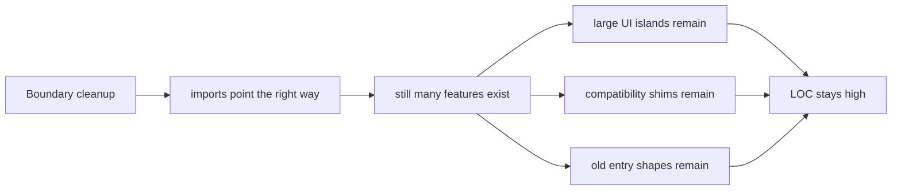
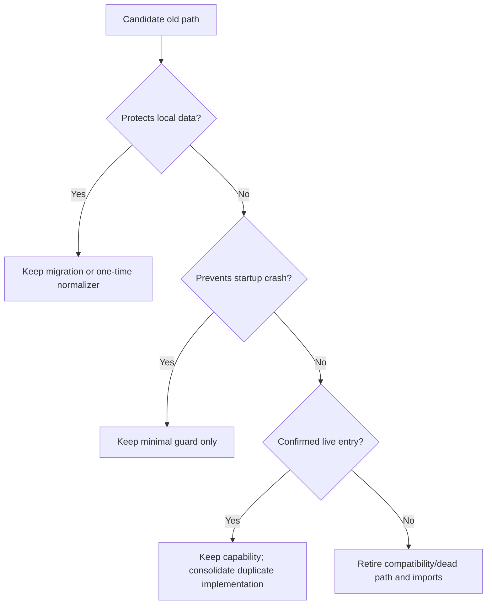
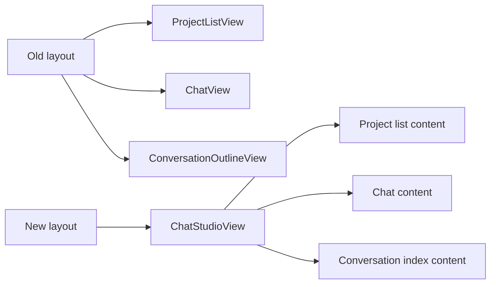

# T11R Prelaunch Code Consolidation Investigation

> Codex read-only investigation. Current working tree includes in-progress Claude changes, so all metrics below should be refreshed after T11Q is committed.

## Executive Summary

当前项目已经不是“层级边界很脏”的状态了。边界审计在当前工作树里是 **41 findings**，其中 `service -> app`、`service -> ui`、`ui -> app`、`core -> upstream` 都已经是 0。

真正的问题变成了：**预上线项目里还保留了太多兼容层、旧入口、重复实现形态、重复 surface 和历史命名债**。这些不会在 boundary audit 里显得很糟，但会让你读代码时感觉“怎么还是 11 万行”。

结论：

- 只删 re-export shim 不能解决体感问题。当前纯 shim 约 **27 个 / 235 行**，删了舒服但不瘦身。
- 要明显降代码量，必须**保功能、合并实现**：Shared UI/CSS 统一 `component` / `components` 组织，Copilot 多面板矩阵收敛成 action factories + generic panels，Quick Search V2 兼容尾巴退役，Morning Briefing 独立实现与 Ambient / Current Work State 投影复用。**Usage Dashboard 是 owner 明确需要的产品面，不纳入退役候选；Chat 三栏 Obsidian view 注册也应保护。**
- 因为产品没有上线，默认策略应该从“保护所有兼容代码”改成“保护可恢复数据和当前功能；旧兼容路径、重复入口、重复实现默认收敛”。
- 下一波不应再叫 boundary wave，而应叫 **Prelaunch Code Consolidation Wave**，硬目标应该是 `-10k LOC` 起步，stretch `-20k LOC`。

## Current Baseline

Commands run:

```bash
npm run audit:boundary -- --out /tmp/t11r-current-boundary.md
cloc src styles.css --quiet --timeout 120
npm run build
```

Results:

| Metric | Current |
| --- | ---: |
| Boundary findings | 41 |
| `service -> app` | 0 |
| `service -> ui` | 0 |
| `ui -> app` | 0 |
| `core -> upstream` | 0 |
| service/core Obsidian side-effect | 3 |
| service/core Obsidian types | 38 |
| Source + CSS LOC | 115,307 |
| TypeScript LOC | 109,281 |
| CSS LOC | 6,026 |
| Build | PASS |

Layer LOC:

| Layer | Files | LOC |
| --- | ---: | ---: |
| `src/ui` | 344 | 49,396 |
| `src/service` | 298 | 32,792 |
| `src/core` | 168 | 21,552 |
| `src/app` | 96 | 6,678 |

Big islands:

| Island | LOC | Read |
| --- | ---: | --- |
| `src/service/search` | 11,189 | Index/search is the largest service island. |
| `src/ui/view/copilot` | 10,609 | Many action panels and result surfaces. |
| `src/core/storage/sqlite` | 10,083 | Real infrastructure; more split/refactor than pure deletion. |
| `src/ui/view/quick-search` | 9,405 | V2 naming, snapshot bridge, replay/history compatibility. |
| `src/service/agents` | 8,985 | SDK, harness, intuition, report agents coexist. |
| `src/ui/view/chat-view` | 8,050 | Legacy layout + retained components still visible. |
| `src/ui/view/usage-dashboard` | 6,837 | Protected product surface; slim internals only. |
| `src/ui/view/settings` | 5,775 | Large settings screens and fallback string table. |
| `src/service/tools/search-graph-inspector` | 4,337 | Large tool family; one tool appears schema-only / unregistered. |

## Why 115k LOC Still Exists

The architecture work moved ownership boundaries. It did not yet decide product scope.



This means the next wave must measure different things:

- consolidated / deleted duplicate source LOC,
- retired duplicate commands/views/modals after equivalent current entry exists,
- removed compatibility branches,
- removed old import surfaces,
- removed duplicate UI routes.

Boundary count alone is now the wrong success metric.

## Prelaunch Functionality Preservation Policy

Because the product is not launched, compatibility should be treated as debt unless it protects one of three things:

1. **Owner local data**: existing notes, sqlite DB, saved settings, analysis docs.
2. **Startup safety**: plugin should not crash if an old settings file exists.
3. **Confirmed live entry**: command/view/modal is still intentionally used.

User-facing functionality is protected by default. Code-volume reduction must come from duplicate-code removal, modularity, reusable abstractions, design-pattern consolidation, compatibility-path retirement, debug-code extraction, and duplicate entry/surface consolidation. Feature deletion requires explicit owner approval and must be called out as a product decision, not a refactor.



## High-Confidence Cleanup Candidates

These are safe-ish because they are either pure shims, no-op compatibility, or likely unregistered.

### 1. Re-export import surfaces

Evidence:

- `src/service/prompt/PromptId.ts` says it is a thin re-export shim.
- `src/service/search/types.ts` says it is a legacy import-path shim.
- `src/service/chat/types.ts` says it remains the legacy import surface.
- `src/ui/view/quick-search/store/v2SessionTypes.ts` says it is a thin re-export shim.
- `src/ui/view/quick-search/types/search-steps.ts` re-exports V2 tool display/types for existing callers.
- Many callers still import through these old paths.

Deletion strategy:

- Migrate all callers to canonical paths first.
- Delete shim files in the same commit.
- Add a guard that bans the old import paths.

Expected LOC reduction is small, but readability gain is real.

### 2. Quick Search legacy snapshot bridge

Evidence:

- `src/ui/view/quick-search/store/aiAnalysisStore.ts` contains `resetAIAnalysisAll()` as a no-op because V1 topic/interaction stores were retired.
- Same file still reconstructs V2 timeline from old saved process logs.
- `searchSessionStore.ts` says it re-exports V2 types for backward compatibility.

Decision:

- If you accept that prelaunch AI analysis history can be regenerated or only minimally displayed, this can shrink.
- If preserving old saved AI analysis markdown replay matters, keep only the loader needed for current docs.

### 3. Unused context profile files

Static reachability found these as unreachable:

- `src/service/chat/context/profiles/AiAnalysisProfile.ts`
- `src/service/chat/context/profiles/CopilotProfile.ts`
- `src/service/chat/context/profiles/FollowupProfile.ts`
- `src/service/chat/context/profiles/AmbientProfile.ts`

Deletion strategy:

- Confirm no dynamic imports.
- Delete files and any stale registry references.

### 4. `find-structural-holes.ts`

Evidence:

- `src/service/tools/search-graph-inspector/find-structural-holes.ts` exists.
- The schema exists in `src/core/schemas/tools/searchGraphInspector.ts`.
- Tool factory registration did not show a matching exported tool.

Deletion strategy:

- Either register it intentionally, or delete both tool implementation and schema.
- Given product is prelaunch, delete unless this is part of the explicit launch surface.

### 5. Debug logs in chat layout handler

Evidence:

- `src/app/view/ViewSwitchConsistentHandler.ts` contains many `console.log('[layout-diag] ...')` and `console.trace('[layout-diag] trace')`.

Deletion strategy:

- Remove diagnostics or gate them behind a debug flag.
- This is not huge LOC, but it cleans the owner reading experience.

## Functionality-Preserving Consolidation Candidates

These are where real LOC reduction lives. They should preserve user-facing capability unless the owner explicitly approves a product deletion.

### A. Chat Three-Pane Layout vs Chat Studio

Evidence:

- `ChatStudioView` is now an all-in-one three-column chat workspace.
- `ViewManager.openChatStudio()` promotes an existing `ChatView` leaf and detaches `ProjectListView` / `ConversationOutlineView` / old `ChatView` leaves.
- `ViewSwitchConsistentHandler` still maintains legacy chat layout behavior.
- `ChatView`, `ProjectListView`, and `ConversationOutlineView` are still registered as independent ItemViews.
- Chat components still use `Retained` names: `ComposerRetained`, `HeaderRetained`, `MessageListRendererRetained`, `MessageViewItemRetained`.

Interpretation:

Correction after owner review:

The three-pane Obsidian layout is not disposable legacy. `ProjectListView`, `ChatView`, and `ConversationOutlineView` are part of the intended Obsidian-native chat experience. T11R must not make Chat Studio-only by default.

The codebase supports two chat surfaces:



Prelaunch recommendation:

- Keep the three-pane view registrations.
- Keep Chat Studio unless owner separately retires it.
- Clean `ViewSwitchConsistentHandler` debug logs / repeated branches only if the ribbon still opens the three-pane layout correctly.
- Rename `Retained` components to current names once old names are gone.

This is no longer a primary LOC-reduction track. Treat Chat as protected product structure with internal cleanup only.

### B. Usage Dashboard protected surface

Evidence:

- `src/ui/view/usage-dashboard` is 6,837 LOC.
- It includes full dashboard screens: Overview, Provider/Model, Outcome Value, Budget Alerts, Optimization, History.
- There is also always-mounted curator push runtime/modal and usage tracking services.

Interpretation:

Usage Dashboard is a needed product surface. It should not be retired for T11R.

Allowed work:

1. Keep `UsageDashboardView`, command, screens, dashboard config, tracking, outcome service, and repos.
2. Remove only zero-reference dashboard internals with proof.
3. Deduplicate dashboard CSS/chart primitives only if the dashboard still renders correctly.
4. Do not delete Curator Push or Optimization unless owner separately says those subfeatures are not needed.

Revised T11R implication:

- Usage Dashboard removal is not a valid LOC reduction strategy.
- LOC reduction must come from Copilot, Chat legacy, Morning Briefing, Quick Search compat, shims, and debug cleanup.

### C. Copilot action panel matrix

Evidence:

- `src/ui/view/copilot` is 10,609 LOC.
- `copilot-action-surfaces.tsx` imports 27 panel components.
- `createBuiltInCopilotActions()` defines 27 built-in actions.

Interpretation:

This is not a boundary issue. It is duplicate implementation shape: many actions and panels repeat similar request/result/review patterns.

Prelaunch recommendation:

- Define Copilot action groups, for example:
  - Polish
  - Review
  - Suggest links
  - Suggest tags
  - Continue writing
  - Vault health
- Preserve action coverage by moving repeated request/result/review wiring into factories and generic panels.
- Do not delete a user-facing action merely to hit LOC. If an action is truly not desired, that is an owner product decision.
- Prefer one generic result renderer for many actions instead of one bespoke panel per action.

Potential reduction is large if whole repeated panel/action bodies are consolidated.

### D. Morning Briefing standalone entry

Evidence:

- `AmbientPushRuntime.tryShowMorningBriefing()` exists.
- `src/app/modals/MorningBriefingModal.ts` exists.
- `src/ui/view/morning-briefing/MorningBriefingPanel.tsx` and `BriefingCard.tsx` exist.
- The product docs already say Ambient Push should become Current Work State / Session Thought Trace later.

Prelaunch recommendation:

- Preserve Morning Briefing capability unless the owner explicitly retires it.
- Fix stale imports and make the current entry stable.
- Consolidate duplicated standalone modal/panel/store implementation only after an equivalent Ambient / Current Work State projection exists.

### E. Settings/onboarding fallback string tables

Evidence:

- `src/ui/view/settings/settingsStrings.ts` is 692 lines.
- `src/ui/view/onboarding/onboardingStrings.ts` is 669 lines.
- Templates already exist in `templates/config/settings.json` and `templates/config/onboarding.json`.

Interpretation:

These fallback tables are reliability-friendly but inflate TS source and reading surface.

Prelaunch recommendation:

- Keep one tiny fallback object for startup safety.
- Move full strings to JSON templates only.
- Add tests that template load failure still shows a minimal safe UI.

## What Not To Do

Do not spend the next wave only on the remaining 41 boundary findings.

Remaining findings are mostly Obsidian type coupling. They matter, but they will not explain 115k LOC.

Do not accept a wave that only deletes shims.

Shims are annoying but too small. A “large” wave must consolidate at least one duplicate implementation family or old entry model.

Do not keep compatibility because “maybe users have old data” without identifying the exact data.

For this prelaunch project, the compatibility burden should be explicit and minimal.

## Recommended T11R Impact Contract

Wait until Claude finishes and commits T11Q, then run T11R.

Hard targets:

- Net source reduction: **at least -10,000 LOC** across `src/` and source CSS.
- Retire at least **one whole duplicate entry/import model** after equivalent current entry is in place.
- Consolidate at least **one major duplicate implementation family** while preserving user-facing capability.
- Add import/source guards for deleted legacy paths.
- Boundary metrics must not regress:
  - `service -> app = 0`
  - `service -> ui = 0`
  - `ui -> app = 0`
  - `core -> upstream = 0`

Stretch targets:

- Net source reduction: **-20,000 LOC**.
- Consolidate Shared UI/CSS organization and Morning Briefing standalone, or reduce Copilot panel matrix into shared action factories / generic renderers. Usage Dashboard and Chat three-pane views are protected.

Required tracks:

| Track | Target | Expected effect |
| --- | --- | --- |
| Track 1 | Shared UI/CSS organization consolidation | Unifies `component` / `components` / settings component folders and removes only zero-reference or replaced paths. |
| Track 2 | Compatibility shim purge | Removes old import surfaces and locks canonical imports. |
| Track 3 | Quick Search V1/V2 tail cleanup | Removes no-op V1 reset and legacy restore branches where safe. |
| Track 4 | Copilot action/panel consolidation | Preserves action coverage while replacing bespoke panels/actions with factories and generic renderers. |
| Track 5 | Usage Dashboard protected cleanup | Keep dashboard view/screens/tracking; only remove zero-reference internals or duplicated CSS with proof. |
| Track 6 | Dead/unregistered tools | Delete schema-only or unregistered search inspector tools. |
| Track 7 | String/config fallback slimming | Move full defaults to templates, keep minimal safe fallback. |

Skip rules:

- If deleting a path risks losing local notes or sqlite data, keep a minimal migration and document it.
- If a feature is still a launch pillar, keep it, but rename it as current and delete old compatibility names.
- If hitting `-10k LOC` would require deleting user-facing functionality without an equivalent replacement, stop and report remaining duplicate families instead.
- If Claude cannot hit `-10k LOC`, it must stop and report why before committing; do not relabel a small cleanup as a major wave.

Verification:

```bash
npm run build
npm run audit:boundary
npm run test -- test/t11p-remaining-ui-app-tail-regression.test.ts
cloc src styles.css --quiet --timeout 120
rg -n "legacy|backward compat|compatibility|deprecated|re-export shim|Retained|V1" src --glob '*.{ts,tsx}'
```

## Suggested Next Claude Prompt Shape

Do not send this until T11Q is committed and accepted.

```text
We are doing T11R Prelaunch Code Consolidation Wave.

Goal: reduce actual source size and cognitive load while preserving user-facing functionality. This is not a feature deletion wave.

Read first:
- docs/superpowers/refactor-ops/t11r-prelaunch-code-retirement-investigation.md
- docs/progress.md
- AGENTS.md

Mode:
1. First refresh metrics on the committed HEAD:
   npm run audit:boundary -- --out /tmp/t11r-before-boundary.md
   cloc src styles.css --quiet --timeout 120
   rg -n "legacy|backward compat|compatibility|deprecated|re-export shim|Retained|V1" src --glob '*.{ts,tsx}'
2. Build a candidate matrix before editing:
   candidate, files, LOC, live entry evidence, feature-preservation plan, data-loss risk, startup risk, consolidation/deletion plan.
3. Execute all safe candidates in one session.

Impact Contract:
- Hard: net -10,000 LOC from src/styles source surfaces.
- Stretch: net -20,000 LOC.
- Must retire at least one real old entry model after equivalent current entry remains.
- Must consolidate at least one duplicate implementation family.
- Must preserve current user-facing functionality unless the owner explicitly approves a product deletion.
- Must not regress boundary metrics:
  service -> app = 0
  service -> ui = 0
  ui -> app = 0
  core -> upstream = 0

Priority order:
1. Shared UI/CSS organization: build import matrix, pick canonical paths, migrate callers, remove zero-reference or replaced old paths.
2. Delete compatibility import shims after migrating callers.
3. Quick Search V1/V2 tail cleanup.
4. Copilot action factories + generic panel consolidation; do not drop actions for LOC.
5. Usage Dashboard protected cleanup only: no dashboard retirement, no command/view/screen deletion.
6. Dead/unregistered search inspector tools.
7. Full string fallback slimming.

Protected:
- Do not delete user vault notes, sqlite data, or settings without a minimal safe normalizer.
- Do not delete Usage Dashboard command/view/screens/tracking/outcome/config. Usage Dashboard is owner-protected.
- Do not remove ChatView / ProjectListView / ConversationOutlineView registration. Chat three-pane Obsidian layout is owner-protected.
- Do not delete user-facing features merely to hit the LOC target.
- Do not add new compatibility facades.
- Do not preserve old paths merely because imports exist; migrate imports and delete old paths.
- Do not call a small shim-only cleanup a major wave.

Implementation note must include:
- Before/after LOC table by island.
- Before/after boundary audit table.
- Deleted / consolidated paths grouped by reason: duplicate implementation, legacy compatibility, debug-only, unreachable, or owner-approved product removal.
- Preserved feature coverage table.
- Kept compatibility paths and exact reason.
- Code reading guide in Chinese.
- Mermaid diagrams for old vs new entry topology.
- Verification commands and results.
```
