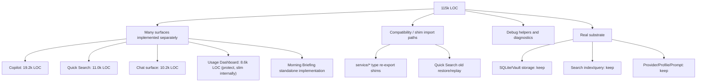
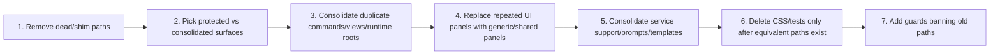
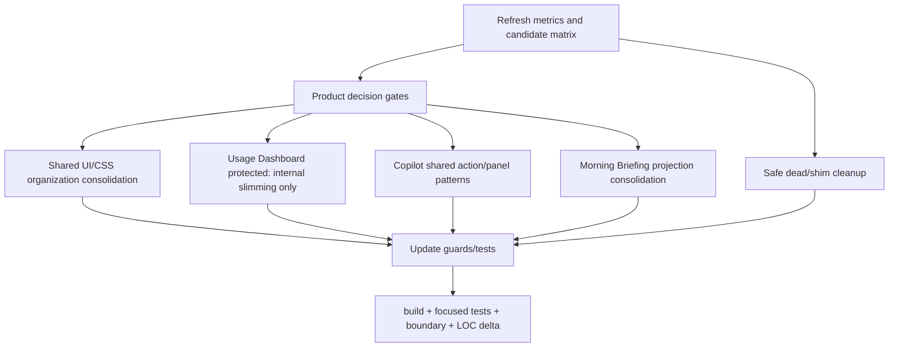

# T11R Specific Consolidation Candidate Audit

> Codex read-only investigation. No source file was deleted or edited for this audit.
> Purpose: turn "115k LOC is too much" into concrete consolidation packages with exact paths, dependency order, risks, and verification.

## 0. Owner Summary

Current state is not "boundary chaos" anymore. The current boundary audit reports **38 findings**:

| Metric | Current |
| --- | ---: |
| `src + styles.css` LOC | 115,310 |
| TypeScript LOC | 109,284 |
| CSS LOC | 6,026 |
| Boundary findings | 38 |
| `service -> app` | 0 |
| `service -> ui` | 0 |
| `ui -> app` | 0 |
| `core -> upstream` | 0 |
| service/core Obsidian side-effect | 3 |
| service/core Obsidian types | 35 |

Interpretation:

- The architecture boundary work largely succeeded.
- The remaining size problem is mostly **duplicate implementation shapes**, **old entry models**, **compatibility import surfaces**, **debug/legacy restore paths**, and **over-specific UI panels/components**.
- Do not expect `audit:boundary` to drop much from this work now; the better metrics are consolidated LOC, fewer duplicate components, fewer old import paths, fewer duplicate entry shells, and simpler owner reading path.

Recommended next wave:

**T11R Prelaunch Code Consolidation Wave**

Hard target:

- Protect Usage Dashboard as a needed product surface.
- Preserve user-facing functionality by default.
- Consolidate at least **one duplicate entry model** and at least **one large duplicate implementation family**.
- Reduce `src + source CSS` by **>= 10,000 LOC**.
- Stretch: **>= 20,000 LOC**.
- Hold boundaries: `service -> app = 0`, `service -> ui = 0`, `ui -> app = 0`, `core -> upstream = 0`.

## 1. Why Code Is Still Big



The key owner decision is this:

> Since the product is prelaunch, compatibility code should only protect local data, startup safety, and intentionally retained live entries. User-facing capabilities should be preserved unless the owner explicitly approves removal.

## 2. Current Code Distribution

Feature-island counts from read-only scripts:

| Area | LOC | Files | Consolidation posture |
| --- | ---: | ---: | --- |
| Copilot full surface | 19,208 | 105 | Big consolidation candidate: shared action patterns + generic panels |
| Shared UI/CSS | 16,285 | 104 | High-priority consolidation: unify `component` / `components` / feature component organization |
| Search index/query/graph tools | 14,501 | 66 | Keep core; prune edge tools only |
| SQLite/Vault storage | 13,236 | 44 | Keep; only delete repos with retired features |
| Quick Search | 11,001 | 72 | Keep current feature; remove obsolete compat tail |
| Chat three-pane + Studio surface | 10,222 | 54 | Protect Obsidian three-pane views; clean internal component duplication and naming debt |
| Agents/Harness/MCP/Skills | 10,071 | 84 | Keep for now; prune only if product scope changes |
| Usage Dashboard + Curator Push | 8,635 | 49 | **Protect as needed product surface; only slim duplicate/internal support** |
| Settings + Onboarding | 8,258 | 27 | Keep; later move large strings/config out of TS |
| Provider/Profile/Prompt | 5,837 | 43 | Keep; delete legacy import surfaces |
| Vault Lint/XRay | 2,494 | 25 | Keep |
| Ambient + Morning | 2,479 | 26 | Keep capability; merge duplicated standalone implementation only with equivalent replacement |

## 3. Recommended Consolidation Order



Reason:

- If Claude removes implementation files first, commands/views may still point to missing surfaces.
- If Claude removes CSS first, product screens remain but break visually.
- If Claude deletes shims before migrating imports, the compile failure is noisy and unhelpful.
- If Claude removes a user-facing action without an equivalent entry, it is product deletion, not refactoring.

## 4. Tier A: Can Delete Or Migrate-Then-Delete With Low Product Risk

These should be included in the next wave even if no large duplicate implementation family is consolidated.

| Candidate | Evidence | Action |
| --- | --- | --- |
| `src/ui/view/quick-search/store/v2SessionTypes.ts` | No current source imports to this shim path; canonical path is `@/core/search/v2SessionTypes` | Delete file after one final `rg` |
| `src/service/chat/context/profiles/AiAnalysisProfile.ts` | Static reachability reports unreachable | Delete after `rg "AiAnalysisProfile"` |
| `src/service/chat/context/profiles/CopilotProfile.ts` | Static reachability reports unreachable | Delete after `rg "CopilotProfile"` |
| `src/service/chat/context/profiles/FollowupProfile.ts` | Static reachability reports unreachable | Delete after `rg "FollowupProfile"` |
| `src/service/chat/context/profiles/AmbientProfile.ts` | Static reachability reports unreachable | Delete after `rg "AmbientProfile"` |
| `src/ui/view/shared/view-utils.ts` | Static reachability reports unreachable; navigation has moved to ports/adapters | Delete after one final `rg "view-utils"` |
| `src/service/tools/search-graph-inspector/find-structural-holes.ts` | Implementation exists, but main `search-graph-inspector.ts` tool factory does not import/register it | Delete implementation and corresponding schema/template only if no live registration |
| `src/app/view/ViewSwitchConsistentHandler.ts` layout diagnostic logs | Multiple `console.log('[layout-diag] ...')` and `console.trace('[layout-diag] trace')` in app view code | Remove logs and repeated branches only if three-pane chat activation still works |
| `src/app/context/AppContext.ts` V2 debug globals | `dumpV2State` and `captureV2Debug` are debug-only window globals | Move to debug module or delete if not needed prelaunch |

Expected LOC reduction:

- Small, likely under 1k unless `ViewSwitchConsistentHandler` is removed.
- High readability benefit.

## 5. Tier B: Functionality-Preserving Consolidation Packages

These are where meaningful LOC reduction lives. They must preserve user-facing capability unless the owner explicitly approves product deletion.

### B1. Chat Three-Pane Protection + Internal Cleanup

Decision:

> Do not make Chat Studio the only Chat entry. The Obsidian left/middle/right chat layout requires `ProjectListView`, `ChatView`, and `ConversationOutlineView` to remain registered. T11R may clean internal duplication, but it must not remove the three-pane product shape.

Current evidence:

- `src/app/view/ChatStudioView.ts` hosts the integrated studio.
- `src/app/view/ChatView.ts`, `src/app/view/ProjectListView.ts`, and `src/app/view/ConversationOutlineView.ts` are still registered.
- `src/app/view/ViewSwitchConsistentHandler.ts` still maintains old layout restoration.
- `src/app/view/ViewManager.ts` registers both old shells and Chat Studio.
- Ribbon still calls `ViewSwitchConsistentHandler.activateChatView()`.
- `ViewManager.openChatStudio()` already detaches old legacy leaves after creating Studio.

Protect:

| Path | Action |
| --- | --- |
| `src/app/view/ChatView.ts` | Keep registered |
| `src/app/view/ProjectListView.ts` | Keep registered |
| `src/app/view/ConversationOutlineView.ts` | Keep registered |
| `src/app/view/types.ts` | Keep `CHAT_VIEW_TYPE`, `PROJECT_LIST_VIEW_TYPE`, `CONVERSATION_OUTLINE_VIEW_TYPE` |
| `src/app/view/ViewManager.ts` | Keep three-pane registration and ribbon activation |
| `src/app/events/Register.ts` | Keep behavior needed to restore/open the chat layout |

Allowed cleanup:

| Path | Action |
| --- | --- |
| `src/app/view/ViewSwitchConsistentHandler.ts` | Remove debug diagnostics and repeated branches only if the three-pane layout still opens correctly |
| `src/ui/view/chat-view/components/*Retained*.tsx` | Rename to current names after import migration |
| `src/ui/view/chat-studio-view/ChatStudioView.tsx` | Keep as optional all-in-one surface unless owner separately retires it |
| Shared chat/project/outline React components | Keep one implementation reused by both Studio and three-pane views |

Reason: these are not just legacy shells. They are part of the Obsidian-native chat experience.

Expected effect:

- Small to moderate LOC reduction.
- Meaningful reading improvement through naming cleanup and fewer debug branches.
- This should not be counted as the main T11R LOC source.

### B1.5. Shared UI/CSS Organization Consolidation

Decision:

> Make Shared UI/CSS a first-class T11R track. The current `component` / `components` split is confusing and likely contains historical leftovers, but deletion must be import-graph based.

Current evidence:

- `src/ui/component/**` exists.
- `src/ui/components/primitives/**` exists.
- `src/ui/view/settings/component/**` and `src/ui/view/settings/components/**` both exist.
- These grouped directories contain about 104 TS/TSX files and 11k LOC.
- Imports currently mix `@/ui/component/shared-ui/*`, `@/ui/components/primitives`, feature-local `components`, and settings-local `component`.

Target organization:

```text
src/ui/components/primitives/      # cross-product primitives
src/ui/components/shared/          # reusable composite UI, e.g. prompt input, diff, streamdown, graph
src/ui/components/domain/          # optional shared domain components
src/ui/view/<feature>/components/  # feature-local only
```

Required investigation before edits:

- Build an import matrix for every file under:
  - `src/ui/component/**`
  - `src/ui/components/**`
  - `src/ui/view/settings/component/**`
  - `src/ui/view/settings/components/**`
- Classify each file as:
  - `primitive`,
  - `shared composite`,
  - `feature-local`,
  - `barrel/shim`,
  - `zero-reference candidate`.
- Do not trust filename-only reachability because barrel exports and index imports can hide usage.

Allowed actions:

- Delete `.DS_Store`.
- Delete zero-reference components only after `rg` / import-matrix proof.
- Migrate old import paths to canonical paths.
- Consolidate duplicate primitives such as Button, IconButton, Pill, Modal, Row, Chip, Segmented when behavior matches.
- Keep usage-dashboard-specific chart components feature-local unless they are intentionally generalized.

Expected effect:

- Potentially high LOC/readability improvement.
- Better UI consistency.
- Better owner understanding than another small boundary cleanup.

### B2. Usage Dashboard Is Protected

Correction:

> Owner decision: Usage Dashboard is needed. Do **not** retire the dashboard view, command, screens, or tracking/outcome data path.

Current evidence:

- `src/ui/view/usage-dashboard/**`: screens, charts, runtime modal, dashboard CSS.
- `src/app/view/UsageDashboardView.ts`: Obsidian ItemView shell.
- `src/app/commands/Register.ts`: `peak-usage-dashboard` command.
- `src/app/view/ViewManager.ts`: `activateUsageDashboardView()`.
- `main.ts`: always imports and boots `UsageTrackingService`, `UsageOutcomeService`, `UsageOptimizationService`, `composeCuratorPushRuntime`, and `mountCuratorPushRoot`.
- Chat uses `UsageOutcomeService` and `InlineReceipt`.

Keep/protect:

| Path | Action |
| --- | --- |
| `src/app/view/UsageDashboardView.ts` | Keep dashboard entry |
| `src/app/commands/Register.ts` `peak-usage-dashboard` | Keep command |
| `src/app/view/ViewManager.ts` `activateUsageDashboardView()` | Keep view activation |
| `src/ui/view/usage-dashboard/UsageDashboard.tsx` | Keep main dashboard |
| `src/ui/view/usage-dashboard/screens/**` | Keep unless a specific screen is proven redundant |
| `src/service/usage/UsageTrackingService.ts` | Keep model/cost tracking |
| `src/service/usage/UsageOutcomeService.ts` | Keep save/adoption outcome tracking |
| `src/ui/view/usage-dashboard/components/InlineReceipt.tsx` | Keep; used by chat message UI |
| `src/core/storage/sqlite/repositories/UsageLogRepo.ts` | Keep data substrate |
| `src/core/storage/sqlite/repositories/UsageOutcomeRepo.ts` | Keep data substrate |
| `templates/config/dashboard.json` | Keep dashboard strings/config |

Allowed slimming inside Usage Dashboard:

| Path | Reason |
| --- | --- |
| `src/ui/view/usage-dashboard/components/charts/dashboard-charts.css` | Can be deduplicated into shared primitives if selectors remain stable |
| `src/ui/view/usage-dashboard/components/charts/**` | Can remove only components with zero dashboard imports |
| `src/service/usage/optimization/**` | Keep if Optimization screen remains; otherwise shrink only with owner approval |
| `src/service/usage/curator/**` + Curator Push runtime | Keep unless owner separately says Curator Push is not needed |

Expected effect:

- Usage Dashboard removal is not a valid T11R LOC strategy.
- LOC reduction must come from Copilot, Chat legacy, Morning Briefing, Quick Search compat, shims, and debug cleanup.

### B3. Copilot Action Matrix Consolidation

Decision:

> Keep Copilot capability coverage, but stop giving every action a bespoke implementation and bespoke result panel when a shared pattern can render it.

Primary consolidation strategy:

| Area | Consolidation |
| --- | --- |
| Action definitions | Move repeated `streamAction` / `queryStructured` / `agent.runAgentStream` patterns into factories/config tables |
| Result panels | Replace many bespoke panels with shared generic renderers: findings list, suggestion list, connection list, task list, generic structured result, generic text stream |
| Prompt/action metadata | Keep IDs where useful, but load repeated labels/descriptions/templates from config |
| Similar actions | Use aliases or shared handlers where the user-facing distinction is useful but the implementation is duplicated |
| Tests | Assert action coverage is preserved, not just that files disappeared |

Possible launch-priority set for UI grouping, **not a deletion list**:

| Keep action | Reason |
| --- | --- |
| `polish` | Core writing action |
| `review` | Core writing/editorial feedback |
| `suggest-links` | Obsidian-native linking |
| `suggest-tags` | Obsidian-native organization |
| `continue-writing` | Core writing continuation |
| `vault-health` | Pairs with Vault Lint / XRay |

Panel files likely to be merged into shared renderers instead of deleted as features:

```text
src/ui/view/copilot/panels/FormatPolishPanel.tsx
src/ui/view/copilot/panels/CorrectContentPanel.tsx
src/ui/view/copilot/panels/SemanticLinkSuggestPanel.tsx
src/ui/view/copilot/panels/SplitPanel.tsx
src/ui/view/copilot/panels/SummarizePanel.tsx
src/ui/view/copilot/panels/ExtractConceptsPanel.tsx
src/ui/view/copilot/panels/TranslatePanel.tsx
src/ui/view/copilot/panels/FindRelatedPanel.tsx
src/ui/view/copilot/panels/KnowledgeGapsPanel.tsx
src/ui/view/copilot/panels/SynthesizePanel.tsx
src/ui/view/copilot/panels/VaultSummaryPanel.tsx
src/ui/view/copilot/panels/RewriteSelectionPanel.tsx
src/ui/view/copilot/panels/AddEvidencePanel.tsx
src/ui/view/copilot/panels/ExtractTodosPanel.tsx
src/ui/view/copilot/panels/WritingPlanPanel.tsx
src/ui/view/copilot/panels/WriteArticlePanel.tsx
src/ui/view/copilot/panels/DetectAndFilePanel.tsx
src/ui/view/copilot/panels/CheckTaskListPanel.tsx
src/ui/view/copilot/panels/PromptAuditPanel.tsx
src/ui/view/copilot/panels/DeduplicateScanPanel.tsx
src/ui/view/copilot/panels/FindAndSolveTasksPanel.tsx
src/ui/view/copilot/panels/SmartConnectionsPanel.tsx
```

Required edits:

- `src/service/copilot/actions/index.ts`: extract repeated action factory helpers and config-driven definitions.
- `src/ui/view/copilot/copilot-action-surfaces.tsx`: map multiple action IDs to shared panel components where shapes match.
- `src/core/prompt/PromptId.ts`: remove only prompt IDs that no preserved capability uses.
- `templates/prompts/*`: remove only templates whose capability is explicitly retired by owner approval.
- Tests: update action registry / surface completeness tests to assert capability coverage is preserved and repeated panel families are consolidated.

Risk:

- Some custom prompt fallback currently uses `WritingPlanPanel`. If that panel is merged, keep a tiny generic text panel or move the component to `GenericTextResultPanel`.

Expected effect:

- Reduces the product matrix implementation without reducing the visible Copilot capability set.
- Total LOC drop depends on how many bespoke panels/actions become shared config + generic renderers.

### B4. Morning Briefing Implementation Consolidation

Decision:

> Preserve the briefing capability unless the owner explicitly retires it. Consolidate the standalone implementation only after an equivalent Ambient / Current Work State surface exists.

Current evidence:

- `main.ts` still calls `runtime.tryShowMorningBriefing()`.
- `main.ts` dynamically imports `@/ui/view/morning-briefing/MorningBriefingModal`, but the actual modal file is `src/app/modals/MorningBriefingModal.ts`.
- `src/ui/view/morning-briefing/MorningBriefingPanel.tsx` and `BriefingCard.tsx` are statically unreachable from `main.ts`.
- `src/ui/store/morningBriefingStore.ts` is only imported by the Ambient UI projection adapter and Morning UI files.

Consolidation paths:

| Path | Action |
| --- | --- |
| `main.ts` dynamic import | Fix stale import path or route through app-owned modal/surface composition |
| `src/app/modals/MorningBriefingModal.ts` | Keep until an equivalent Ambient/Current Work State surface exists |
| `src/ui/view/morning-briefing/MorningBriefingPanel.tsx` | Merge card/list primitives with Ambient Push UI if shapes overlap |
| `src/ui/view/morning-briefing/BriefingCard.tsx` | Reuse shared `PushCard` / insight-card primitives if possible |
| `src/ui/store/morningBriefingStore.ts` | Merge with Ambient projection state only if UI behavior remains identical |
| `src/app/ambient/AmbientUiProjectionAdapter.ts` | Keep projection boundary; reduce duplicate store writes if merged |
| `src/service/ambient/ports/AmbientPorts.ts` | Keep capability port until replacement is complete |
| `src/service/ambient/AmbientRuntime.ts` | Keep method until replacement surface is complete |
| `src/app/ambient/SqliteAmbientBriefingAdapter.ts` | Keep data access unless briefing capability is explicitly retired |

Expected effect:

- Small-to-medium LOC drop.
- Large conceptual clarity if Morning Briefing becomes one Ambient projection instead of a parallel standalone implementation.

### B5. Quick Search Compatibility Tail

Decision:

> Keep current Quick Search behavior. Remove obsolete compatibility paths only when current V2, live background sessions, and saved owner data still work.

Current evidence:

- `src/ui/view/quick-search/store/aiAnalysisStore.ts` has `resetAIAnalysisAll()` no-op.
- It reconstructs V2 tool/timeline state from saved process-log strings.
- It has a non-V2 snapshot restore branch.
- `src/ui/view/quick-search/store/v2SessionTypes.ts` is an unused shim.

Consolidate/delete compatibility paths:

| Path | Action |
| --- | --- |
| `src/ui/view/quick-search/store/v2SessionTypes.ts` | Delete |
| `src/ui/view/quick-search/store/aiAnalysisStore.ts` | Remove no-op reset and old non-V2 restore branch only if saved analyses still open safely |
| `src/ui/view/quick-search/store/sessionSnapshot.ts` | Delete UI shim only if callers can import core snapshot directly |
| `src/ui/view/quick-search/types/search-steps.ts` | Migrate callers to core types, then delete shim |
| `src/ui/view/quick-search/components/ai-analysis-sections/RecentAIAnalysis.tsx` | Simplify restore assumptions |

Keep:

- `QuickSearchBackgroundRuntime`
- foreground/background session restoration for live running sessions
- current V2 report display

Expected effect:

- Moderate LOC drop.
- Better owner understanding because Quick Search stops carrying V1/V2 archaeology.

## 6. Tier C: Do Not Delete Just To Reduce LOC

| Area | Why not delete now |
| --- | --- |
| `src/core/storage/sqlite/**` | Data substrate for search/chat/usage/lint/ambient. Delete only repo tables tied to retired features. |
| `src/core/storage/vault/**` | Chat/search document persistence substrate. |
| `src/service/search/index/**` | Knowledge index is core product infrastructure. Refactor later, do not bulk delete. |
| `src/core/providers/**` and `src/core/profiles/**` | Provider/profile/model routing is core setup infrastructure. |
| `src/core/template/**` and `templates/config/**` | Needed for configurability rule; delete only prompt/config entries tied to retired features. |
| `src/service/lint/**` and `src/ui/view/vault-lint/**` | Small, coherent, and already modernized. |
| `src/app/runtime/AppRuntimeRegistry.ts` | Correct runtime ownership point. |
| `src/app/context/AppContext.ts` | App composition root; shrink debug/global helpers, do not remove as a concept. |

## 7. Concrete T11R Execution DAG

Recommended large wave, not tiny prompts:



Safe parallel tracks:

- Shared UI/CSS organization and Copilot action/panel consolidation are related; if both touch Button/panel primitives, do Shared UI first or isolate Copilot generic panels under `src/ui/view/copilot/` initially.
- Usage Dashboard is protected. Only internal duplicate cleanup may run, and it should be independent of Morning Briefing.
- Shim cleanup should run after entry/implementation consolidation so callers are fewer.

Skip rules:

- Skip a track if it requires data migration beyond settings sanitizer.
- Skip a track if it introduces a second runtime path.
- Skip a track if deleting it removes user-facing functionality without an equivalent replacement.
- Skip a track if it breaks current core product entry: Quick Search, Chat Studio, Copilot, Usage Dashboard, Vault X-Ray, Settings.

## 8. Suggested Owner Decisions Before Implementation

I recommend these decisions:

1. **Chat three-pane registration: protect.**
   Do not remove `ChatView` / `ProjectListView` / `ConversationOutlineView`. Clean debug branches and component naming only.

2. **Shared UI/CSS organization consolidation: yes.**
   Treat `component` / `components` / settings `component(s)` cleanup as a major T11R track. Use an import matrix before deleting anything.

3. **Usage Dashboard: protect.**
   Do not delete the dashboard view, command, screens, tracking/outcome services, or dashboard config. Only allow internal duplicate cleanup with evidence.

4. **Copilot action/panel consolidation: yes.**
   Keep capability coverage; reduce bespoke action and panel implementations through shared factories/renderers.

5. **Morning Briefing consolidation: yes, but no capability deletion.**
   Fix the stale modal import and merge duplicate UI/state only when an equivalent Ambient/Current Work State projection exists.

6. **Quick Search compat tail: yes, but preserve current behavior and owner data.**
   Remove obsolete compatibility, keep current V2 + running session restore + safe opening of saved analyses.

With these decisions, the next Claude prompt should target a real major wave, not another small cleanup.

## 9. Verification Commands For Claude

Claude should run at minimum:

```bash
cloc src styles.css --quiet --timeout 120
npm run audit:boundary -- --out /tmp/t11r-after-boundary.md
npm run build
npm run test -- test/t11p-remaining-ui-app-tail-regression.test.ts
npm run test -- test/t11q-service-app-tail-regression.test.ts
```

Plus focused tests depending on chosen tracks:

```bash
# Chat three-pane protection
npm run test -- test/chat-runtime-state-port.test.ts

# Copilot consolidation
npm run test -- test/copilot-action-runtime-ports.test.ts
npm run test -- test/copilot-action-surface-registry.test.ts

# Usage tracking retained
npm run test -- test/usage-outcome-service.test.ts
npm run test -- test/usage-log-repo.test.ts

# Ambient / Morning consolidation
npm run test -- test/ambient-runtime-ports.test.ts
npm run test -- test/ambient-source-guard.test.ts
```

## 10. Acceptance Standard

Do not accept the wave as "major" unless:

- `src + source CSS` LOC decreases by at least **10,000**.
- No user-facing feature is removed without explicit owner approval.
- At least one duplicate implementation family is consolidated.
- At least one old duplicate entry model is replaced by the current entry model.
- No new service/core mutable singleton is added.
- No `src/ui/** -> @/app/**` static or dynamic import returns.
- `service -> app`, `service -> ui`, `ui -> app`, `core -> upstream` remain zero.
- The implementation note lists:
  - deleted files grouped by reason: duplicate implementation, legacy compatibility, debug-only, unreachable, or owner-approved feature removal;
  - preserved feature coverage table;
  - kept files and why;
  - exact commands removed;
  - exact views removed;
  - exact prompts/templates removed;
  - code reading guide for what remains.
