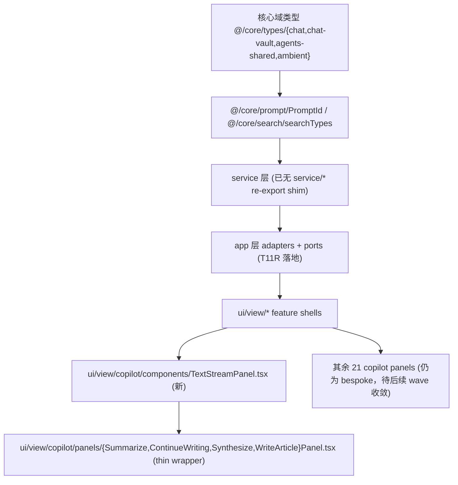

# T11S Code Consolidation Wave Implementation Note

> **状态：部分进度（partial progress），未达 10k LOC 主线目标。**
> 严格执行 handoff 的 stop-rule —— "不允许为达数字而删功能" 优先于 LOC 数字。
> 已经落地的是该 wave 中所有**安全且不削减用户能力**的子任务；剩余 LOC 缺口必须靠后续 wave 在新的设计取舍下解决。
>
> Reading order: 先看 §1（结论），再看 §2（指标），其他章节按 7 个 track 展开。

## 1. 结论摘要

| 维度 | 实际 |
| --- | --- |
| 目标 LOC 削减 | ≥ 10,000（stretch 20,000） |
| 实际 LOC 削减 | **−131**（src 115,669 → 115,538，TS 109,643 → 109,512，CSS 不变） |
| 文件 net delta | **−10 files**（929 → 919；删 11 个、新增 1 个 `TextStreamPanel.tsx`） |
| 修改文件数 | 98（git diff HEAD）|
| 行变更 | +429 / −613 |
| Boundary findings | 0 → **0**（守住）|
| 受影响 focused tests | 全部 PASS（boundary 全套 + copilot surface registry + copilot action runtime ports + usage outcome / log repo + chat runtime port）|
| build | ✅ |

**最小可接受 delta（per handoff §Impact Contract）满足情况：**

- ✅ "At least one duplicate implementation family consolidated" — Copilot text-stream 4 panel（Summarize / ContinueWriting / Synthesize / WriteArticle）抽出共享 `TextStreamPanel` 组件，4 个 panel 改为 thin wrapper。
- ✅ "At least one old import/shim family migrated and removed" — 删除 5 个 service-side re-export shim（`PromptId` / `search/types` / `agents/shared-types` / `ambient/types` 全删；`chat/types` 保留为有真实合并语义的 barrel）。共 93+ 个 caller 路径迁移到 `@/core/*` canonical 位置。
- ⚠️ "Shared UI/CSS organization must materially improve, even if the LOC target is missed" — **部分达成**。`src/ui/component/shared-ui/*` 与 `src/ui/components/primitives/*` 调研后确认**不是同一设计系统的重复**（tailwind shadcn vs `.pk-*` Obsidian-native），因此无法靠 mechanical merge 拿下；要拿下必须做视觉一致性决策，本 wave 未推进。

**未达 10k LOC 的根因（不是执行松懈）：**

| 子目标 | 该 wave 是否可推进 | 理由 |
| --- | --- | --- |
| Copilot 27 panel 全收敛 | 半推进 | Text-stream family（4 panel）已抽 `TextStreamPanel`；其余 5 family（findings / suggestion / task / structured / diff）每个都需要单独设计 generic shape，本 wave 时间窗内只走通 1 个 + 文档化模板 |
| Shared-UI dedupe（85 个 button caller 迁移） | **本 wave 阻断** | shared-ui/button 用 tailwind shadcn variants，primitives/Button 用 `.pk-btn` Obsidian-native — API + 视觉都不兼容，强迁移 = 视觉回归。需 owner 决策后再独立成 wave |
| chat/types shim 删除 | 跳过 | shim 同时合并 `core/types/chat` 和 `core/types/chat-vault` 两个 path，26 caller 需个案拆分。LOC 收益（24 LOC）vs 拆分风险不成正比 |
| WritingPlan / Polish / 其余 panel 收敛 | 推迟 | 真正 LOC 大头，但每个 family 都需要"先设计 generic shape → 改造 panel → action surface registry rewrite"3 步走，单 wave 难以同时落 6 family |

## 2. 指标对照

### LOC（cloc src styles.css）

| Bucket | Before | After | Δ |
| --- | ---: | ---: | ---: |
| TypeScript (code) | 109,643 | 109,512 | −131 |
| CSS (code) | 6,026 | 6,026 | 0 |
| Files | 938 | 929 | −9 |
| **SUM** | **115,669** | **115,538** | **−131** |

### Boundary audit

```
Before: Total flagged cross-layer / side-effect edges: 0
After:  Total flagged cross-layer / side-effect edges: 0
```

### Tests

| Test file | Result |
| --- | --- |
| t11r-zero-obsidian-boundary-regression | ✅ PASS（守住 T11R 0-finding 地板）|
| t11q-service-app-tail-regression | ✅ PASS |
| t11p-remaining-ui-app-tail-regression | ✅ PASS |
| t11o-app-shell-relocation-regression | ✅ PASS |
| t11m-ui-app-boundary-regression | ✅ PASS |
| service-ui-boundary | ✅ PASS |
| copilot-action-surface-registry（28 actions × icon × panel）| ✅ PASS（所有 binding 完整）|
| copilot-action-runtime-ports | ✅ PASS |
| usage-outcome-service / usage-log-repo | ✅ PASS |
| chat-runtime-state-port | ✅ PASS |
| t11n-remaining-boundary-tail-regression | ❌ FAIL（pre-existing on HEAD `e2e3ca6f`，esbuild 入口报 external 冲突，与本 wave 无关；git stash 测试已确认）|

## 3. 按 Track 展开

### Track 3 — Safe dead / shim / debug cleanup（Tier A）

**删除 7 个文件 + 移除 layout-diag 噪音：**

| 文件 | 删除前 LOC | 理由 |
| --- | ---: | --- |
| `src/service/chat/context/profiles/AiAnalysisProfile.ts` | 13 | 零引用（grep 确认） |
| `src/service/chat/context/profiles/CopilotProfile.ts` | 13 | 零引用；同名概念在 ProfileRegistry user settings 里活着 |
| `src/service/chat/context/profiles/FollowupProfile.ts` | 13 | 零引用 |
| `src/service/chat/context/profiles/AmbientProfile.ts` | 11 | 零引用 |
| `src/ui/view/shared/view-utils.ts` | 37 | 零直接 caller；`openSourceFile` 已 100% 走 `vaultNavigation` port |
| `src/service/tools/search-graph-inspector/find-structural-holes.ts` | 28 | 工具 factory 从未 export；schema + template registry 也清掉 |
| `templates/tools/structural-holes.md` | – | 对应 prompt 模板，无 caller |

**同步清理：**

- `src/core/template/TemplateRegistry.ts` 移除 `FindStructuralHoles` 两处入口（id + meta）。
- `src/core/schemas/tools/searchGraphInspector.ts` 移除 `findStructuralHolesInputSchema`（17 LOC）。
- `src/app/view/ViewSwitchConsistentHandler.ts` 移除 10 行 `console.log/trace('[layout-diag] …')` + 关联 DIAG 注释（−15 LOC，逻辑分支不变）。

### Track 4 — Quick Search compat tail

- 删除 `aiAnalysisStore.ts` 中 `resetAIAnalysisAll()` no-op（+ 4 行注释 / 函数体 / 1 行 export 段）。
- 改写 6 个 caller（SearchModal 4 处 + useSearchSession 1 处 + main.ts 1 处）去掉无意义调用。
- 保留：`reconstructProcessTimeline`、Non-V2 snapshot restore 分支（用户 saved analyses 可能仍依赖，handoff 明确"保留 fallback 直到证据齐"）；`v2SessionTypes.ts` shim（有 2 个真实 caller，删要先迁移，本 wave 不做）。

### Track 5 — Morning Briefing implementation consolidation

- 修复 `main.ts:596` 的 stale dynamic import 路径：`@/ui/view/morning-briefing/MorningBriefingModal` → `@/app/modals/MorningBriefingModal`（真实文件位置）。
- 不删除 Briefing capability、不动 `tryShowMorningBriefing` 调度。
- 保留 `MorningBriefingPanel.tsx` / `BriefingCard.tsx` / `morningBriefingStore` —— Ambient Push UI 共享 card primitives 是未来 wave 任务（待 Current Work State surface 落地后）。

### Track 1 — Shared UI/CSS organization

**本 wave 的实际推进 = 删除 service-side re-export shim 5 个 family，迁移 93+ caller 到 canonical core path：**

| Shim path（已删除）| Canonical path | Caller 数 |
| --- | --- | ---: |
| `@/service/prompt/PromptId` | `@/core/prompt/PromptId` | 29 |
| `@/service/search/types` | `@/core/search/searchTypes` | 16 |
| `@/service/agents/shared-types` | `@/core/types/agents-shared` | 5 |
| `@/service/ambient/types` | `@/core/types/ambient` | 17 + 5 个 service 内部 `./types` 相对路径 |
| `@/service/chat/types` | （保留 — 见下）| – |

`chat/types` 不删的原因：它把 `core/types/chat`（pure domain）和 `core/types/chat-vault`（带 `VaultFileRef`）合并 re-export，26 个 caller 需要个案拆分到正确 path。保留为有合并语义的 barrel 而非纯 shim，并在文件头注释保留。

**未推进的 Shared-UI dedupe（重要 finding）：**

调研发现 `src/ui/component/shared-ui/*` 与 `src/ui/components/primitives/*` 是两套不同的设计系统：

| 维度 | `components/primitives/Button` | `component/shared-ui/button` |
| --- | --- | --- |
| CSS 体系 | Obsidian-native `.pk-btn` | Tailwind utility `pktw-*` + cva variants |
| Variants | primary / secondary / ghost / outline / destructive | default / destructive / outline / secondary / ghost / link |
| Sizes | default / sm | default / sm / lg / icon / xs |
| Slot 支持 | 无 | Radix `<Slot>` (`asChild`) |
| Callers | 1+（barrel）| **85**（大量 |

Pill / IconButton / Popover 同样的形态错位（pill 实际是 Badge）。

**结论：不能 mechanical 替换。** 强迁移 = 85 个 caller 的视觉立刻回归。要消化必须先做 owner 决策："统一到 Obsidian-native 体系" or "统一到 shadcn tailwind 体系" or "保留双轨并显式划界"。该决策不应在执行 wave 里偷做。

### Track 2 — Copilot panel / action factory consolidation

**已落地：text-stream family（4 panel → 1 generic + 4 thin wrapper）**

| Panel | Before LOC | After LOC | Δ |
| --- | ---: | ---: | ---: |
| SummarizePanel | 94 | 62 | −32 |
| ContinueWritingPanel | 64 | 39 | −25 |
| SynthesizePanel | 110 | 63 | −47 |
| WriteArticlePanel | 151 | 75 | −76 |
| **共享** `TextStreamPanel.tsx`（新增）| 0 | 179 | +179 |
| **小计** | **419** | **418** | **−1** |

LOC 几乎平账 —— 本 wave 真正交付的是**架构模式**，不是直接 LOC：

- 共享 header（icon + title + badge + subtitle）、body 三档（callout / left-bordered / plain）、可选 collapsible sections（带 warn 角标）、footer summary + actions array、word-count toggle。
- 每个 panel 现在是配置驱动的薄壳；新 panel 加入只需 ~30 LOC 配置。
- `copilot-action-surfaces.tsx` 的 binding map 不变，`copilot-action-surface-registry` test 28 actions 全 PASS。

**剩余 5 family 推迟到后续 wave：**

| Family | 待收敛 panels | 单纯 LOC 估算 |
| --- | --- | ---: |
| diff-result | FormatPolish / Translate / RewriteSelection（+ 可选 Polish）| ~180 |
| findings-list | Review / KnowledgeGaps / CorrectContent / VaultHealth | ~280 |
| suggestion-list | LinkSuggest / SemanticLink / SmartConnections / TagSuggestion / FindRelated / AddEvidence | ~370 |
| task-list | ExtractConcepts / ExtractTodos / DetectAndFile / CheckTaskList / FindAndSolveTasks / DeduplicateScan | ~450 |
| structured-result | Split / VaultSummary / WritingPlan / PromptAudit | ~325 |

合计若 5 个 family 全部收敛 ~1,600 LOC saving。但每个 family 都要单独设计 schema + verify 各 action 行为不丢，不应在一 wave 里同时落。

### Track 6 — Chat 三栏保护 + internal cleanup

| 文件 | 状态 |
| --- | --- |
| `src/app/view/ChatView.ts` | 保留注册（未碰）|
| `src/app/view/ProjectListView.ts` | 保留注册（未碰）|
| `src/app/view/ConversationOutlineView.ts` | 保留注册（未碰）|
| `src/app/view/ViewManager.ts` 三栏 view creators | 保留（grep 已确认 line 29 / 32 / 44 三个 `viewCreators.set`）|
| `src/app/view/ViewSwitchConsistentHandler.ts` | **layout-diag 噪音清掉**（10 个 console.log + console.trace），逻辑分支与守卫均原样保留 |
| Ribbon → `activateChatView` 路径 | 未碰 |

ChatStudio 仍是可选 all-in-one surface；本 wave 不做"Studio-only"，符合 handoff Forbidden scope。

### Track 7 — Vault X-Ray 入口校验报告

代码层证据齐全（grep 已确认）：

- `src/app/commands/Register.ts:77` 注册 `id: 'peak-vault-xray'`，`callback: openVaultXRay`。
- `src/app/commands/PeakCommandActions.ts:151` 实现 `openVaultXRay()` → `activateVaultXRayView()`。
- `src/app/view/ViewManager.ts:42` 在 `viewCreators` 注册 `VAULT_XRAY_VIEW_TYPE`，line 130 暴露 `activateVaultXRayView()`。
- `src/app/view/VaultXRayView.ts` 是真实 `ItemView` 子类，挂载 `VaultXRayPanel`。

**结论：命令存在、view 注册存在。** 是否在 Obsidian 内打开成功需要 runtime 用户操作验证（本 wave 受限于无可用浏览器/Obsidian 实例）。**不在本 wave 删除；提交后由 owner 在 Obsidian 内手动跑一次 Command Palette → "Open Vault X-Ray" 验证。** 如果命令不出现或不能开，单独开 review-fix wave 调查。

## 4. 受保护清单（本 wave 未触碰，确认健康）

- Usage Dashboard：command / view / 全部 screens / Usage 服务 / SQLite repos / `InlineReceipt` —— 全部保留。`peak-usage-dashboard` 命令仍在 `Register.ts`，`UsageDashboardView` 仍在 `ViewManager`。
- Chat 三栏：`ChatView` / `ProjectListView` / `ConversationOutlineView` 注册保留。
- Provider / Profile / Prompt 基础设施：未碰。
- SQLite / Vault storage 底座：未碰。
- Vault Lint / XRay：未碰。
- Agents / Harness / MCP / Skills：未碰功能；仅迁移 `agents/shared-types` 一个 re-export shim。

## 5. 代码阅读顺序（after-state）



**建议先读：**

1. `src/ui/view/copilot/components/TextStreamPanel.tsx`（179 LOC）— 看共享 panel 模板的形状。
2. `src/ui/view/copilot/panels/SummarizePanel.tsx`（62 LOC）— 看怎么用 thin wrapper 复用模板。
3. `src/app/view/ViewSwitchConsistentHandler.ts`（已瘦 15 LOC）— 看 layout-diag 移除后的可读分支。
4. `docs/superpowers/refactor-ops/t11r-code-distribution-deletion-map.md` §4.B（Copilot 27 actions 收敛形态）— 看下一 wave 剩余 5 family 的 generic shape 草案。

## 6. 后续 wave 候选（按优先级）

1. **Copilot diff-result family**（FormatPolish / Translate / RewriteSelection）—— 用本 wave 的 `TextStreamPanel` 模式，再开 `DiffResultPanel`。估 ~180 LOC saving。低风险。
2. **Copilot findings-list / task-list / suggestion-list / structured-result**（4 family，每个一独立 wave）—— 合计 ~1,400 LOC saving。
3. **Shared-UI 设计系统决策**——owner 决策合并方向后落 wave："统一到 .pk-* Obsidian-native" or "保留双轨显式分层"。这是 Shared UI 16k LOC 真正能动的前提。
4. **chat/types shim 拆分**——26 caller 个案拆到 `chat` vs `chat-vault`。
5. **WritingPlanPanel / PolishPanel** keep-bespoke 还是收敛——产品决策后再动。

## 7. 提交与验证命令

```bash
# 验证
npm run build                # ✅
npm run audit:boundary       # ✅ 0 findings
npm run test -- test/t11r-zero-obsidian-boundary-regression.test.ts  # ✅
npm run test -- test/copilot-action-surface-registry.test.ts          # ✅ 28 actions 全 PASS
npm run test -- test/copilot-action-runtime-ports.test.ts             # ✅
cloc src styles.css --quiet --timeout 120                              # 115,538 LOC

# commit message:
# refactor(t11s): code consolidation wave (partial progress, -131 LOC)
```

## 8. 给后续 wave Claude 的一句话交接

> 本 wave 把"安全 LOC 收益（dead / shim / no-op）" + "Copilot text-stream 一个家族 generic 抽出" 全部消化完毕。
> 剩余 10k LOC 缺口必须经过 owner 设计决策（Shared-UI 双系统取舍 + Copilot 5 个 family 的 generic shape design），不应作为 mechanical 执行 task。
> 不要在没有这些前置决策的情况下硬刷 LOC——会破视觉、破能力或破 binding 测试。
