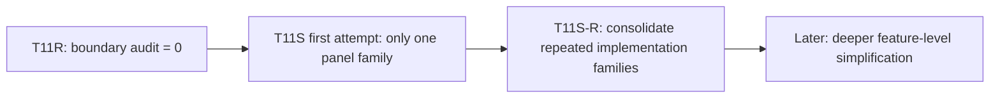
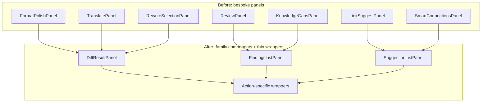
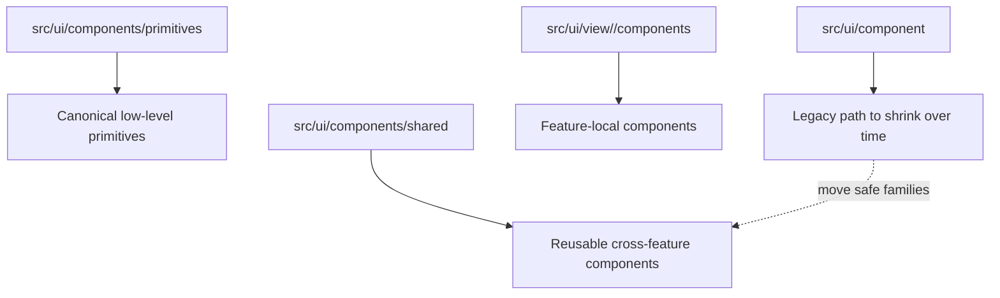

# T11S-R Code Consolidation Redo Handoff

> Owner intent: T11S first attempt is **not accepted as a major code-slimming wave**. It delivered useful cleanup, but only `-131 LOC` and left one runtime blocker. T11S-R must be a real consolidation wave: fewer duplicated panel implementations, clearer shared UI ownership, preserved product capability, and an owner-readable implementation note.

## 0. Owner Summary

This wave is not about deleting features. Usage Dashboard, Chat three-pane views, Copilot actions, Vault X-Ray, Ambient, Search, and Settings must remain.

The goal is to reduce code volume by removing duplicate implementation shapes:

- Copilot panels that render the same result pattern in 20 slightly different ways.
- Shared UI folders that currently have unclear ownership: `src/ui/component/**` vs `src/ui/components/**`.
- Compatibility tails and stale calls left by earlier code-volume work.

The previous T11S result should be treated as **partial progress only**. Do not repeat a one-family tiny cleanup and call it a wave.

## 1. Copyable Prompt For Claude Code

Paste the full block below to Claude Code.

```text
You are implementing T11S-R Code Consolidation Redo for Obsidian Peak Assistant.

Repository:
/Users/zhangjike/code/my-code/mobius-highestpeak-kb/.obsidian/plugins/obsidian-peak-assistant

Background:
- T11R closed boundary audit to 0 findings.
- T11S first attempt landed partial progress only: 973e128f reduced only 131 LOC and consolidated only the Copilot text-stream panel family.
- Codex review found a real blocker: src/ui/view/quick-search/SearchModal.tsx still calls resetAIAnalysisAll() at two live call sites, but T11S deleted that function/import. Build does not catch this because esbuild is not typechecking unresolved identifiers.
- This T11S-R must be a real consolidation wave, not another tiny cleanup.

Protected scope:
- Do NOT remove Usage Dashboard.
- Do NOT collapse Chat into Chat Studio only. Keep the three Obsidian views: ChatView, ProjectListView, ConversationOutlineView.
- Do NOT remove Copilot actions or change action ids.
- Do NOT remove Vault X-Ray unless owner explicitly approves a product deletion. It currently has command + view registration and must stay.
- Do NOT merge the two button/design systems mechanically if that changes visuals. Shared UI cleanup here is ownership and path consolidation first.
- Do NOT introduce ui -> app, service -> ui, service -> app, core -> upstream, or service/core -> obsidian imports.
- Do NOT create a god component, god hook, EverythingPort, AppPort, HostServices, RuntimeBag, or raw app/plugin bag.

Impact Contract:
You may commit Track 0 as a separate fix commit if useful, but you must not stop there.

Minimum acceptable T11S-R result:
1. Track 0 blocker fixed.
2. At least 3 complete Copilot panel families consolidated beyond the existing TextStreamPanel family.
3. At least 1 shared UI folder ownership migration completed with callers migrated and old import path guarded.
4. Boundary audit remains 0 findings.
5. Copilot action surface registry remains green.
6. Implementation note is Chinese-first and includes diagrams, before/after family matrix, changed code files, reading order, skipped tracks with evidence, and verification results.

If you cannot complete at least Track 0 + three Copilot families + one shared UI ownership migration safely, stop and write a read-only failure report. Do not commit a tiny "partial major wave".

Execution DAG:

Track 0 — Review blocker fix, must do first:
- File: src/ui/view/quick-search/SearchModal.tsx
- Remove the two remaining resetAIAnalysisAll() calls around the suggestion/recent-analysis selection handlers.
- Reason: useSearchSessionStore.getState().resetAll() is now the V2 reset owner.
- Add or update a source guard so `rg "resetAIAnalysisAll" src test` has no live source/test hits.

Track 1 — Copilot diff-result family:
- Create a reusable DiffResultPanel component under src/ui/view/copilot/components/.
- Consolidate these panels into thin wrappers:
  - src/ui/view/copilot/panels/FormatPolishPanel.tsx
  - src/ui/view/copilot/panels/TranslatePanel.tsx
  - src/ui/view/copilot/panels/RewriteSelectionPanel.tsx
  - src/ui/view/copilot/panels/PolishPanel.tsx if safe; otherwise explain exactly why skipped.
- Preserve current apply/dismiss behavior, Notice behavior, selection vs full-file behavior, labels, and visual affordances.
- The wrapper should contain action-specific config and callbacks only, not duplicated layout.

Track 2 — Copilot findings / issue-list family:
- Create a reusable FindingsListPanel or IssueListPanel component under src/ui/view/copilot/components/.
- Consolidate at least 3 of these panels:
  - ReviewPanel.tsx
  - KnowledgeGapsPanel.tsx
  - CorrectContentPanel.tsx
  - VaultHealthPanel.tsx if safe; otherwise explain exactly why skipped.
- Preserve severity/priority badges, empty states, per-item actions, and any open/fix/apply callbacks.
- Do not flatten domain-specific data into `any`; use typed config/adapters.

Track 3 — Copilot suggestion-list family:
- Create a reusable SuggestionListPanel component under src/ui/view/copilot/components/.
- Consolidate at least 4 of these panels:
  - LinkSuggestPanel.tsx
  - SemanticLinkSuggestPanel.tsx
  - SmartConnectionsPanel.tsx
  - FindRelatedPanel.tsx
  - TagSuggestionPanel.tsx if safe
  - AddEvidencePanel.tsx if safe
- Preserve open/apply/create/copy/dismiss behavior.
- The shared component should own the repeated card/list/header/footer shape; wrappers own action-specific mapping.

Track 4 — Optional Copilot task/structured family, do if time after Tracks 1-3:
- Candidate panels:
  - ExtractConceptsPanel.tsx
  - ExtractTodosPanel.tsx
  - DetectAndFilePanel.tsx
  - CheckTaskListPanel.tsx
  - FindAndSolveTasksPanel.tsx
  - DeduplicateScanPanel.tsx
  - SplitPanel.tsx
  - VaultSummaryPanel.tsx
  - WritingPlanPanel.tsx
  - PromptAuditPanel.tsx
- Only do this if a clean generic shape emerges. Do not produce a vague god panel.

Track 5 — Shared UI folder ownership migration:
- First write a small import matrix for:
  - src/ui/component/**
  - src/ui/components/**
  - src/ui/view/settings/component/**
  - src/ui/view/settings/components/**
- Then complete at least one safe ownership migration:
  - Preferred A: move src/ui/component/diff/** to src/ui/components/shared/diff/** and migrate all callers/tests.
  - Preferred B: move src/ui/component/prompt-input/** to src/ui/components/shared/prompt-input/** and migrate all callers if safe.
  - Preferred C: move src/ui/component/mine/streamdown/** to src/ui/components/shared/streamdown/** and migrate all callers if safe.
- Keep feature-local components under src/ui/view/<feature>/components/.
- Keep primitives under src/ui/components/primitives/.
- Do not mechanically merge src/ui/component/shared-ui/button with src/ui/components/primitives/Button in this wave; they are different design systems.
- Add a source guard for the migrated old path(s), for example no remaining imports from @/ui/component/diff if Track 5A is chosen.

Stop / skip rules:
- Do not stop after only Track 0.
- Do not stop after only one Copilot family.
- If one family is too risky, skip it with evidence and take the next family instead.
- If a panel wrapper grows nearly as large as the original, the abstraction is wrong. Re-plan that family.
- If the shared component needs many nullable props for unrelated behaviors, split it into two family components.
- If net LOC goes up because of well-named generic components, still report gross duplicated LOC retired and why it is a temporary tradeoff. But the wave must still complete the required families.

Verification, run serially:
- npm run build
- npm run audit:boundary
- npm run test -- test/copilot-action-surface-registry.test.ts
- npm run test -- test/copilot-action-runtime-ports.test.ts
- npm run test -- test/t11r-zero-obsidian-boundary-regression.test.ts
- rg -n "resetAIAnalysisAll" src test
- rg -n "@/ui/component/diff|../component/diff|src/ui/component/diff" src test if Track 5A is done
- Add similar rg checks for whichever shared UI path is migrated.

Important test note:
Run tests sequentially. Do not run multiple test files in parallel; this repo's test runner can share temporary bundle names and produce misleading output.

Required implementation note:
Write docs/superpowers/refactor-ops/t11s-r-code-consolidation-redo-implementation-note.md in Chinese-first style.
It must include:
- Did this meet the Impact Contract? yes/no.
- Before/after metrics: LOC, file count, Copilot panel LOC, boundary findings.
- Family matrix: old panels -> new shared component -> wrappers left.
- Shared UI ownership map.
- Changed code files grouped by track.
- Deleted/moved paths.
- Visual dependency maps with Mermaid.
- Code Reading Guide: exact files to read, in order, with what question each file answers.
- Protected features verified: Usage Dashboard, Chat three-pane views, Vault X-Ray, Copilot 28 action bindings.
- Skipped tracks with evidence, not handwaving.

Commit messages in English.
Suggested commits:
1. fix(t11s): remove stale resetAIAnalysisAll call sites
2. refactor(t11s): consolidate copilot result panel families
3. refactor(t11s): clarify shared ui ownership paths
4. docs(t11s): add consolidation redo implementation note
```

## 2. Why This Is The Right Direction

T11R made the dependency graph clean. That is necessary, but it does not automatically make the codebase smaller.

T11S-R should now use that clean boundary to simplify repeated shapes. The main repeated shape is not "feature exists"; it is "many panels independently implement the same UI grammar."



The correct slimming target is therefore:

- Repeated rendering logic.
- Compatibility tails.
- Ambiguous shared UI ownership.
- Old import paths after migration.

The wrong slimming target is:

- Deleting useful product surfaces.
- Removing Usage Dashboard.
- Collapsing required Chat views into one surface.
- Deleting Vault X-Ray without product approval.

## 3. Current Evidence

### 3.1 Review Blocker

`resetAIAnalysisAll()` was removed by T11S, but two live calls remain in:

```text
src/ui/view/quick-search/SearchModal.tsx
```

The two call sites are inside:

- suggestion selection handler
- recent analysis query selection handler

This is a real runtime bug because the identifier is no longer imported or defined.

### 3.2 Copilot Panel Size

Current Copilot panel surface is still large:

```text
src/ui/view/copilot/panels/*.tsx + TextStreamPanel.tsx = about 4,124 LOC
```

Largest remaining panels:

| Panel | Current LOC |
| --- | ---: |
| `WritingPlanPanel.tsx` | 260 |
| `TagSuggestionPanel.tsx` | 242 |
| `VaultHealthPanel.tsx` | 201 |
| `DeduplicateScanPanel.tsx` | 199 |
| `CorrectContentPanel.tsx` | 190 |
| `FindAndSolveTasksPanel.tsx` | 182 |
| `ExtractTodosPanel.tsx` | 179 |
| `ReviewPanel.tsx` | 177 |
| `SmartConnectionsPanel.tsx` | 173 |
| `CheckTaskListPanel.tsx` | 160 |

T11S only created `TextStreamPanel`. T11S-R should repeat that pattern for at least three more families.

### 3.3 Shared UI Folder Confusion

The owner complaint is valid. We currently have both:

```text
src/ui/component/**
src/ui/components/**
```

And Settings has both:

```text
src/ui/view/settings/component/**
src/ui/view/settings/components/**
```

This is not readable. But not all of it is duplicate UI; some folders represent different design systems. So T11S-R should start by moving safe families into a canonical ownership map, not by blindly merging all button primitives.

## 4. Target Architecture For This Wave

### 4.1 Copilot Panel Consolidation



The rule is simple: the shared component owns layout; the wrapper owns meaning.

### 4.2 Shared UI Ownership



Recommended first safe moves:

| Old path | Target path | Why |
| --- | --- | --- |
| `src/ui/component/diff/**` | `src/ui/components/shared/diff/**` | Small, testable, already generic |
| `src/ui/component/prompt-input/**` | `src/ui/components/shared/prompt-input/**` | Large but coherent family |
| `src/ui/component/mine/streamdown/**` | `src/ui/components/shared/streamdown/**` | Shared renderer, not truly "mine" |

Do at least one complete move in T11S-R.

## 5. Owner Reading Guide

After Claude lands T11S-R, read the changed code in this order:

1. `src/ui/view/quick-search/SearchModal.tsx`
   - Question: were the stale `resetAIAnalysisAll()` calls actually removed?

2. `src/ui/view/copilot/components/TextStreamPanel.tsx`
   - Question: what did T11S already establish as the reusable panel pattern?

3. `src/ui/view/copilot/components/DiffResultPanel.tsx`
   - Question: does the new component own only repeated layout, not action-specific logic?

4. One wrapper such as `src/ui/view/copilot/panels/TranslatePanel.tsx`
   - Question: did the old panel become a thin action-specific config layer?

5. `src/ui/view/copilot/components/FindingsListPanel.tsx`
   - Question: are Review / Knowledge Gaps / Correct Content now one family?

6. `src/ui/view/copilot/components/SuggestionListPanel.tsx`
   - Question: are related-links / smart-connections / tag suggestions now one family?

7. The chosen shared UI migration target, for example:
   - `src/ui/components/shared/diff/**`
   - Question: did callers move to the canonical path and did the old path disappear?

8. `src/ui/view/copilot/copilot-action-surfaces.tsx`
   - Question: do the same Copilot actions still map to icons and panels?

9. `docs/superpowers/refactor-ops/t11s-r-code-consolidation-redo-implementation-note.md`
   - Question: did the wave meet the Impact Contract, or is it honestly marked partial?

## 6. What Would Count As Success

This counts as success:

- Quick Search blocker fixed.
- 3+ Copilot panel families consolidated.
- 1+ shared UI folder migration completed.
- No product capability deleted.
- Boundary audit remains zero.
- Implementation note makes the result legible to the owner.

This does not count as success:

- Only deleting a few unused files.
- Only fixing `resetAIAnalysisAll`.
- Only consolidating one more panel family.
- Moving files without reducing duplicated implementation shapes.
- Reporting "big wave" while the impact contract is missed.

## 7. Codex Review Checklist After Claude Returns

When Claude returns, Codex should verify:

```bash
git show --stat --oneline HEAD
npm run build
npm run audit:boundary
npm run test -- test/copilot-action-surface-registry.test.ts
npm run test -- test/copilot-action-runtime-ports.test.ts
npm run test -- test/t11r-zero-obsidian-boundary-regression.test.ts
rg -n "resetAIAnalysisAll" src test
cloc src styles.css --quiet --timeout 120
```

Codex should also inspect:

- Whether wrappers are truly thinner.
- Whether new shared components are not god components.
- Whether skipped panels have real evidence.
- Whether the implementation note gives the owner a clear reading path.
- Whether protected features are still wired.

