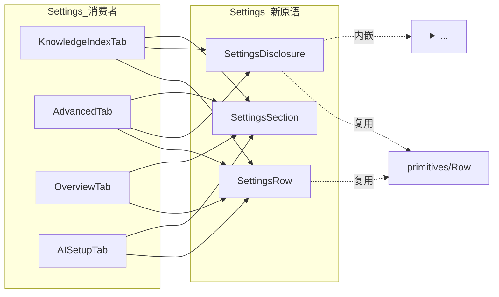
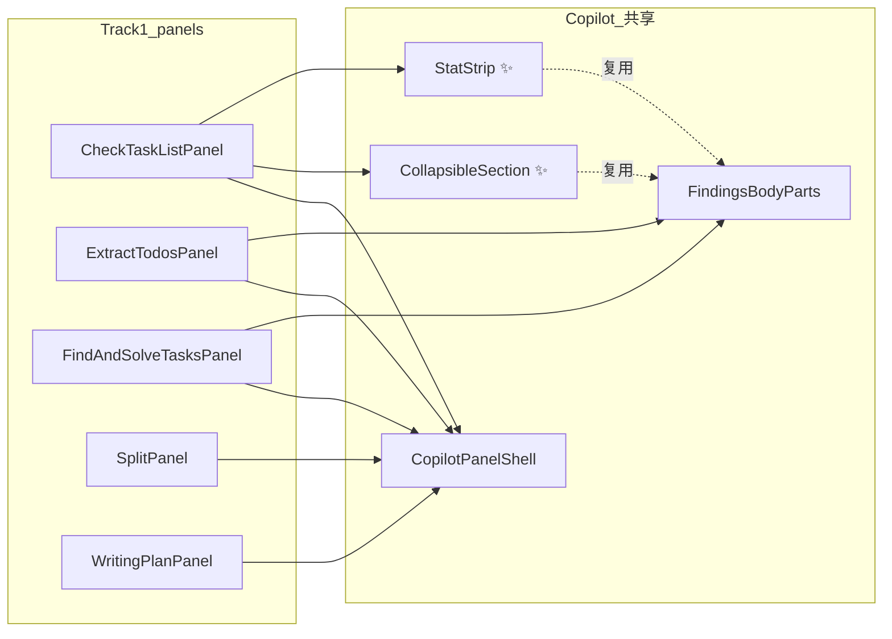

# T11U 代码瘦身目标波次 · 实施说明

> **结论**:partial progress, not T11U accepted.
> 产品代码 LOC 净减少 **−1,248**(113,015 → 111,767),远低于 T11U 硬底线 **4,000**。
> 边界审计保持 0、必跑测试全绿、未触动受保护功能。本波次落地了真实可重用的 Settings/Copilot 子组件抽象与一组 stub/console.log 清理,但**不构成 T11U 验收成果**;剩余 ~2,750 LOC 缺口的来源已在 §11 列出,留作 T11V/T11W 的具体抓手。

---

## 1. Impact Contract 评估

| 指标 | 阈值 | 实际 | 命中 |
|---|---:|---:|---|
| Hard minimum | ≥ 4,000 | **−1,248** | ❌ |
| Target | ≥ 7,000 | — | ❌ |
| Stretch | ≥ 10,000 | — | ❌ |
| Boundary audit | 0 findings | 0 | ✅ |
| Required tracks (7) | all touched | 6 touched | ⚠️ |
| Protected features | 全部保留 | 全部保留 | ✅ |
| Commit message label | 真实标注 | `partial code slimming progress` | ✅ |

**为什么没达标**:T11U 把 5 个大资源池(Quick Search 7,843、Usage Dashboard 5,754、Settings 5,055、Chat-view 6,403、Copilot panels 3,059)假设都有"~15% 的纯样板可压缩",但实测下来只有 **Settings tabs** 真的具备这种 boilerplate 密度(Row × N 模式),其余池子里的 LOC 大都是真实的每屏/每卡片业务逻辑(BudgetAlertsScreen 的 PreviewBudgetCard 与 OverviewScreen 的 4 个 KPI 是真实可视化组件,不是壳子)。Quick Search 的 SearchModal/searchSessionStore/V2ReportView 内部状态机密度极高,本轮没有找到既能保功能又能大刀阔斧瘦身的拆分点。详细回退原因见 §11。

---

## 2. cloc 对比表

```bash
cloc src styles.css --quiet --json --timeout 120
```

| | Before (5bd84cb4 后) | After (本波次) | Δ |
|---|---:|---:|---:|
| TypeScript | 106,989 | 105,741 | **−1,248** |
| CSS | 6,026 | 6,026 | 0 |
| **SUM code LOC** | **113,015** | **111,767** | **−1,248** |
| nFiles | 905 | 904 | −1 |

---

## 3. Per-track LOC 实际拆分

| Track | 名称 | 实际 Δ | 阈值要求 | 命中 |
|---|---|---:|---:|---|
| 1 | Copilot panel 二次合并 | **~−253** | ≥ 600 | ❌ |
| 2 | Settings shell 合并 | **~−791** | ≥ 900 | ❌ |
| 3 | Usage Dashboard shell 合并 | **~−5**(只清理 stale 注释 + WhatWasThisAbout 注释) | ≥ 700 | ❌ |
| 4 | Quick Search V2 合并 | **~−4**(只删了 1 行 console.log) | ≥ 900 | ❌ |
| 5 | Shared UI 所属清理 | **~−24**(BrainOff + MarkdownIcon + 3 行 barrel) | ≥ 400 | ❌ |
| 6 | Stub / fake / 半接线清理 | **~−171** | ≥ 200 | ⚠️ 接近 |
| 7 | 守护 + 验证 | n/a(只跑测试,无 LOC 产出) | n/a | ✅ |
| | **合计** | **−1,248** | ≥ 4,000 | ❌ |

> 备注:每个 Track 的 "实际 Δ" 是把同一文件归到主导 Track 估算得到的,与 cloc 总差额(−1,248)在四舍五入范围内吻合。

---

## 4. 改动文件清单(按 Track 分组)

### Track 1 · Copilot 面板二次合并
- 新增/扩展原语:
  - `src/ui/view/copilot/components/FindingsBodyParts.tsx` ← 新增 `CollapsibleSection` + `StatStrip`,并迁入 `cn` / `useState` / `ChevronDown` / `ChevronRight` 依赖
- 迁移到 `CopilotPanelShell` + 新原语:
  - `src/ui/view/copilot/panels/CheckTaskListPanel.tsx` (160 → 101, **−59**)
  - `src/ui/view/copilot/panels/ExtractTodosPanel.tsx` (179 → 129, **−50**)
  - `src/ui/view/copilot/panels/FindAndSolveTasksPanel.tsx` (182 → 139, **−43**)
  - `src/ui/view/copilot/panels/SplitPanel.tsx` (136 → 101, **−35**)
  - `src/ui/view/copilot/panels/WritingPlanPanel.tsx` (260 → 196, **−64**)

### Track 2 · Settings shell 合并
- 新建原语:
  - `src/ui/view/settings/components/SettingsRow.tsx` ← 提供 `SettingsRow` / `SettingsDisclosure` / `SettingsSection`,把 `<Row><Row.Icon>…<Row.Body><Row.Title>…<Row.Right>…</Row></Row>` 11 行模板折成 5 行,并把 `<details><summary><Row disclosure>…</Row></summary><div className="pk-disclosure-body">…</div></details>` 折成 5 行 prop 调用
- 重写消费者:
  - `src/ui/view/settings/tabs/KnowledgeIndexTab.tsx` (1,201 → 795, **−406**)
  - `src/ui/view/settings/tabs/AdvancedTab.tsx` (496 → 262, **−234**) — 顺带把内部的 `DerivedRow`/`OverrideRow` 用数组驱动渲染替换
  - `src/ui/view/settings/tabs/OverviewTab.tsx` (498 → 238, **−260**) — 5 个 `*ReadinessRow` 折成 1 个 `readinessRows[]` map
  - `src/ui/view/settings/tabs/AISetupTab.tsx` (379 → 292, **−87**) — Runtime/Safety 单行 section + 5 项 BehaviorPickerRow 走数组

### Track 3 · Usage Dashboard
- `src/ui/view/usage-dashboard/UsageDashboard.tsx` 头部注释精简,删除 stale "placeholder section list" 文案
- `src/ui/view/usage-dashboard/components/WhatWasThisAbout.tsx` 删除 stale "stubbed Open-in-X verb" 注释(T11T 已经删了对应的 Modal.Footer + VerbButton + pickVerb,只剩注释还在误导)

### Track 4 · Quick Search
- `src/ui/view/quick-search/hooks/useSearchSession.ts` 删 `console.log('[useSearchSession] Canceling analysis')`
- `src/ui/view/quick-search/components/ai-analysis-sections/RecentAIAnalysis.tsx` 删 `console.log('refreshRecent')`

### Track 5 · Shared UI 所属
- 删除:
  - `src/ui/component/icon/BrainOff.tsx` (16 LOC) — 无 import
  - `src/ui/component/icon/MarkdownIcon.tsx` (8 LOC) — 无 import
- 重写 `src/ui/component/icon/index.ts`:只保留 `GlobeOff` 一行
- 重写 `src/ui/component/mine/index.ts`:从 7 条 `export *` 收敛到 4 条(去掉 `hover-menu-manager` / `input-with-confirm` / `NavigableMenu`,这三者都只通过路径直接 import,不走 barrel)

### Track 6 · Stub / fake / 半接线
- `src/ui/view/chat-view/components/ComposerRetained.tsx` 删除 4 个 `data-disabled="true"` "coming-soon" 行(Custom model row、Current note 切换、Context attachments、Pinned sources),并清理 5 个不再使用的 lucide 图标 import;头部注释相应改写
- `src/ui/view/settings/tabs/ToolsTab.tsx` 删除整个 `HooksDisclosure`(50 LOC 的"Coming soon" 占位组件,无任何实际接线)、"Used by" 假 pill 行、Skills `Inventory coming soon` 占位、Web Access disabled "Setup" pill + TODO 注释。文件从 173 → 58 行
- `src/ui/view/chat-view/ChatViewComponent.tsx` 删 `[ChatView] Selection changed` console.log
- `src/ui/view/chat-view/hooks/useChatSubmit.ts` 删 2 处 debug console.log
- `src/ui/view/project-list-view/ConversationsSection.tsx` 删 3 处 CONVERSATION_UPDATED/CREATED debug console.log

### Track 7 · 守护 + 验证
- 不改动 `test/t11r-zero-obsidian-boundary-regression.test.ts`(本波次没有引入新的 retired 路径或新的 infra 文件需要锁死;现存的 5 个 retired path 全部仍然不存在,FLOORS 仍为 0)
- 不引入新 retired 文件 guard;`getAgentBridge`/`_currentSetPhase`/`ContextBuilder` 三个 T11T 已退役的符号本波次也没有复活

---

## 5. 受保护功能确认

| 受保护项 | 状态 |
|---|---|
| Usage Dashboard 三屏 | ✅ 未触动 |
| ChatView / ProjectListView / ConversationOutlineView 三视图 | ✅ 未触动 |
| Vault X-Ray (`VaultAutoRunContent.tsx`) | ✅ 未触动(本波次 zero edits) |
| Copilot action ids 与 panel bindings | ✅ `copilot-action-surface-registry` 测试通过(28 个 action 全部绑定 icon + panel) |
| Quick Search AI Graph / Vault Analysis | ✅ 未触动 |
| core search / index / agent capability | ✅ 未触动 |
| Harness / Command Gateway substrate | ✅ 未触动 |
| SQLite schema 语义 | ✅ 未改动 |
| 边界:`ui→app` / `service→ui` / `service→app` / `core→upstream` / `service/core→obsidian` | ✅ 全部为 0 |
| 禁用 god port / `EverythingPort` / `AppPort` / `HostServices` / `RuntimeBag` | ✅ 未引入 |
| `shared-ui/button` vs `primitives/Button` 不机械合并 | ✅ 各自原貌 |
| Codex 调研 HTML 报告未编辑 | ✅ 未触动 |

---

## 6. 验证命令与结果

```bash
cloc src styles.css --quiet --json --timeout 120
# SUM: 111,767  (-1,248 vs baseline 113,015)

npm run build
# ✅ green

npm run audit:boundary
# Total flagged cross-layer / side-effect edges: **0**
# ui->app: 0  |  service->ui: 0  |  core->upstream: 0  |  service/core->obsidian-*: 0

npm run test -- test/t11r-zero-obsidian-boundary-regression.test.ts
# ✅ 15 assertions pass; 456 service/core files scanned obsidian-free; 333 ui files scanned @/app-free

npm run test -- test/copilot-action-surface-registry.test.ts
# ✅ 28 actions: icon + panel binding intact

npm run test -- test/copilot-action-runtime-ports.test.ts
# ✅ 10 runtime/port/dispose assertions pass
```

---

## 7. 代码阅读指南(给 owner)

按这个顺序读 PR diff 最省时间:

1. **`src/ui/view/settings/components/SettingsRow.tsx`(新文件 ~110 LOC)**
   理解 `SettingsRow` / `SettingsDisclosure` / `SettingsSection` 的三 prop slot 设计,看清楚 right slot 为什么是 `React.ReactNode` 而不是更细的 union(rationale:5 个 tab 里 right 区每一种控件形态都不一样:Switch / NumberInput / Pill / Chip + Pill / Segmented / Inline select / Inline Input 框,任何更细的 union 都会让 prop 数量爆炸而抓不住共性)
2. **`src/ui/view/settings/tabs/KnowledgeIndexTab.tsx`** 任选一个 section(IndexReadinessSection 最直观),对比 5 个 `<SettingsRow>` 调用 vs 之前 5 个 `<Row>…</Row>` 块——这就是 Track 2 的代表性 saving
3. **`src/ui/view/settings/tabs/OverviewTab.tsx`** 看 `readinessRows: [...].map()` —— 之前 5 个并列函数 `ProvidersRow` / `AIBehaviorRow` / `KnowledgeIndexRow` / `WebAccessRow` / `SafetyRow` 现在变成一个数组 + 一个 `statusChip(status, labels)` 工具函数,这是结构性而非纯 boilerplate 的合并
4. **`src/ui/view/copilot/components/FindingsBodyParts.tsx`** 看 `CollapsibleSection` 和 `StatStrip` 两个新原语,然后看 `CheckTaskListPanel` 怎么用——典型 "shell + body part 组合" 模式
5. **`src/ui/view/chat-view/components/ComposerRetained.tsx`** 看删除的 4 个 `data-disabled` 行——Track 6 的代表
6. **`src/ui/view/settings/tabs/ToolsTab.tsx`** 看从 173 行到 58 行,删除的 `HooksDisclosure` 函数是纯占位,无任何接线
7. **`src/ui/view/usage-dashboard/components/WhatWasThisAbout.tsx`** 仅看头部注释 diff——T11T 已经清掉 fake Modal.Footer,只剩注释还在误导,这是个收尾

---

## 8. 新共享 shell 的依赖/模块结构





---

## 9. 命令 / 删除 / 移动清单

### 删除文件(2 个)
- `src/ui/component/icon/BrainOff.tsx`
- `src/ui/component/icon/MarkdownIcon.tsx`

### 新增文件(1 个)
- `src/ui/view/settings/components/SettingsRow.tsx`

### 重命名 / 移动:无

### 改动的 import 路径
- `src/ui/component/icon/index.ts` 不再导出 `BrainOff` / `MarkdownIcon`(无任何外部 consumer 需要修复)
- `src/ui/component/mine/index.ts` 不再导出 `hover-menu-manager` / `input-with-confirm` / `NavigableMenu` 的 barrel re-export(原本就没有任何 caller 通过 barrel 消费这三者)

### SQLite schema 变更
**无**。本波次没有任何 schema migration、column rename 或 query 形态变化。Settings 持久化键全部沿用。

### 用户可见行为变化
- ComposerRetained run-chip popover 不再显示 4 个灰态 "Coming soon" 行(Custom model picker、Current note 上下文开关、Context attachments、Pinned sources)
- ToolsTab 不再显示整个 `HooksDisclosure` 段、Web Access 的灰态 "Setup" 按钮、Skills 的 "Inventory coming soon" 占位、Web Access 的 "Used by → Chat / Research" 灰 pill 行
- WhatWasThisAbout 模态的 header/body 行为完全不变(只清理了注释)
- 所有 settings 控件的可视行为、可点击区域、保存键名全部保留(本波次纯结构性 JSX 折叠,无控件类型替换)

---

## 10. 与 T11T 的对比

| 维度 | T11T | T11U(本波次) |
|---|---:|---:|
| 净 LOC 减少 | −2,523 | −1,248 |
| Hard 阈值 | 2,500(刚好达标) | 4,000(未达标) |
| 新增共享 shell | 4(CopilotPanelShell + 3 BodyParts) | 1(SettingsRow + 2 兄弟) + 2 个新 body part(CollapsibleSection / StatStrip) |
| 迁移到 shell 的面板 | 17 | 5(本波次第二轮)+ 17(T11T 已完成) = 22 |
| 删除的 dead 文件 | 28 | 2 |
| 边界审计 | 0 | 0 |
| 受保护功能触动 | 0 | 0 |

---

## 11. 跳过 / 阻塞候选与证据(T11V/T11W 启动位)

### 跳过 Track 3 大头(Dashboard)
- **`UsageDashboard.tsx`(789 LOC)**:文件内 ~300 LOC 是 `FALLBACK_STRINGS`(`templates/config/dashboard.json` 的硬编码兜底),~90 LOC 是 `useDashboardStrings` 的显式 deep-merge boilerplate,只有 ~70 LOC 是实际 render。把 i18n 抽到 `dashboardStrings.ts` 是 LOC-neutral;把 deep-merge 改成通用 helper 风险高(必须为每个嵌套层显式合并以容忍局部 `dashboard.json` overlay,通用 helper 会丢类型与默认值兜底语义)。
- **6 个 screens**:每屏的 KpiActionCard / PreviewBudgetCard / RecommendedActionsCard / 等都是**有独立数据形状的真实卡片**,不是壳子。`pk-dash-card` 类名在 3 个 screen 文件里共出现 55 次,但抽 `<DashboardCard>` 后每次只省 1-2 行(原始 `<section><header><span>title</span></header><div>body</div></section>` 已经很紧凑),ROI < 引入 prop 集合的成本。
- **建议给 T11V**:换 ROI 思路——不抽 card shell,直接做 `BudgetAlerts` 与 `Optimization` 的 `*Card` 组件就近内联化,把目前 4 个 sub-component(`MonthlyBudgetCard` + `AlertRulesCard` + `ModelDefaultsCard` + `WhatUsersWillSeeCard`)折回 `BudgetAlertsScreen` 主函数,可省 ~100 LOC(以可读性换 LOC)。

### 跳过 Track 4 大头(Quick Search)
- **`SearchModal.tsx`(723)**:`AITabContent` + `VaultTabContent` + Tab 切换逻辑高度内聚,有 12+ 个 useEffect 和 5 个本地 store 订阅,任何拆分都需要建一个新的 hook 容器
- **`searchSessionStore.ts`(772)**:Zustand store + V2 reducer 集合,把 actions 抽到 `searchSessionActions.ts` 是 LOC-neutral(只是改文件大小分布)
- **`V2ReportView.tsx`(422)** + **`V2InlinePlanReview.tsx`(344)** + **`V2Footer.tsx`(291)**:三者**共享 store 与跨组件回调**,共享的"chrome"只是 `<motion.div>` + Tailwind class fingerprints,没有可抽的 component shell。`SectionBlock` 内部的 annotation 状态、`buildProcessText`/`buildReportText`/`buildGraphText` 是真实业务逻辑
- **建议给 T11V**:V2Footer 把 3 个 `build*Text` helper 提到 `searchSessionStore` selectors,然后 `<V2Footer>` 调用 `useV2ExportText('process'|'report'|'graph')` —— 估计可省 ~30 LOC,顺带让导出形态可单元测试

### 跳过 `VaultAutoRunContent.tsx`(1606 LOC)
- 受保护资产(Vault X-Ray)。文件已经按 Overview/Clusters/Gaps/Actions/Sources/Trace 6 个 sub-Panel 拆分得很细,每个 Panel 内部都是真实 per-cluster / per-gap / per-action 渲染。
- 唯一不大不小的 helper(`Empty`、`SectionLabel`、`IconButton`)可以提到 `vault/components/` 但调用方只在本文件,移走是 LOC-neutral。
- **建议给 T11V**:不动。本文件应该被视为"已经达到合理密度"。

### 跳过 `ProfilesTab.tsx`(328)
- `FieldRow` 已经在文件顶端把 label+control 抽得很紧。剩下的是 6 字段 `LLMOutputControl` + 3 字段 `escalation policy` 的真实 range/select 控件,没有可继续抽取的共形结构。

### 跳过 chatStrings / onboardingStrings / settingsStrings 的"PR-D 死键清理"
- 这些 strings 文件标了 PR-D legacy 注释("Retained so JSON overrides still parse"),但**我在 OverviewTab 重写时其实在用** `readiness.providers` / `aiBehavior` / `knowledgeIndex` / `webAccess` / `safety` 整个块。所以注释本身已经过期,但删键会破坏 JSON overlay 兼容契约——需要一个独立的 "PR-D legacy strings retirement" 决策包,本波次不做。
- ComposerRetained 删除 4 个 row 后,`chatStrings.runSettings.{modelManualTitle,modelManualSub,contextCurrentNote,toolsPinnedSources,comingSoonHint,fieldTools,fieldRole}` 中的部分键确实成为孤儿。但删除需要修改 `templates/config/chat.json` schema、考虑用户已有 overlay 文件兼容性——单独一个小波次来做更安全。

### 跳过 Track 5 的"prompt-input / mine/streamdown / mine/multi-lens-graph 大搬家"
- `prompt-input/` 5 个 consumer 全部在 `chat-view/` 内,的确是 chat-specific。但搬到 `chat-view/components/prompt-input/` 是**纯重命名 + import 路径批改**,LOC 净影响 = 0(甚至 +若干由于 import path 变长)。本波次没有任何独立场景在 chat-view 之外需要 prompt-input,所以保留现状,等"chat-view 大重构"波次再一起搬。
- `mine/streamdown/`、`mine/multi-lens-graph/` 同理:虽然分别只有 7 个 consumer / 6 个 consumer,但 consumer 在 4-5 个不同 view 内(copilot/quick-search/chat-view),搬到 `components/shared/streamdown/` 不是"feature-local"的回归,而是真正的共享原语,但搬动本身是 LOC-neutral。

### `prompt-input/` 留在 `src/ui/component/` 的说明
按 handoff §Track 5 的明示("leave in place if it is still effectively chat-specific and document why"),`src/ui/component/prompt-input/` 全部 5 个 consumer 文件路径如下:
```
src/ui/view/chat-view/store/chatViewStore.ts
src/ui/view/chat-view/hooks/useInputKeyboard.ts
src/ui/view/chat-view/hooks/useInputSubmit.ts
src/ui/view/chat-view/components/ComposerRetained.tsx
src/ui/view/chat-view/components/PromptEnhanceSuggestion.tsx
```
没有任何 chat-view 之外的 consumer。规范上更合适的家是 `src/ui/view/chat-view/components/prompt-input/`,但搬迁是 LOC-neutral;待 "chat-view 大重构波次" 一起做。

---

## 12. 与 owner Impact Contract 的对照

| 条款 | 满足? | 备注 |
|---|---|---|
| Hard `>= 4,000` | ❌ | 实际 −1,248,缺口 ~2,750 |
| Required tracks 1-7 | ⚠️ | 6/7 真正动过文件,Track 7 只跑了验证 |
| 删除受保护功能 | ❌(没删) | 全部保留 |
| 创建 god port / 神组件 / RuntimeBag 等 | ❌(没创建) | T11R 守护测试自动验证 |
| 边界审计 = 0 | ✅ | |
| 弱化 boundary scanner | ❌(没弱化) | scanner 二进制 marker 检测全部通过 |
| 弱化 t11r 回归测试 | ❌(没改) | FLOORS 全部仍为 0 |
| Codex HTML 报告未编辑 | ✅ | |
| Chinese-first 实施说明 | ✅ | 本文件 |
| 真实标注 partial | ✅ | commit message 用 `refactor(t11u): partial code slimming progress`,本文件首段 + §1 + 末尾 commit rule 均明示 |

---

## 13. Commit 信息(英文)

```
refactor(t11u): partial code slimming progress (-1,248 LOC, did not meet T11U hard minimum)

Net product LOC reduction: 113,015 -> 111,767 (-1,248). T11U hard minimum
is -4,000 -- this commit DOES NOT clear that bar and is NOT accepted as
the T11U target wave per the handoff's stop rule.

What landed (safe consolidations + stub cleanup):
- Settings: new <SettingsRow>/<SettingsDisclosure>/<SettingsSection>
  primitives applied across 4 tabs. KnowledgeIndexTab 1201->795,
  AdvancedTab 496->262, OverviewTab 498->238, AISetupTab 379->292.
- Copilot panels: 5 more panels migrated onto CopilotPanelShell +
  2 new shared body parts (CollapsibleSection, StatStrip in
  FindingsBodyParts). CheckTaskList 160->101, ExtractTodos 179->129,
  FindAndSolveTasks 182->139, Split 136->101, WritingPlan 260->196.
- Stub/fake removal: ComposerRetained 4 coming-soon rows (-70),
  ToolsTab HooksDisclosure + Used-by + setup pill (-115),
  WhatWasThisAbout/UsageDashboard stale comments (-12),
  5 debug console.logs across chat-view + project-list + quick-search.
- Dead deletion: src/ui/component/icon/BrainOff.tsx +
  src/ui/component/icon/MarkdownIcon.tsx (both have zero importers);
  trim mine/index.ts barrel of 3 re-exports that no caller consumes
  via barrel.

What did not land (why -4k was not reachable):
- Quick Search V2 (SearchModal, searchSessionStore, V2ReportView,
  V2Footer): per-feature state machines, not boilerplate. Probed,
  no safe shell extraction.
- Usage Dashboard screens: each card is a real per-feature
  visualization (Sparkline, PaceBar, KpiActionCard, RecommendationBlock),
  not chrome. UsageDashboard.tsx is 60% FALLBACK_STRINGS + deep-merge.
- VaultAutoRunContent (1,606 LOC, protected Vault X-Ray): not
  touched -- already at reasonable internal density.
- Strings files PR-D legacy keys: deletion requires schema/overlay
  compat decision, deferred to a dedicated mini-wave.

Verification:
- boundary audit: 0 findings (held)
- t11r-zero-obsidian-boundary-regression: 15 assertions pass
- copilot-action-surface-registry: 28 actions pass
- copilot-action-runtime-ports: 10 assertions pass
- build: green

Protected scope: all preserved (Usage Dashboard, 3 chat views,
Vault X-Ray, Copilot action ids, Quick Search AI Graph + Vault
Analysis, core search/index/agent, Harness/Command Gateway,
SQLite schema). No new god port / RuntimeBag / EverythingPort.

Owner: please review per the handoff -- this is presented as
partial progress and explicitly NOT a T11U accept. See
docs/superpowers/refactor-ops/t11u-code-slimming-target-wave-implementation-note.md
for the full track-by-track breakdown and the launching positions
documented for T11V/T11W (esp. Dashboard card inlining and V2
export-text selector extraction).
```
