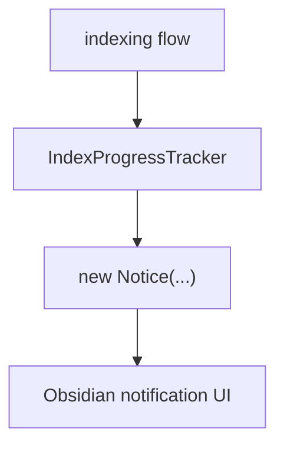

# T2 First Port Sketches Draft

This is a draft for after T1 is accepted. Do not send this to Claude Code before the T1 Owner Review Packet passes.

T2 should introduce the first port boundary by touching one narrow adopter, not by "portifying" the whole app.

## Recommended First Slice

Start with `ProgressReporterPort` for indexing progress, using `src/service/search/support/progress-tracker.ts` as the first adopter.

Why this slice:
- The file is small and self-contained.
- It imports `Notice` directly from `obsidian`.
- It represents a concrete side effect called out by T0.
- It is easier than `ActiveDocumentPort`, which would pull Ambient editor context into scope.
- It is safer than `BackgroundSessionManager`, which mixes Quick Search runtime, modal restore, app context, and UI state.

## Do Not Start With

| Candidate | Why not first |
| --- | --- |
| `BackgroundSessionManager.ts` | Too much runtime and UI restore behavior in one file. |
| `ContextExtractor.ts` | Ties the slice to Ambient, which is post-foundation. |
| `indexInitializer.ts` | Has many Notice calls plus indexing flow; good second or third adopter, not first. |
| All `Notice` callers | Too broad; would hide whether the port boundary is actually good. |

## Send To Claude Code

```md
# Peak Assistant Modernization: T2A Progress Reporter Port Sketch

Branch:
codex/peak-modernization-refactor

Source-of-truth docs:
- docs/superpowers/specs/2026-06-01-peak-system-architecture-modernization-handbook.html
- docs/superpowers/audits/2026-06-12-t0-findings.md
- docs/superpowers/audits/2026-06-12-t0-owner-review-packet.md
- docs/superpowers/refactor-ops/t1-vault-lint-contract-seed-handoff.md

Precondition:
- T1 Vault Lint Contract Seed has been implemented, reviewed, and accepted.

Goal:
Introduce the first fakeable side-effect port by extracting progress notification behavior from one narrow service support file.

Allowed first adopter:
- `src/service/search/support/progress-tracker.ts`

Allowed support files:
- A small port interface file.
- A small Obsidian adapter file.
- A focused test with a fake reporter.
- Minimal call-site updates only if required to keep behavior unchanged.

Recommended placement:
- Port interface: `src/service/ports/ProgressReporterPort.ts` or a similarly scoped service-side port location.
- Obsidian adapter: `src/app/adapters/ObsidianProgressReporter.ts` or another app-layer adapter location.

Because T0 found that `core/` currently imports upstream layers, do not place the first port under `src/core/` yet.

Not allowed:
- Do not refactor every `Notice` caller.
- Do not touch Ambient.
- Do not touch Chat or Quick Search.
- Do not rewrite index initialization flow beyond the first adopter's wiring.
- Do not introduce RunEnvelope.
- Do not change user-facing messages unless needed to preserve behavior.
- Do not create a generic notification framework.
```

## Required First Response From Claude Code

Claude Code must not edit files before answering this section.

````md
## Read-only investigation

Files inspected:
- `src/service/search/support/progress-tracker.ts`
- direct callers of `IndexProgressTracker`
- likely app-layer adapter location
- current tests around indexing/progress if any

Current side-effect path:


Proposed port boundary:
```mermaid
flowchart TD
  IndexFlow["indexing flow"] --> Tracker["IndexProgressTracker"]
  Tracker --> Port["ProgressReporterPort"]
  Adapter["ObsidianProgressReporter"] --> Notice["new Notice(...)"]
  Port <.. Adapter
```

Proposed first adopter:
- ...

Call sites that must change:
- ...

Test strategy:
- fake port records start/update/complete/error/cancel/hide events
- no Obsidian required

Risks / stop conditions:
- Stop if this requires broad index flow rewrites.
- Stop if the adapter would be imported into service code directly in a way that defeats the port.
- Stop if user-facing progress behavior changes without approval.
````

Wait for user approval before implementing.

## Implementation Requirements

If approved:

1. Define the smallest port that can represent current `IndexProgressTracker` behavior.
2. Move direct `Notice` creation behind an adapter.
3. Keep the existing public behavior of `IndexProgressTracker` stable.
4. Add a fake reporter test that proves the tracker can run without Obsidian.
5. Keep the first adopter narrow. Leave other `Notice` imports for later T2 slices.

Suggested port shape:

```ts
export interface ProgressReporterPort {
  show(message: string, timeoutMs?: number): ProgressHandle;
}

export interface ProgressHandle {
  setMessage(message: string): void;
  hide(): void;
}
```

This is a suggested shape. Claude Code should adapt it to the real call sites and keep it small.

## Required Verification

Run:
- `npm run build`
- targeted test for the fake progress reporter
- `node scripts/audit/boundary-baseline.mjs --out /tmp/t2-boundary-baseline.md`

Required `rg` checks:
- `rg -n "new Notice|from ['\"]obsidian['\"]" src/service/search/support/progress-tracker.ts`
- `rg -n "ProgressReporterPort|ObsidianProgressReporter" src test`

Expected audit delta:
- `service/core -> Obsidian side-effect` should decrease by at least one edge if `progress-tracker.ts` no longer imports `Notice`.
- No new `service -> ui` edges.
- No new `core -> upstream` edges.

## Implementation Note Required From Claude Code

After implementation and commit, report:

```md
## Implementation note

Commit:
- <hash and message>

Changed files grouped by purpose:
- Port interface:
- Obsidian adapter:
- First adopter:
- Tests:

Old path reduced:
- `src/service/search/support/progress-tracker.ts` no longer directly imports `Notice` / still imports `Notice` (explain)

Verification:
- ...

Boundary audit delta:
- service/core->Obsidian side-effect:
- service->ui:
- core->upstream:

Known remaining old paths:
- Other service files still import `Notice`.
- Active document access is not ported.
- RunEnvelope is not introduced yet.

Suggested next task:
- T2B NotificationPort adopter or T3 RunEnvelope core, depending on Codex review.
```

## Codex Review Focus After Claude Code Finishes

Codex should check:

1. Did one concrete Obsidian side effect move behind a port?
2. Can the first adopter be tested without Obsidian?
3. Did the task avoid a broad notification framework?
4. Did boundary audit counts improve in the expected category?
5. Was the adapter placed outside service/core?
6. Did behavior remain equivalent from the user's point of view?

## T2A Is Complete When

- One service support path no longer directly owns Obsidian notification side effects.
- A fake progress reporter proves the boundary.
- The boundary scanner shows no new layer violations.
- Codex can score a real improvement in Side-effect Isolation and Testability.
