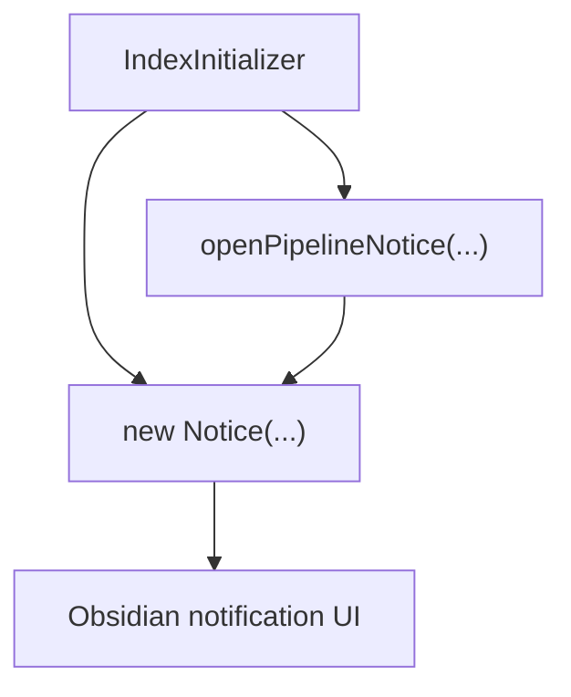
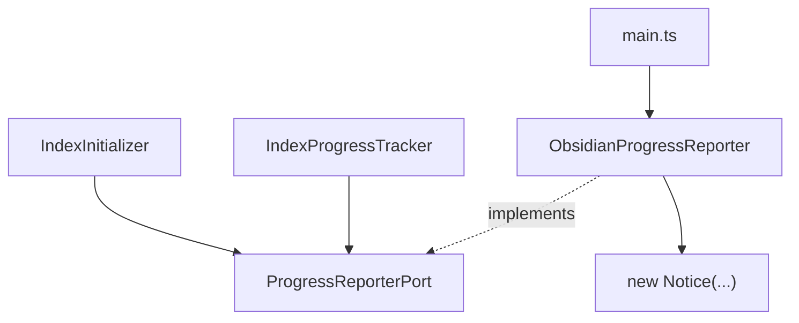

# Peak Assistant Modernization Handoff: T2B IndexInitializer ProgressReporterPort Follow-up

## 中文摘要

这一步在全局架构里的位置：
- 现在仍在 `T2 Port Sketches`。
- T2A 已经证明 `ProgressReporterPort -> ObsidianProgressReporter` 可以让一个 service support 文件不再直接 `new Notice(...)`。
- T2B 的目标是验证这个 port 不是一次性样板，而是能被同一个 search indexing 区域的第二个文件复用。

为什么现在做它：
- `src/service/search/index/indexInitializer.ts` 仍然在 service 层直接 import `Notice` 并多处 `new Notice(...)`。
- 它和 T2A 的 `IndexProgressTracker` 属于同一个 indexing/progress 通知区域。
- 如果 T2B 成功，search indexing 通知边界会更统一，T2 的 side-effect isolation 会更可信。

允许 Claude Code 改什么：
- 先只做 read-only investigation，不改文件。
- 经用户批准后，优先只改 `src/service/search/index/indexInitializer.ts` 和必要的 focused tests。
- 如确实需要，可对既有 `ProgressReporterPort` / `ObsidianProgressReporter` 做最小兼容调整，但必须说明为什么。

明确不允许改什么：
- 不做广义 `NotificationPort`。
- 不批量改全仓 `Notice`。
- 不碰 Chat、Ambient Push、Quick Search、Command Gateway。
- 不引入 `RunEnvelope`。
- 不改索引业务逻辑、索引级别、数据库行为、settings 行为。
- 不改变用户可见通知文案和 timeout。

做完后用户应该看什么：
- Claude Code implementation note。
- Codex 后续写的 T2B Owner Review Packet。
- boundary audit delta：特别看 `service/core -> Obsidian side-effect` 是否继续下降。

## Send To Claude Code

````md
# Peak Assistant Modernization: T2B IndexInitializer ProgressReporterPort Follow-up

Branch:
codex/peak-modernization-refactor

Source-of-truth docs:
- docs/superpowers/specs/2026-06-01-peak-system-architecture-modernization-handbook.html
- docs/superpowers/audits/2026-06-12-t2a-owner-review-packet.md
- docs/superpowers/refactor-ops/t2-first-port-sketches-draft.md

Current operating rules:
- Codex owns architecture reports, diagrams, task design, and review packets.
- Claude Code owns implementation only.
- User manually authorizes each handoff.
- Owner-facing explanations should be Chinese-first. Keep code symbols, commands, test names, and commit messages in English.

## Goal

Reuse the existing `ProgressReporterPort` from T2A to reduce direct Obsidian `Notice` usage in `src/service/search/index/indexInitializer.ts`, without changing indexing behavior.

This is a T2B follow-up, not a new notification framework.

## Required First Response From Claude Code

Do not edit files yet. First return a read-only investigation.

```md
## Read-only investigation — T2B IndexInitializer ProgressReporterPort

中文摘要:
- 这一步在全局架构里的位置:
- 为什么现在做它:
- 你建议 T2B 实现范围:
- 你建议暂时不碰的内容:

Files inspected:
- `src/service/search/index/indexInitializer.ts`
- `src/service/ports/ProgressReporterPort.ts`
- `src/app/adapters/ObsidianProgressReporter.ts`
- `src/service/search/support/progress-tracker.ts`
- direct construction site(s) for `IndexInitializer`
- existing related tests, if any

Current direct Notice inventory in `indexInitializer.ts`:
| Line / area | Message kind | One-shot or long-running? | Proposed handling |
| --- | --- | --- | --- |
| ... | ... | ... | ... |

Current side-effect path:


Proposed T2B path:


Recommended implementation shape:
- ...

Call sites that must change:
- ...

Tests to add or update:
- ...

Expected boundary audit delta:
- ...

Risks / stop conditions:
- Stop if this requires broad indexing-flow rewrite.
- Stop if `ProgressReporterPort` must become a broad generic notification framework.
- Stop if preserving `openPipelineNotice` behavior requires changing `ObsidianProgressReporter` in a way that changes T2A `IndexProgressTracker` user-visible behavior.
- Stop if service code would need to import `ObsidianProgressReporter` directly.
- Stop if AppContext needs to be expanded.
- Stop if Chat / Ambient / Quick Search / Command Gateway becomes necessary.
```

Wait for user approval before implementation.

## Implementation Constraints If Approved

Allowed:
- Modify `src/service/search/index/indexInitializer.ts`.
- Reuse `ProgressReporterPort`.
- Add optional constructor injection for a fake reporter only if it keeps existing call sites backwards-compatible.
- Add focused tests proving `indexInitializer.ts` no longer directly imports concrete `Notice`, if practical.
- Add or update source-scan tests to prevent service importing `ObsidianProgressReporter`.

Potentially allowed only with explicit explanation:
- Minimal adjustment to `ProgressReporterPort` / `ObsidianProgressReporter` if `indexInitializer.ts` needs current `openPipelineNotice` semantics.

Not allowed:
- Do not create `NotificationPort`.
- Do not port every `Notice` caller in the repo.
- Do not touch unrelated service-side Notice files.
- Do not touch Chat.
- Do not touch Ambient Push.
- Do not touch Quick Search runtime.
- Do not touch Command Gateway.
- Do not introduce RunEnvelope.
- Do not change index behavior, settings behavior, database behavior, or user-facing copy.

## Required Verification If Implemented

Run:
- `npm run build`
- `npm run test -- test/progress-tracker-port.test.ts`
- any new/updated T2B test
- `node scripts/audit/boundary-baseline.mjs --out /tmp/t2b-boundary-baseline.md`

Required `rg` checks:
- `rg -n "new Notice|from ['\"]obsidian['\"]|\\bNotice\\b" src/service/search/index/indexInitializer.ts`
- `rg -n "ObsidianProgressReporter" src/service || true`
- `rg -n "ProgressReporterPort" src/service/search/index/indexInitializer.ts src/service/search/support/progress-tracker.ts src/service/ports/ProgressReporterPort.ts src/app/adapters/ObsidianProgressReporter.ts main.ts test`

Expected direction:
- `src/service/search/index/indexInitializer.ts` should not directly import concrete `Notice` if T2B succeeds.
- `service/core -> Obsidian side-effect` should decrease.
- No new `service -> ui`, `service -> app`, or `core -> upstream` regression.

## Implementation Note Required From Claude Code

After implementation and commit, report:

```md
## Implementation note

中文摘要:
- 本轮在全局架构里的位置:
- 为什么做这个:
- 用户可见行为是否变化:
- 最重要的边界变化:
- 还没有解决的旧路径:
- 下一步建议:

Commit:
- <hash and message>

Changed files grouped by purpose:
- First adopter:
- Port / adapter changes, if any:
- Tests:
- Docs:

Code reading guide:
- Read first:
- Then read:
- Optional / only if debugging:
- Main symbols to inspect:
- Files intentionally not changed:

Old path reduced:
- ...

Verification:
- ...

Boundary audit delta:
- total flagged edges:
- service/core -> Obsidian side-effect:
- service files importing side-effect Obsidian symbol:
- service -> ui:
- service -> app:
- core -> upstream:

Known remaining old paths:
- ...

Suggested next task:
- ...
```
````

## Codex Review Focus After Claude Code Finishes

Codex should check:

1. Did T2B reuse `ProgressReporterPort` instead of inventing `NotificationPort`?
2. Did `indexInitializer.ts` stop owning concrete Obsidian `Notice` side effects?
3. Did behavior remain equivalent from the user's point of view?
4. Did tests prove the fakeable boundary or at least guard the import boundary?
5. Did boundary audit counts improve without new reverse dependencies?
6. Did the implementation avoid Chat, Ambient, Quick Search, Command Gateway, and RunEnvelope?

## T2B Is Complete When

- `IndexInitializer` no longer directly owns concrete Obsidian `Notice` side effects, or Claude Code provides a clear stop-condition report explaining why that is not safe in one slice.
- The existing `ProgressReporterPort` is reused as the second adopter boundary.
- Tests/build pass.
- Boundary audit has no new regressions.
- Codex writes a T2B Owner Review Packet in Chinese-first format.
