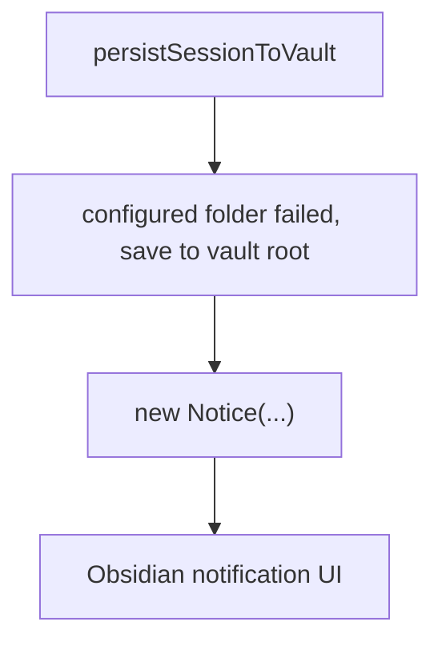
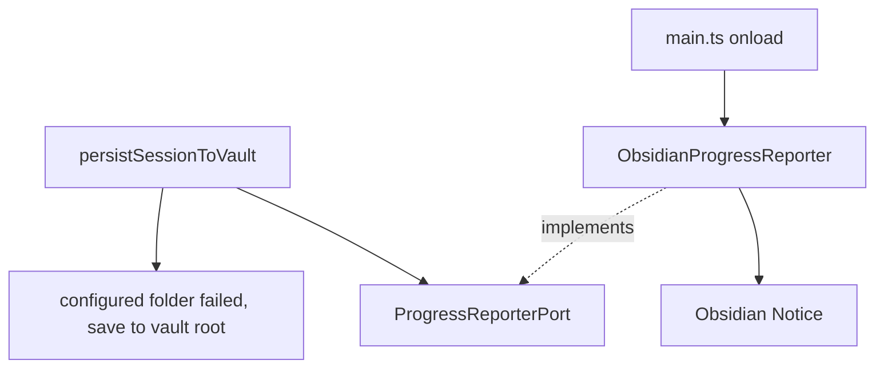

# Peak Assistant Modernization Handoff: T2C AnalysisDocPersistence Notice Cleanup

## 中文摘要

这一步在全局架构里的位置：
- 仍然属于 `T2 Port Sketches`，不是 `T3 RunEnvelope Core`。
- T2A/T2B 已经把 search indexing 区域的两个直接 `Notice` 路径迁到 `ProgressReporterPort -> ObsidianProgressReporter`。
- T2C 只收掉 search persistence 区域里剩下的一个 concrete `Notice`，继续验证同一个 port 模式能降低 service 层 Obsidian UI 副作用。

为什么现在做它：
- `src/service/search/analysisDocPersistence.ts` 仍然在 service 层 `import { Notice } from 'obsidian'`，并在 auto-save folder 失败、fallback 到 vault root 成功时直接 `new Notice(...)`。
- 这个文件已经很乱：它同时碰 `AppContext`、Quick Search UI callbacks/types、Vault write、history insert、event dispatch。T2C 不能把这些都拆掉，否则会变成 Quick Search persistence 大重构。
- 所以本轮只拔掉一个明确的 Obsidian UI side effect，并把剩余旧耦合写清楚。

允许 Claude Code 改什么：
- 先只做 read-only investigation，不改文件。
- 经用户批准后，优先只改 `src/service/search/analysisDocPersistence.ts` 和一个 focused source-scan test。
- 如确实需要，可以只改 `src/service/ports/ProgressReporterPort.ts` 顶部注释，让它准确说明 `defaultReporter` 是 T2 临时 wiring，不能改实现。

明确不允许改什么：
- 不做 Quick Search persistence 重构。
- 不搬迁 UI callback/store imports。
- 不扩 `AppContext`。
- 不新增 `NotificationPort`。
- 不新增任何 `let defaultX = null` 这类模块级 mutable default。
- 不改 auto-save、history、event、graph JSON、folder fallback 的业务行为。
- 不碰 Chat、Ambient Push、Command Gateway、RunEnvelope。

做完后用户应该看什么：
- Claude Code implementation note 里的 Code reading guide。
- `src/service/search/analysisDocPersistence.ts`：看 `persistSessionToVault` 的 options、fallback root save 后的通知调用。
- 新增/更新的 focused test：看它如何阻止这个 service 文件重新 import concrete `Notice`。
- Codex 后续 T2C Owner Review Packet：看 boundary audit delta 和 mutable global check。

## Review Entry Points

| Review item | Status | Why open it |
| --- | --- | --- |
| This T2C handoff | Ready to send | 给 Claude Code 的下一轮任务边界。 |
| [`2026-06-12-t2b-owner-review-packet.md`](../audits/2026-06-12-t2b-owner-review-packet.md) | Previous packet | 说明为什么 T2B 后推荐 T2C 或 T3。 |
| [`architecture-scorecard.md`](./architecture-scorecard.md) | Current score ledger | T2C 完成后再更新分数。 |
| [`README.md`](./README.md) | Operating rules | 包含 owner review、中文优先、code reading guide、mutable global state rule。 |

## Send To Claude Code

````md
# Peak Assistant Modernization: T2C AnalysisDocPersistence Notice Cleanup

Branch:
codex/peak-modernization-refactor

Source-of-truth docs:
- docs/superpowers/specs/2026-06-01-peak-system-architecture-modernization-handbook.html
- docs/superpowers/audits/2026-06-12-t2b-owner-review-packet.md
- docs/superpowers/refactor-ops/README.md
- docs/superpowers/refactor-ops/t2c-analysis-doc-persistence-notice-cleanup-handoff.md

Current operating rules:
- Codex owns architecture reports, diagrams, task design, and review packets.
- Claude Code owns implementation only.
- User manually authorizes each handoff.
- Owner-facing explanations should be Chinese-first. Keep code symbols, commands, test names, and commit messages in English.
- Every code-changing task must include a Code reading guide.
- Do not introduce scattered module-level mutable defaults. `ProgressReporterPort.defaultReporter` is an accepted T2 temporary compromise only; do not copy that pattern into a new port or helper.

## Goal

Remove the one direct Obsidian `Notice` side effect from `src/service/search/analysisDocPersistence.ts` by reusing the existing `ProgressReporterPort` boundary, without changing auto-save persistence behavior.

This is a narrow T2C port cleanup, not a Quick Search persistence rewrite and not `T3 RunEnvelope`.

## Required First Response From Claude Code

Do not edit files yet. First return a read-only investigation.

```md
## Read-only investigation — T2C AnalysisDocPersistence Notice Cleanup

中文摘要:
- 这一步在全局架构里的位置:
- 为什么现在做它:
- 你建议 T2C 实现范围:
- 你建议暂时不碰的内容:

Files inspected:
- `src/service/search/analysisDocPersistence.ts`
- `src/service/ports/ProgressReporterPort.ts`
- `src/app/adapters/ObsidianProgressReporter.ts`
- call sites for `persistSessionToVault`
- existing T2A/T2B port tests

Current direct Notice inventory in `analysisDocPersistence.ts`:
| Line / area | Message | Critical to persistence success? | Proposed handling |
| --- | --- | --- | --- |
| ... | ... | ... | ... |

Current call sites for `persistSessionToVault`:
| Caller | Options currently passed | Needs caller change? | Why |
| --- | --- | --- | --- |
| ... | ... | ... | ... |

Current side-effect path:


Proposed T2C path:


Recommended implementation shape:
- Prefer an explicit optional dependency on `persistSessionToVault` options, for example `progressReporter?: ProgressReporterPort`.
- Existing callers should stay backwards-compatible.
- If no reporter is passed, use the existing T2 temporary default reporter only for this notification.
- Do not let notification failure turn a successful vault-root fallback save into a failed persistence result.
- Do not introduce any new module-level mutable default.
- If `ProgressReporterPort.ts` has stale comments about its only consumer, update comments only; do not change the port implementation unless strictly necessary.

Tests to add or update:
- A focused source-scan test, likely `test/analysis-doc-persistence-port.test.ts`, that proves:
  - `analysisDocPersistence.ts` does not import `Notice` from `obsidian`.
  - `analysisDocPersistence.ts` does not call `new Notice(...)`.
  - `analysisDocPersistence.ts` does not import `ObsidianProgressReporter`.
  - `analysisDocPersistence.ts` exposes or accepts an optional `ProgressReporterPort` dependency.
  - No new `let default...` mutable global was added in this task.
  - The existing fallback message and timeout remain present.

Expected boundary audit delta:
- total flagged edges should decrease by about 1, if the scanner classifies this direct `Notice` edge.
- `service/core -> Obsidian side-effect` should decrease by about 1.
- `service files importing Obsidian` should decrease by about 1 for this file.
- `service -> ui`, `service -> app`, and `core -> upstream` should not regress.

Risks / stop conditions:
- Stop if this requires changing the return shape of `persistSessionToVault`.
- Stop if this requires moving Quick Search UI persistence helpers or stores.
- Stop if this requires changing auto-save folder fallback behavior.
- Stop if this requires changing history insert or event dispatch semantics.
- Stop if service code would need to import `ObsidianProgressReporter` directly.
- Stop if a new `NotificationPort` or new global default registry seems necessary.
- Stop if AppContext usage would expand.
- Stop if Chat / Ambient Push / Command Gateway / RunEnvelope becomes necessary.
```

Wait for user approval before implementation.

## Implementation Constraints If Approved

Allowed:
- Modify `src/service/search/analysisDocPersistence.ts`.
- Reuse `ProgressReporterPort`.
- Add an optional `progressReporter?: ProgressReporterPort` dependency to the existing options object if it keeps all current call sites compatible.
- Add one focused test file or extend a focused existing test.
- Update comments in `src/service/ports/ProgressReporterPort.ts` only if needed to remove stale "only intended consumer" wording.

Not allowed:
- Do not create `NotificationPort`.
- Do not add `setDefaultNotification...` / `getDefaultNotification...` / `let defaultNotification...`.
- Do not import `ObsidianProgressReporter` from service code.
- Do not port every `Notice` caller in the repo.
- Do not touch unrelated service-side `Notice` files.
- Do not refactor Quick Search stores, callbacks, graph export, auto-save state, or history UI.
- Do not change user-facing notification copy or timeout.
- Do not introduce `RunEnvelope`.
- Do not touch Chat, Ambient Push, or Command Gateway.

Important behavior constraint:
- The vault-root fallback notification is non-critical. If notification wiring is unavailable in a test-like environment, the already-successful save should still return `{ path }`. Report how you preserved this.

## Required Verification If Implemented

Run:
- `npm run build`
- the new/updated T2C test
- `npm run test -- test/progress-tracker-port.test.ts`
- `npm run test -- test/index-initializer-port.test.ts`
- `node scripts/audit/boundary-baseline.mjs --out /tmp/t2c-boundary-baseline.md`

Required `rg` checks:
- `rg -n "new Notice|from ['\"]obsidian['\"]|\\bNotice\\b" src/service/search/analysisDocPersistence.ts`
- `rg -n "ObsidianProgressReporter" src/service || true`
- `rg -n "let default|setDefault|getDefault" src/service/ports src/service/search/analysisDocPersistence.ts`
- `rg -n "persistSessionToVault\\(" src test`

Expected direction:
- `analysisDocPersistence.ts` should not directly import concrete `Notice`.
- `analysisDocPersistence.ts` should not call `new Notice(...)`.
- No new module-level mutable default should be introduced.
- No caller should be forced to change unless there is a clearly justified reason.
- Boundary audit should improve or at least not regress outside this target.

## Implementation Note Required From Claude Code

After implementation and commit, report:

```md
## Implementation note

中文摘要:
- 本轮在全局架构里的位置:
- 为什么做这个:
- 用户可见行为是否变化:
- 最重要的边界变化:
- 还没有解决的旧路径:
- 下一步建议:

Commit:
- <hash and message>

Changed files grouped by purpose:
- Runtime:
- Port/comment-only changes, if any:
- Tests:
- Docs:

Code reading guide:
- Read first:
- Then read:
- Optional / only if debugging:
- Main symbols to inspect:
- Files intentionally not changed:

Mutable global state:
- New module-level mutable defaults introduced:
- Existing module-level mutable defaults preserved:
- Did this add any new use of `getDefaultProgressReporter()`:
- Why any preserved/default lookup is temporary:
- What future task should retire it:

Old path reduced:
- ...

Verification:
- ...

Boundary audit delta:
- total flagged edges:
- service/core -> Obsidian side-effect:
- service files importing side-effect Obsidian symbol:
- service -> ui:
- service -> app:
- core -> upstream:

Known remaining old paths:
- `analysisDocPersistence.ts` still imports Quick Search UI callbacks/types.
- `analysisDocPersistence.ts` still uses `AppContext`.
- `persistSessionToVault` still mixes vault write, history insert, and event dispatch.
- No `RunEnvelope` yet.

Suggested next task:
- ...
```
````

## Codex Review Focus After Claude Code Finishes

Codex should check:

1. Did T2C remove the concrete `Notice` import and construction from `analysisDocPersistence.ts`?
2. Did it reuse the existing `ProgressReporterPort` instead of inventing a new notification framework?
3. Did it avoid new mutable globals?
4. Did notification failure remain non-critical to successful persistence?
5. Did call sites remain backwards-compatible?
6. Did tests or source scans guard the boundary?
7. Did boundary audit improve without new reverse dependencies?
8. Did the implementation leave Quick Search persistence, AppContext, Chat, Ambient, Command Gateway, and RunEnvelope untouched?

## T2C Is Complete When

- `analysisDocPersistence.ts` no longer directly owns concrete Obsidian `Notice` side effects, or Claude Code provides a clear stop-condition report explaining why this is not safe in one slice.
- The existing `ProgressReporterPort` is reused as the transitional boundary.
- No new mutable global default is introduced.
- Tests/build pass.
- Boundary audit has no new regressions.
- Claude Code provides a Chinese-first implementation note with a code reading guide.
- Codex writes a T2C Owner Review Packet in Chinese-first format.
