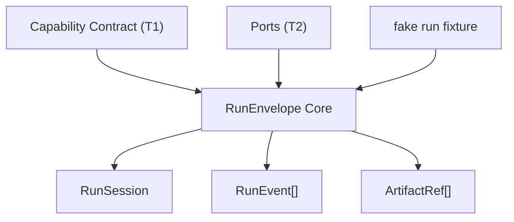

# Peak Assistant Modernization Handoff: T3A RunEnvelope Core

## 中文摘要

这一步在全局架构里的位置：
- 进入 `T3 RunEnvelope Core`。
- T1 已经有 `VaultLintContract`，能说明一个 capability 的 input/output/current dependencies。
- T2A/T2B/T2C 已经有 `ProgressReporterPort` 和 3 个 adopter，能说明 port / adapter / fakeability 的真实形状。
- T3A 的任务不是迁移业务，而是先建立一个 dependency-light 的 `RunEnvelope` 核心外壳：`RunSession`、`RunEvent`、`ArtifactRef`、最小 in-memory recorder / fixture test。

为什么现在做它：
- 继续清其它 `Notice` 的边际收益变低，而且 `BackgroundSessionManager` 这类文件会牵出 UI store、session truth、background lifecycle，应该等 envelope 有了再拆。
- `ProgressReporterPort.defaultReporter` 已经被明确标为 T2 临时妥协。T3 必须开始给它一个未来退役路径：依赖应从 envelope / runtime context 显式传入，而不是继续复制全局默认。
- 主手册要求 T3 输出 `RunSession + RunEvent + ArtifactRef`。现在正好有 T1/T2 的真实证据，不再是凭空设计。

允许 Claude Code 改什么：
- 先只做 read-only investigation，不改文件。
- 经用户批准后，只新增最小 RunEnvelope core 文件和 focused tests。
- 可以新增一个 service-level runtime 目录，例如 `src/service/runtime/` 或 `src/service/run-envelope/`，但必须先在 read-only investigation 中解释为什么放这里。

明确不允许改什么：
- 不接入 `VaultLintService` 真实运行路径。
- 不改 `ProgressReporterPort.defaultReporter`。
- 不改 `main.ts` wiring。
- 不改 UI stores / React views。
- 不改 Chat、Quick Search、Ambient Push、Command Gateway。
- 不把旧 `src/service/capabilities/CapabilityRegistry.ts` 扩成运行时总线；那个目前是 Settings readiness registry，不是 RunEnvelope。
- 不新增 module-level mutable default / singleton registry。

做完后用户应该看什么：
- Claude Code implementation note 里的 Code reading guide。
- 新增的 RunEnvelope core 文件：看 `RunSession` / `RunEvent` / `ArtifactRef` 的类型是否小而清楚。
- 新测试：看 fake run 如何产出 deterministic event trace 和 artifact ref。
- Codex 后续 T3A Owner Review Packet：看它是否真的为 T4/T7 提供地基，而不是又多一个空抽象。

## Review Entry Points

| Review item | Status | Why open it |
| --- | --- | --- |
| This T3A handoff | Ready to send | 给 Claude Code 的下一轮任务边界。 |
| [`2026-06-12-t2c-owner-review-packet.md`](../audits/2026-06-12-t2c-owner-review-packet.md) | Previous packet | 说明为什么现在从 T2 进入 T3。 |
| [`architecture-scorecard.md`](./architecture-scorecard.md) | Current score ledger | T3A 完成后再更新分数。 |
| [`README.md`](./README.md) | Operating rules | 包含 task order、mutable global state rule、code reading guide rule。 |

## Send To Claude Code

````md
# Peak Assistant Modernization: T3A RunEnvelope Core

Branch:
codex/peak-modernization-refactor

Source-of-truth docs:
- docs/superpowers/specs/2026-06-01-peak-system-architecture-modernization-handbook.html
- docs/superpowers/audits/2026-06-12-t2c-owner-review-packet.md
- docs/superpowers/refactor-ops/README.md
- docs/superpowers/refactor-ops/t3-run-envelope-core-handoff.md

Current operating rules:
- Codex owns architecture reports, diagrams, task design, and review packets.
- Claude Code owns implementation only.
- User manually authorizes each handoff.
- Owner-facing explanations should be Chinese-first. Keep code symbols, commands, test names, and commit messages in English.
- Every code-changing task must include a Code reading guide.
- Do not introduce scattered module-level mutable defaults. T3 should create a path away from `ProgressReporterPort.defaultReporter`, not copy that pattern.

## Goal

Add the first dependency-light `RunEnvelope` core: `RunSession`, `RunEvent`, `ArtifactRef`, and a minimal deterministic recorder/fixture test.

This is T3A foundation only. It must not migrate a real capability yet.

## Required First Response From Claude Code

Do not edit files yet. First return a read-only investigation.

```md
## Read-only investigation — T3A RunEnvelope Core

中文摘要:
- 这一步在全局架构里的位置:
- 为什么现在做它:
- 你建议 T3A 实现范围:
- 你建议暂时不碰的内容:

Files inspected:
- `docs/superpowers/specs/2026-06-01-peak-system-architecture-modernization-handbook.html` around RunEnvelope / task DAG
- `docs/superpowers/audits/2026-06-12-t2c-owner-review-packet.md`
- `src/service/lint/VaultLintContract.ts`
- `src/service/ports/ProgressReporterPort.ts`
- `src/service/capabilities/CapabilityRegistry.ts`
- `src/service/capabilities/SurfaceCapability.ts`
- `src/service/agents/harness/trace/events.ts`
- `src/service/copilot/CopilotRunArtifacts.ts`
- relevant existing tests

Existing concepts inventory:
| Existing file | Concept | Reuse / avoid / learn from | Why |
| --- | --- | --- | --- |
| ... | ... | ... | ... |

Recommended file placement:
- Proposed new path:
- Why not `src/core/`:
- Why not existing `src/service/capabilities/` registry:
- Why this placement keeps dependencies visible:

Proposed T3A shape:


Minimal types you propose:
- `RunStatus`:
- `RunSession`:
- `RunEvent`:
- `ArtifactRef`:
- `RunRecorder` / helper, if any:

How this relates to T1/T2:
- VaultLintContract:
- ProgressReporterPort:
- `defaultReporter` retirement path:

Implementation files if approved:
- ...

Tests to add:
- ...

Expected boundary audit delta:
- Likely no reduction in existing flagged edges because this is foundation-only.
- Must not add `service -> ui`, `service -> app`, `core -> upstream`, or concrete Obsidian imports.

Risks / stop conditions:
- Stop if this needs to modify real VaultLint / Search / Chat / Copilot runtime.
- Stop if this needs UI store changes.
- Stop if this needs `main.ts` wiring.
- Stop if this needs a singleton registry or module-level mutable default.
- Stop if existing `CapabilityRegistry` would need to become the execution registry.
- Stop if placing files under `src/core/` would require resolving the T0 `core` ownership problem first.
```

Wait for user approval before implementation.

## Implementation Constraints If Approved

Allowed:
- Add one small dependency-light RunEnvelope core module.
- Add one focused test file, for example `test/run-envelope-core.test.ts`.
- Add an index export only if it is local to the new runtime/envelope folder.
- Use a deterministic clock/id provider in tests if the helper creates sessions or artifact ids.
- Include source-scan guards proving the new core module does not import Obsidian, AppContext, UI, React, Zustand, SQLite, `ProgressReporterPort`, or concrete business services.

Potentially allowed only with explicit explanation:
- A generic `ports?: TPorts` field on run context, but do not import a concrete port like `ProgressReporterPort`.
- A small in-memory recorder/helper if it removes boilerplate in tests and stays dependency-free.

Not allowed:
- Do not migrate `VaultLintService`.
- Do not modify `VaultLintContract`.
- Do not modify `ProgressReporterPort` or retire `defaultReporter` yet.
- Do not modify `main.ts`.
- Do not modify UI stores/views.
- Do not import `obsidian`.
- Do not add a global singleton registry.
- Do not create a second live runtime path for any real capability.
- Do not start Chat, Ambient Push, Command Gateway, or broad Copilot work.

Suggested minimal model:

```ts
export type RunStatus = 'queued' | 'running' | 'completed' | 'failed' | 'cancelled';

export interface RunSession {
  runId: string;
  capabilityId: string;
  status: RunStatus;
  trigger: 'manual' | 'startup' | 'scheduled' | 'agent' | 'test';
  startedAt: number;
  endedAt?: number;
}

export type RunEvent =
  | { type: 'status'; runId: string; status: RunStatus; message?: string; ts: number }
  | { type: 'progress'; runId: string; phase: string; label?: string; processed?: number; total?: number; ts: number }
  | { type: 'artifact'; runId: string; artifact: ArtifactRef; ts: number }
  | { type: 'error'; runId: string; message: string; recoverable: boolean; ts: number }
  | { type: 'log'; runId: string; level: 'debug' | 'info' | 'warn'; message: string; ts: number };

export interface ArtifactRef {
  artifactId: string;
  runId: string;
  kind: 'result' | 'report' | 'trace' | 'source' | 'diff' | 'file' | 'custom';
  title?: string;
  uri?: string;
  contentType?: string;
  createdAt: number;
}
```

This model is guidance, not mandatory. Claude Code should adjust only if read-only investigation finds a better local pattern, and must explain the difference.

## Required Verification If Implemented

Run:
- `npm run build`
- the new T3A test
- `npm run test -- test/vault-lint-contract.test.ts`
- `npm run test -- test/progress-tracker-port.test.ts`
- `node scripts/audit/boundary-baseline.mjs --out /tmp/t3a-boundary-baseline.md`

Required `rg` checks:
- `rg -n "RunEnvelope|RunSession|RunEvent|ArtifactRef" src test docs/superpowers/refactor-ops`
- `rg -n "from ['\"]obsidian['\"]|AppContext|getInstance\\(|zustand|react|better-sqlite3|@/ui/" <new-run-envelope-files>`
- `rg -n "let default|static instance|new Map" <new-run-envelope-files>`
- `rg -n "ProgressReporterPort" <new-run-envelope-files>`

Expected direction:
- New RunEnvelope core should be dependency-light.
- No business runtime behavior should change.
- Boundary audit should not regress.
- `ProgressReporterPort.defaultReporter` should remain unchanged but be listed as a T4 retirement target.

## Implementation Note Required From Claude Code

After implementation and commit, report:

```md
## Implementation note

中文摘要:
- 本轮在全局架构里的位置:
- 为什么做这个:
- 用户可见行为是否变化:
- 最重要的边界变化:
- 还没有解决的旧路径:
- 下一步建议:

Commit:
- <hash and message>

Changed files grouped by purpose:
- RunEnvelope core:
- Tests:
- Exports:
- Docs:

Code reading guide:
- Read first:
- Then read:
- Optional / only if debugging:
- Main symbols to inspect:
- Files intentionally not changed:

Mutable global state:
- New module-level mutable defaults introduced:
- Existing module-level mutable defaults preserved:
- Does this add any singleton registry:
- How T3A prepares retirement of `ProgressReporterPort.defaultReporter`:

Old path reduced or not reduced:
- ...

Verification:
- ...

Boundary audit delta:
- total flagged edges:
- service/core -> Obsidian side-effect:
- service -> ui:
- service -> app:
- core -> upstream:

Known remaining old paths:
- `ProgressReporterPort.defaultReporter` remains.
- No real capability uses RunEnvelope yet.
- Vault Lint still writes UI store directly.
- Chat / Search / Copilot / Ambient still use their old runtimes.

Suggested next task:
- ...
```
````

## Codex Review Focus After Claude Code Finishes

Codex should check:

1. Did T3A create a small RunEnvelope core, or did it start migrating real business runtime?
2. Did it avoid `src/core/` unless placement was explicitly justified?
3. Did it avoid the existing Settings readiness `CapabilityRegistry` as an execution registry?
4. Did it avoid new mutable globals and singletons?
5. Are `RunSession`, `RunEvent`, and `ArtifactRef` understandable to the owner?
6. Do tests produce a deterministic event trace and artifact ref?
7. Does boundary audit avoid regressions?
8. Does the implementation create a clear next step for T4 Vault Lint replacement?

## T3A Is Complete When

- A dependency-light RunEnvelope core exists.
- A fake/deterministic test proves status/progress/artifact/error event recording.
- No real capability behavior changes.
- No new mutable default or singleton registry is introduced.
- Boundary audit has no regression.
- Claude Code provides a Chinese-first implementation note with a code reading guide.
- Codex writes a T3A Owner Review Packet in Chinese-first format.
